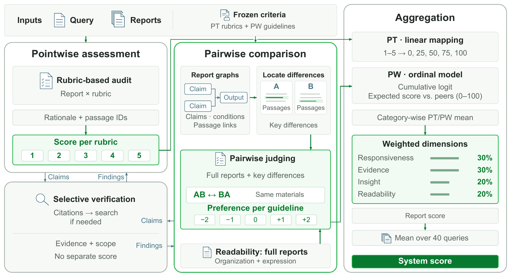

# CompareDR

**Benchmarking Deep Research Reports from Individual Quality to Comparative Merit**

CompareDR evaluates both whether a research report meets a query's requirements and
how it compares with another report. Task-specific pointwise rubrics are combined
with passage-linked pairwise comparisons and selective evidence verification.

**40 queries · 9 systems · 360 main-study reports · 1,099 criteria · 80 human-labeled pairs**

[Leaderboard](LEADERBOARD.md) · [New-system participation](website/participation.md) ·
[Resource guide](docs/RESOURCES.md) · [Evaluation code](evaluation/README.md) ·
[Experiments](experiments/README.md) · [Reports and annotations](docs/DATA.md) ·
[Website](website/README.md) · [Validation](docs/VALIDATION.md)



The figure is the paper's original vector figure ([PDF](docs/assets/framework.pdf)),
not a newly redrawn approximation. Pointwise scores and ordinal pairwise scores
are combined within dimensions and then averaged over queries. The figure groups
Reasoning and Synthesis as **Insight (20%)**; the implementation retains their
separate 10% weights, with Responsiveness 30%, Evidence 30%, and Readability 20%.

## Leaderboard and main results

The main table uses the complete **40-query, nine-system** cohort. Scores are
relative to this comparison cohort; they are not percentages of factual accuracy.
The table below shows **all five quality dimensions and the overall score**,
with model and research harness listed separately. The
[leaderboard reference](LEADERBOARD.md) provides judging settings and full-precision
downloads; the [interactive page](website/dist/leaderboard.html) supports sorting
by overall score or any dimension and explains how to participate.

<!-- LEADERBOARD_SUMMARY_START -->
| Rank | Research harness | Model | Responsiveness | Evidence | Reasoning | Synthesis | Readability | Overall |
|---:|---|---|---:|---:|---:|---:|---:|---:|
| 1 | ChatGPT Deep Research | GPT-6 | 93.07 | **86.09** | 74.83 | 73.74 | 72.35 | **83.08** |
| 2 | LongCat-DeepResearch | LongCat | **93.59** | 83.60 | **82.64** | **78.79** | 66.61 | 82.62 |
| 3 | Kimi Researcher | Kimi K3 | 90.88 | 76.55 | 70.19 | 67.04 | **74.52** | 78.86 |
| 4 | Claude Research | Claude Opus 5 | 86.74 | 69.58 | 52.03 | 57.61 | 45.33 | 66.93 |
| 5 | MiniMax Agent | MiniMax M3 | 84.41 | 60.85 | 47.33 | 46.19 | 57.63 | 64.46 |
| 6 | GPT Researcher | GPT-5.5 | 78.86 | 59.11 | 36.35 | 46.75 | 46.30 | 58.96 |
| 7 | DuMate Deep Research | — | 82.92 | 50.24 | 35.08 | 37.93 | 44.05 | 56.06 |
| 8 | Gemini Deep Research | Gemini 3.7 Flash | 81.25 | 46.11 | 35.51 | 27.73 | 33.42 | 51.22 |
| 9 | Qwen Deep Research | Qwen 3.8 Max | 70.18 | 39.60 | 16.05 | 14.22 | 12.44 | 38.45 |
<!-- LEADERBOARD_SUMMARY_END -->

Higher is better; bold marks the best score in each column, not statistical
significance. Weights are **30% Responsiveness, 30% Evidence, 10% Reasoning,
10% Synthesis, and 20% Readability**, with equal query weights. “—” means the
underlying model was undisclosed. Display values are rounded to two decimals;
[CSV](website/dist/leaderboard.csv) and [JSON](website/dist/leaderboard.json)
retain full precision.

To evaluate another research system, use the
[system-submission form](https://github.com/CompareDR/CompareDR/issues/new?template=submit-system.yml).
Start with the [ZIP template](website/dist/submission-template.zip) and
[required format](submissions/README.md): 40 Markdown reports plus a system/metadata
manifest, with an offline format checker. Maintainers coordinate input validation
and a consistently aggregated expanded comparison cohort. The form uses GitHub
issues; it does not run evaluation automatically.

The matched human-preference study obtains **86.25% accuracy (69/80)**. Controlled
revisions obtain **64.2% macro-F1** on the common 119-revision comparison, with
within-set threshold calibration. Sparse entry with two of six opponents per
query reduces recorded dependency-ledger tokens by **64.23%**, with **0.318**
overall-score MAE against complete entry. These are distinct studies, not extra
measurements of the nine-system leaderboard. Full values, denominators and
limitations are in [results](reproduction/results/verified_20261116/RESULTS.json)
and the [experiment guide](experiments/README.md).

## Where to find each resource

| You want to… | Start here | What is included |
|---|---|---|
| Understand or run the evaluation | [`evaluation/run.py`](evaluation/run.py), [`pipeline.py`](evaluation/pipeline.py) | Report parsing, graph construction, PT/PW judging, verification, AB/BA, caching and aggregation |
| Reproduce paper tables without APIs | [`experiments/run.py`](experiments/run.py) | All 16 numerical tables, including a fresh main-table ordinal fit |
| Inspect the final nine-system reports | [`data/reports/main9/manifest.json`](data/reports/main9/manifest.json) | **360 Markdown reports**, 40 queries × 9 systems |
| Inspect the reports used by the seven-system studies | [`data/reports/studies7/manifest.json`](data/reports/studies7/manifest.json) | **280 Markdown reports**, 40 queries × 7 fixed system inputs |
| Read queries, rubrics and routing | [`data/evaluation/`](data/evaluation/) | Complete original query strings, PT rubrics, PW guidelines and verification routes for both cohorts |
| Find human preference labels | [`data/annotations/human_preferences.json`](data/annotations/human_preferences.json) | **80 pairs / 128 distinct reports**; exact A/B report paths and hashes; overall + dimension labels |
| Find controlled revisions and labels | [`reproduction/materials/`](reproduction/materials/), [`data/annotations/controlled_revisions.json`](data/annotations/controlled_revisions.json) | **40 bases + 120 revisions**, directions, target dimensions and report hashes |
| Inspect raw numerical judgments | [`reproduction/offline/data/main_judgments.json`](reproduction/offline/data/main_judgments.json), [`data/results/studies7_judgments.json`](data/results/studies7_judgments.json) | Main-study 6,984 PT + 23,256 physical AB/BA levels; seven-system 5,432 PT + 13,566 levels |
| Locate each experiment's code and data | [`experiments/README.md`](experiments/README.md) | Table-to-function-to-input map; human alignment, controlled edits, ablations, judges, usage and sparse entry |
| Refit a sparse-entry trial | [`experiments/sparse_entry.py`](experiments/sparse_entry.py) | Exact opponent designs, old-system initializations and weighted/unweighted ordinal optimization |
| Build or edit the project website | [`website/`](website/README.md) | Source templates, build script, static preview and manuscript-aligned downloadable results |

**Do not substitute the nine-system reports into seven-system experiments.** A
report is identified by **cohort + query ID + report ID + hash**, not by `R1` or a
system name alone. The seven-system set is preserved independently, not created
by deleting two systems from the main table.

## Quick start: offline reproduction

Python 3.11+; run from the repository root. The pinned environment is recorded
in [`requirements.txt`](requirements.txt). Installation may use the network;
the reproduction itself blocks network access and needs no credentials.

```bash
python -m pip install -r requirements.txt
python -B tools/verify_resources.py
python -B reproduction/verify_package.py
python -B reproduction/verify_materials.py
python -B experiments/run.py --out outputs/paper_replay
```

Choose a new output directory. All 16 tables are recalculated from supplied
judgments, scores, labels and trials. Expected values are regression references,
not replacement outputs. The sealed [`reproduction/`](reproduction/README.md)
payload is unchanged; new reports and runtime code live alongside it.

## Prepare or rerun the evaluator

```bash
# No network or model calls: check all 360 inputs and preprocessing contracts.
python -B evaluation/run.py prepare --cohort main9 --out outputs/main9_run
python -B evaluation/run.py preflight --out outputs/main9_run

# Only after configuring your own endpoints, keys and search adapter:
python -B evaluation/run.py run --out outputs/main9_run --query drb1_19 --execute
```

See [configuration and full-cohort execution](evaluation/README.md). Online runs
cost tokens and fetch public evidence; they are separate from reproducing the
archived paper results. No keys, app IDs, company gateway addresses or login
sessions are supplied. Live provider access is not claimed by offline tests.

## Licensing and resources

Copyright (c) 2026 LongCat. Project-owned code is licensed under
[Apache-2.0](LICENSE). Original data contributions are licensed under
[CC BY 4.0](DATA_LICENSE.md), subject to the retained source-specific terms in
[THIRD_PARTY_NOTICES.md](THIRD_PARTY_NOTICES.md). The code license does not
override the rights of third-party data, quotations, images, or trademarks.

The [bilingual LongCat blog](website/longcat-blog/README.md) combines the technical
report and CompareDR in two tabs. Its [versioned leaderboard feed](website/longcat-blog/feed/v1/leaderboard.json)
can update the deployed blog without redeploying its HTML. The CompareDR arXiv
and Hugging Face links will be added after their separate submissions complete.

Original package receipts are in [`SOURCE_PACKAGES.json`](SOURCE_PACKAGES.json).
New resources and validation scope are described in [VALIDATION.md](docs/VALIDATION.md).
