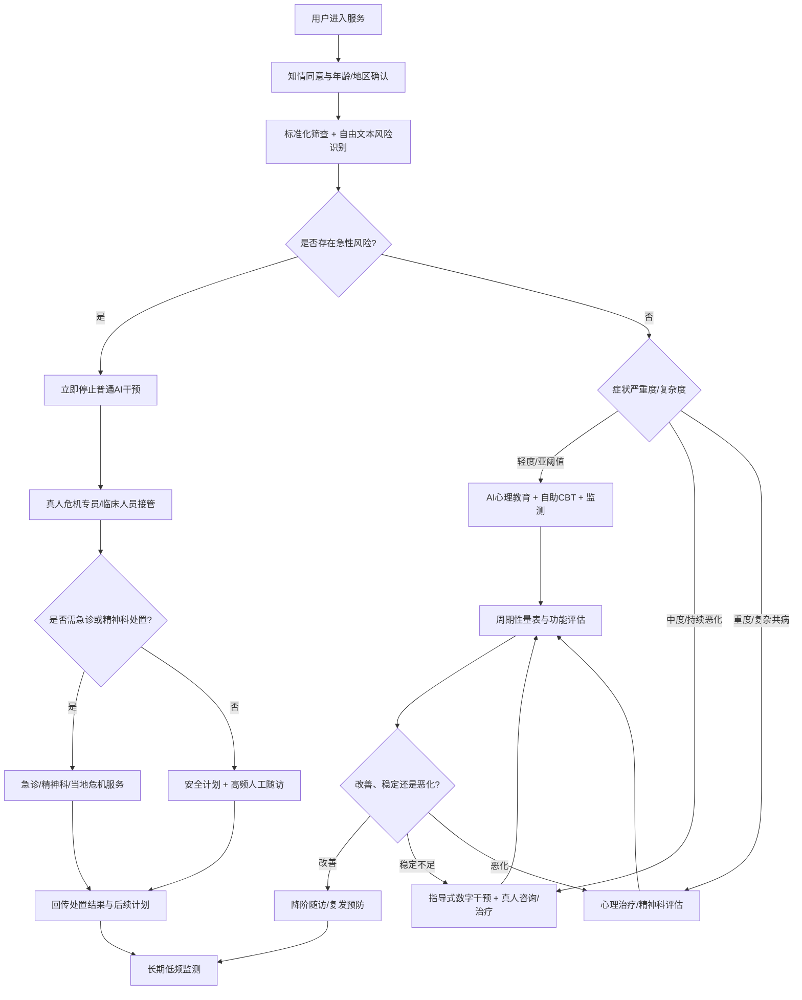
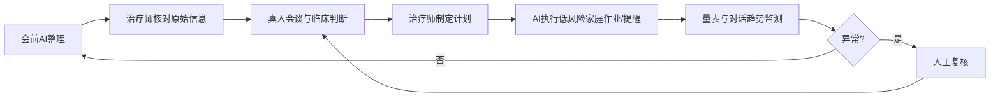
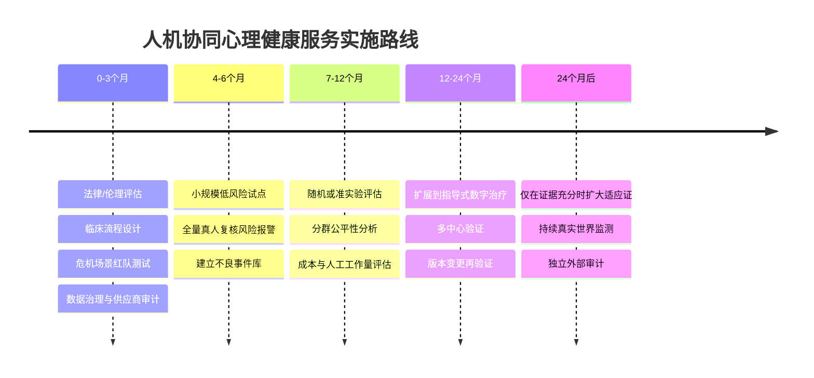

# AI心理咨询与人类心理咨询协同：面向心理健康福祉的人机融合照护体系研究报告

## 执行摘要

截至 **2026年11月13日**，最稳妥的结论不是“AI能否替代心理咨询师”，而是：**AI已经足以承担一部分低风险、结构化、可审计、可升级的心理健康任务，但现有证据不足以支持把通用大语言模型或自主聊天机器人当作持证心理治疗者、精神科医生或危机干预者的替代品。** 世界卫生组织（WHO）关于医疗AI的治理框架强调自主权、安全、透明、问责、公平与可持续性；其2024年针对大型多模态模型的专门指南进一步要求明确用途、独立审计、利益相关方参与和持续风险管理。美国心理学会（APA）2025年健康咨询明确建议，通用生成式AI不应被依赖来提供心理治疗，专门设计的数字工具最多宜作为专业照护的辅助。2026年美国精神病学会亦继续主张AI应发挥“增强”而非替代临床人员的作用。[[1]](https://www.who.int/publications/i/item/9789240029200)

临床效果方面，**“数字心理干预有效”与“自主AI治疗师有效”必须严格区分**。互联网CBT（iCBT）已经积累了数十项RCT和较长期证据；对于抑郁，个体数据网络Meta分析显示指导式和自助式iCBT均优于对照，症状较重者从人工指导中获益更大，而轻度/亚阈值人群中无指导方案与指导方案差距较小。2021年的个体参与者数据分析还发现，“人工鼓励+自动鼓励”可显著减少治疗脱落。[[2]](https://pubmed.ncbi.nlm.nih.gov/33471111/) 相比之下，AI聊天机器人证据更新、更异质。2024年一项纳入18个RCT、3477人的Meta分析发现短疗程AI机器人对抑郁和焦虑有小效应，但在3个月随访时未检出显著效果；2026年针对商业AI心理机器人的系统综述纳入52项研究、22个RCT，发现抑郁改善约为小效应，平均相当于约1.6分PHQ‑9变化，低于该综述采用的5分最小临床重要差异标准；焦虑结果不确定，安全事件报告质量极差，证据确定性为低至极低。[[3]](https://pubmed.ncbi.nlm.nih.gov/38631422/)

与此同时，生成式AI的治疗潜力并非可以忽略。2025年《NEJM AI》发表的Therabot随机试验显示，在4至8周内，面向临床水平症状的专门微调生成式AI系统在抑郁和焦虑等结局上相对等待名单出现较大效应，且用户报告了较强的治疗联盟感；2026年另一项995名大学生的三臂RCT亦发现，会话式AI在部分焦虑、抑郁和幸福感指标上优于等待组，部分指标甚至优于团体治疗。但这些研究仍主要集中于年轻人、大学生、特定平台和短期结局，不能直接外推为“AI可独立执业”。[[4]](https://pubmed.ncbi.nlm.nih.gov/42932588/)

中国证据正在快速出现。2022年天津大学生三臂RCT在入组前明确排除了较高自杀风险、幻觉/妄想及正在服用精神科药物者，说明早期研究本身即把AI定位于较低风险样本。2025年一项100名中国大学生的RCT发现，7天文化适配CBT机器人可减少抑郁和孤独感，但未显著改善焦虑；另一项40名中国中学生的WarmGPT小型RCT报告了抑郁和焦虑改善。2026年中国团队发表的系统综述也提示大学生群体中CAI对抑郁、焦虑具有小到中等效应，但LLM证据仍较有限。[[5]](https://www.jmir.org/2022/11/e40719/)

因此，本报告提出的核心模式是 **“AI前台扩容 + 专业人员负责临床判断 + 风险实时升级 + 结果闭环回流”**。AI最适合承担心理教育、低强度支持、结构化筛查、CBT练习、情绪/睡眠记录、预约导航、随访提醒、治疗师会前摘要和质量监测；人类专业人员负责诊断、治疗计划、复杂关系工作、危机评估、创伤处理、精神病性或躁狂症状处置、药物治疗以及责任承担。在中国，《精神卫生法》明确规定心理咨询人员不得从事心理治疗或精神障碍诊断、治疗，精神障碍诊断应由精神科执业医师作出；心理治疗应在医疗机构内开展。因此，所谓“AI心理咨询师”在中国更宜被设计为**心理健康辅助系统，而非模仿一种并不存在相同执业资格和法律责任的自主临床主体**。[[6]](https://www.nhc.gov.cn/wjw/zcjd/201304/929300d0d6a64946b1a88d70e8a677bb.shtml)

本报告的实施建议是：先在**成人、轻中度症状、低危、可随时升级到人工**的人群中试点；禁止将AI单独用于自杀危机、急性躁狂/精神病、复杂创伤急性期和未成年人高风险处置；所有高风险提示均进入真人复核队列；建立“模型测试—上线灰度—实时监测—不良事件复盘—版本回滚”的医疗级质量体系；以临床结局、可及性、安全性和人工工作量变化同时作为KPI，而不能只看日活、对话时长或用户黏性。该方向与WHO、NICE数字健康证据框架以及当前中美欧风险导向监管趋势一致。[[7]](https://www.who.int/publications/b/70584)

## 核心框架、角色定义与证据等级

这里的“AI心理咨询”不应理解为一种单一产品，而应拆成若干风险和证据完全不同的功能。**功能越接近诊断、个体化治疗决策和危机处置，所需证据、监管与人工监督等级就越高。** NICE数字健康证据标准同样采用按功能和风险提高证据要求的思路；FDA则以“预期用途”区分低风险健康软件、临床决策支持和医疗器械软件，并强调专业人员必须能独立审查AI建议的依据。[[8]](https://www.fda.gov/medical-devices/digital-health-center-excellence/step-6-software-function-intended-provide-clinical-decision-support)

| 功能 | 合理定位 | 当前证据判断 | 人工参与 | 相对实施成本 |
|---|---|---|---|---|
| 心理教育、资源导航 | 解释压力、睡眠、焦虑、CBT概念，推荐正规服务 | **已有证据/低风险**，但内容须有知识库约束 | 低 | 低 |
| 情绪陪伴、对话支持 | 共情式倾听、反思、日常压力支持 | **初步至中等证据**；短期主观改善可能存在，长期效果不清 | 低危可异步抽查 | 低—中 |
| PHQ‑9/GAD‑7等筛查 | 标准量表施测、趋势监测、预约分诊 | **工具本身证据成熟；AI解释属另一个证据问题** | 阳性/恶化需真人复核 | 中 |
| 自助数字CBT/iCBT | 行为激活、认知重构、暴露练习、睡眠干预 | **已有较强证据**，尤其结构化程序；指导式常对较重人群更优 | 低—中 | 中 |
| 生成式个体化CBT | 根据对话动态生成干预 | **初步证据**；已有RCT但外部验证、长期安全不足 | 建议高水平监督 | 中—高 |
| 随访与依从性支持 | 提醒、家庭作业、情绪记录、复发预警 | **已有数字健康证据，生成式AI增益尚需验证** | 定期人工检查 | 中 |
| 治疗师辅助 | 会前摘要、量表趋势、资料检索、记录草稿 | **很有潜力但临床效益研究仍有限** | 必须由专业人员确认 | 中 |
| 诊断、治疗方案自主决定 | 自动判断疾病、改变治疗、停药/加药 | **不应自主实施** | 精神科/合格临床人员主导 | 高 |
| 自杀、精神病、急性躁狂危机处置 | 风险评估、立即安全安排 | **AI不得作为唯一处置者** | 必须实时真人接管 | 高 |

本报告采用四档证据语言：**“已有证据”**指至少有多项RCT、系统综述或成熟临床指南支持某类数字干预；**“初步证据”**指存在单个或少量RCT、短随访、特定平台或特定样本；**“证据不足”**指尚无足够临床效果与安全数据；**“政策建议”**是基于现有临床伦理、数字健康治理原则和风险管理推导出的实施规则，而非已被RCT直接验证的治疗效果结论。

在人类专业角色方面，中国尤其需要避免称谓混淆。《精神卫生法》明确：心理咨询人员可以提供专业心理咨询，但不得从事心理治疗或精神障碍诊断、治疗；发现可能患精神障碍者应建议到合规医疗机构就诊；精神障碍的诊断由精神科执业医师作出；专门从事心理治疗者不得诊断精神障碍，也不得开具处方。2017年国家职业资格目录调整后，原“心理咨询师”国家职业资格考试取消，卫生专业体系中的心理治疗等职称与社会心理咨询人员并非同一法律身份。[[9]](https://www.nhc.gov.cn/wjw/zcjd/201304/929300d0d6a64946b1a88d70e8a677bb.shtml)

因而，在协同体系中应形成清晰责任边界：**AI负责“建议与辅助”，心理咨询/心理服务人员负责其资质范围内的支持性工作，医疗机构心理治疗人员承担合规心理治疗，精神科执业医师承担精神障碍医学诊断与药物/医学治疗决策。** 这不是技术能力排序，而是临床责任和法律责任排序。[[10]](https://www.nhc.gov.cn/fzs/c100048/201211/5501de023266421894f4e065f5c1fdc3.shtml)

## 证据综述：疗效、脱落、长期随访与适用人群

数字CBT的证据基础明显强于“开放式AI治疗师”。2021年针对抑郁症iCBT的个体患者数据网络Meta分析纳入39项可提供个体数据的RCT，结果显示指导式和无指导式iCBT短期和长期均优于对照；指导式在治疗结束时平均优于无指导式约0.8分PHQ‑9，而在6或12个月时差异不再明确。更重要的是，基线症状越重，人工指导的相对收益越明显。[[11]](https://pubmed.ncbi.nlm.nih.gov/33471111/) 另一项对76个RCT进行的个体数据组分网络Meta分析发现，将人工鼓励与自动化鼓励结合与更低脱落相关，其增量比值比约为0.32，这直接支持“自动化工具+人工支持”而不是纯自动化替代的设计。[[12]](https://pmc.ncbi.nlm.nih.gov/articles/PMC8838916/)

2024年针对跨诊断互联网心理治疗的Meta分析纳入57个试验、21,795人。相较于简单被动对照，抑郁效应约为g=0.52、焦虑约g=0.45；相较于有注意/参与成分的积极对照，效应降至约0.30和0.21，且异质性较高，证据确定性很低。这提醒实施者：数字干预的效应大小会显著取决于对照条件，不能把“比等待名单好”直接解释为“等同于高质量面对面治疗”。[[13]](https://pubmed.ncbi.nlm.nih.gov/38569713/)

AI机器人方面，2023年发表、检索至2023年5月的系统综述纳入35项实验研究、其中15个RCT，报告AI会话代理在抑郁和心理困扰上有中等效应，但研究之间差异较大。[[14]](https://pubmed.ncbi.nlm.nih.gov/38114588/) 2024年的18个RCT、3477人Meta分析则得到更保守的结果：抑郁g约−0.26、焦虑g约−0.19，8周附近效果最明显，而3个月随访不再显著。[[15]](https://pubmed.ncbi.nlm.nih.gov/38631422/) 2026年更大范围的商业AI机器人综述纳入52项研究和22个RCT，发现抑郁相对对照效应为g=−0.35，焦虑95%置信区间跨越无效线；仅3/22个RCT满足主动监测伤害事件的标准，因此“没有报告不良事件”不能被解释为“已证明安全”。证据确定性为低至极低。[[16]](https://pubmed.ncbi.nlm.nih.gov/42113705/)

较新的生成式AI试验提示效果上限可能高于早期规则机器人。Therabot的2025年RCT显示，4周与8周时，生成式AI组在抑郁和焦虑等指标上均较等待名单显著改善，并具有较高使用量和治疗联盟评分；论文作者也明确强调仍需更大临床样本验证其效果与可推广性。[[17]](https://pubmed.ncbi.nlm.nih.gov/42932588/) 2026年一项995名大学生的三臂试验发现，12周AI平台在焦虑、部分抑郁和幸福感指标上显示优势，但PTSD指标未出现组间差异；研究对象仍以大学生为主，因此不能自动外推至严重精神障碍、老年人、儿童、复杂共病人群。[[18]](https://pubmed.ncbi.nlm.nih.gov/41979879/)

中国研究方向与国际结果基本一致，即**短期可行、年轻人数据较多、长期及高风险证据不足**。天津研究在设计上排除较高自杀风险、幻觉/妄想和精神科用药人群；2025年中国大学生文化适配CBT机器人7天RCT虽在抑郁和孤独上达到中等组内/组间改善，却未显著改善焦虑，且随访极短。[[19]](https://www.jmir.org/2022/11/e40719/) 2025年WarmGPT中学生研究仅40人、干预2周，应被视为探索性证据，而非未成年人自动心理治疗的安全性证明。[[20]](https://pubmed.ncbi.nlm.nih.gov/40704906/) 2026年中国大学生CAI Meta分析纳入15个RCT、1773人，抑郁SMD约−0.40、焦虑SMD约−0.32，脱落风险与对照没有统计学差异；作者也指出LLM类CAI证据仍有限。[[21]](https://castjournals.cast.org.cn/joweb/xdyfyx/CN/1327015883735675780)

长期证据主要仍来自成熟数字治疗而非开放式生成AI。例如2026年一项全自动数字CBT‑I的约2年随访显示，治疗组仍保持中等程度失眠改善，并在该研究的经济模型中具有较高成本效果概率；但仅约三分之一随机入组者完成长期随访，提示数字疗法的长期证据仍要认真处理失访偏倚。[[22]](https://pmc.ncbi.nlm.nih.gov/articles/PMC13186012/) 对抑郁的“混合CBT”则出现更直接的人机协同证据：2026年一项跨9个欧洲国家、835人的常规照护非劣效RCT显示，面对面治疗与结构化数字模块结合的bCBT在3、6和12个月抑郁结局上不劣于常规治疗，但在12个月医疗体系视角下并没有明确节约总成本，成本效果取决于支付意愿阈值。[[23]](https://pubmed.ncbi.nlm.nih.gov/42784817/)

**综合证据等级判断**：结构化iCBT/dCBT可评为“已有证据、中等至较高可信度，视疾病和具体产品而异”；规则型心理机器人为“已有但效应小、异质性大”；专用生成式AI治疗机器人为“初步至中等证据”；通用LLM作为独立心理治疗师为“证据不足且存在安全反证”；AI用于高风险危机自主处置为“当前不应实施”。

## 人机协同的分层照护、闭环转介与典型服务旅程

最优设计不是在“AI”与“真人”之间二选一，而是把每一项工作放在其风险最低、边际成本最低、最可审计的一层。该架构与分层照护、指导式数字治疗及WHO强调的人类监督相吻合，也符合中国现有学校—社区—家庭—医疗机构联动的社会心理服务方向。[[24]](https://iris.who.int/bitstream/handle/10665/341996/9789240029200-eng.pdf?sequence=)

这一流程的关键不在“首筛精度多高”，而在于**任何一次对话都可以重新触发风险升级**。特别是自杀风险不能仅依靠PHQ‑9第9题、风险分数或“低/中/高”标签。NICE明确建议，不应使用风险评分预测未来自杀或决定是否提供治疗、是否出院，而应由专业人员进行包含需求、情境、保护因素和安全性的心理社会评估。[[25]](https://www.nice.org.uk/guidance/NG225/chapter/recommendations)

一个典型成人轻中度抑郁服务旅程可以这样运行：首次进入时，系统说明自己是AI辅助工具而非真人治疗师，解释数据用途和紧急情况限制；完成PHQ‑9/GAD‑7和功能损害评估；若无高风险，则由AI提供7—14天行为激活、睡眠和认知练习；每次训练后采集简短状态；每周由真人查看量表趋势和AI摘要；连续恶化、出现自杀表达、明显功能崩溃或异常思维时立即升级；症状改善后转入复发预防和低频随访。这里“AI摘要”只能作为线索，原始记录和临床判断仍需人工可追溯。

治疗师端则应采用另一条流程：

这种模式把AI的优势放在**高频、重复、低边际成本的任务**，把人类优势保留在**意义理解、关系修复、价值冲突、复杂诊断、伦理判断和责任承担**上。从现有证据看，这比“无人值守AI治疗师”更符合风险—收益比。[[26]](https://pmc.ncbi.nlm.nih.gov/articles/PMC8838916/)

## 高风险场景、算法风险与关系伦理

自杀/自伤是最清楚的红线。WHO 2023年对有自杀想法者的独立数字干预只给予**条件性推荐、低确定性证据**；安全计划本身也属于条件性推荐、证据确定性很低。这并不意味着数字工具无用，而意味着数字工具不能替代专业危机评估、限制致死手段、社会支持和持续随访。[[27]](https://www.who.int/teams/mental-health-and-substance-use/treatment-care/mental-health-gap-action-programme/evidence-centre/self-harm-and-suicide/digital-interventions) 2025年对29个心理健康聊天机器人的模拟自杀场景测试中，没有任何系统达到研究者最严格的充分应对标准；约一半在较宽松标准下仍被判为不足。[[28]](https://pmc.ncbi.nlm.nih.gov/articles/PMC12391427/) 2026年的安全综述也发现，危机转介协议普遍不成熟，真人监督和不良事件监测不足。[[29]](https://pubmed.ncbi.nlm.nih.gov/42194487/)

人机协同确实能改善这一点，但不能消除风险。2026年一项前瞻性实施研究把PHQ‑9、自发对话中的自杀提示与真人临床升级结合，技术上可以在约十余分钟内启动联系，但被触发者中相当一部分最终无法联系成功。这说明“检测到风险”与“把人安全送到照护”是两件不同的事，真正的KPI应是**成功联系、完成专业评估和完成转介**，而不是“模型报警率”。[[30]](https://pubmed.ncbi.nlm.nih.gov/42853564/)

对于躁狂、精神病性症状和妄想，应默认进入人工评估而不是继续“深度共情”。2025年FAccT同行评审研究发现，多种LLM在妄想、自杀意念、幻觉和强迫症等场景中可出现不恰当回应，并观察到对精神疾病的污名偏差；作者据此反对用当前LLM直接替代心理健康专业人员。[[31]](https://doi.org/10.1145/3715275.3732039?trk=article-ssr-frontend-pulse_little-text-block) 2026年对高风险虚拟治疗代理的专家模拟评估中，29%的对话出现有问题的回应，12.5%被评为高度严重，问题包括风险识别不足及不适当建议。[[32]](https://www.nature.com/articles/s41598-026-49764-w) 因此，“不附和妄想、不强化异常信念、不过度解释所谓隐含意义”应成为硬编码安全规范，并由独立测试集持续回归验证。

未成年人需要更高保护阈值。中国《个人信息保护法》把不满14周岁未成年人的个人信息直接列为敏感个人信息，并要求处理者取得父母或其他监护人的同意；《生成式人工智能服务管理暂行办法》要求采取措施防止未成年人过度依赖或沉迷。[[33]](https://www.cac.gov.cn/2021-08/20/c_1631050028355286.htm) UNICEF 2025年儿童AI指南特别指出，AI伴侣和聊天机器人可能制造依赖、暴露儿童于不当内容或危险建议，要求明确告知“不是人类”、避免故意制造情感依赖，并采取适当年龄保障措施。[[34]](https://www.unicef.org/innocenti/reports/policy-guidance-ai-children) 所以未成年人AI心理服务应采用“家长/监护规则 + 年龄适配 + 学校或临床专业人员可升级 + 更严格数据最小化”的独立产品路线，而非缩小版成人产品。

创伤场景同样不能机械套用“多聊一点”。AI可以帮助完成稳定化教育、地面化练习、睡眠和自我照顾，但未经治疗联盟与个体耐受评估就诱导详细回忆创伤、暴露或重构记忆，可能造成过度激活。鉴于截至2026年生成式AI在PTSD和复杂创伤方面的有效性证据远弱于抑郁/焦虑，而2026年大学生三臂RCT中PTSD指标未出现显著组间优势，应把创伤处理核心环节留给有训练的专业人员。[[18]](https://pubmed.ncbi.nlm.nih.gov/41979879/)

隐私方面，心理对话具有远高于普通聊天记录的敏感性。中国《个人信息保护法》明确将医疗健康数据列为敏感个人信息，处理时需要特定目的、充分必要性、严格保护措施和通常的单独同意。[[35]](https://www.cac.gov.cn/2021-08/20/c_1631050028355286.htm) 美国FTC针对BetterHelp的案件表明，即便服务本身由真人提供，只要心理健康数据被用于广告或向第三方披露，亦可造成严重监管后果；BetterHelp最终同意支付780万美元解决相关指控。[[36]](https://www.ftc.gov/enforcement/refunds/betterhelp-refunds)

关系伦理则是生成式AI独有的难题。治疗联盟评分高并不等同于系统具有真正的责任、关心或道德主体性。生成式模型可以产生强烈的“被理解感”，这可能增加依从性，也可能增加过度依赖、拟人化、迎合和对AI判断的信任。APA和UNICEF均要求明确AI身份并避免把AI塑造成真人替代者。[[37]](https://www.apa.org/topics/artificial-intelligence-machine-learning/health-advisory-ai-chatbots-wellness-apps-mental-health.pdf)

可操作的风险防护清单如下：

| 风险 | 必须的技术控制 | 必须的人类控制 | 禁止做法 |
|---|---|---|---|
| 自杀/自伤 | 多模型+规则识别、持续风险触发、地区危机资源 | 实时/准实时危机团队、联系失败预案 | 仅弹热线号码后结束 |
| 精神病/躁狂 | 妄想附和检测、异常行为词典 | 精神科评估 | “验证”妄想、鼓励冲动决策 |
| 未成年人 | 年龄保障、儿童模式、最小数据 | 监护/学校/专业人员升级 | 故意制造依赖、成人化治疗 |
| 创伤 | 限制自动暴露技术 | 创伤知情治疗师决定深度 | 自动引导创伤细节回忆 |
| 隐私 | 默认不训练、最小化、加密、分层权限 | 数据保护责任人和审计 | 用心理内容做广告画像 |
| 幻觉 | 检索增强、知识白名单、置信度/拒答机制 | 临床内容抽检 | 编造诊断、药物或证据 |
| 依赖/拟人化 | AI身份持续可见、休息提醒 | 定期人工关系评估 | 自称真人、暗示“只有我懂你” |
| 算法偏差 | 分群性能测试、语言与文化测试 | 多元用户共创 | 只以总体平均准确率验收 |

## 知情同意、监管合规、质量保障与数据治理

中国的合规要求来自至少四组规则共同叠加。第一，《精神卫生法》决定了诊断、治疗、心理咨询和医疗机构之间的职责边界。[[10]](https://www.nhc.gov.cn/fzs/c100048/201211/5501de023266421894f4e065f5c1fdc3.shtml) 第二，《个人信息保护法》决定心理健康信息作为敏感个人信息的处理条件。[[35]](https://www.cac.gov.cn/2021-08/20/c_1631050028355286.htm) 第三，《生成式人工智能服务管理暂行办法》要求公开适用人群、场景和用途，保护输入与使用记录，并特别关注未成年人依赖。[[38]](https://www.miit.gov.cn/gyhxxhb/jgsj/cyzcyfgs/bmgz/xxtxl/art/2023/art_4248f433b62143d8a0222a7db8873822.html) 第四，算法推荐、深度合成和2025年生效的AI生成合成内容标识规则要求算法治理、内容管理、显式或隐式标识、备案和相应的风险管理。[[39]](https://www.cac.gov.cn/2025-03/14/c_1743654684782215.htm)

如果产品声称诊断、治疗疾病或直接驱动医疗决策，还可能进入医疗器械软件监管。国家药监局已发布AI医疗软件分类原则和人工智能医疗器械质量标准，并在2025—2026年继续推进大模型人工智能医疗器械审评方法和独立软件质量监管。[[40]](https://english.nmpa.gov.cn/2021-07/08/c_660267.htm) 因此，企业不能仅凭“免责声明写着非医疗”就规避真实预期用途所带来的监管责任。

国际比较可以概括如下：

| 法域/框架 | 对AI心理健康最相关要求 | 对项目设计的意义 |
|---|---|---|
| WHO | 自主、安全、透明、问责、公平；LMM需独立审计与明确用途 | 采用全生命周期治理，而非只做上线前测试 |
| 中国 | 精神卫生职责边界 + PIPL敏感数据 + 生成式AI/算法/标识规则 + 医疗器械监管 | “心理支持”和“医疗治疗”必须分产品功能、分责任主体 |
| 欧盟 | AI Act要求直接与人互动的AI告知其AI身份；作为受监管产品安全组件的AI可进入高风险制度；GDPR把健康数据列为特殊类别数据 | 强化透明、风险管理、数据合法性和可审计性 |
| 美国 | FDA以预期用途决定是否属于医疗器械/受监管CDS；可独立审查AI依据是非器械CDS的重要条件 | 临床决策不能成为“黑箱指令” |
| 英国/NICE | 数字健康按风险分证据等级；高风险/治疗类技术要求临床效果与真实世界证据 | 采购前应把RCT、真实世界效果、成本和安全并列评估 |

欧盟《AI Act》2024年正式通过，并在截至2026年已逐步进入实施阶段；其第50条要求直接与自然人互动的AI原则上必须告知用户正在与AI互动。医疗器械中满足相应条件的AI可能被列为高风险系统。[[41]](https://eur-lex.europa.eu/eli/reg/2024/1689) GDPR第9条则将健康数据归为特殊类别个人数据，原则上禁止处理，除非满足明确同意等法定条件。[[42]](https://eur-lex.europa.eu/eli/reg/2016/679/oj/eng/pdf)

美国FDA 2026年最新版临床决策支持指南明确，若想落入某些“非医疗器械CDS”范围，医疗专业人员应能独立审查建议基础，而不能主要依赖软件替自己作临床决定。[[43]](https://www.fda.gov/regulatory-information/search-fda-guidance-documents/clinical-decision-support-software) FDA已经批准/许可过数字精神健康产品，例如2024年获准上市的Rejoyn被明确定位为成人MDD的**临床医生管理门诊照护的辅助工具，而不是替代医生或单独治疗**，这一监管定位对AI心理工具具有重要示范意义。[[44]](https://www.fda.gov/news-events/press-announcements/fda-roundup-april-2-2024)

知情同意不应只是“勾选同意”。最低应向用户解释：系统是AI而非人；它能做什么和不能做什么；危机情况下的限制与升级规则；何时会有人查看对话；哪些数据会存储、保存多久、是否用于模型训练；是否会跨境或共享；用户如何删除/导出数据；系统出现错误时如何申诉；以及用户可以随时选择真人服务。WHO、APA、EU AI Act和中国生成式AI规则的共同趋势都是提高这类透明度。[[45]](https://www.who.int/news/item/18-01-2024-who-releases-ai-ethics-and-governance-guidance-for-large-multi-modal-models)

质量体系应至少设置三个门槛：**模型门槛、服务门槛、临床门槛**。模型门槛测试幻觉、拒答、危机识别、偏差和提示攻击；服务门槛测试转介成功、值班覆盖、故障和数据泄露；临床门槛测试症状改善、恶化率、不良事件、脱落与功能恢复。NICE的数字健康证据标准要求治疗类数字技术具有高质量效果研究并补充真实世界证据；WHO亦主张发布后审计和影响评估。[[46]](https://www.nice.org.uk/corporate/ecd7/chapter/how-to-meet-the-standards)

## 试点方案、KPI、成本效果与实施路线图

推荐的第一阶段试点对象是 **18岁以上、轻度至中度焦虑/抑郁或生活压力、没有急性自杀/精神病/躁狂风险、愿意使用数字工具且能够获得真人升级服务的人群**。这一选择不是说AI只对这些人有效，而是因为现有RCT最集中于年轻成人、大学生和轻中度症状，而许多中国和国际研究主动排除了高危个体。[[47]](https://mental.jmir.org/2017/2/e19)

一个可执行的医院、大学或企业EAP试点可采用约6个月准备与试运行、随后扩大规模的分阶段设计。AI首期仅开放心理教育、行为激活、睡眠卫生、标准化CBT练习、量表、预约和随访，不开放“自主诊断”“药物建议”“创伤深度暴露”或危机自主处理。所有风险事件由真人处理。

KPI必须避免“技术产品化偏差”。最重要的临床KPI应包括PHQ‑9/GAD‑7等验证量表变化、临床显著改善/恶化、社会和职业功能、幸福感、睡眠、复发及服务使用；流程KPI包括等待时间、真人首次响应时间、转介完成率和未成功联系率；安全KPI包括自伤事件、危机漏检、错误升级、不当建议、严重幻觉以及人工覆盖率；公平KPI应按年龄、性别、地区、教育、语言/方言、残障和数字素养分层查看；体验KPI可包括满意度和工作联盟，但**不应把对话时长、黏性或“依赖感”作为首要成功指标**。WHO特别要求大规模AI部署的影响评估按不同用户群体分解结果。[[48]](https://www.who.int/news/item/18-01-2024-who-releases-ai-ethics-and-governance-guidance-for-large-multi-modal-models)

人员培训应分成三类能力：临床人员学习如何审查AI摘要、识别AI诱导偏差和处理用户对AI的依附；危机团队学习AI报警的误报/漏报边界和失联处置；工程与产品团队接受基础精神病理、自杀风险、创伤知情、未成年人保护及临床不良事件培训。APA 2025年的健康咨询已明确建议心理专业训练项目把AI质量评估和安全使用纳入训练。[[49]](https://www.apa.org/topics/artificial-intelligence-machine-learning/health-advisory-ai-chatbots-wellness-apps-mental-health.pdf)

成本效果分析必须比“机器人比咨询师便宜”更严格。至少需要同时估算软件许可、模型推理、数据存储、安全工程、临床值班、危机升级、审计、保险和合规成本，以及由误报导致的额外就诊和由漏报导致的潜在损害。成熟数字治疗的确可能具有成本效果：2026年的dCBT‑I长期研究报告其两年结果显示成本效果概率较高。[[22]](https://pmc.ncbi.nlm.nih.gov/articles/PMC13186012/) 但“AI聊天机器人”本身的高质量成本—效用证据仍不足；而欧洲835人混合CBT试验提示，临床非劣并不自动意味着医疗成本更低。[[23]](https://pubmed.ncbi.nlm.nih.gov/42784817/) 因此试点应预先注册**每个获得临床显著改善者的增量成本、每QALY成本（如有合适效用数据）、每完成治疗者成本以及每节省一小时临床人员工时的真实成本**，而不是事后只计算模型调用费。

对于公平可及性，AI最有潜力改善夜间、偏远地区、等待名单期间和污名敏感人群的“第一公里”，但也可能扩大数字鸿沟。训练数据中的文化、语言、城乡、性别和精神疾病污名偏差会影响输出；2025年FAccT研究已观察到不同精神疾病标签下的污名化差异。[[31]](https://doi.org/10.1145/3715275.3732039?trk=article-ssr-frontend-pulse_little-text-block) 因此中国部署不应只测试标准普通话，还应测试中文网络语言、方言混用、少数民族语言需求、老年人表达、低教育水平表达和隐晦自杀用语。真正的文化适配不是“把英文CBT翻成中文”，而是重新验证示例、家庭角色、孝道/羞耻、学业和工作压力、求助路径及当地危机资源。中国2025年的文化适配大学生机器人RCT提供了早期可行性证据，但样本和时间都不足以代表全国人群。[[50]](https://pubmed.ncbi.nlm.nih.gov/40882177/)

## 研究局限、未来议程与结论

目前研究最主要的局限，是“AI心理咨询”这一标签覆盖了从静态CBT程序、规则机器人到开放式LLM代理的完全不同干预，Meta分析中的平均效应往往掩盖了产品差异。[[51]](https://pubmed.ncbi.nlm.nih.gov/38114588/) 其次，许多试验样本年轻、女性比例偏高、来自大学或线上招募，高风险者常被排除，因此现实精神卫生服务中多病共存、药物治疗、人格障碍、精神病、躁狂、认知障碍、儿童和老年人的外部效度不足。[[52]](https://www.jmir.org/2022/11/e40719/) 第三，短期症状指标远多于6—24个月复发、功能恢复、严重不良事件和死亡结局；2024年的Meta分析已经显示部分短期机器人效果在3个月后消失。[[15]](https://pubmed.ncbi.nlm.nih.gov/38631422/) 第四，安全性报告尤其薄弱，2026年商业机器人综述中仅少数RCT主动、系统地追踪伤害。[[16]](https://pubmed.ncbi.nlm.nih.gov/42113705/)

未来研究应从“AI能不能像治疗师说话”转向“哪一种人、在什么病程、由什么AI做什么任务、在什么人工监督强度下，能够得到比现行服务更好的净收益”。最重要的研究方向包括：专用AI+真人与纯真人、纯数字方案的直接非劣效/优效RCT；至少12个月的复发和功能随访；严重不良事件的主动监测；模型版本更新后的持续再验证；面向中国普通话、方言和不同社会文化群体的公平性研究；未成年人独立研究；高风险场景的标准化安全基准；对“治疗联盟”究竟代表有效机制还是拟人化依附的机制研究；以及医疗体系视角下的QALY、人工工时和危机资源占用成本。2026年已经出现VERA‑MH、ASTRA等自动安全评测方法的早期验证，未来可作为持续监测的一部分，但这类自动审计同样不能取代临床人员和独立外部评价。[[53]](https://pubmed.ncbi.nlm.nih.gov/42155999/)

最终而言，**最值得建设的不是“AI心理医生”，而是一套有边界、有转介、有真人责任主体、有数据治理、有持续证据生产能力的“AI增强心理健康系统”**。在这一体系里，AI扩大可及性、频次和标准化程度，人类专业人员承担诊断、治疗关系、复杂判断、危机与责任；AI发现问题后能够把人送到正确的照护，而不是继续把人留在聊天窗口。现有iCBT、混合治疗和早期生成式AI试验已经说明这种方向具有现实可行性，而自杀安全、幻觉、污名、隐私和依赖风险则说明“完全无人化心理治疗”在2026年仍不具备足够的证据和治理基础。[[54]](https://pmc.ncbi.nlm.nih.gov/articles/PMC8838916/)

## 关键参考文献与法规索引

以下文献均可通过相邻引用直接核验来源与发布日期。Fitzpatrick KK, Darcy A, Vierhile M. *Delivering Cognitive Behavior Therapy to Young Adults With Symptoms of Depression and Anxiety Using a Fully Automated Conversational Agent (Woebot)*，2017年；DOI `10.2196/mental.7785`。[[55]](https://mental.jmir.org/2017/2/e19) Karyotaki E 等，*Internet-Based Cognitive Behavioral Therapy for Depression: A Systematic Review and Individual Patient Data Network Meta-analysis*，2021年。[[11]](https://pubmed.ncbi.nlm.nih.gov/33471111/) Furukawa TA 等，*Dismantling, optimising, and personalising internet cognitive behavioural therapy for depression*，2021年；DOI `10.1016/S2215-0366(21)00077-8`。[[56]](https://pmc.ncbi.nlm.nih.gov/articles/PMC8838916/)

Li等相关系统综述，*Systematic review and meta-analysis of AI-based conversational agents for promoting mental health and well-being*，2023/2024年发表，纳入35项研究、15个RCT。[[14]](https://pubmed.ncbi.nlm.nih.gov/38114588/) 2024年短疗程AI机器人Meta分析，纳入18个RCT、3477人，PMID 38631422。[[15]](https://pubmed.ncbi.nlm.nih.gov/38631422/) Heinz MV 等，*Randomized Trial of a Generative AI Chatbot for Mental Health Treatment*，《NEJM AI》，2025年3月27日；DOI `10.1056/AIoa2400802`。[[57]](https://doi.org/10.1056/AIoa2400802) Yang H 等，*Commercial AI-Based Mental Health Chatbots as Low-Intensity Adjuncts to Psychotherapy*，2026年5月11日；DOI `10.1159/000552072`。[[16]](https://pubmed.ncbi.nlm.nih.gov/42113705/)

Wang Y 等，*Effect of a Cognitive Behavioral Therapy-Based AI Chatbot on Depression and Loneliness in Chinese University Students*，2025年8月29日；DOI `10.2196/63806`。[[58]](https://pubmed.ncbi.nlm.nih.gov/40882177/) Ye X 等，WarmGPT中国中学生RCT，2025年；DOI `10.1097/CIN.0000000000001349`。[[20]](https://pubmed.ncbi.nlm.nih.gov/40704906/) Xu S, Ma T，AI机器人社会线索随机试验，2025年；DOI `10.1016/j.jad.2025.119760`。[[59]](https://pubmed.ncbi.nlm.nih.gov/40562106/)

Moore J 等，*Expressing stigma and inappropriate responses prevents LLMs from safely replacing mental health providers*，ACM FAccT 2025，2025年6月23日；DOI `10.1145/3715275.3732039`。[[31]](https://doi.org/10.1145/3715275.3732039?trk=article-ssr-frontend-pulse_little-text-block) WHO, *Ethics and governance of artificial intelligence for health*，2021年6月28日。[[60]](https://www.who.int/publications/i/item/9789240029200) WHO, *Ethics and governance of artificial intelligence for health: guidance on large multi-modal models*，2024年1月。[[61]](https://www.who.int/publications/b/70584) APA, *Health advisory: Use of generative AI chatbots and wellness applications for mental health*，2025年。[[62]](https://www.apa.org/topics/artificial-intelligence-machine-learning/health-advisory-chatbots-wellness-apps?trk=article-ssr-frontend-pulse_little-text-block)

中国《中华人民共和国精神卫生法》，2012年公布、2013年实施；心理咨询、心理治疗及精神科诊断职责边界见第二十三、二十五、二十九、五十一条。[[10]](https://www.nhc.gov.cn/fzs/c100048/201211/5501de023266421894f4e065f5c1fdc3.shtml) 《中华人民共和国个人信息保护法》，2021年8月20日通过、2021年11月1日起施行。[[63]](https://www.cac.gov.cn/2021-08/20/c_1631050028355286.htm) 《生成式人工智能服务管理暂行办法》，2023年7月公布、2023年8月15日起施行。[[64]](https://www.cac.gov.cn/2023-07/13/c_1690898327029107.htm?ref_source=www.aiclubs.cn) 《人工智能生成合成内容标识办法》，2025年3月发布、2025年9月1日起施行。[[65]](https://www.cac.gov.cn/2025-03/14/c_1743654684782215.htm) 欧盟《Artificial Intelligence Act》，Regulation (EU) 2024/1689。[[41]](https://eur-lex.europa.eu/eli/reg/2024/1689) FDA, *Clinical Decision Support Software Guidance*，最终版2026年1月29日。[[66]](https://www.fda.gov/regulatory-information/search-fda-guidance-documents/clinical-decision-support-software) NICE, *Evidence Standards Framework for Digital Health Technologies*，最新版框架包含AI和自适应算法要求。[[67]](https://www.nice.org.uk/what-nice-does/digital-health/evidence-standards-framework-esf-for-digital-health-technologies)
