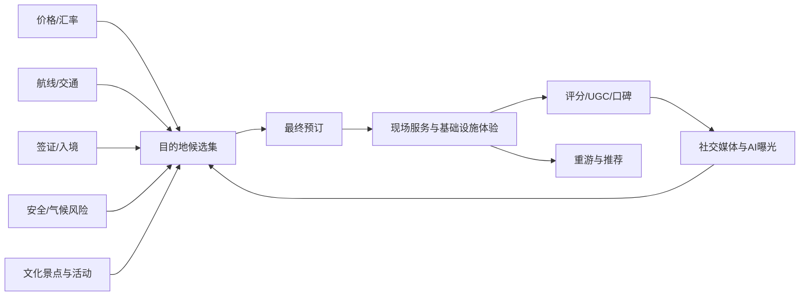

# 2025年全球旅客目的地选择影响因素研究报告

## 执行摘要

2025年全球旅游市场已经从“疫情后恢复”进入**需求创新高、但决策更复杂**的新阶段。联合国旅游组织（UN Tourism）最终统计显示，2025年全球国际游客到达量约 **15.2亿人次，同比增长4%，比2019年高约6%**；欧洲接待约7.93亿国际游客，仍是全球最大目的地区域。与此同时，世界旅游及旅行理事会（WTTC）估计，2025年旅游业对全球GDP贡献达到 **11.6万亿美元，占全球经济约9.8%**，并支撑约3.66亿个就业岗位。换言之，2025年的核心问题已经不再是“人们是否旅行”，而是**在大量可替代目的地之间，什么因素决定最终选择**。[[1]](https://www.untourism.int/news/international-tourist-arrivals-up-4-in-2025-reflecting-strong-travel-demand-around-the-world)

综合UN Tourism、WTTC、IATA、Booking.com、Expedia Group、Trip.com Group以及各国官方统计，本报告判断，2025年目的地选择可以概括为一个“**可负担性 × 可达性 × 摩擦成本 × 安全感 × 体验价值 × 数字可见度 × 环境承载力**”模型。Expedia Group在11个市场、约1.1万名消费者中的2025年调查显示，消费者选择目的地时，“**低价格**”排在首位，其后依次包括“一生一次的体验”和“文化体验”；近60%的消费者预计未来一年会比过去一年更加关注价格。[[2]](https://partner.expediagroup.com/content/dam/unified/partner/documents/one-pagers/expedia-group-tvi-snapshot-destinations_en-au.pdf)

但“便宜”并不能单独解释目的地竞争力。航空连接恢复、签证便利、安全形象、活动供给以及数字推荐共同改变了相对吸引力。IATA数据显示，2025年全球航空客运需求同比增长 **5.3%**，其中国际需求增长7.1%、国内需求增长2.4%；全球运力增长仍受到飞机交付、发动机和维修能力约束。由此形成一个重要机制：**新增直航或运力往往能够显著提高目的地进入候选集的概率，而航班稀缺、转机复杂和高票价则会使目的地退出比较范围。**[[3]](https://www.iata.org/en/pressroom/2026-releases/2026-01-29-02/)

签证和边境便利化的影响在2025年尤其明显。IATA的2025全球旅客调查显示，**33%的航空旅客曾因签证或移民要求复杂而放弃旅行**。中国则提供了反向案例：2025年免签入境外国人达到 **3008万人次，同比增长49.5%**，约占外国人入境的73.1%；同期中国外国游客入境人数同比增长30.6%。两组数据不能证明全部增长均由免签造成，但高度一致地说明，降低制度摩擦能明显扩大目的地的潜在客源池。[[4]](https://www.iata.org/en/pressroom/2026-releases/10-22-iata-partners-with-onevasco-to-streamline-visa-applications/)

2025年另一个结构性变化是**目的地选择越来越先发生在数字信息环境中，再发生在预订平台上**。Expedia Group的2025 Traveler Value Index显示，61%的消费者以社交媒体作为旅行灵感来源，而2022年仅为35%；73%以上的消费者表示网红推荐曾影响其预订。Booking.com于2025年对33个市场超过3.7万名消费者的调查进一步发现，67%的旅客已经至少一次在旅行过程中使用AI，89%希望未来在旅行规划中使用AI；其中38%用AI研究目的地和最佳旅行时间，37%寻找当地体验或文化活动。[[5]](https://partner.expediagroup.com/content/dam/unified/partner/documents/one-pagers/expedia-group-tvi-snapshot-destinations_en-au.pdf)

可持续性也已从品牌议题转化为目的地选择变量。Booking.com 2025年对34个市场约3.2万名旅行者的调查显示，**84%认为更可持续地旅行仍然重要，53%开始意识到旅游对当地社区的影响，73%希望自己的消费更多回流当地社区**。其后续研究还发现，极端天气已经影响真实行为：74%的受访者会在选择目的地和旅行时间时考虑极端天气风险。[[6]](https://news.booking.com/bookingcoms-2025-research-reveals-growing-traveler-awareness-of-tourism-impact-on-communities-both-at-home-and-abroad/)

中国旅客与全球旅客的差异主要不是“是否重视价格”，而是各变量的权重不同。2025年中国国内居民出游达到 **65.22亿人次，同比增长16.2%**，国内旅游花费6.30万亿元；同期内地居民出境旅游约1.48亿人次，同比增长20.8%。中国出境市场仍明显受到签证、航班、汇率和公共假期集中度影响，而国内市场则更容易受到高铁/航空网络、节假日、短视频种草和城市文化活动驱动。[[7]](https://zwgk.mct.gov.cn/zfxxgkml/tjxx/202606/t20260602_966073.html)

**核心结论是：2025年的目的地竞争不再是单一景点竞争，而是整个“旅行决策系统”的竞争。** 价格决定能否进入预算范围，直航和签证决定能否顺利成行，安全与气候决定风险容忍度，文化与活动决定“为什么非去不可”，而社交媒体和AI决定旅客首先看到谁、比较谁。

## 研究范围、数据基础与统计事实

本研究将“目的地选择”界定为旅客从多个可能目的地中形成候选集并最终决定旅行国家、地区或城市的过程。重点考察休闲旅游，同时纳入探亲、商务延伸休闲（bleisure）、活动旅游等会显著改变目的地需求的情形。全球总量优先使用UN Tourism、WTTC和IATA；消费者行为优先采用Booking.com、Expedia Group和Trip.com Group的一手调查与平台数据；中国使用文化和旅游部、国家统计局和国家移民管理局数据；日本、西班牙案例则使用JNTO、世博会官方机构和西班牙国家统计局INE。

| 指标 | 2025年事实 | 对目的地选择的含义 |
|---|---:|---|
| 全球国际游客到达量 | 约15.2亿，同比增长4% | 国际需求已全面超过疫情前水平，目的地间竞争从“恢复客流”转向“争夺增量” [[8]](https://www.untourism.int/news/international-tourist-arrivals-up-4-in-2025-reflecting-strong-travel-demand-around-the-world) |
| 全球旅游业GDP贡献 | 11.6万亿美元，约占全球GDP 9.8% | 市场体量扩大，使政府在签证、交通、活动和营销上的竞争更激烈 [[9]](https://wttc.org/news/travel-tourism-sees-best-year-ever-outpacing-the-global-economy-in-2025/) |
| 全球国际游客支出 | 约2.02万亿美元 | 高价值游客争夺的重要性高于单纯追求到访人数 [[10]](https://wttc.org/news/spain-becomes-europe-s-high-value-travel-champion-as-global-visitor-spend-reaches-record-us2tn/) |
| 全球航空需求 | +5.3%；国际+7.1%，国内+2.4% | 国际目的地选择受航空网络恢复明显推动 [[3]](https://www.iata.org/en/pressroom/2026-releases/2026-01-29-02/) |
| Expedia受访者计划国内旅行 | 92% | 国内游仍是最广泛、进入门槛最低的旅行形态 [[11]](https://partner.expediagroup.com/content/dam/unified/partner/documents/one-pagers/expedia-group-tvi-snapshot-destinations_en-au.pdf) |
| Expedia受访者计划国际旅行 | 68% | 国际游需求强劲，但仍明显低于国内游意向 [[11]](https://partner.expediagroup.com/content/dam/unified/partner/documents/one-pagers/expedia-group-tvi-snapshot-destinations_en-au.pdf) |
| 中国国内居民出游 | 65.22亿人次，+16.2% | 高频、短途和区域化目的地仍有巨大市场 [[12]](https://zwgk.mct.gov.cn/zfxxgkml/tjxx/202601/t20260126_964367.html) |
| 中国内地居民出境旅游 | 1.4836亿人次，+20.8% | 出境游恢复速度快，亚洲近程和长线市场同时受益 [[13]](https://zwgk.mct.gov.cn/zfxxgkml/tjxx/202606/t20260602_966073.html) |
| 西班牙国际游客 | 9680万人，+3.2% | 成熟目的地仍增长，但承载力与居民压力变得更关键 [[14]](https://ine.es/dyngs/Prensa/en/FRONTUR1225.htm) |
| 日本国际游客 | 4268万人，+15.8% | 汇率、航班、文化资产和活动叠加可形成强劲需求 [[15]](https://www.jnto.go.jp/news/press/20260121_monthly.html) |

这些指标并非完全可横向相除。例如，中国“国内出游人次”按旅行次数统计，而国际游客到达数据按跨境到达计数；平台调查则是意向或态度数据。因此，本报告只在定义一致时进行数量比较，不将“意向”“预订”“入境次数”和“独立旅客人数”混为一谈。

消费者调查同样存在样本局限。Expedia 2025 Traveler Value Index由Wakefield Research开展，样本约1.1万人、覆盖11个市场，调查时间为2025年2月14日至3月3日，因此更能代表主要在线旅行消费市场，而非全球全部人口。[[16]](https://partner.expediagroup.com/en-us/resources/research-insights/2025-traveler-value-index) Booking.com的2025旅游趋势调查覆盖33个国家和地区、27,713名计划未来12—24个月旅行的成年人，调查实际完成于2024年7—8月，因此它属于“针对2025年的前瞻意向调查”，而不是2025年实际行为统计。[[17]](https://news.booking.com/defying-convention-to-deepen-connections-bookingcoms-nine-predictions-for-travel-in-2025/)

## 核心因素分析

**旅游成本与汇率。** 成本仍是2025年最基础的筛选条件。Expedia的目的地专项数据显示，“低价格”是受访者选择目的地最重要的价值因素，特殊优惠列第四；近60%的消费者表示未来12个月会更加关注价格。[[2]](https://partner.expediagroup.com/content/dam/unified/partner/documents/one-pagers/expedia-group-tvi-snapshot-destinations_en-au.pdf) UN Tourism在2025年初对全球旅游专家的调查也显示，超过一半受访专家把交通、住宿成本以及油价等经济因素列为2025年国际旅游的主要挑战。[[18]](https://www.untourism.int/news/international-tourism-recovers-pre-pandemic-levels-in-2024)

汇率则改变同一目的地对不同客源市场的“实际价格”。2025年日元兑美元仍处于历史偏弱区间，例如日本银行数据显示2025年8月美元兑日元月均约147.6日元；这意味着来自美元或与美元相对强势货币市场的游客在日本消费时拥有较高购买力。[[19]](https://www.stat-search.boj.or.jp/ssi/mtshtml/fm08_m_1_en.html) 但汇率效应通常需要与航班供给和文化需求共同出现才会产生大规模流量，不能把日本2025年游客纪录简单归因于日元。

**可达性及航线。** 2025年全球航空需求强劲，但飞机和发动机供应链使运力恢复受到限制；IATA最终数据显示，国际RPK同比增长7.1%，明显快于国内市场。[[3]](https://www.iata.org/en/pressroom/2026-releases/2026-01-29-02/) WEF的旅游业发展指数也把航空基础设施、地面交通和旅游服务基础设施列为决定旅游发展条件的核心支柱，并显示2024—2026年航空基础设施得分明显改善。[[20]](https://www.weforum.org/publications/travel-tourism-development-index-2026/technical-notes-and-methodology) 对消费者而言，这体现为非常具体的决策：有没有直飞、航班频率、飞行时间、转机风险、机场到市中心交通以及总票价。

中国赴日市场很好地展示了这一机制。JNTO指出，2025年1—2月中国赴日游客大增除春节和寒假外，还受到北京—札幌、上海—冲绳、广州—福冈等地方航线增班推动。[[21]](https://www.jnto.go.jp/statistics/market-info/china/market-topics202501-02.html) 因此，航线不仅影响“去不去日本”，还会影响旅客选择东京、大阪之外的哪一个地区。

**签证与入境政策。** 签证摩擦对于出境游远比国内游重要，而且是最容易通过公共政策迅速改变的变量之一。IATA 2025全球旅客调查显示，33%的旅客曾因签证和入境要求复杂而被劝退。[[22]](https://www.iata.org/en/pressroom/2026-releases/10-22-iata-partners-with-onevasco-to-streamline-visa-applications/) 中国在2025年继续扩大单方面免签和240小时过境免签范围，全年免签入境外国人3008万人次，同比增长49.5%。[[23]](https://www.nia.gov.cn/n741435/n1194535/n1762482/index.html) 国家移民管理局截至2025年7月披露，中国已给予75个国家公民不同形式的免签入境便利，同时240小时过境免签覆盖更多口岸和省区市。[[24]](https://english.www.gov.cn/english.www.gov.cn/news/202507/30/content_WS6889b01fc6d0868f4e8f48b9.html)

这说明目的地政府可以通过减少签证费用、材料要求、不确定审批时间以及入境排队等“非价格成本”来提高竞争力。在旅行成本相近时，**“今天就能订”通常比“先准备签证再决定”具有明显优势**——这是基于IATA和中国入境数据的因果机制推断，而不是对单一国家增长率的直接因果估计。[[25]](https://www.iata.org/en/pressroom/2026-releases/10-22-iata-partners-with-onevasco-to-streamline-visa-applications/)

**安全、地缘政治与风险感知。** 安全首先是一个门槛变量：当风险超过旅客个人容忍度时，低价和景点吸引力往往失去作用。WEF把Safety and Security作为旅游目的地竞争力的独立支柱，衡量居民、游客和企业暴露于安全风险的程度。[[26]](https://www.weforum.org/publications/travel-tourism-development-index-2026/1-about-the-travel-tourism-development-index-2026) UN Tourism则指出，2025年国际旅游虽然继续增长，但始终面对地缘政治、经济和气候挑战。[[27]](https://www.untourism.int/news/international-tourism-up-5-in-first-half-of-2025-despite-global-challenges)

风险还会通过航空网络间接作用于目的地选择。WEF总结2025年经验时指出，中东和北非冲突曾关闭连接欧洲、亚洲、澳大利亚和非洲的重要航空走廊，进而影响航班时刻、运力、票价以及旅客信心。[[28]](https://www3.weforum.org/docs/WEF_Travel_and_Tourism_Development_Index_2026.pdf) 因而，地缘政治的影响不仅表现为“游客不去冲突国家”，也可能使远离冲突区但依赖相关空域或枢纽的目的地变得更贵、更难到达。

**目的地吸引力、文化、景点和活动。** 2025年的“体验价值”已经与价格同等重要。Expedia目的地调查把“一生一次的体验”和“文化体验”列为价格之后最重要的目的地价值因素，餐饮、户外活动和活动/观光项目也进入前十。[[11]](https://partner.expediagroup.com/content/dam/unified/partner/documents/one-pagers/expedia-group-tvi-snapshot-destinations_en-au.pdf) Expedia的Unpack ’25还发现，电影、电视和娱乐内容继续推动“影视取景地旅行”（set-jetting），越来越多旅客选择较少人知的“绕行目的地”作为主目的地或行程附加地。[[29]](https://partner.expediagroup.com/en-us/resources/blog/top-unpack-25-partner-trends)

文化活动尤其能够把“某天去”变成“必须在某个日期去”。大阪·关西世博会在2025年4月13日至10月13日期间累计接待约 **2902万人次**；官方调查显示约93%的参观者来自日本、约200万人来自海外。[[30]](https://www.expo2025.or.jp/en/expo_data/) 这说明大型文化和国际活动不仅是国际入境工具，也能极大地重塑国内旅游时间和城市选择。

**社交媒体与AI。** 这是2025年变化速度最快的因素。Expedia数据显示，社交媒体作为旅行灵感来源的比例从2022年的35%提高到2025年的61%，超过朋友家人、预订网站和传统媒体。[[11]](https://partner.expediagroup.com/content/dam/unified/partner/documents/one-pagers/expedia-group-tvi-snapshot-destinations_en-au.pdf) 这改变了目的地竞争逻辑：过去首先要“被旅行社上架”或“出现在搜索结果”，现在首先要**被算法推送、具有视觉传播性并形成用户内容**。

AI进一步把“灵感”与“比较”合并。Booking.com 2025 Global AI Sentiment Report覆盖33个市场、超过3.7万名消费者，67%的旅行者已在旅行过程中至少使用过一次AI，89%有意在未来旅行规划中使用AI；38%利用AI研究目的地及最佳旅行时段，37%寻找当地活动和文化体验。[[31]](https://news.booking.com/bookingcom-releases-the-global-ai-sentiment-report/) Trip.com Group则在2025年正式推出整合规划、调整、预订和订单管理的AI行程规划工具，并利用约2000万个地理标记景点及大量用户反馈进行推荐。[[32]](https://investors.trip.com/static-files/0fa048a3-5bcc-46d0-a1f7-66cd2baebad6)

这意味着目的地营销正在从SEO进一步转向“**AI可发现性**”：目的地的景点、开放时间、交通、签证、活动和安全信息若不结构化、不及时或缺乏多语言内容，将更难进入AI生成的候选行程。

**可持续旅游、气候、拥挤和季节性。** Booking.com的2025研究显示，84%的全球旅行者认为可持续旅行重要，53%首次明确意识到旅游不仅影响环境，也影响目的地社区；73%希望自己的旅行支出回流当地经济。[[33]](https://news.booking.com/bookingcoms-2025-research-reveals-growing-traveler-awareness-of-tourism-impact-on-communities-both-at-home-and-abroad/) 这并不意味着大多数人会为可持续性支付无限溢价——2024年同一研究就显示，45%的旅客认为可持续旅行重要，但并非预订时首要考虑因素。[[34]](https://news.booking.com/latest-bookingcom-sustainable-travel-data-reveals-ongoing-challenges-for-consumers--highlights-a-heightened-opportunity-for-cross-industry-collaboration/) 更准确的判断是：**可持续性越来越成为在价格、交通和体验相近时的“次级决胜变量”。**

气候的影响则更直接。Booking.com在后续调查中发现，74%的旅客会在选择目的地和旅行时间时考虑极端天气风险，31%曾因极端天气取消或修改行程；43%计划避开过度拥挤目的地，42%考虑淡季旅行，25%考虑选择更凉爽地区。该调查发表于2026年，但询问的是2025年实际天气扰动和下一阶段旅行计划，因此可作为2025行为后果的补充证据。[[35]](https://news.booking.com/bookingcoms-latest-travel-and-sustainability-research-reveals-unexpected-generational-paradox)

**服务质量与基础设施。** 基础设施不一定成为旅客“想去”的理由，却往往决定“去了以后是否推荐”和“会不会再去”。Expedia 2025研究显示，76%的消费者愿意为评价更好的酒店支付更高价格，40岁以下群体这一比例达到80%。[[36]](https://partner.expediagroup.com/en-us/resources/blog/2025-traveler-value-index-highlights) WEF旅游业发展指数则把地面交通、航空、旅游服务、ICT、卫生和安全共同纳入目的地竞争条件。[[37]](https://www.weforum.org/publications/travel-tourism-development-index-2026/technical-notes-and-methodology)

服务质量的影响因此形成反馈循环：

这也是为什么2025年的目的地竞争越来越具有“平台飞轮”特征：好的服务带来评价，评价影响算法排序，算法排序再影响下一批旅客。

## 旅客群体差异比较

不同旅客面对的是同一套变量，但权重差异显著。以下判断结合2025消费者调查、平台数据和官方统计；“高/中/低”表示相对敏感度，而不是严格计量系数。

| 群体 | 成本/价格 | 签证与交通 | 社交媒体/AI | 文化与体验 | 安全/便利 | 可持续/避拥挤 | 2025年主要特征 |
|---|---|---|---|---|---|---|---|
| Z世代 | 高 | 中 | **极高** | 高，尤其娱乐、夜生活、流行文化 | 中 | 中高 | 47%的Z世代称若目的地无法进行位置标记可能重新考虑是否前往；对数字分享和另类目的地接受度高 [[38]](https://news.booking.com/defying-convention-to-deepen-connections-bookingcoms-nine-predictions-for-travel-in-2025/) |
| 千禧一代 | 中高 | 中高 | **高** | **高**，亲子、美食、深度体验突出 | 中高 | 高 | 44%的千禧一代也会因无法标记地点重新考虑目的地；远程办公和bleisure扩大非周末、非旺季需求 [[39]](https://news.booking.com/defying-convention-to-deepen-connections-bookingcoms-nine-predictions-for-travel-in-2025/) |
| 婴儿潮/老年 | 中 | **高** | 低至中 | 高，但更偏文化、家庭与高品质体验 | **极高** | 中高 | Booking.com发现23%的婴儿潮一代对冒险型假期有兴趣，较2024年的10%明显上升；80%愿为成年子女下一次旅行付款，78%愿为孙辈付款 [[17]](https://news.booking.com/defying-convention-to-deepen-connections-bookingcoms-nine-predictions-for-travel-in-2025/) |
| 中国出境旅客 | **高**，且汇率敏感 | **极高** | **高** | **高**，购物、美食、文化、演出共同驱动 | 高 | 中高 | 2025年出境旅游约1.48亿人次；日本等近程市场受增班和假期驱动明显 [[40]](https://zwgk.mct.gov.cn/zfxxgkml/tjxx/202606/t20260602_966073.html) |
| 国际跨境旅客总体 | 高 | **极高** | 高 | 高 | **高** | 高 | 33%曾因签证/移民复杂度放弃旅行，显示跨境制度摩擦是国内游没有的重大门槛 [[22]](https://www.iata.org/en/pressroom/2026-releases/10-22-iata-partners-with-onevasco-to-streamline-visa-applications/) |
| 国内旅客总体 | **高** | 中 | 高 | 高 | 中高 | 中 | Expedia调查中92%可能进行国内旅行，高于68%的国际旅行意向，说明国内游的低摩擦优势显著 [[11]](https://partner.expediagroup.com/content/dam/unified/partner/documents/one-pagers/expedia-group-tvi-snapshot-destinations_en-au.pdf) |

年龄差异中最值得注意的一点，是“数字化”不等于年轻旅客只追求低价。Expedia发现40岁以下消费者对优质评价的支付意愿反而更高：80%愿为评价更好的酒店多付费。[[36]](https://partner.expediagroup.com/en-us/resources/blog/2025-traveler-value-index-highlights) 因此，对Z世代和年轻千禧一代而言，**低价负责吸引注意，高评分、真实性和独特体验负责促成成交**。

中国旅客与国际平均旅客的另一差异是**假期集中度与区域航线的重要性更高**。JNTO在2025年中国市场分析中明确将春节/寒假与地方航线增班列为中国赴日增长的重要因素。[[21]](https://www.jnto.go.jp/statistics/market-info/china/market-topics202501-02.html) 相比之下，欧美成熟市场拥有更多带薪休假和长期跨境交通网络，出游时间往往更分散，因此季节性营销策略不能简单复制。

国内和出境旅游的决策顺序也不同。国内游没有护照、签证、国际支付和跨境通信等摩擦，因此通常先比较“时间—交通—价格—体验”；国际游则往往先通过“签证—安全—航班—汇率”形成可行目的地集合，再比较文化、酒店和活动。这是对前述IATA、Expedia和中国官方数据的综合推断。[[41]](https://www.iata.org/en/pressroom/2026-releases/10-22-iata-partners-with-onevasco-to-streamline-visa-applications/)

## 地区与国家案例研究

**案例一：中国赴日——汇率、航线、文化内容和大型活动的叠加效应。** 日本2025年接待国际游客达到 **4268.36万人次，同比增长15.8%并创历史纪录**。[[15]](https://www.jnto.go.jp/news/press/20260121_monthly.html) 中国市场恢复尤其明显：截至2025年11月，中国大陆赴日游客约876.6万人，同比增长37.5%。[[42]](https://www.jnto.go.jp/en/news/20251217.pdf) JNTO指出，春节和学生寒假、北京—札幌、上海—冲绳、广州—福冈等增班，以及中国游客在竞争目的地之间选择日本，共同推高年初需求。[[21]](https://www.jnto.go.jp/statistics/market-info/china/market-topics202501-02.html)

同时，日元偏弱降低了外国游客以本币衡量的日本消费成本，而动漫、餐饮、购物、樱花、滑雪等成熟体验不断提供旅行理由；大阪·关西世博会又在2025年形成强烈的事件型吸引力，累计接待约2902万人次。[[43]](https://www.stat-search.boj.or.jp/ssi/mtshtml/fm08_m_1_en.html) 这一案例表明，一个目的地最强的增长往往不是单个变量的结果，而是**“价格优势+交通恢复+文化品牌+活动事件”同时发生**。

**案例二：中国入境——签证便利改变目的地进入门槛。** 2025年中国入境游客达到约1.545亿人次，同比增长17.1%；其中外国游客3517万人次，同比增长30.6%。[[13]](https://zwgk.mct.gov.cn/zfxxgkml/tjxx/202606/t20260602_966073.html) 国家移民管理局数据显示，免签入境外国人3008万人次，同比增长49.5%，占外国人入境的73.1%。[[23]](https://www.nia.gov.cn/n741435/n1194535/n1762482/index.html)

Trip.com Group则报告，2025年平台服务约2000万名前往中国大陆的国际旅客，来自83个国家和地区，带动约240亿美元旅游消费；公司同时加强多语言产品、支付、住宿信息与AI行程工具。[[44]](https://investors.trip.com/static-files/16e43895-9431-4a1f-918a-e66a9f04fc84) 由于平台数据仅代表Trip.com生态，不能直接推算全国市场份额，但它说明签证政策只有与支付、酒店接待、多语言内容和交通共同改善时，才能把“允许入境”转化为“愿意预订”。

这一案例对政策制定者特别重要：**边境开放决定流量上限，目的地服务决定转化率与消费额。**

**案例三：西班牙——高需求与过度拥挤并存。** 西班牙国家统计局显示，2025年国际游客达到创纪录的 **9677万人次，同比增长3.2%**；国际游客支出达到 **1347.12亿欧元，同比增长6.8%**，支出增幅明显快于人数增长。[[45]](https://ine.es/dyngs/Prensa/en/FRONTUR1225.htm) 这说明成熟目的地可以通过高价值消费而不只是增加客流实现增长。

与此同时，Booking.com全球调查显示，交通拥堵、垃圾、生活成本上升和游客拥挤已成为居民感受到的旅游负面影响，53%的旅行者也开始意识到旅游对社区的影响。[[33]](https://news.booking.com/bookingcoms-2025-research-reveals-growing-traveler-awareness-of-tourism-impact-on-communities-both-at-home-and-abroad/) 对西班牙、意大利、日本京都等成熟目的地而言，下一阶段竞争优势可能不再是“吸引最多人”，而是**把客流向淡季、二线城市和高消费体验分流**。这一判断属于基于客流纪录和消费者拥挤偏好的趋势推断。[[46]](https://ine.es/dyngs/Prensa/en/FRONTUR1225.htm)

**案例四：大阪·关西世博会——文化活动如何重新分配旅游流量。** 世博会2025年六个月累计接待2902万人次，其中约2702万来自日本、约200万来自海外；9月10日以后连续34天单日客流超过20万人。[[47]](https://www.expo2025.or.jp/en/wp-content/uploads/sites/2/2026/01/f41f76fde7af43a4808817bf8ee5abad.pdf) 其意义不仅是增加日本总旅游量，而是把旅游需求集中到**特定城市、特定月份与特定交通走廊**。

这说明大型展会、演唱会、体育赛事、节庆和艺术活动具有与汇率完全不同的作用机制：汇率使已有目的地“更便宜”，而事件能够创造一个**此前并不存在的旅行理由和固定时间窗口**。对城市目的地而言，文化日历本身已经成为航空和酒店需求管理工具。

## 2025年关键趋势与短中期预测

**统计事实层面的2025趋势**可以归纳为六点：国际旅游已超过2019年；航空国际需求增长快于国内需求；价格仍是首要筛选项；社交媒体成为第一梯队灵感来源；AI开始实际介入目的地比较；签证、气候和拥挤从外围议题进入购买决策。上述趋势分别由UN Tourism、IATA、Expedia、Booking.com和中国边境数据交叉印证。[[48]](https://www.untourism.int/news/international-tourist-arrivals-up-4-in-2025-reflecting-strong-travel-demand-around-the-world)

**趋势解读。** 2025年的最显著结构变化并不是某个单独因素突然取代价格，而是旅客开始进行“多目标优化”。一个目的地即使票价低，如果签证繁琐、气候风险高或社交媒体反馈差，也可能输给略贵但更容易抵达、评价更好且体验更明确的目的地。反过来，独特文化活动可以让游客接受更高价格和更长距离。Expedia同时发现低价排名第一、优质评价又具有明显溢价能力，恰好说明消费者并非单纯追求最低价格，而是在寻找“**风险调整后的体验价值**”。[[2]](https://partner.expediagroup.com/content/dam/unified/partner/documents/one-pagers/expedia-group-tvi-snapshot-destinations_en-au.pdf)

**短期预测：未来1—2年，目的地之间的竞争将更偏向“低摩擦旅行”。** 依据2025年33%的旅客因入境规则被劝退、中国免签客流快速增长，以及全球航空连接继续改善，可以预期签证电子化、免签、快速入境、直飞和一站式支付将继续比传统广告更直接地影响跨境游客转化。[[49]](https://www.iata.org/en/pressroom/2026-releases/10-22-iata-partners-with-onevasco-to-streamline-visa-applications/)

**短期预测：AI将从“规划工具”变成目的地流量入口。** Booking.com数据显示89%的消费者有意在未来旅行规划中使用AI，而WEF统计显示旅游行业风险投资中AI相关项目所占比例从2023年的10%上升至2025年上半年的45%。[[50]](https://news.booking.com/bookingcom-releases-the-global-ai-sentiment-report/) 因此，2026—2027年目的地管理机构的数字竞争重点很可能从单纯搜索引擎优化扩展到结构化数据、实时活动信息、多语言知识库以及AI平台合作。

**中期预测：热门目的地增长将越来越受到承载力约束，增长会向淡季和“第二目的地”外溢。** Booking.com数据显示游客主动避开拥挤和选择淡季的倾向上升，Trip.com也已经观察到中国游客向日本横滨、高山、伊东等非东京—大阪—京都传统线路扩散。[[51]](https://news.booking.com/bookingcoms-latest-travel-and-sustainability-research-reveals-unexpected-generational-paradox) 因此，未来2—4年最大的新增机会之一可能不是创造新的全球超级目的地，而是把成熟目的地周边的城市、小镇和乡村纳入同一旅游网络。

**中期预测：气候会改变全球旅游季节地图。** 2025实际经历显示，极端天气已经导致部分旅客改签或取消，而消费者越来越希望避开酷暑和高峰。[[52]](https://news.booking.com/bookingcoms-latest-travel-and-sustainability-research-reveals-unexpected-generational-paradox/) 因此，传统地中海夏季、南欧城市旺季以及部分热带目的地可能出现更多“春秋化、夜间化和凉爽目的地替代”，而北欧、高纬度、山区和夜间旅游产品的相对吸引力上升。Booking.com针对2025的调查中，62%的受访者考虑暗夜观星类目的地，54%希望通过夜间活动避开白天气温上升，已经提供了需求侧信号。[[17]](https://news.booking.com/defying-convention-to-deepen-connections-bookingcoms-nine-predictions-for-travel-in-2025/)

上述预测并非确定性点预测。汇率、战争、能源价格、自然灾害以及航空供给均可能迅速改变结果，因此更适合作为情景规划依据，而非游客人数的机械外推。

## 对旅游业者和政策制定者的建议与结论

对**目的地管理机构和政府**而言，2025年的数据支持一个明显优先级：先降低旅行摩擦，再扩大营销。签证简化、电子许可、机场通关、直航激励、公共交通、多语言支付和数字地图，应被视为旅游营销的一部分，而非单纯基础设施事务；IATA有关签证劝退的调查和中国免签增长提供了直接依据。[[25]](https://www.iata.org/en/pressroom/2026-releases/10-22-iata-partners-with-onevasco-to-streamline-visa-applications/)

对**成熟热门目的地**，应从“游客数量KPI”转向“单位游客价值、淡季占比、地方社区收益和空间分散度”。西班牙2025年游客人数增长3.2%、支出增长6.8%的结构说明，提高价值密度可以比单纯追求人数更有效。[[45]](https://ine.es/dyngs/Prensa/en/FRONTUR1225.htm) 同时，应通过预约制、动态票价、实时拥挤度提示、二线城市联程产品和淡季活动来降低高峰压力；UN Tourism认可的日本高野山等目的地已经使用拥挤预测日历和ICT交通引导鼓励平日访问。[[53]](https://tourism-villages.unwto.org/en/villages/koyasan/)

对**航空公司、酒店和OTA**，2025年最重要的商业机会是把价格、内容和信任结合，而不是单独打折。近60%的消费者更加价格敏感，但76%又愿意为评价更好的酒店多付费，因此“早订优惠+高评分+明确退改+套餐”比单纯最低价更符合实际决策机制。[[36]](https://partner.expediagroup.com/en-us/resources/blog/2025-traveler-value-index-highlights)

对**面向中国游客的海外目的地**，应重点关注直航恢复、中文数字内容、移动支付、美食和文化活动、节假日运力以及短视频传播。日本2025年的中国游客增长显示，地方航线增班可以直接把流量导向传统核心城市之外。[[21]](https://www.jnto.go.jp/statistics/market-info/china/market-topics202501-02.html) 对长线目的地，则需要进一步降低签证申请时间，并设计多城市联游，因为Trip.com此前已观察到中国赴欧洲旅客中超过30%采用多目的地行程，且英国、西班牙、德国和意大利等长线停留通常达到10—14天。该数据来自2024年国庆前预订观察，因缺乏同口径2025全年细分数据，本报告仅将其作为中国长线游结构的补充参考。[[54]](https://investors.trip.com/zh-hant/news-releases/news-release-details/tripcom-group-highlights-golden-week-2024-travel-shifts-chinese?mobile=1)

对**面向Z世代和千禧一代的目的地**，必须同时优化社交传播和AI信息基础设施。地点标签、短视频素材、真实用户内容、活动日历以及可机器读取的开放时间、交通和票务信息，将越来越直接影响一个目的地是否进入候选行程。Booking.com对年轻人“无法标记地点则重新考虑目的地”的调查，以及AI搜索目的地、文化活动的数据都支持这一方向。[[55]](https://news.booking.com/defying-convention-to-deepen-connections-bookingcoms-nine-predictions-for-travel-in-2025/)

对**老年和多代家庭市场**，重点不应停留在“静态观光”。Booking.com数据显示婴儿潮一代对探险活动兴趣明显提高，同时有很强的为子女和孙辈支付旅行费用的意愿，因此无障碍设施、医疗便利、高品质住宿、慢节奏文化体验与轻冒险活动可以组合成新的高价值产品。[[17]](https://news.booking.com/defying-convention-to-deepen-connections-bookingcoms-nine-predictions-for-travel-in-2025/)

最终，2025年的证据表明，旅客目的地选择已经形成三层决策结构：第一层是**能不能去**——签证、安全、航班和时间；第二层是**值不值得去**——价格、汇率、景点、文化、美食和活动；第三层是**为什么选择这里而不是别处**——社交口碑、AI推荐、服务质量、独特事件、气候舒适度和拥挤程度。所有三层同时表现良好的目的地，才最可能持续赢得全球客流。

因此，未来旅游竞争的核心不是制造更多“网红景点”，而是建立一个从**数字发现—政策准入—交通到达—现场体验—社区收益—线上口碑**完整闭环。2025年全球旅游量创下新高后，真正稀缺的已不是旅行意愿，而是旅客的时间、预算和注意力。能够以最低摩擦把这三种资源转化为高质量体验的目的地，将更有可能成为下一阶段全球旅游增长的赢家。[[56]](https://www.untourism.int/news/international-tourist-arrivals-up-4-in-2025-reflecting-strong-travel-demand-around-the-world)
