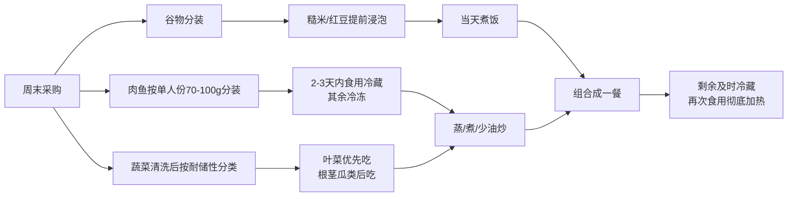

# 53岁、体重约80公斤中国成年人的两周科学健康食谱与营养研究报告

## 执行摘要

本报告面向一位**53岁、体重约80公斤的中国成年人**。目前**身高、性别、日常活动量、既往疾病史均未指定**，因此不能仅凭“80公斤”判断是否超重，也不能科学地预设每日热量或减重目标。正确做法是：先用身高计算BMI，再结合性别与活动水平选择《中国居民膳食营养素参考摄入量（2023版）》对应的能量需要量；若存在糖尿病、慢性肾病、痛风、高血压、骨质疏松、肌少症等，则进一步调整食谱。中国营养学会2023版DRIs明确按年龄、性别和身体活动水平分别给出能量和营养素参考值。[[1]](https://www.cnsoc.org/bookpublica/612410201.html)

本方案以《中国居民膳食指南（2022）》为基本框架：成年人平均每天谷类约200～300克，其中全谷物和杂豆50～150克、薯类50～100克；新鲜蔬菜不少于300克且深色蔬菜约占一半；水果200～350克；奶及相当量奶制品每天至少约300毫升；鱼、禽、蛋、瘦肉平均每天合计120～200克；成年人食盐不超过5克、烹调油约25～30克、添加糖不超过50克且最好控制在25克以下。指南同时建议平均每天摄入12种以上食物、每周25种以上。[[2]](https://dg.cnsoc.org/article/04/J4-AsD_DR3OLQMnHG0-jZA.html)

对于50～64岁成年人，2023版DRIs中男性蛋白质RNI约65克/日，女性约55克/日；钙RNI约800毫克/日，维生素D约10微克/日，膳食纤维约25～30克/日，脂肪供能比20%～30%，碳水化合物供能比50%～65%，饱和脂肪酸低于总能量10%，预防慢性病的钠建议量不超过约2000毫克/日。[[3]](https://www.youlu.com/ggyys/article/CA20240827020000000053)

53岁已进入应提前关注肌肉、骨量和心血管代谢健康的阶段。本报告因此让**每顿正餐都出现明确蛋白质来源**，每天安排奶类、豆制品或两者，保持规律鱼类摄入，并通过全谷物、蔬果和坚果提高膳食纤维、不饱和脂肪酸及钾镁等营养素密度。国家卫健委2026年肌少症与骨质疏松食养指南进一步强调优质蛋白、三餐分配、奶类、豆制品、鱼虾以及抗阻运动的重要性；但其中针对已经患有肌少症或骨质疏松症的较高蛋白、钙和维生素D剂量，**不应自动套用于健康的53岁成年人**。[[4]](https://www.nhc.gov.cn/sps/c100087/202604/a69d2fce21e040dc96cbc40b923a06d3/files/%E9%99%84%E4%BB%B65.%E6%88%90%E4%BA%BA%E8%82%8C%E5%B0%91%E7%97%87%E9%A3%9F%E5%85%BB%E6%8C%87%E5%8D%97%EF%BC%882026%E5%B9%B4%E7%89%88%EF%BC%89.pdf)

下述14天菜单按中国家庭常见食材设计，不追求“减脂餐”式极端控制。除特别注明外，**谷物和杂粮为生重，肉鱼豆腐为可食生重，蔬果为可食部重量；馒头、面包为成品重量；奶按毫升或克计**。每天烹调油建议控制在约20～25克，本方案留出少量余量给家庭调味；食盐连同酱油、蚝油、豆瓣酱、腌菜等含钠调味品折算后应控制在5克盐当量以内。[[5]](https://www.cnsoc.org/bookpublica/0522202019.html)

## 营养依据与个体化调整

### 当前未指定信息如何影响食谱

体重80公斤本身不能判断是否需要减重。BMI计算公式为：

\[
BMI=\frac{\text{体重（kg）}}{\text{身高（m）}^2}
\]

例如，体重同为80公斤，身高1.60米和1.80米对应的BMI完全不同。因此在没有身高、腰围、体成分和既往体重趋势时，本报告只制定**均衡膳食结构**，不主动制造能量缺口。《健康中国行动》将成年人BMI 18.5～24 kg/m²作为健康体重的参考区间，但是否需要减重还应同时参考腰围、疾病、肌肉量及医生评估。[[6]](https://www.nhc.gov.cn/guihuaxxs/c100133/201907/2a6ed52f1c264203b5351bdbbadd2da8.shtml)

50～64岁成年人可先依据性别和活动水平选择2023版DRIs的能量需要量，而不是用“80公斤×固定热量”硬套。下表由DRIs的MJ/d换算为约kcal/d，**仅用于选择起始能量层级，并非本报告给您的既定热量处方**。男性PALⅠ、Ⅱ、Ⅲ分别约为1950、2400、2800千卡/日，女性约为1600、1950、2300千卡/日；PALⅠ、Ⅱ、Ⅲ大致代表低、中、高身体活动水平。[[3]](https://www.youlu.com/ggyys/article/CA20240827020000000053)

| 50～64岁 | 低活动 PAL≈1.40 | 中等活动 PAL≈1.70 | 高活动 PAL≈2.00 |
|---|---:|---:|---:|
| 男性 | 约1950 kcal/d | 约2400 kcal/d | 约2800 kcal/d |
| 女性 | 约1600 kcal/d | 约1950 kcal/d | 约2300 kcal/d |

拿到身高、性别和活动量后，可以这样调整本菜单：若属于较低能量需求，首先把每顿主食生重减少约10～20克，而不是先砍掉奶、鱼、蛋或蔬菜；若活动量较高，则每顿主食适当增加约10～20克并增加水果或奶类。连续观察体重、腰围、饥饿感和运动表现，比一次性估算更可靠。若已存在明显肥胖、非故意体重下降、肌肉减少或慢性病，则应由注册营养师或医生进行个体化能量和蛋白质处方。WHO也指出，健康饮食的具体组成需要结合年龄、性别、生活方式和活动水平调整。[[7]](https://www.who.int/westernpacific/health-topics/healthy-diet/1)

### 日常营养目标

| 项目 | 本报告建议作为日常目标 | 主要依据 |
|---|---:|---|
| 谷类 | 200～300 g/d | 中国居民膳食指南2022 |
| 其中全谷物、杂豆 | 50～150 g/d | 同上 |
| 薯类 | 50～100 g/d，可与部分主食互换 | 同上 |
| 蔬菜 | ≥300 g/d，通常安排400～500 g | 同上 |
| 深色蔬菜 | 约占蔬菜1/2 | 同上 |
| 水果 | 200～350 g/d | 同上 |
| 奶及相当量奶制品 | ≥300 ml/d | 同上 |
| 鱼、禽、蛋、瘦肉 | 平均120～200 g/d | 同上 |
| 蛋类 | 通常约1个/d | 膳食宝塔2022 |
| 水产品 | 每周约300～500 g | 膳食指南2022 |
| 大豆及豆制品 | 经常吃，可安排豆腐100～200 g/次 | 膳食指南与“增豆加奶”核心信息 |
| 坚果 | 少量，常用约10 g/d | 膳食指南2022 |
| 食盐 | <5 g/d | 中国指南及WHO |
| 烹调油 | 25～30 g/d以内，本方案通常20～25 g | 中国指南 |
| 添加糖 | <50 g/d，最好<25 g/d | 中国指南 |
| 膳食纤维 | 约25～30 g/d | 中国DRIs |
| 蛋白质 | 50～64岁男约65 g/d、女约55 g/d RNI | 中国DRIs 2023 |
| 钙 | 约800 mg/d RNI | 中国DRIs 2023 |
| 维生素D | 约10 μg/d RNI | 中国DRIs 2023 |

上述数量来自《中国居民膳食指南（2022）》和2023版DRIs；WHO的国际健康膳食建议与之方向一致，强调至少约400克蔬果、限制盐至每天5克以内，并以全谷物、豆类、蔬果和较少加工食品作为健康膳食基础。[[8]](https://dg.cnsoc.org/article/04/J4-AsD_DR3OLQMnHG0-jZA.html)

## 53岁阶段的肌肉、骨骼与心血管重点

对肌肉而言，比单纯追求“大量吃肉”更重要的是**蛋白质总量足够、来源优质且三餐分散**。鱼虾、鸡蛋、奶、瘦禽肉、大豆及豆腐均可作为优质蛋白来源。国际老年营养证据及中国最新肌少症指南均支持随年龄增长关注蛋白质质量和三餐分配，并把抗阻训练与膳食结合；本报告虽然面向53岁而非65岁以上人群，但提前形成这种结构有利于进入老年前维持肌肉健康。[[9]](https://www.nhc.gov.cn/sps/c100087/202604/a69d2fce21e040dc96cbc40b923a06d3/files/%E9%99%84%E4%BB%B65.%E6%88%90%E4%BA%BA%E8%82%8C%E5%B0%91%E7%97%87%E9%A3%9F%E5%85%BB%E6%8C%87%E5%8D%97%EF%BC%882026%E5%B9%B4%E7%89%88%EF%BC%89.pdf)

骨骼方面，健康50～64岁人群首先以DRIs约800毫克钙和10微克维生素D为基础，优先通过奶类、豆腐、小油菜等食物获得钙，并通过鱼蛋、强化食品和适当户外活动改善维生素D来源。已经诊断骨质疏松或骨量减少者的要求不同：国家卫健委2026版骨质疏松食养指南提出尽量使钙达到约1000毫克或以上、维生素D约10～15微克，并根据血清25(OH)D和医生评估决定补充剂，而不是所有53岁成年人自行高剂量补充。[[10]](https://www.youlu.com/ggyys/article/CA20240827020000000053)

心血管方面，主线是减少高盐、高饱和脂肪、高添加糖和高度加工食品，增加蔬菜、水果、全谷物、豆类、坚果和水产品。中国DRIs对50～64岁成人给出的脂肪供能比为20%～30%、饱和脂肪酸低于总能量10%，并将钠的慢病预防建议量设在不高于约2000毫克/日；WHO同样建议成人钠摄入低于2000毫克，相当于食盐不足5克/日。[[11]](https://www.youlu.com/ggyys/article/CA20240827020000000053)

饮食之外，肌骨健康离不开运动。WHO建议成年人每周进行约150～300分钟中等强度有氧活动，或75～150分钟高强度活动，并至少每周2天进行主要肌群的力量训练；有心血管、骨关节或其他疾病者应根据医生意见调整强度。[[12]](https://www.who.int/initiatives/behealthy/physical-activity/)

### 每餐营养要点对照表

| 餐次 | 结构 | 主要营养目的 | 操作重点 |
|---|---|---|---|
| 早餐 | 全谷或杂粮 + 奶 + 蛋 + 水果/少量坚果 | 提供优质蛋白、钙、膳食纤维，避免早餐只有粥和咸菜 | 奶约300 ml；主食约50～80 g；避免甜饮料、油条长期作为主食 |
| 午餐 | 1份主食 + 1份鱼禽瘦肉/豆腐 + ≥200 g蔬菜 | 一天中较完整的一餐，补足蛋白、铁锌、蔬菜 | 一半左右蔬菜尽量深色，炒菜少油 |
| 晚餐 | 主食适量 + 鱼禽豆腐 + ≥200 g蔬菜 | 蛋白质继续分配，避免晚餐全是主食 | 不因“怕胖”完全不吃晚餐，也不以夜宵补偿 |
| 加餐 | 水果、奶或少量原味坚果 | 填补水果、奶或能量差额 | 非必需；不饿可不吃，不用饼干糕点替代 |

这种搭配与《中国居民膳食指南》“谷类为主、蔬果奶豆充足、鱼禽蛋肉适量、少盐少油控糖”的框架一致。[[13]](https://dg.cnsoc.org/article/04/J4-AsD_DR3OLQMnHG0-jZA.html)

## 两周连续菜单

### 每日菜单汇总表

| 天 | 早餐 | 午餐 | 晚餐 | 可选加餐 |
|---|---|---|---|---|
| 第1天 | 燕麦牛奶、鸡蛋、苹果、核桃 | 糙米饭、三文鱼、西兰花胡萝卜 | 鸡丝荞麦面、小白菜香菇 | 橙子 |
| 第2天 | 小米粥、牛奶、鸡蛋、猕猴桃、花生 | 藜麦饭、虾仁豆腐菠菜 | 玉米红薯、瘦肉圆白菜木耳 | 梨 |
| 第3天 | 全麦馒头、牛奶、鸡蛋、香蕉、杏仁 | 红豆米饭、清蒸鲈鱼、番茄黄瓜 | 小米饭、芹菜牛肉口蘑 | 苹果 |
| 第4天 | 燕麦全麦面包、酸奶、鸡蛋、蓝莓 | 糙米饭、去皮鸡腿、菜花青椒 | 土豆荞麦、香菇豆腐油菜 | 橙子 |
| 第5天 | 玉米红薯、牛奶、鸡蛋、梨 | 燕麦米饭、带鱼、冬瓜胡萝卜 | 黑米饭、鸡胸西兰花木耳南瓜 | 猕猴桃 |
| 第6天 | 小米燕麦粥、牛奶、鸡蛋、苹果 | 肉丝番茄青菜荞麦面 | 糙米饭、虾仁豆腐芦笋 | 橙子 |
| 第7天 | 全麦面包、牛奶、鸡蛋、香蕉 | 小米饭、鲫鱼白菜豆腐 | 山药饭、鸡胸菠菜胡萝卜 | 梨 |
| 第8天 | 燕麦牛奶、鸡蛋、橙子、杏仁 | 糙米饭、牛肉西兰花彩椒 | 鲈鱼青菜香菇荞麦面 | 苹果 |
| 第9天 | 小米粥、酸奶、鸡蛋、猕猴桃 | 红豆饭、鸡胸芹菜胡萝卜 | 玉米土豆、豆腐菠菜口蘑 | 梨 |
| 第10天 | 全麦馒头、牛奶、鸡蛋、苹果 | 燕麦米饭、三文鱼西兰花南瓜 | 黑米饭、瘦肉圆白菜木耳 | 橙子 |
| 第11天 | 燕麦全麦面包、牛奶、鸡蛋、香蕉 | 糙米饭、虾仁豆腐油菜 | 鸡丝番茄青菜荞麦面 | 猕猴桃 |
| 第12天 | 玉米红薯、酸奶、鸡蛋、梨 | 小米饭、鲈鱼菠菜香菇 | 糙米饭、芹菜牛肉胡萝卜 | 苹果 |
| 第13天 | 小米燕麦粥、牛奶、鸡蛋、苹果 | 黑米饭、去皮鸡腿菜花青椒 | 山药饭、虾仁豆腐小白菜 | 橙子 |
| 第14天 | 全麦面包、牛奶、鸡蛋、猕猴桃 | 糙米饭、带鱼冬瓜胡萝卜 | 鸡胸西兰花香菇荞麦面 | 梨 |

14天的整体结构有意保持每天奶类、蛋类、蔬菜、全谷/杂粮和优质蛋白，并轮换鱼、虾、鸡、猪、牛、大豆；这是把指南强调的“食物多样、每周25种以上”转化为家庭菜单的实际做法。[[14]](https://dg.cnsoc.org/article/04/J4-AsD_DR3OLQMnHG0-jZA.html)

### 逐日食材、做法与替换方案

| 天 | 餐次 | 单人食材量 | 简便做法 | 可替换 |
|---|---|---|---|---|
| 1 | 早餐 | 燕麦50g、牛奶300ml、鸡蛋50g、苹果150g、核桃10g | 燕麦加奶煮3～5分钟；鸡蛋水煮 | 燕麦→全麦面包70g；苹果→梨/橙 |
|  | 午餐 | 糙米30g、大米50g、三文鱼80g、西兰花150g、胡萝卜50g | 米饭同煮；鱼煎/蒸，蔬菜快炒或焯拌 | 三文鱼→鲈鱼/带鱼；糙米→黑米 |
|  | 晚餐 | 荞麦面80g、鸡胸80g、小白菜200g、香菇80g | 鸡胸切丝，与菜菇同煮成汤面 | 鸡胸→瘦猪肉/豆腐150g |
|  | 加餐 | 橙子100g | 直接吃 | →猕猴桃/苹果 |
| 2 | 早餐 | 小米40g、大米20g、牛奶300ml、鸡蛋50g、猕猴桃150g、花生10g | 小米大米煮粥，鸡蛋煮熟 | 小米→燕麦；花生→核桃 |
|  | 午餐 | 藜麦20g、大米60g、北豆腐150g、虾仁70g、菠菜200g | 米饭同煮；虾仁豆腐菠菜少油烩 | 虾→鱼80g；藜麦→糙米 |
|  | 晚餐 | 玉米150g、红薯100g、瘦猪肉80g、圆白菜200g、木耳50g | 玉米红薯蒸；肉丝与菜木耳快炒 | 猪肉→鸡胸；圆白菜→大白菜 |
|  | 加餐 | 梨100g | 直接吃 | →苹果 |
| 3 | 早餐 | 全麦馒头80g、牛奶300ml、鸡蛋50g、香蕉120g、杏仁10g | 馒头蒸热、鸡蛋水煮 | 馒头→全麦面包70g |
|  | 午餐 | 大米70g、红豆20g、鲈鱼90g、西红柿100g、黄瓜150g | 红豆预泡后与米同煮；鱼蒸熟；番茄黄瓜凉拌少盐 | 鲈鱼→鳕鱼/带鱼 |
|  | 晚餐 | 小米20g、大米60g、瘦牛肉80g、芹菜200g、口蘑80g | 小米饭；芹菜口蘑牛肉快炒 | 牛肉→鸡肉 |
|  | 加餐 | 苹果120g | 直接吃 | →橙 |
| 4 | 早餐 | 燕麦40g、全麦面包40g、无糖酸奶300g、鸡蛋50g、蓝莓100g、核桃10g | 燕麦泡酸奶，配鸡蛋面包 | 蓝莓→草莓/苹果 |
|  | 午餐 | 糙米30g、大米50g、去皮鸡腿90g、菜花150g、青椒80g | 鸡腿蒸/焖熟；菜花青椒快炒 | 鸡腿→鸡胸 |
|  | 晚餐 | 土豆150g、荞麦面60g、北豆腐180g、油菜200g、香菇60g | 豆腐香菇油菜做汤，配土豆和少量面 | 豆腐→豆干80～100g |
|  | 加餐 | 橙子150g | 直接吃 | →梨 |
| 5 | 早餐 | 玉米120g、红薯100g、牛奶300ml、鸡蛋50g、梨150g、花生10g | 玉米红薯蒸熟 | 红薯→山药 |
|  | 午餐 | 大米60g、燕麦米20g、带鱼90g、冬瓜200g、胡萝卜50g | 带鱼少油煎或蒸；冬瓜胡萝卜清炒/煮 | 带鱼→鲈鱼 |
|  | 晚餐 | 大米60g、黑米20g、鸡胸80g、西兰花150g、木耳50g、南瓜100g | 黑米饭；鸡胸西兰花木耳炒，南瓜蒸 | 鸡胸→虾仁90g |
|  | 加餐 | 猕猴桃100g | 直接吃 | →橙 |
| 6 | 早餐 | 小米40g、燕麦30g、牛奶300ml、鸡蛋50g、苹果150g、杏仁10g | 小米燕麦同煮 | 小米→糙米 |
|  | 午餐 | 荞麦面80g、瘦猪肉80g、西红柿120g、小白菜180g | 做番茄肉丝青菜汤面 | 猪肉→鸡丝 |
|  | 晚餐 | 糙米30g、大米50g、虾仁90g、北豆腐120g、芦笋180g、口蘑70g | 虾仁豆腐芦笋口蘑少油炒 | 芦笋→西兰花 |
|  | 加餐 | 橙子100g | 直接吃 | →苹果 |
| 7 | 早餐 | 全麦面包70g、牛奶300ml、鸡蛋50g、香蕉120g、核桃10g | 面包配水煮蛋 | 香蕉→苹果 |
|  | 午餐 | 大米60g、小米20g、鲫鱼100g、白菜200g、豆腐100g | 鲫鱼白菜豆腐汤，少油少盐 | 鲫鱼→鲈鱼 |
|  | 晚餐 | 山药150g、大米60g、鸡胸80g、菠菜180g、胡萝卜50g | 山药蒸；米饭；鸡胸菠菜胡萝卜炒 | 山药→土豆 |
|  | 加餐 | 梨120g | 直接吃 | →猕猴桃 |
| 8 | 早餐 | 燕麦50g、牛奶300ml、鸡蛋50g、橙子150g、杏仁10g | 燕麦牛奶粥 | 燕麦→小米 |
|  | 午餐 | 糙米30g、大米50g、瘦牛肉80g、西兰花150g、彩椒100g | 牛肉彩椒西兰花快炒 | 牛肉→鸡胸 |
|  | 晚餐 | 荞麦面80g、鲈鱼90g、小白菜200g、香菇70g | 鲈鱼蒸熟，青菜香菇面 | 鲈鱼→虾仁 |
|  | 加餐 | 苹果120g | 直接吃 | →梨 |
| 9 | 早餐 | 小米40g、大米20g、无糖酸奶300g、鸡蛋50g、猕猴桃150g、花生10g | 小米粥，酸奶另饮 | 酸奶→低乳糖奶300ml |
|  | 午餐 | 大米60g、红豆20g、鸡胸90g、芹菜180g、胡萝卜50g | 红豆饭；芹菜鸡丝炒 | 鸡胸→瘦牛肉 |
|  | 晚餐 | 玉米150g、土豆120g、北豆腐180g、菠菜180g、口蘑70g | 玉米土豆蒸；豆腐菠菜口蘑烩 | 豆腐→鸡蛋+豆干 |
|  | 加餐 | 梨100g | 直接吃 | →苹果 |
| 10 | 早餐 | 全麦馒头80g、牛奶300ml、鸡蛋50g、苹果150g、核桃10g | 馒头蒸热配鸡蛋 | 馒头→全麦面包 |
|  | 午餐 | 大米60g、燕麦米20g、三文鱼90g、西兰花150g、南瓜120g | 三文鱼蒸/煎，西兰花焯拌，南瓜蒸 | 三文鱼→带鱼 |
|  | 晚餐 | 大米60g、黑米20g、瘦猪肉80g、圆白菜200g、木耳50g | 黑米饭，肉丝圆白菜木耳炒 | 猪肉→鸡胸 |
|  | 加餐 | 橙子100g | 直接吃 | →猕猴桃 |
| 11 | 早餐 | 燕麦40g、全麦面包40g、牛奶300ml、鸡蛋50g、香蕉120g、杏仁10g | 燕麦牛奶粥配面包鸡蛋 | 香蕉→梨 |
|  | 午餐 | 糙米30g、大米50g、虾仁90g、北豆腐120g、油菜200g | 虾仁豆腐油菜烩 | 虾→鱼 |
|  | 晚餐 | 荞麦面80g、鸡胸80g、西红柿120g、小白菜180g | 番茄鸡丝青菜面 | 鸡胸→瘦猪肉 |
|  | 加餐 | 猕猴桃120g | 直接吃 | →橙 |
| 12 | 早餐 | 玉米120g、红薯100g、无糖酸奶300g、鸡蛋50g、梨150g、花生10g | 玉米红薯蒸熟 | 红薯→山药 |
|  | 午餐 | 大米60g、小米20g、鲈鱼90g、菠菜180g、香菇60g | 鲈鱼蒸，菠菜香菇炒 | 鲈鱼→带鱼 |
|  | 晚餐 | 大米60g、糙米20g、瘦牛肉80g、芹菜180g、胡萝卜50g | 芹菜胡萝卜牛肉丝 | 牛肉→鸡肉 |
|  | 加餐 | 苹果100g | 直接吃 | →梨 |
| 13 | 早餐 | 小米40g、燕麦30g、牛奶300ml、鸡蛋50g、苹果150g、核桃10g | 小米燕麦粥 | 小米→黑米 |
|  | 午餐 | 大米60g、黑米20g、去皮鸡腿90g、菜花150g、青椒80g | 鸡腿蒸熟，菜花青椒炒 | 鸡腿→鸡胸 |
|  | 晚餐 | 山药150g、大米60g、北豆腐180g、虾仁70g、小白菜180g | 虾仁豆腐青菜烩，山药蒸 | 虾→鱼80g |
|  | 加餐 | 橙子100g | 直接吃 | →苹果 |
| 14 | 早餐 | 全麦面包70g、牛奶300ml、鸡蛋50g、猕猴桃150g、杏仁10g | 面包配鸡蛋牛奶 | 面包→燕麦50g |
|  | 午餐 | 糙米30g、大米50g、带鱼90g、冬瓜200g、胡萝卜50g | 带鱼蒸/少油煎；冬瓜胡萝卜煮 | 带鱼→鲈鱼 |
|  | 晚餐 | 荞麦面80g、鸡胸80g、西兰花150g、香菇70g | 鸡丝西兰花香菇拌/汤面 | 鸡胸→瘦猪肉/豆腐 |
|  | 加餐 | 梨120g | 直接吃 | →苹果 |

这里的“可选加餐”并非每天必须吃；若当日饥饿感不明显、活动量低或正餐已达到水果目标，可省略。水果应优先整果而不是果汁，因为《中国居民膳食指南》明确指出果汁不能替代新鲜水果。[[15]](https://dg.cnsoc.org/article/04/70JvPbFmTlyZbjoO67LeRg.html)

## 常见慢病情况下的调整

### 高血压

如果已经确诊高血压，应把控盐放在最高优先级：食盐逐步降至每天5克以下，减少酱油、蚝油、豆瓣酱、榨菜、腊肉、火腿、方便面汤料等隐形钠，并增加新鲜蔬果、全谷物等富钾食物。国家卫健委高血压食养指南明确提出每天食盐逐步降至5克以下并增加富钾食物。[[16]](https://www.nhc.gov.cn/cms-search/downFiles/63f752a17cfd4b4781f744477561866f.pdf)

但低钠盐通常含较多钾，若同时有慢性肾病、高钾血症，或正在服用可能升高血钾的药物，不能自行大量使用，应先咨询医生。《健康中国行动》也特别提醒肾功能障碍等不适宜高钾摄入者使用低钠盐需要谨慎。[[6]](https://www.nhc.gov.cn/guihuaxxs/c100133/201907/2a6ed52f1c264203b5351bdbbadd2da8.shtml)

### 糖尿病或血糖异常

已有糖尿病时，关键不是完全不吃主食，而是**主食定量、规律进餐、优先全谷杂豆、控制总量并根据血糖监测调整**。国家卫健委《成人糖尿病食养指南》建议主食中全谷物、粗杂粮等富含膳食纤维的低GI食物占约三分之一以上，并根据血糖波动安排水果。[[17]](https://www.nhc.gov.cn/wjw/c100378/202301/7faed9993c9b45aea158c5335346f282/files/1732844468167_10535.pdf)

对本菜单的实际改法是：米饭中的糙米、黑米、燕麦米比例提高到约1/3～1/2；避免粥煮得过烂；水果一次约100～150克并尽量放在两餐之间；不喝果汁、蜂蜜水和含糖饮料。若正在使用胰岛素或磺脲类等有低血糖风险的药物，不能随意减少主食或漏餐，应以医生和营养师给出的碳水化合物处方为准。[[18]](https://www.nhc.gov.cn/wjw/c100378/202301/7faed9993c9b45aea158c5335346f282/files/1732844468167_10535.pdf)

### 慢性肾脏病

如果存在慢性肾病，**不能直接照搬本食谱中的高豆、高奶、高钾蔬果组合，也不应自行采用高蛋白饮食**。肾病的蛋白质、钠、钾、磷和液体需要量必须结合肾小球滤过率、尿蛋白、血钾、血磷、是否透析等个体指标确定。国家卫健委2024版慢性肾脏病食养指南明确要求根据患者状况评估能量、蛋白质、钠、钾、磷、钙等摄入。[[19]](https://www.nhc.gov.cn/cms-search/downFiles/5c5179f8fd134a3580e846a56a8f17d4.pdf)

因此如果您有肾病，首先需要把肾功能化验结果和用药情况交给医生或临床营养师，再决定牛奶、豆腐、坚果、香蕉、橙子、菠菜以及高蛋白食物的具体份量。

### 高尿酸血症或痛风

痛风并不意味着“一口肉都不能吃”。更重要的是限制酒精、高果糖饮料、动物内脏、浓肉汤及部分高嘌呤海鲜，同时保持体重管理和足量饮水；鸡蛋和奶类通常是较合适的蛋白质来源。国家卫健委2024年指南明确提出限制高果糖加工食品并不饮酒或限制饮酒，卫健委专家也指出痛风患者可用鸡蛋和牛奶补充蛋白质。[[20]](https://www.nhc.gov.cn/cms-search/downFiles/5d8a03a81dd949158e7d66283c0f1849.pdf)

豆制品不必一概禁止。国家卫健委“减油、增豆、加奶”核心信息指出，豆腐、豆干等加工过程中嘌呤含量会有所降低，高尿酸血症和痛风人群可以适量食用。若正在急性痛风发作，可暂时把本菜单中的虾、部分鱼类换成鸡蛋、低脂奶、鸡胸或适量豆腐，并按医生的降尿酸方案执行。[[21]](https://www.nhc.gov.cn/sps/c100087/202404/90c64c79708740a1bca0ee31e524caf7.shtml)

## 采购、备餐与食品安全

### 两周统一采购清单

以下数量根据上面的14天单人食谱汇总，实际购买时可按包装规格和食材损耗略向上取整。

| 类别 | 食材 | 14天约需量 |
|---|---|---:|
| 精制与全谷主食 | 大米 | 1.19 kg |
|  | 糙米 | 0.20 kg |
|  | 小米 | 0.22 kg |
|  | 燕麦片 | 0.24 kg |
|  | 燕麦米 | 0.04 kg |
|  | 黑米 | 0.06 kg |
|  | 红豆 | 0.04 kg |
|  | 藜麦 | 0.02 kg |
|  | 荞麦面 | 0.46 kg |
|  | 全麦面包 | 0.22 kg |
|  | 全麦馒头 | 0.16 kg |
| 薯杂粮 | 玉米 | 0.54 kg |
|  | 红薯 | 0.30 kg |
|  | 土豆 | 0.27 kg |
|  | 山药 | 0.30 kg |
| 奶类 | 牛奶 | 约3.3 L |
|  | 无糖酸奶 | 0.9 kg |
| 蛋类 | 鸡蛋 | 约700 g，约14个中等鸡蛋 |
| 禽畜肉 | 鸡胸 | 0.49 kg |
|  | 去皮鸡腿 | 0.18 kg |
|  | 瘦猪肉 | 0.24 kg |
|  | 瘦牛肉 | 0.24 kg |
| 水产品 | 三文鱼 | 0.17 kg |
|  | 带鱼 | 0.18 kg |
|  | 鲈鱼 | 0.27 kg |
|  | 鲫鱼 | 0.10 kg |
|  | 虾仁 | 0.32 kg |
| 豆制品 | 北豆腐等 | 约1.03 kg |
| 蔬菜 | 各类绿叶菜、十字花科、瓜茄、菌菇等 | 约6.85 kg |
| 水果 | 苹果、梨、橙、猕猴桃、香蕉、蓝莓等 | 约3.51 kg |
| 坚果 | 核桃、杏仁、花生 | 约140 g |
| 烹调油 | 菜籽油、花生油、橄榄油等任选 | 约300～350 g |
| 食盐 | 碘盐 | 14天理论上限70 g；因酱油等含钠，实际用盐应更少 |

### 省时备餐方法

最省时间的办法是把肉鱼按70～100克一袋分装冷冻；糙米、红豆等预先混好；每次多做1～2顿量的杂粮饭，冷却后分装冷藏或冷冻。蔬菜不建议一次炒很多天，尤其绿叶菜最好现做。食品安全方面，国家卫健委和WHO均强调保持清洁、生熟分开、彻底煮熟、在安全温度保存，并使用安全的水和原料；剩饭剩菜应及时冷藏，再食用时彻底加热。[[22]](https://www.who.int/activities/promoting-safe-food-handling/five-key-to-safer-food)

生肉、禽、鱼和即食食品要使用不同砧板或至少彻底清洗后再切熟食；肉禽蛋和水产品必须烧熟煮透。国家卫健委家庭食品安全提示还特别建议生鲜肉和鱼虾若当天不吃，应分装冷冻保存，豆制品则因易腐败要特别注意冷藏。[[23]](https://www.nhc.gov.cn/sps/c100087/202204/835f7abc9a7b40fe97c0a7264c9631e8.shtml)

### 油盐糖控制技巧

实际家庭烹饪中，比“完全不放油盐”更可持续的是定量。可给全家准备控油壶和限盐勺；一人一天烹调油尽量控制在约25克左右，分到午晚餐每餐约8～10克，早餐只需少量或不用油。盐则把一天的5克上限看成包括盐、酱油、蚝油、豆瓣酱、鸡精和腌制食品的总账，而不是“5克盐之外还能随意放酱油”。中国居民减盐核心信息指出1克食盐约含400毫克钠。[[24]](https://www.nhc.gov.cn/sps/c100087/201908/3709725eee834ac1a1818ea2a1f5f7e8.shtml)

用醋、蒜、姜、葱、胡椒、香菇、番茄和香草增加风味，可以降低对盐和酱料的依赖。红烧、糖醋类菜不必完全禁止，但不要每天出现；饮料以白水和无糖茶为主，不把蜂蜜、红糖、冰糖视为“健康糖”。中国膳食指南和WHO均建议限制游离/添加糖，并优先选择低糖、低盐、低脂的少加工食品。[[25]](https://www.cnsoc.org/bookpublica/0522202019.html)

乳糖不耐受时，不必放弃奶类，可以换成低乳糖或无乳糖奶、酸奶或适量奶酪；超重或高脂血症者可选择低脂奶。国家卫健委“减油、增豆、加奶”核心信息明确给出了这些替代方式。[[21]](https://www.nhc.gov.cn/sps/c100087/202404/90c64c79708740a1bca0ee31e524caf7.shtml)

## 主要参考来源

《中国居民膳食指南（2022）》由中国营养学会发布，其核心包括食物多样、谷类为主，多吃蔬果、奶类、全谷、大豆，适量鱼禽蛋瘦肉以及少盐少油控糖限酒，是本报告食物结构和每日份量设计的首要依据。[[26]](https://dg.cnsoc.org/article/04/J4-AsD_DR3OLQMnHG0-jZA.html)

《中国居民膳食营养素参考摄入量（2023版）》由中国营养学会组织专家修订，提供能量、蛋白质、脂肪、碳水化合物、矿物质、维生素等不同年龄和性别人群的DRIs；本报告采用其50～64岁男性和女性参考值作为能量、蛋白质、钙、维生素D及宏量营养素范围的依据。[[27]](https://www.cnsoc.org/bookpublica/612410201.html)

国家卫生健康委《成人高血压食养指南（2023年版）》《成人糖尿病食养指南（2023年版）》《成人高尿酸血症与痛风食养指南（2024年版）》和《成人慢性肾脏病食养指南（2024年版）》构成本报告慢病调整部分的主要中国官方依据。[[28]](https://www.nhc.gov.cn/sps/c100088/202301/f01895a06c5349ef999f25da833c166d.shtml)

国家卫生健康委2026年发布《成人骨质疏松症食养指南》和《成人肌少症食养指南》，本报告用其补充说明53岁以后应提前关注的骨骼、肌肉和优质蛋白问题，并特别区分“健康成年人预防性饮食”与“已确诊骨质疏松/肌少症的治疗性营养目标”。[[29]](https://www.nhc.gov.cn/sps/c100087/202604/a69d2fce21e040dc96cbc40b923a06d3.shtml)

国际证据方面，本报告参考WHO健康膳食和身体活动建议，用于核对蔬果、盐、游离糖和运动方向，并参考ESPEN/PROT-AGE等老年蛋白质研究作为肌肉健康的补充证据；这些国际建议与中国指南在整体方向上基本一致，但具体食谱仍优先依据中国居民膳食结构。[[30]](https://www.who.int/news-room/fact-sheets/detail/healthy-diet)
