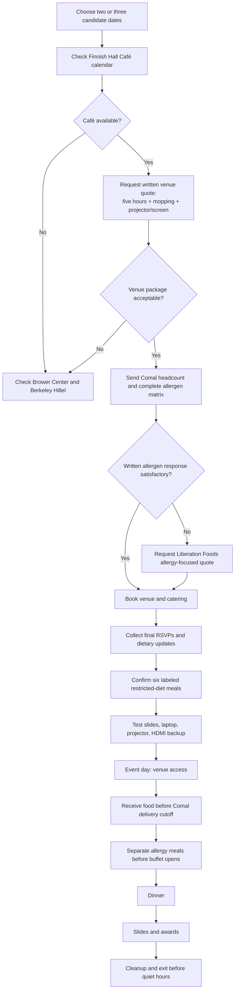

# End-of-Year Student Banquet Plan Near Berkeley, California

## Executive summary

For a roughly 30-person end-of-year student banquet, the strongest value combination I found is the **[Berkeley Finnish Hall — Café](https://www.finnishhall.org/cafe)** at **1970 Chestnut St., Berkeley, CA 94702**, paired with **[Comal Next Door Berkeley](https://www.comalnextdoor.com/catering/)** for a Mexican taco-bar dinner. The Café is significantly more economical than comparable Berkeley event venues, is food-friendly, accessible, has tables and chairs, high-speed Wi-Fi, an included 70-inch HDMI display, and — critically for the request — the Hall owns a **Vivitek D91x/D86x-series video projector and an 8-foot portable screen available for an additional rental charge**. The Café has an 80-person maximum capacity, so 30 seated guests fit comfortably. Special-event rental is published at **$50–$100/hour with a four-hour minimum**, plus a **$50–$100 food-event mopping fee**. [[1]](https://www.finnishhall.org/cafe)

The major venue caveat is alcohol: **Finnish Hall prohibits alcohol at all events**. Given that alcohol was left unspecified, this report assumes an alcohol-free student banquet. If alcohol later becomes a requirement, the venue recommendation must change. The Hall also asks users to observe Berkeley's 10 p.m. quiet period, so a proposed **4:30–9:30 p.m. rental** is operationally cleaner than a late-night schedule. [[1]](https://www.finnishhall.org/cafe)

For catering, Comal Next Door is attractive because it is in Berkeley, offers catering with no minimum order, delivers in the East Bay for a published **$50–$100 delivery fee**, and states that most catering items serve ten people; each Taco Bar kit supplies **20 street tacos, or approximately two per person for ten people**. Comal also states that much of its menu is gluten- and nut-free and that vegan choices are available, but it does **not** publicly promise an allergen-free kitchen. That distinction is important: the menu below is deliberately designed to omit the listed allergens, but final booking should be conditional on written ingredient and cross-contact confirmation from Comal for the six affected guests. [[2]](https://www.comalnextdoor.com/catering/)

My planning estimate is approximately **$1,735 all-in for 30 people**, including the venue, a conservative projector allowance, food, delivery, Comal's 15% service charge, and current Berkeley sales tax. A stress case allowing for **35 attendees, maximum published venue rates, an extra hour, higher AV allowance, maximum delivery fee, and a $250 allergy/last-minute reserve comes to about $2,655**, leaving roughly **$345 below the $3,000 hard cap**. Berkeley's current combined sales-tax rate is **10.25% effective October 1, 2026**; California treats mandatory restaurant/catering service charges as taxable gross receipts. [[3]](https://cdtfa.ca.gov/taxes-and-fees/rates.aspx)

**Recommendation:** book Finnish Hall Café + Comal only after receiving two written confirmations: **(a)** Finnish Hall's projector/screen charge keeps the venue package within approximately $900, and **(b)** Comal confirms ingredients and cross-contact procedures for egg, peanut/tree-nut, dairy, and shellfish allergies. If Comal cannot provide adequate reassurance for a medically severe allergy, the best catering fallback is **Liberation Foods**, whose Bay Area operation offers fully plant-based and allergen-conscious menus beginning around $25/person for streamlined drop-off catering. [[4]](https://liberationfoods.net/catering-oakland)

### Assumptions used

The estimates assume 30 attendees, with a stress case of 35; no transportation expense; approximately five hours of venue access in the base case; no alcohol; six distinct people with dietary restrictions unless the restrictions overlap; and “nuts” treated conservatively as **tree nuts plus peanuts** for menu planning. Availability is deliberately left open because no date was supplied. Comal's catering prices below use the most recent public catering listings I found as a **planning estimate**, because Comal's own catering FAQ currently publishes portions and delivery charges but not item-by-item catering prices. Final direct-order pricing must therefore be reconfirmed. [[5]](https://www.comalnextdoor.com/catering/)

## Recommended venue

### Berkeley Finnish Hall — Café

**Address:** 1970 Chestnut St., Berkeley, CA 94702  
**Venue page:** [Finnish Hall Café](https://www.finnishhall.org/cafe)  
**Policies / AV:** [Finnish Hall Policies & FAQ](https://www.finnishhall.org/policies)  
**Contact:** `finnish.hall@gmail.com` · (510) 845-5352. [[6]](https://www.finnishhall.org/cafe)

The Café measures **43 × 22 feet, 946 square feet**, and has an **80-person capacity**, with 14 folding tables and 80 folding chairs. The room has high-speed Wi-Fi and an included **70-inch LCD television with HDMI**, while the building separately offers a **Vivitek D91x/D86x-series projector and 8-foot portable screen for an additional fee**. That makes the projector the primary slide solution and the 70-inch HDMI display a useful backup if an AV issue occurs. [[1]](https://www.finnishhall.org/cafe)

The Café is particularly practical for catered food because it includes a substantial kitchen: six-burner Wolf range/griddle/oven, refrigerator/freezer, microwave ovens, coffee maker, dishwasher and table settings. Outside catering is permitted. The room is now reachable by an accessibility ramp. [[1]](https://www.finnishhall.org/cafe)

Published special-event pricing is **$50–$100/hour, four-hour minimum**, with the actual rate dependent on event characteristics such as group size, nonprofit status and food service. Any event serving food incurs an additional **$50–$100 mopping fee**. Use of the 70-inch television is included; the projector/screen price is not published and must be requested. [[1]](https://www.finnishhall.org/cafe)

### Recommended rental configuration

I would request **4:30–9:30 p.m.**, five hours total. This solves two logistical problems simultaneously: Comal currently lists catering delivery only through **5 p.m.**, and Finnish Hall is not designed for late-night parties because Berkeley quiet hours begin at 10 p.m. A 4:30 access time allows a 4:45–5:00 food delivery, AV testing before guests arrive, dinner around 5:45–6:00, slides/awards after dinner, and cleanup completed by 9:30. [[7]](https://www.comalnextdoor.com/catering/)

For budgeting, I would use:

| Venue component | Base planning figure | Stress-case figure |
|---|---:|---:|
| Café, 5 hours | $375 at assumed $75/hr | $500 at published maximum $100/hr |
| Food-event mopping | $75 | $100 |
| Projector + 8-ft screen | **$125 allowance** | **$200 allowance** |
| Extra sixth hour | — | $100 |
| **Venue total** | **$575** | **$900** |

The $125/$200 AV figures are **budget reserves, not published Finnish Hall quotes**. The room and mopping figures are grounded in the Hall's published ranges. Even if the projector costs somewhat more than assumed, there is substantial headroom under the overall cap. [[1]](https://www.finnishhall.org/cafe)

### Booking steps

First, check the Café's live availability calendar on the venue page; because the exact event date has not been selected, availability cannot yet be confirmed. Then email or call Finnish Hall with **two or three candidate dates**, specifying approximately 30 guests, a catered student banquet, 4:30–9:30 p.m., projector plus portable screen, and use of existing tables/chairs. Ask for one written all-in quote identifying the hourly room rate, food mopping charge, AV fee, payment/deposit terms, and any insurance requirement. Hall viewings are by appointment rather than drop-in. [[6]](https://www.finnishhall.org/cafe)

Before paying, obtain explicit confirmation that the projector is reserved for your date and ask what computer inputs/adapters it requires. The included 70-inch TV supports HDMI, but the Hall's public projector description does not specify the connector configuration, so whoever owns the presentation laptop should bring and test the necessary USB-C/HDMI or other adapter. [[1]](https://www.finnishhall.org/cafe)

Finally, make sure everyone understands that **no alcohol is permitted**. If organizers later decide alcohol is essential, do not attempt to negotiate around that rule; move to a different venue. [[8]](https://www.finnishhall.org/policies)

## Recommended caterer and menu

### Comal Next Door Berkeley

**Address:** 2024 Shattuck Ave., Berkeley, CA 94704  
**Catering:** [Comal Next Door Catering](https://www.comalnextdoor.com/catering/)  
**Berkeley location:** [CND Berkeley](https://www.comalnextdoor.com/location/comal-next-door-berkeley/)  
**Phone:** (510) 422-6625  
**Email:** `info@comalrg.com`. [[9]](https://www.comalnextdoor.com/location/comal-next-door-berkeley/)

Comal requires at least 24 hours' notice for normal catering orders, has **no catering minimum**, and charges **$50–$100 for nearby East Bay/San Francisco delivery**. For a year-end event I would not rely on the 24-hour minimum: place the order several weeks ahead, especially because the allergy conversation should be completed before payment. Comal says most catering items are sized for ten people, and a Taco Bar kit contains ingredients for 20 street tacos. [[2]](https://www.comalnextdoor.com/catering/)

The Berkeley location states that it adds a **15% service charge in lieu of tips**. Accordingly, this budget carries that mandatory service charge and sets additional gratuity at **$0**; there is no reason to budget a second percentage tip on top unless your organization voluntarily chooses to do so. California treats mandatory service charges as taxable. [[10]](https://www.comalnextdoor.com/location/comal-next-door-berkeley/)

### Proposed dinner for thirty

The menu intentionally makes the **whole buffet free of obvious egg, peanuts, tree nuts, dairy and shellfish**, rather than creating a risky “normal buffet plus one special corner.” The sole meat protein is achiote-grilled chicken, and the vegetarian protein is corn, zucchini and poblano chile. Comal's regular menu lists both as taco choices, while its catering setup materials describe a taco bar built around tortillas, protein, salsas, onions/cilantro, escabeche and lime rather than cheese/crema. [[11]](https://www.comalnextdoor.com/menu/cnd-berkeley-menu)

| Item | Quantity for 30 | Portion logic | Planning price |
|---|---:|---|---:|
| Achiote grilled chicken Taco Bar | 3 kits | 60 chicken street tacos | $285 |
| Corn, zucchini & poblano Taco Bar | 1 kit | 20 vegetarian street tacos | $95 |
| Black beans | 3 × 10-person trays | 30 servings | $90 |
| Red rice | 3 × 10-person trays | 30 servings | $90 |
| Chips + two salsas + guacamole | 3 × 10-person orders | 30 appetizer servings | $180 |
| Hibiscus lemonade / non-dairy agua fresca | 8 × 32 oz | ~256 oz, about 8.5 oz/person plus water | $40 |
| Compostable plates | 30 | One per attendee | $30 |
| Compostable utensil sets | 30 | One per attendee | $30 |
| Serving spoons/tongs | Allowance | Separate utensils by dish | $10 |
| **Food + disposables subtotal** |  |  | **$850** |

The taco-bar, side and disposable estimates use current publicly listed catering prices; Comal's official FAQ supplies the serving-size guidance, while direct pricing should be reconfirmed before booking. [[12]](https://www.ezcater.com/catering/comal-next-door-berkeley)

Eighty street tacos provides approximately **2.7 tacos per person**, on top of rice, beans, chips/guacamole and salsa. That is deliberately more generous than Comal's own taco-kit planning ratio of two tacos per person, giving some buffer for hungry student attendees without generating an excessive amount of food. [[2]](https://www.comalnextdoor.com/catering/)

I would **not** order Comal's cookies or a dairy-containing dessert for this event, and I would omit cheese, crema, fish and shrimp entirely. The restaurant's broader menu includes seafood and dairy-containing preparations, so merely selecting dishes that do not list those ingredients does not prove absence of kitchen cross-contact. [[13]](https://www.comalnextdoor.com/menu/cnd-oakland-menu/)

### Dietary accommodations

For the **two egg-allergy guests**, ask Comal to confirm in writing that the selected corn tortillas, chicken, vegetable filling, rice, black beans, guacamole and selected salsas have no egg ingredients and to describe shared-equipment exposure. Their portions should be individually packed and labeled in the kitchen before the communal buffet is assembled.

For the **two peanut-allergy guests**, the same selected menu can work only after Comal confirms the ingredient statements and cross-contact process. Comal says much of its menu is nut-free, but that is not the same as certifying a peanut-free facility. [[2]](https://www.comalnextdoor.com/catering/)

For the guest allergic to **dairy + nuts + shellfish**, request an individually sealed meal containing corn tortillas, the vegetable taco filling, black beans, red rice, guacamole and a confirmed-safe salsa, with **no cheese, crema or seafood** and separate preparation/packing utensils. Treat “nuts” conservatively as both peanuts and tree nuts until the guest clarifies otherwise.

For the **vegetarian guest**, the corn-zucchini-poblano taco bar plus black beans, rice, guacamole, salsa and chips gives a full meal rather than an afterthought. Comal lists corn, zucchini and poblano as a meatless taco option. [[14]](https://www.comalnextdoor.com/menu/cnd-berkeley-menu)

The important wording is **allergy-minimized**, not “guaranteed allergy-safe,” until the caterer answers the cross-contact questions. A restaurant can accurately describe a dish as nut-free by recipe while still operating equipment or preparation areas where allergens are present. Comal's public website does not make a dedicated allergen-free-kitchen guarantee. [[2]](https://www.comalnextdoor.com/catering/)

### What to send Comal

The catering inquiry should state, in one message:

> “This is a 30-person student banquet. We have 2 guests with egg allergy, 2 with peanut allergy, 1 guest with dairy + peanut/tree-nut + shellfish allergy, and 1 vegetarian guest. We want the entire buffet to omit egg, peanuts/tree nuts, dairy and shellfish wherever possible. Please confirm the ingredients and cross-contact risk for corn tortillas, achiote chicken, corn-zucchini-poblano filling, black beans, red rice, guacamole, chips and selected salsas. Can you pack six meals separately with clean utensils before the buffet order is assembled and label each meal by restriction?”

That written reply should be treated as a booking condition, not a courtesy.

## Budget and sensitivity analysis

### Base case

Using the published/current inputs above, the base budget is:

| Cost category | Calculation | Estimate |
|---|---:|---:|
| Finnish Hall Café | 5 hr × $75 planning rate | $375.00 |
| Food-event mopping | Planning midpoint | $75.00 |
| Projector + screen | Budget allowance; quote required | $125.00 |
| Food + beverages + disposables | Menu above | $850.00 |
| Delivery | Midpoint of published $50–$100 | $75.00 |
| Comal service charge | 15% × $850 | $127.50 |
| Tax | 10.25% × conservatively taxable $1,052.50 | $107.88 |
| Additional gratuity | Service charge is stated as in lieu of tips | $0.00 |
| **Estimated total** |  | **$1,735.38** |

The current Berkeley sales-tax rate is **10.25%**. For conservatism, the calculation taxes the food/disposables, delivery and mandatory service charge; CDTFA guidance specifically says catering food/preparation charges and mandatory service charges are taxable, while actual invoice tax treatment should be taken from the caterer's final quote. [[15]](https://cdtfa.ca.gov/taxes-and-fees/rates.aspx)

That leaves approximately **$764.62 below the preferred $2,500 budget** and **$1,264.62 below the $3,000 hard cap**.

### Stress case

A realistic stress test should ask what happens if attendance rises, the venue charges its maximum published hourly rate, the event needs an extra hour, delivery reaches the top of Comal's range, and special allergy packaging or substitute meals create extra expense.

For **35 people**, I would increase the catering order to five taco kits, four each of rice/beans/chips-guacamole, 40 place settings, and approximately ten 32-ounce beverages. That is approximately **$1,100 of menu/disposable cost**, before service charge and tax. Comal's published portion framework supports scaling in ten-person increments. [[5]](https://www.comalnextdoor.com/catering/)

| Stress-case category | Estimate |
|---|---:|
| Café, 6 hr at maximum $100/hr | $600.00 |
| Maximum mopping fee | $100.00 |
| Higher projector/screen allowance | $200.00 |
| Food/disposables for ~35 | $1,100.00 |
| Maximum published delivery fee | $100.00 |
| 15% service charge | $165.00 |
| 10.25% tax on assumed taxable catering total | $139.91 |
| Extra allergy / last-minute backup reserve | $250.00 |
| Additional gratuity | $0.00 |
| **Stress-case total** | **$2,654.91** |
| **Remaining below $3,000 hard cap** | **$345.09** |

The **$250 reserve is intentionally uncommitted**. It could absorb individually packaged replacement meals, extra ice/beverages, a pricing change, AV adapters, or a last-minute dietary issue. It should not be spent simply because it is available.

The financial conclusion is unusually strong: the recommended pairing is not merely under the $3,000 cap; the base plan is comfortably under the **$2,500 target**, and a fairly aggressive stress case still remains under the hard ceiling.

## Alternatives and trade-offs

### Alternative venues

| Venue | Fit for ~30 / AV | Evening suitability and estimated venue cost | Pros | Cons |
|---|---|---|---|---|
| **David Brower Center — Tamalpais Room**, 2150 Allston Way | Banquet capacity about 80; professional AV package includes projector, PA, laptop/connectivity and microphones | A quarter-day/≤4-hour college rate is about $590 plus ~$425 standard AV; with weekend surcharge, roughly **$1,115** before any required security/janitorial. If security and janitorial are triggered, planning cost can approach **$1,900+**. | Downtown Berkeley, polished event setting, professional AV | Far more expensive than Finnish Hall; security/janitorial requirements can threaten the cap; short rental block. [[16]](https://browercenter.org/event-room/tamalpais-room/) |
| **Berkeley Hillel — Bakar Auditorium & Banquet Room**, 2736 Bancroft Way | Built-in projector, speakers and microphones; 180 banquet capacity | Evening rentals are offered through its general rental program, but **pricing is quote-only**. I would impose a planning ceiling of **$800–$1,000** before committing. | Very close to campus; AV built in; tables/chairs setup and waste removal included | Vastly oversized for 30; no kitchen access for outside rentals; unpublished price introduces budget uncertainty. [[17]](https://berkeleyhillel.org/rentals/) |
| **Phoebe A. Hearst Museum of Anthropology**, UC Berkeley | 60 seated; projector, screen, PA/mics, Wi-Fi, chairs/tables and monitors included | Evening package 5–9 p.m.; **$2,400 weekday / $2,700 weekend for four hours** | Excellent built-in production package; memorable campus setting | Venue alone consumes nearly/all of budget; once catering is added it clearly exceeds the $3,000 cap. [[18]](https://hearstmuseum.berkeley.edu/rentals/) |

The **Brower Center** is the best upgrade if the student group values a more polished conference/event environment and can tolerate a substantially higher room cost. **Hillel** is worth a quote because its AV is built in and its location is excellent, but the unpublished rental rate prevents a firm budget conclusion. The **Hearst Museum** meets the technical requirements but should be rejected on cost for this project. [[19]](https://browercenter.org/event-room/tamalpais-room/)

Finnish Hall therefore wins not because it is the fanciest option, but because it preserves roughly **$1,000+ of financial headroom** for food, allergy safeguards and last-minute changes while still satisfying the projector/evening/seating requirements. [[1]](https://www.finnishhall.org/cafe)

### Alternative caterers

| Caterer | Approximate cost for 30 | Allergy position | Pros | Cons |
|---|---:|---|---|---|
| **[Market Hall Caterers](https://www.markethallcaterers.com/)**, Rockridge/Oakland | Published set menus ~$32–$34/person → **$960–$1,020 food**, roughly **$1,150–$1,400 all-in planning range** after delivery/tax/fees | Explicitly accommodates dairy-free, nut-free, vegetarian and other needs, **but explicitly says its kitchen is not nut-free and cross-contamination cannot be guaranteed** | Professional full caterer; extensive customization; close to Berkeley | More expensive; menu contains many nut/egg/dairy items, making a severe-allergy order more operationally complex. [[20]](https://markethallcaterers.com/about-us/faqs) |
| **[Picante Berkeley](https://picanteberkeley.com/party-planning)**, 1328 Sixth St. | Chicken Taco Party is $89 for 16–20 tacos; rice/beans $17.50/quart. A robust 30-person spread is roughly **$650–$850 before/around final fees and tax**, depending on sides | Dietary requests would need direct confirmation; I found no equivalent public cross-contact guarantee | Very local, inexpensive, crowd-friendly Mexican food | Allergy documentation is less explicit than Market Hall's; would require detailed ingredient/cross-contact call before use. [[21]](https://picanteberkeley.com/party-planning) |
| **[Liberation Foods](https://liberationfoods.net/catering-oakland)**, Oakland | Streamlined drop-off starts at about **$25/person**, so **~$750 starting food/service level**, with a practical ~$850–$1,100 planning range after tax/delivery/options | Offers fully plant-based, gluten-free and **allergen-conscious** menu options | A fully plant-based menu automatically removes egg, dairy and shellfish from the selected dishes; strongest fallback for this allergy profile | Exact menu and nut/peanut cross-contact protocol require custom quote; less transparent à-la-carte pricing than Comal. [[4]](https://liberationfoods.net/catering-oakland) |

**Liberation Foods is the strongest safety-oriented Plan B.** Selecting a fully plant-based menu would remove three problem categories — egg, dairy and shellfish — from the meal by design, leaving peanut/tree-nut control as the main allergen conversation. “Allergen-conscious” still does not equal a guaranteed nut-free facility, so written confirmation remains necessary. [[4]](https://liberationfoods.net/catering-oakland)

Market Hall is unusually transparent about its limitation: it can construct nut-free menus but explicitly cannot guarantee against cross-contamination because its kitchen is not nut-free. That makes it a good professionally managed option for dietary preferences and some allergies, but not automatically superior for a guest with a severe nut allergy. [[22]](https://markethallcaterers.com/about-us/faqs)

## Allergy and change contingency plan

The central risk in this event is **not budget; it is allergen cross-contact**. The financial plan has ample headroom, whereas a menu description alone cannot establish that shared pans, fryers, cutting boards, utensils or prep surfaces are safe for someone with a severe allergy.

### Before the order is binding

Ask each affected guest privately whether the stated allergy is a preference/intolerance, a physician-diagnosed allergy, or associated with prior anaphylaxis, without asking for unnecessary medical detail. For guests with diagnosed severe food allergies, use their own physician-provided emergency plan rather than inventing a student-group protocol. FARE recommends having an allergy/anaphylaxis emergency care plan and keeping prescribed epinephrine readily accessible; it also emphasizes reducing cross-contact through clean surfaces and separation practices. [[23]](https://www.foodallergy.org/resources/travel-tips-us)

Send Comal one written allergen matrix rather than making multiple phone calls. Require a reply before final payment covering ingredients, shared cooking surfaces/equipment, whether the selected salsa/beans/rice/tortillas contain hidden dairy/egg/nuts, and whether six meals can be packaged separately before the buffet is assembled. Comal itself directs customers with special dietary questions to contact it for menu advice. [[2]](https://www.comalnextdoor.com/catering/)

If the caterer says **“we cannot guarantee against cross-contact”** and any affected attendee reports a severe/anaphylactic allergy, do not treat individually boxed food from the same production line as magically safe. At that point, spend part of the $250 reserve on a separate meal from a provider whose kitchen practices that guest considers acceptable, or switch the entire order to a more allergy-oriented provider such as Liberation Foods. [[4]](https://liberationfoods.net/catering-oakland)

### At the banquet

The six separately packed meals should **never be placed on the public buffet**. Put them on a cleaned, designated table away from shared serving utensils and label them by restriction or guest name with permission. Clean food-service surfaces before setup, and do not let attendees move serving spoons between dishes; FARE/CDC-oriented food-allergy guidance specifically emphasizes preventing cross-contact and cleaning surfaces around food service. [[24]](https://www.foodallergy.org/resources/reducing-risk-exposure-food-allergens-cdc)

Have water, the attendee's own emergency medication and emergency contact information readily accessible. FARE states that epinephrine is the emergency treatment capable of stopping anaphylaxis and advises people with food allergies to discuss carrying it with their doctor; event organizers should call **911** for a suspected severe reaction and follow the affected person's emergency care plan. [[25]](https://www.foodallergy.org/our-initiatives/awareness-campaigns/ready-act)

### Last-minute attendance or menu changes

For a rise from 30 to roughly **35 guests**, add one taco kit, one additional tray each of rice/beans/chips-guacamole, and ten place settings. Because Comal's catering is structured largely in ten-person portions, this is operationally straightforward and is already represented in the $2,655 stress case. [[2]](https://www.comalnextdoor.com/catering/)

For a decline in attendance, do not remove the allergy meals or vegetarian supply first; reduce general chicken/side quantities instead. For a new allergy reported within the final week, do not improvise based on ingredient names — send the exact new allergen to Comal and obtain a written answer. Comal formally requires only 24 hours' lead time, but extra-large or unusual requests may need more. [[2]](https://www.comalnextdoor.com/catering/)

If the projector fails, use the Café's **included 70-inch HDMI television** for slides. If the presentation laptop cannot connect, keep the presentation as both PowerPoint and PDF on a second laptop/cloud drive and bring tested USB-C-to-HDMI and HDMI cables. The availability of the 70-inch HDMI display is confirmed by the venue; the adapter kit is a planning recommendation. [[6]](https://www.finnishhall.org/cafe)

If alcohol becomes desired after the booking process begins, the contingency is **not** to add a bartender: Finnish Hall explicitly prohibits alcohol. Re-open the venue search and verify alcohol, insurance and permit policies before changing the plan. [[8]](https://www.finnishhall.org/policies)

## Booking timeline and day-of workflow

### Practical timeline

**As soon as the date shortlist exists — ideally six to eight weeks before the banquet:** send two or three evening dates to Finnish Hall, request the Café + projector/screen quote, and simultaneously send Comal the complete allergen matrix. Finnish Hall publishes a live availability calendar; exact availability remains open until the date is selected. [[6]](https://www.finnishhall.org/cafe)

**About four weeks before:** sign/pay for the venue once the AV charge is known; place the catering order once the written allergen response is satisfactory; collect final RSVPs with a field asking attendees to disclose dietary restrictions directly to one designated organizer.

**About two weeks before:** finalize the seating/table layout, determine who will run slides, send Comal the working headcount, confirm six separately labeled restricted-diet meals, and test the presentation laptop with HDMI.

**Three to five days before:** lock the final headcount, reconfirm the 4:45–5:00 p.m. delivery, verify that the venue's projector and screen are on the reservation, print the catering ingredient/allergen correspondence, and assign one person — not the presenter — to receive the food. Comal's official minimum notice is 24 hours, but a banquet with multiple allergies should be finalized earlier. [[2]](https://www.comalnextdoor.com/catering/)

**Day of:** target venue access at 4:30 p.m.; AV test immediately; receive catering by 5 p.m.; isolate the separately packed allergy meals before public buffet setup; open doors around 5:30; dinner around 5:45–6:00; slides/awards around 6:45–7:00; begin cleanup by 8:45–9:00; and exit by 9:30, comfortably before the venue's 10 p.m. neighborhood quiet constraint. [[7]](https://www.comalnextdoor.com/catering/)

Taken together, the plan's strongest feature is **margin**. Finnish Hall keeps fixed costs low enough that the organizers do not have to choose between a projector, adequate portions and allergy contingencies. The base plan of about **$1,735** leaves substantial room under the $2,500 target, while the approximately **$2,655 stress case** remains below the $3,000 hard cap. The two unresolved variables — exact date availability and the unpublished Finnish Hall projector fee — can both be resolved with a single venue inquiry, while the principal nonfinancial go/no-go question is whether Comal's written cross-contact answer is adequate for the actual severity of the listed allergies. [[26]](https://www.finnishhall.org/cafe)
