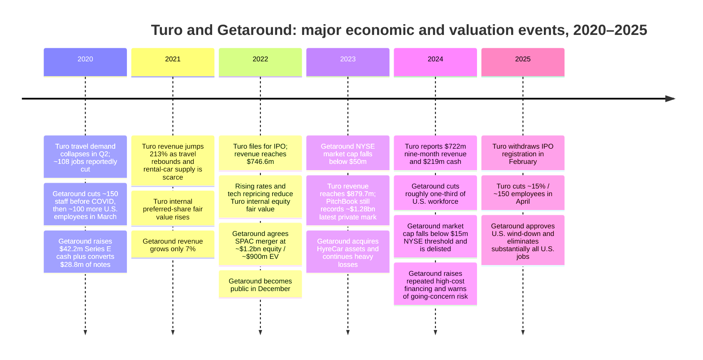
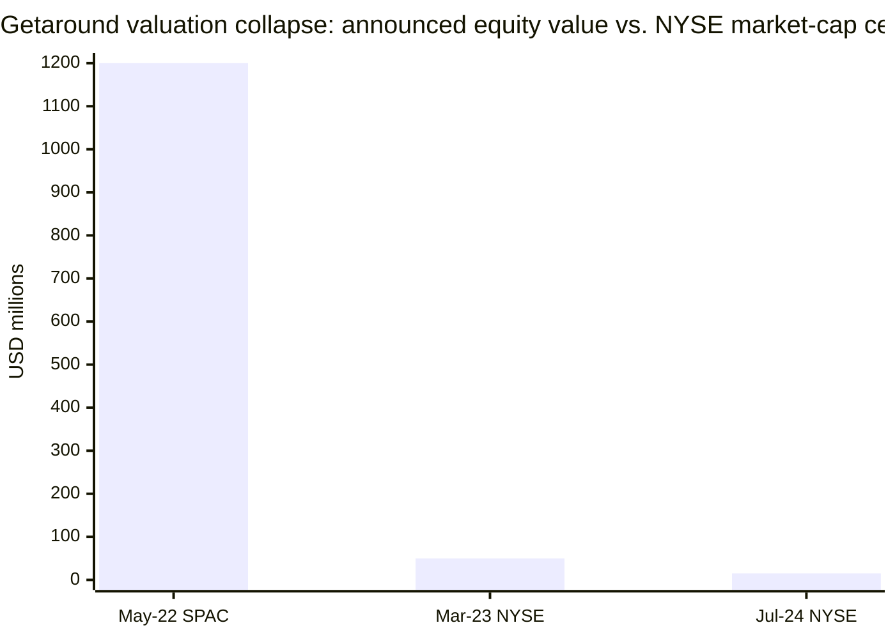
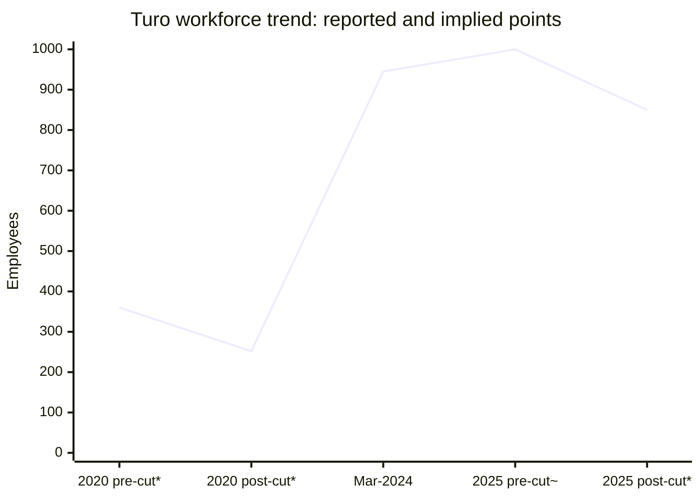

# Turo vs. Getaround: Valuation, Financial Performance, and Workforce, 2020–2025

## Executive summary

Turo and Getaround entered 2020 as superficially similar venture-backed U.S. peer-to-peer car-sharing companies, but by the end of 2025 their economic outcomes had diverged dramatically.

**Turo became the structurally stronger business.** Its net revenue rose from $149.9 million in 2020 to $469.0 million in 2021, $746.6 million in 2022, and $879.7 million in 2023; the last public filing showed another 8% year-over-year increase to $722.0 million for the first nine months of 2024. Turo generated positive contribution profit from 2020 onward and, despite volatility in insurance costs, had $219.1 million of cash at September 2024 and positive operating cash flow during the first nine months of that year. [[1]](https://www.sec.gov/Archives/edgar/data/1514587/000162828024047889/turoinc-sx1a12.htm)

**Getaround followed the opposite trajectory.** Revenue was only $58.7 million in 2020 and $63.1 million in 2021, remained $59.5 million in 2022, and reached $72.7 million in 2023—partly because of its acquisition of HyreCar assets. Against that revenue, Getaround lost roughly $136.1 million in 2022 and $113.9 million in 2023. By September 2024 it still had a $58.5 million nine-month net loss and had burned $44.8 million of operating cash in nine months. [[2]](https://www.sec.gov/Archives/edgar/data/1839608/000119312522251383/d319747ds4a.htm)

The valuation contrast is even sharper. Getaround announced its 2022 SPAC merger at approximately **$1.2 billion of equity value and $900 million of enterprise value**. By March 2023, the New York Stock Exchange said its average market capitalization had fallen below $50 million; by July 2024 it had fallen below the exchange's $15 million threshold, prompting suspension and eventual delisting. Those thresholds imply losses of **more than 95.8% and 98.75%**, respectively, relative to the announced $1.2 billion transaction value. [[3]](https://www.sec.gov/Archives/edgar/data/1839608/000119312522147020/d289503dex991.htm)

Turo did **not** suffer an observable public-market collapse because it never completed its IPO. Its latest widely cited priced private valuation remained around $1.2–$1.3 billion, dating ultimately to the 2019 financing era; PitchBook was still listing about $1.28 billion as the latest private-market valuation in March 2023. Turo itself disclosed that the estimated fair value of its preferred/common stock **declined during 2022** because comparable-company valuations fell, market conditions worsened, volatility increased, and the probability of a liquidity event declined. That is strong evidence of valuation compression, but it is not the same thing as a new priced funding round. [[4]](https://techcrunch.com/2023/03/27/turo-getaround-ipo-valuations/)

Turo eventually withdrew its IPO registration on **February 13, 2025** and cut roughly **15% of its workforce, about 150 jobs, in April 2025**. Getaround had already cut about one-third of its U.S. workforce in early 2024 and in February 2025 decided to wind down its U.S. business and eliminate substantially all remaining U.S. jobs. [[5]](https://www.sec.gov/Archives/edgar/data/1514587/000162828025005472/turo-formrw.htm)

For investors, the central lesson is that **the same macroeconomic shock produced two very different outcomes because the underlying unit economics and balance sheets were different**. Turo's marketplace had sufficient scale and positive contribution economics to survive both COVID and the 2022–24 capital-market reset. Getaround's gross-margin presentation looked attractive, but insurance, operations, support, technology, and administrative costs consumed far more than the business generated, forcing repeated debt/equity financing and eventually a U.S. shutdown. [[6]](https://www.sec.gov/Archives/edgar/data/1514587/000162828024047889/turoinc-sx1a12.htm)

## How to read the valuations and business models

A few definitions are important for readers unfamiliar with U.S. venture capital.

A **private-company valuation** normally comes from a funding round: an investor buys newly issued shares at an agreed price, implying a value for the entire company. That valuation can become stale for years if the company does not raise another priced round. A **secondary transaction**, by contrast, is generally an existing shareholder—often an employee or early investor—selling shares; unless the share price, capital structure and fully diluted share count are disclosed, it may be impossible to derive a reliable company valuation from the transaction.

A **SPAC** is a publicly listed shell company that merges with a private operating company. The announced valuation is a negotiated transaction value, not a guarantee that public investors will continue to value the company at that amount. Getaround illustrates that distinction exceptionally clearly: its $1.2 billion announced SPAC equity value collapsed to less than $50 million of public-market capitalization within months. [[7]](https://www.sec.gov/Archives/edgar/data/1839608/000119312522147020/d289503dex991.htm)

**Market capitalization** is share price multiplied by shares outstanding. **Enterprise value** approximately equals equity value plus net debt and is intended to measure the value of the operating business independent of financing. Getaround's announcement distinguished its roughly $1.2 billion equity value from approximately $900 million of enterprise value. [[8]](https://www.sec.gov/Archives/edgar/data/1839608/000119312522189756/d319747ds4.htm)

### Business-model comparison

| Dimension | Turo | Getaround |
|---|---|---|
| Core model | Marketplace connecting private/professional vehicle hosts with renters; Turo generally does not own the cars | Peer-to-peer marketplace, historically emphasizing connected/keyless urban car sharing through proprietary Getaround Connect hardware |
| Typical use case | Multi-day travel, leisure, airport/destination rentals; broad vehicle variety | Historically more urban and shorter-duration use, with instant/keyless access; later expanded gig-driver supply through HyreCar |
| Capital intensity | Relatively asset-light; hosts supply vehicles | Also host-supplied, but heavier operational complexity from connected-car hardware, installation, parking, claims/support and fragmented geography |
| Main variable economic risks | Insurance/protection claims, payment processing, guest acquisition, host incentives | Claims/support, hardware/installation, parking and operations, customer acquisition, geographic density |
| Scale indicator | 160,000 active vehicle listings and 1.3 million active guests were disclosed for 2021; press reports said roughly 340,000 vehicle listings by 2025 | Company promoted coverage of 1,000 cities in 2022, but no comparable audited active-vehicle series is publicly available |
| 2023 revenue | $879.7m | $72.7m |
| 2023 profitability | $14.7m GAAP net income; $48.8m adjusted EBITDA | ≈$113.9m GAAP net loss |
| Principal advantage | Much greater marketplace liquidity and brand/network scale | Connected-car technology and strong historic European urban presence |
| Principal risk | Insurance economics, regulation, host/guest acquisition costs, delayed IPO/liquidity | Persistent cash burn, debt burden, insufficient U.S. scale, delisting/liquidity |

Turo's 2023 top line was therefore roughly **12 times Getaround's**, a useful scale proxy where no authoritative apples-to-apples U.S. market-share dataset exists. I would not assign an exact U.S. peer-to-peer market-share percentage to either company from the available public evidence. [[9]](https://www.sec.gov/Archives/edgar/data/1514587/000162828024047889/turoinc-sx1a12.htm)

## Timeline of economic and valuation events

### Event-by-event economic impact

| Date | Company | Event | Economic effect | Valuation implication |
|---|---|---|---|---|
| Q2 2020 | Turo | COVID disrupts travel; marketing spending paused and headcount temporarily reduced | Q2 revenue fell to $24.0m from $35.0m in Q1; cost cutting followed | No priced financing occurred, so there was no observable new private valuation, but operating risk rose sharply. [[10]](https://www.sec.gov/Archives/edgar/data/1514587/000162828024047889/turoinc-sx1a12.htm) |
| Jan–Mar 2020 | Getaround | Roughly 150 jobs cut in an initial restructuring, then about 100 U.S. jobs during the COVID shock | Major attempt to reduce an oversized cost structure | Evidence that financial pressure pre-dated COVID; valuation was not publicly re-priced because company remained private. [[11]](https://www.autofinancenews.net/allposts/technology/softbank-backed-startup-getaround-begins-staff-cuts/) |
| Sep–Oct 2020 | Getaround | Series E financing | $42.2m of new cash at $3.84/share; another $28.8m of outstanding notes converted into Series E | Capital was available, but complex warrants and preferred-stock terms prevent a clean public post-money valuation calculation. [[12]](https://www.sec.gov/Archives/edgar/data/1839608/000119312522189756/d319747ds4.htm) |
| 2021 | Turo | U.S. travel rebound plus conventional rental-car shortage | Revenue rose 213%; booked days +185% and price/day +31% | Turo said higher travel-demand forecasts increased the estimated fair value of preferred shares; warrant revaluation produced an $85.2m accounting loss. [[13]](https://www.sec.gov/Archives/edgar/data/1514587/000162828024047889/turoinc-sx1a12.htm) |
| Jan 2022 | Turo | Public S-1 filed | IPO created prospective employee/investor liquidity | No price range was ultimately set, so no defensible IPO valuation was established. [[14]](https://www.sec.gov/Archives/edgar/data/1514587/000119312522005696/d145731ds1.htm) |
| 2022 | Turo | Public-tech valuations fall as rates rise | Revenue still increased 59%, but market multiples compressed | Turo explicitly attributed its 2022 internal share-value decline to lower peer valuations, higher market volatility, worse capital markets and lower probability of a liquidity event. [[15]](https://www.sec.gov/Archives/edgar/data/1514587/000119312523078252/d145731ds1a.htm) |
| May–Dec 2022 | Getaround | SPAC announced and completed | Transaction provided public listing and debt financing, although redemptions sharply reduced SPAC cash available | Announced equity value ≈$1.2bn; enterprise value ≈$900m. [[16]](https://www.sec.gov/Archives/edgar/data/1839608/000119312522147020/d289503dex991.htm) |
| Mar 2023 | Getaround | NYSE compliance failure | Average global market cap fell under $50m | >95.8% below the $1.2bn announced SPAC equity value. [[17]](https://www.sec.gov/Archives/edgar/data/1839608/000095017024038301/getr-20231231.htm) |
| 2023 | Turo | Revenue growth slows to 18%; rental market normalizes | Price per day declined as alternative mobility supply recovered | PitchBook still listed ~$1.28bn as latest private-market value, but this should be treated as a stale/latest-recorded private mark, not proof of a fresh 2023 round. [[18]](https://www.sec.gov/Archives/edgar/data/1514587/000162828024036158/turoinc-sx1a11.htm) |
| Feb–Jul 2024 | Getaround | Restructuring plus repeated financings | Cost cuts failed to eliminate cash burn; new capital increased creditor seniority and dilution risk | NYSE 30-day average market cap fell below $15m in July, implying >98.75% destruction relative to the SPAC's announced equity value. [[19]](https://markets.financialcontent.com/worldnow.wgem/news/publisher/getaround) |
| Sep 2024 | Getaround | OTC-listed distressed equity | Stock used in its warrant valuation was $0.06; company disclosed substantial doubt about going concern | Equity was economically distressed while secured debt became the dominant source of capital. [[20]](https://www.sec.gov/Archives/edgar/data/1839608/000095017024126782/getr-20240930.htm) |
| Feb 2025 | Turo | IPO registration withdrawn | Public-market liquidity for shareholders and employees postponed indefinitely | No public-market valuation established; a private-company liquidity discount remained appropriate. [[21]](https://www.sec.gov/Archives/edgar/data/1514587/000162828025005472/turo-formrw.htm) |
| Feb 2025 | Getaround | U.S. wind-down approved | Substantially all U.S. employment eliminated; European business retained | U.S. operating franchise had little or no residual standalone equity value; creditor recovery became more relevant than headline equity valuation. [[22]](https://www.globenewswire.com/news-release/2025/02/12/3024676/0/en/getaround-inc-announces-wind-down-of-u-s-operations.html) |
| Apr 2025 | Turo | ~15% workforce reduction | About 150 roles eliminated despite much stronger liquidity than Getaround | Suggests management optimization after IPO cancellation/economic uncertainty rather than a Getaround-style solvency crisis. [[23]](https://www.linkedin.com/posts/turo_turo-april-2025-activity-7323426269335896064-SMGi) |

## Valuation and financing evidence

### Valuation record

Turo has an important data-quality problem: **there is no reliable annual valuation series** because it stayed private. A private company's last financing price can remain unchanged on databases even while its true economic value rises or falls.

| Date | Turo valuation evidence | Confidence / interpretation |
|---|---|---|
| 2019 baseline | Series E commonly reported at about **$1.2–$1.25bn**, accompanying IAC's $250m investment | High as a historical benchmark, although immediately before requested period. SEC filings confirm the Series E financing structure; secondary research places valuation around $1.25bn. [[24]](https://www.sec.gov/Archives/edgar/data/1514587/000119312522005696/d145731ds1.htm) |
| 2020 | No disclosed new priced primary-equity round | No defensible transaction valuation; COVID probably reduced perceived value temporarily, but that is inference rather than a priced mark. [[25]](https://www.sec.gov/Archives/edgar/data/1514587/000119312522236530/d145731ds1a.htm) |
| 2021 | Internal accounting fair value of preferred stock increased | Directionally strong evidence of higher valuation, not an investable transaction price. Turo said its forecasts increased with travel demand. [[26]](https://www.sec.gov/Archives/edgar/data/1514587/000162828024047889/turoinc-sx1a12.htm) |
| 2022 | Internal preferred/common-stock fair value declined | Official evidence of a valuation markdown; Turo cites peer-company valuation declines, volatility, market conditions and reduced IPO probability. [[27]](https://www.sec.gov/Archives/edgar/data/1514587/000162828024047889/turoinc-sx1a12.htm) |
| Mar 2023 | PitchBook latest private-market value: **~$1.28bn** | Medium confidence as a database reference; may reflect the latest known priced round rather than a fresh March 2023 trade. [[28]](https://techcrunch.com/2023/03/27/turo-getaround-ipo-valuations/) |
| Mar 2023 | A private-market database reports a roughly **$67.5m secondary share purchase** | Low-to-medium valuation usefulness: without public price/share-count details it cannot produce a reliable fully diluted valuation. [[29]](https://www.premieralts.com/companies/turo/funding-rounds) |
| 2024 | Some brokerage/IPO commentary estimated **~$2.7bn** | **Low confidence**. This was a speculative model/estimate, not a disclosed funding round, tender offer or IPO price. It should not be used as a hard valuation. [[30]](https://www.forex.com/en-au/news-and-analysis/turo-ipo-everything-you-need-to-know-about-turo/) |
| Feb 2025 | IPO withdrawn without pricing | No public valuation was crystallized. [[21]](https://www.sec.gov/Archives/edgar/data/1514587/000162828025005472/turo-formrw.htm) |

A useful illustration is the difference between operating growth and valuation multiples. Using the historical ~$1.25 billion private mark, Turo was valued at roughly **8.8× 2019 revenue** of $141.7 million. Using PitchBook's ~$1.28 billion latest-recorded mark against 2023 revenue would imply only about **1.45× revenue**. That does **not** prove the equity value fell—the 2023 mark may be stale—but it shows how radically Turo's revenue base expanded while venture/public-market revenue multiples compressed. [[31]](https://www.sec.gov/Archives/edgar/data/1514587/000162828024047889/turoinc-sx1a12.htm)

Getaround, in contrast, provides a true public-market repricing:

| Date | Getaround valuation evidence | Interpretation |
|---|---|---|
| Sep–Oct 2020 | $42.2m Series E cash financing at $3.84/share plus $28.8m note conversion | No clean public post-money valuation because of complex preferred classes/warrants. [[12]](https://www.sec.gov/Archives/edgar/data/1839608/000119312522189756/d319747ds4.htm) |
| May 11, 2022 | SPAC transaction announced at **~$1.2bn equity value / ~$900m enterprise value** | Negotiated transaction valuation. [[32]](https://www.sec.gov/Archives/edgar/data/1839608/000119312522147020/d289503dex991.htm) |
| Dec 8, 2022 | Business combination completed | Getaround becomes publicly priceable; financing included substantial convertible-debt capital. [[33]](https://www.sec.gov/Archives/edgar/data/1839608/000119312523024353/d599529ds1.htm) |
| Jan 2023 | NYSE says share price averaged below $1 | First formal exchange warning of valuation collapse. [[17]](https://www.sec.gov/Archives/edgar/data/1839608/000095017024038301/getr-20231231.htm) |
| Mar 2023 | Average global market cap **< $50m** | More than **95.8% below** the $1.2bn transaction equity value. [[17]](https://www.sec.gov/Archives/edgar/data/1839608/000095017024038301/getr-20231231.htm) |
| Dec 2023 | Debt valuation assumptions imply ~50% market yield on Mudrick convertible notes | Evidence creditors demanded distressed-level returns. [[34]](https://www.sec.gov/Archives/edgar/data/1839608/000095017024038301/getr-20231231.htm) |
| Jul 2024 | 30-day average market cap **< $15m** | More than **98.75% below** $1.2bn; NYSE suspended trading. [[35]](https://www.sec.gov/Archives/edgar/data/1839608/000095017024126782/getr-20240930.htm) |
| Aug 16, 2024 | NYSE delisting became effective | Reduced liquidity, investor base and access to conventional public equity capital. [[35]](https://www.sec.gov/Archives/edgar/data/1839608/000095017024126782/getr-20240930.htm) |
| Sep 30, 2024 | Common-stock reference price **$0.06** | With public warrants carrying an $11.50 exercise price, market expectations for common equity were exceptionally weak. [[36]](https://www.sec.gov/Archives/edgar/data/1839608/000095017024126782/getr-20240930.htm) |
| Feb 2025 | U.S. operations wind-down | No meaningful exchange-traded market-cap benchmark remained; solvency and creditor claims mattered more than a headline equity value. [[22]](https://www.globenewswire.com/news-release/2025/02/12/3024676/0/en/getaround-inc-announces-wind-down-of-u-s-operations.html) |

**Chart caveat:** $50 million and $15 million are *ceilings*, not exact market capitalizations: NYSE said the company's rolling average was **below** those values. The actual decline was therefore even larger than the bars show. [[37]](https://www.sec.gov/Archives/edgar/data/1839608/000095017024038301/getr-20231231.htm)

### Funding and capital raised during the period

| Date | Company | Financing | Amount / terms | Why it mattered |
|---|---|---|---|---|
| Sep–Oct 2020 | Getaround | Series E | $42.2m cash at $3.84/share; $28.8m notes converted at $3.84/share; associated warrants | Financed survival/recovery during COVID but added a complex preferred/warrant structure. [[12]](https://www.sec.gov/Archives/edgar/data/1839608/000119312522189756/d319747ds4.htm) |
| Nov 2020–Feb 2021 | Getaround | Horizon term debt | $18m initially, then $7m additional; 10.5% interest | Demonstrates increasing reliance on debt. [[38]](https://www.sec.gov/Archives/edgar/data/1839608/000119312522292093/d416454d424b3.htm) |
| Oct 2021 | Getaround | Deutsche Bank term loan | $75m; roughly 10–12% interest depending on period/terms | Expensive capital even before the 2022 rate shock. [[38]](https://www.sec.gov/Archives/edgar/data/1839608/000119312522292093/d416454d424b3.htm) |
| 2022 | Getaround | SPAC + Mudrick financing | SPAC transaction at $1.2bn equity valuation; financial statements subsequently show only about $15.7m of net reverse-recapitalization cash but substantial Mudrick convertible-note proceeds | Heavy SPAC redemptions meant the headline valuation did not translate into equivalent cash for operations. [[39]](https://www.sec.gov/Archives/edgar/data/1839608/000119312522147020/d289503dex991.htm) |
| Jan 2024 | Getaround | Additional financing | $20m announced | Needed to extend runway. [[40]](https://markets.financialcontent.com/worldnow.wgem/news/publisher/getaround) |
| May 2024 | Getaround | Additional financing commitment | Up to $50m | Continued dependence on external capital. [[40]](https://markets.financialcontent.com/worldnow.wgem/news/publisher/getaround) |
| Jul 2024 | Getaround | Mudrick financing | Additional $20m commitment plus plan to convert $10m of existing convertible debt at $0.25/share | Capital arrived alongside delisting pressure; implied large dilution/distress. [[40]](https://markets.financialcontent.com/worldnow.wgem/news/publisher/getaround) |
| First 9m 2024 | Getaround | Aggregate financing cash flow | $60.9m net cash provided by financing activities | Without financing, $44.8m operating cash burn would have rapidly depleted liquidity. [[41]](https://www.sec.gov/Archives/edgar/data/1839608/000095017024126782/getr-20240930.htm) |
| 2020–2025 | Turo | Primary equity | **No material new priced primary-equity round publicly disclosed** | Turo largely financed growth internally after its 2019 Series E, materially reducing refinancing risk versus Getaround. Its 2024 filing instead showed positive operating cash flow and an unused/revolving credit facility. [[42]](https://www.sec.gov/Archives/edgar/data/1514587/000162828024047889/turoinc-sx1a12.htm) |

## Financial performance, cash, and unit economics

### Key financial metrics

USD millions except margins.

| Metric | 2020 | 2021 | 2022 | 2023 | 2024 available period |
|---|---:|---:|---:|---:|---:|
| **Turo net revenue** | 149.9 | 469.0 | 746.6 | 879.7 | 722.0, 9m (+8% YoY) |
| Turo GAAP net income/(loss) | (97.1) | (40.4) | 154.7 | 14.7 | 19.4, 9m |
| Turo operating income/(loss) | (55.7) | 46.6 | 33.8 | 13.7 | (9.7), 9m |
| Turo contribution margin | 11.5% | 37.6% | 28.9% | 25.4% | 21.7%, 9m |
| Turo operating cash flow | (41.2) | 108.0 | 41.0 | (31.7) | +19.2, 9m |
| Turo period-end cash | — | 245.3 | 301.0 | 214.0 | 219.1 at Sep. 30 |
| **Getaround total revenue** | 58.7 | 63.1 | 59.5 | 72.7 | Q3: 22.4; 9m service revenue 57.2 |
| Getaround GAAP net loss | n/a here | n/a here | ≈(136.1) | ≈(113.9) | (58.5), 9m |
| Getaround operating cash flow | n/a | n/a | (132.5) | (56.1) | (44.8), 9m |
| Getaround period-end cash | 49.9 | 62.5 | 64.3 | 15.6 | 30.8 at Sep. 30 |
| Getaround service gross margin | n/a | n/a | n/a | n/a | 87% for 9m |
| Getaround trip contribution profit | n/a | n/a | n/a | n/a | 27.2 for 9m |

Turo figures are from the company's SEC filings; Getaround 2020–21 revenue and 2022–24 figures are from its merger registration statement, 10-K and 10-Q. [[43]](https://www.sec.gov/Archives/edgar/data/1514587/000162828024047889/turoinc-sx1a12.htm)

Two accounting qualifications materially change the interpretation.

First, Turo's **$154.7 million 2022 net profit should not be treated as $154.7 million of recurring operating profit**. Operating income was only $33.8 million. Net earnings benefited from a $50.7 million gain caused by the falling accounting value of its preferred-stock warrant liability and a $64.2 million income-tax benefit. [[44]](https://www.sec.gov/Archives/edgar/data/1514587/000162828024047889/turoinc-sx1a12.htm)

Similarly, Turo remained GAAP-profitable in the first nine months of 2024 at $19.4 million even though it reported a $9.7 million operating loss; interest income and a $16.0 million warrant-value gain helped. Adjusted EBITDA was $25.6 million, down from $47.6 million a year earlier. Turo said much of the deterioration reflected unusually favorable insurance-reserve development in 2023 that normalized in 2024. [[45]](https://www.sec.gov/Archives/edgar/data/1514587/000162828024047889/turoinc-sx1a12.htm)

Second, Getaround's **87% service gross margin is misleading if viewed in isolation**. During the first nine months of 2024, operations/support costs alone were 73% of revenue, G&A 66%, sales/marketing 24%, and technology/product development 21%. Claims and support expenses sit outside the narrow gross-margin definition, so attractive service gross profit never translated into company-level profitability. [[46]](https://www.sec.gov/Archives/edgar/data/1839608/000095017024126782/getr-20240930.htm)

### Turo's unit-economics trajectory

Turo's contribution margin—its measure of the economics of an incremental booking after directly attributable costs—improved from **11.5% in 2020 to 37.6% in 2021**, then normalized to 28.9% in 2022, 25.4% in 2023 and 21.7% for the first nine months of 2024. The declining post-2021 margin reflects lower price-per-day as the conventional mobility market normalized, together with insurance/protection costs. [[47]](https://www.sec.gov/Archives/edgar/data/1514587/000162828024047889/turoinc-sx1a12.htm)

That trend is important: Turo is not a software marketplace with near-zero marginal cost. Insurance and host-protection claims are economically substantial. In the first nine months of 2024, cost of net revenue rose 23% even though revenue rose only 8%, primarily because liability-insurance costs increased by $54.1 million as 2023's unusually favorable loss development normalized. [[48]](https://www.sec.gov/Archives/edgar/data/1514587/000162828024047889/turoinc-sx1a12.htm)

Nevertheless, Turo's marketplace demonstrated that it could fund itself. It generated $108.0 million of operating cash in 2021, $41.0 million in 2022 and $19.2 million in the first nine months of 2024. At September 2024 it had $219.1 million cash plus restricted cash and told investors that existing liquidity was sufficient for at least the following 12 months and beyond. [[49]](https://www.sec.gov/Archives/edgar/data/1514587/000162828024047889/turoinc-sx1a12.htm)

### Getaround's runway problem

Getaround reduced its annual operating cash burn from **$132.5 million in 2022 to $56.1 million in 2023**, a substantial improvement, but ended 2023 with only $15.6 million of unrestricted cash. A simple, non-management estimate—$15.6 million divided by the 2023 average operating burn of roughly $4.7 million per month—would imply only about **3.3 months of runway** if nothing changed. In reality, Getaround repeatedly raised new financing during 2024, so that simple calculation should not be read as a literal bankruptcy date. [[50]](https://www.sec.gov/Archives/edgar/data/1839608/000095017024038301/getr-20231231.htm)

By September 30, 2024, financing had replenished cash to $30.8 million, but Getaround had burned $44.8 million from operations in nine months, or about **$5.0 million per month** on a simple average basis. That corresponds to roughly **6.2 months of cash** at an unchanged burn rate. More importantly, management explicitly disclosed “substantial doubt” about its ability to continue as a going concern and said additional funding would be necessary. [[51]](https://www.sec.gov/Archives/edgar/data/1839608/000095017024126782/getr-20240930.htm)

The February 2025 U.S. shutdown was therefore not simply a reaction to a low stock price. The low valuation and delisting were symptoms of a deeper problem: **the operating business continuously consumed more cash than it generated, while new capital had become expensive and increasingly senior to common shareholders**. [[52]](https://www.sec.gov/Archives/edgar/data/1839608/000095017024126782/getr-20240930.htm)

## Workforce and macroeconomic effects

### Headcount and layoffs

| Date | Turo | Getaround |
|---|---|---|
| Early 2020 | Reportedly cut **108 employees, about 30%**; implied pre-cut workforce ≈360 and post-cut ≈252. These two totals are estimates derived from the reported percentage/count, not company disclosures. [[53]](https://techcrunch.com/2021/08/09/car-sharing-startup-turo-has-filed-confidentially-for-an-ipo/) | Before COVID, roughly **150 employees / 25% of staff** were reportedly targeted, implying ~600 pre-cut. In March another ~100 U.S. employees were cut as COVID hit. The second cut is U.S.-specific, so a global post-cut total cannot be reliably reconstructed. [[11]](https://www.autofinancenews.net/allposts/technology/softbank-backed-startup-getaround-begins-staff-cuts/) |
| Dec 2022 | No comparable audited total located | **283 full-time employees.** [[54]](https://www.sec.gov/ixviewer/ix.html?doc=%2FArchives%2Fedgar%2Fdata%2F1839608%2F000095017023064515%2Fgetr-20221231.htm) |
| Dec 2023 | No comparable audited total located | **~290 employees worldwide.** [[55]](https://www.sec.gov/ix?doc=%2FArchives%2Fedgar%2Fdata%2F0001839608%2F000119312524152114%2Fd599529ds1a.htm) |
| Mar 31 2024 | **945 full-time employees** across six countries. [[56]](https://www.sec.gov/Archives/edgar/data/1514587/000162828024024022/turoinc-sx1a10.htm) | Early-2024 restructuring cut roughly **one-third of U.S. workforce**; exact worldwide post-cut headcount was not publicly disclosed. [[57]](https://techcrunch.com/startup-battlefield/company/getaround/) |
| Feb 2025 | — | U.S. wind-down: **substantially all U.S. employees** to be eliminated; European operations continued. Exact global remaining total was not disclosed. [[58]](https://www.globenewswire.com/news-release/2025/02/12/3024676/0/en/getaround-inc-announces-wind-down-of-u-s-operations.html) |
| Apr 2025 | **~15%, about 150 employees** cut from a workforce described as nearly 1,000, implying roughly 850 afterward. The ~850 figure is an estimate, not a company-reported post-layoff count. [[23]](https://www.linkedin.com/posts/turo_turo-april-2025-activity-7323426269335896064-SMGi) | — |

`*` denotes a value inferred from the reported layoff count/percentage; `~` denotes press description (“nearly 1,000”), not a precise company disclosure. [[59]](https://techcrunch.com/2021/08/09/car-sharing-startup-turo-has-filed-confidentially-for-an-ipo/)

The data do **not** support saying that valuation declines mechanically “caused” layoffs. Valuation is largely an outcome of expected cash flow and financing conditions. The causal sequence was more often: weaker demand or poor unit economics → cash preservation/restructuring → lower investor valuation → harder financing → further restructuring.

That distinction is particularly important for Turo. Its April 2025 reduction came after the IPO was abandoned, but Turo said the cut was motivated by “ongoing economic uncertainty” and strengthening the company for long-term growth, while press reports described its financial position as strong. It was therefore a strategic cost reset, not evidence of imminent insolvency. [[23]](https://www.linkedin.com/posts/turo_turo-april-2025-activity-7323426269335896064-SMGi)

For Getaround, the relationship was much tighter: persistent losses forced repeated financing; expensive financing and dilution hurt equity value; falling market capitalization caused NYSE delisting; continued cash burn produced a going-concern warning; and the U.S. business was finally wound down. [[60]](https://www.sec.gov/Archives/edgar/data/1839608/000095017024126782/getr-20240930.htm)

I found **no sufficiently reliable public evidence of a formal company-wide hiring freeze** at either company during the period, so I would not insert one into the timeline.

### COVID, supply chains, vehicle prices and interest rates

**COVID initially hurt both businesses, but the rebound disproportionately favored Turo.** Turo's second-quarter 2020 net revenue fell to $24.0 million, but domestic travel began recovering in Q3. In 2021 its booked days increased 185% and price per day rose 31%; management explicitly attributed the surge to vaccine availability, removal of travel restrictions, increased consumer comfort with travel and a shortage of conventional rental cars. [[26]](https://www.sec.gov/Archives/edgar/data/1514587/000162828024047889/turoinc-sx1a12.htm)

The vehicle market reinforced that effect. U.S. Bureau of Labor Statistics data show that **used-car and truck prices were 45.2% higher year-over-year in June 2021**, the largest 12-month rise then recorded. The unusual vehicle shortage was associated with supply-chain and semiconductor constraints; by June 2023 used-car prices were 5.2% below their year-earlier level, and BLS reported a 7.1% decline across 2023, indicating normalization. [[61]](https://www.bls.gov/news.release/archives/cpi_07132021.htm)

That normalization was a mixed blessing. During the shortage, conventional rental fleets had fewer vehicles and high prices, making Turo unusually attractive to guests and allowing hosts to charge more. Once rental and used-car markets normalized in 2022–23, Turo's price per day declined and revenue growth decelerated from 213% in 2021 to 59% in 2022 and 18% in 2023. [[62]](https://www.sec.gov/Archives/edgar/data/1514587/000162828024047889/turoinc-sx1a12.htm)

Supply-chain disruptions also made vehicle repairs more expensive, which matters because car-sharing platforms absorb significant claims and protection-program costs. Getaround disclosed higher claims expenses associated with repair-cost inflation, while Turo's filings repeatedly identify insurance and protection-plan claim severity as major components of cost of revenue. [[63]](https://www.sec.gov/Archives/edgar/data/1839608/000119312522292093/d416454d424b3.htm)

**Interest rates explain much of the valuation compression after 2021.** The Federal Reserve began raising its policy-rate target in March 2022 and reached **5.25–5.50% by July 2023**, after a series of unusually rapid increases. Higher interest rates increase investors' required returns and make distant future profits less valuable in present-value terms; they also make debt financing more expensive. [[64]](https://www.federalreserve.gov/monetarypolicy/openmarket.htm)

Turo's own filing essentially confirms this mechanism without requiring external speculation: it said its 2022 preferred/common-stock fair value fell because comparable-company valuations weakened, market volatility increased, U.S./global capital-market conditions deteriorated and a liquidity event became less likely. [[27]](https://www.sec.gov/Archives/edgar/data/1514587/000162828024047889/turoinc-sx1a12.htm)

For Getaround, the higher-rate environment was more dangerous because it was already dependent on debt. Its 2023 valuation assumptions used an approximately **50% market yield** on Mudrick convertible debt—far above normal corporate borrowing rates—showing that creditors viewed the company as highly risky. [[34]](https://www.sec.gov/Archives/edgar/data/1839608/000095017024038301/getr-20231231.htm)

## Competitive position and principal risks

### Why Turo proved more resilient

**Network scale is the largest structural advantage.** Marketplace businesses become more useful as more sellers and buyers participate: travelers get more vehicle choice, while hosts see more potential renters. Turo's revenue scale and reported listings suggest a substantially denser marketplace than Getaround's, although no credible public dataset permits a precise U.S. market-share percentage. [[65]](https://www.sec.gov/Archives/edgar/data/1514587/000162828024047889/turoinc-sx1a12.htm)

**Turo's economics work at the transaction level.** Contribution profit was positive even in 2020 and reached $223.1 million in 2023. That means incremental bookings generally added economic value after direct booking costs, although the margin declined after the exceptional 2021 environment. [[66]](https://www.sec.gov/Archives/edgar/data/1514587/000162828024047889/turoinc-sx1a12.htm)

**Turo did not need continual external capital to remain alive.** It had more than $200 million of cash through 2023–24, a revolving credit facility and positive operating cash flow in the first nine months of 2024. This gave management the option to postpone an IPO rather than accept a low public-market valuation. [[67]](https://www.sec.gov/Archives/edgar/data/1514587/000162828024047889/turoinc-sx1a12.htm)

Its central vulnerability is **insurance/claims volatility**. Turo is sometimes described as an asset-light software marketplace, but the filing data show that protection and liability costs are economically central. The deterioration of contribution margin from 37.6% in 2021 to 21.7% in the first nine months of 2024 is a warning that scale does not automatically create software-like margins. [[68]](https://www.sec.gov/Archives/edgar/data/1514587/000162828024047889/turoinc-sx1a12.htm)

The delayed IPO also matters to employees. Turo disclosed large amounts of stock compensation associated with restricted stock units whose recognition depended in part on a qualifying liquidity event such as an IPO. Abandoning the IPO did not make those awards worthless, but it postponed the main path by which employees could convert private-company equity into liquid public shares. [[69]](https://www.sec.gov/Archives/edgar/data/1514587/000162828024024022/turoinc-sx1a10.htm)

### Why Getaround's model failed to scale in the United States

Getaround's connected-car technology was strategically differentiated: it could enable instantaneous access without a physical key handoff. But its filings show the cost of maintaining the broader ecosystem—hardware, customer service, claims, parking and geographically dispersed operations. [[70]](https://www.sec.gov/Archives/edgar/data/1839608/000095017024126782/getr-20240930.htm)

The clearest unit-economic warning is that **2023 revenue of $72.7 million supported more than $65 million of operations/support expense, $51 million of G&A and additional technology and marketing spending**. Even after significant restructuring, operations/support remained 73% of revenue during the first nine months of 2024. [[71]](https://www.sec.gov/Archives/edgar/data/1839608/000095017024038301/getr-20231231.htm)

The 22% reported revenue growth in 2023 also overstates underlying momentum. Getaround attributed **$19.3 million of incremental revenue to HyreCar**, while total company revenue increased by only about $13.2 million from 2022. That implies, directionally, that the pre-HyreCar business contracted rather than expanded, although acquisition accounting and product mix mean the simple subtraction should be treated as an approximation. [[72]](https://www.sec.gov/Archives/edgar/data/1839608/000095017024038301/getr-20231231.htm)

The SPAC exacerbated rather than solved the problem. The $1.2 billion headline valuation did not mean Getaround had $1.2 billion in cash; public shareholders could redeem their SPAC shares instead of participating in the merger. Getaround consequently emerged as a listed company still dependent on expensive convertible financing. Once equity value collapsed, raising common equity became highly dilutive, leaving secured creditors with increasing economic influence. [[73]](https://www.sec.gov/Archives/edgar/data/1839608/000119312522251383/d319747ds4a.htm)

| Strategic factor | Turo | Getaround | Assessment |
|---|---|---|---|
| Marketplace scale | Large and rapidly expanded | Much smaller U.S. revenue base | Strong Turo advantage |
| Transaction economics | Positive contribution profit | Positive trip contribution, but overhead/support overwhelmed it | Turo advantage |
| Balance-sheet resilience | >$200m cash; sometimes cash-generative | Persistent cash burn; repeated financings | Major Turo advantage |
| Technology differentiation | Marketplace/risk/pricing platform | Proprietary connected-car/keyless technology | Getaround advantage, but insufficient economically |
| Geographic complexity | U.S. plus selected international markets | U.S. plus substantial European footprint | Getaround complexity raised execution burden |
| Insurance exposure | High and volatile | High and operationally intensive | Risk for both |
| Access to capital | Could defer IPO | Needed repeated high-cost capital | Major Turo advantage |
| Employee equity liquidity | Private and illiquid; IPO postponed | Public but value collapsed and later OTC/delisted | Poor for both, for different reasons |
| 2025 outcome | Remains operating, privately held; cost reset | U.S. operations wound down | Decisive Turo advantage |

## Takeaways for investors and employees

### For investors

The most important conclusion is **not** simply that Turo was “worth more” than Getaround. Public and private valuations are not directly comparable: Getaround was continuously marked by a liquid public market, while Turo's private valuation could remain stale. A private company can therefore appear stable on paper while its real market-clearing value changes substantially.

What is comparable is operating performance. On that basis Turo was overwhelmingly stronger. In 2023 it generated about **$880 million of net revenue and $14.7 million of GAAP net income**, versus Getaround's **$72.7 million of revenue and roughly $113.9 million loss**. Turo had enough liquidity to decline unfavorable IPO conditions; Getaround needed financing merely to continue operating. [[74]](https://www.sec.gov/Archives/edgar/data/1514587/000162828024047889/turoinc-sx1a12.htm)

Turo should nevertheless not be valued like a high-margin pure software company. Insurance and protection programs consume substantial revenue, contribution margins fell as pandemic distortions normalized, and 2022/2024 GAAP profits contained important non-operating fair-value and tax effects. The more defensible valuation approach would therefore emphasize normalized contribution profit, operating cash flow and claims-adjusted EBITDA rather than a simple revenue multiple. [[75]](https://www.sec.gov/Archives/edgar/data/1514587/000162828024047889/turoinc-sx1a12.htm)

For Getaround, the lesson is that a negotiated venture/SPAC valuation can become almost irrelevant when a company lacks self-sustaining economics. The collapse from a $1.2 billion deal value to a sub-$50 million public-market capitalization in less than a year was not simply “market irrationality”: persistent losses, substantial redemptions, high-cost debt, weak legacy growth and cash-burn risk supplied fundamental reasons for the repricing. [[76]](https://www.sec.gov/Archives/edgar/data/1839608/000095017024038301/getr-20231231.htm)

### For employees

Turo employees experienced **liquidity risk rather than primarily solvency risk**. The 2025 IPO withdrawal postponed the easiest route to sell employee equity, and the subsequent 15% layoff demonstrated that even a cash-rich private company can resize when its expected growth path or financing strategy changes. Employees evaluating private-company compensation should therefore discount RSUs/options for both the uncertainty of valuation and the uncertainty of when shares can actually be sold. [[77]](https://www.sec.gov/Archives/edgar/data/1514587/000162828024024022/turoinc-sx1a10.htm)

Getaround employees experienced both **valuation risk and business-continuity risk**. A public listing technically created liquidity, but the collapse to $0.06 per share by September 2024 destroyed most of the economic value associated with equity granted around SPAC-era prices. Repeated restructurings culminated in elimination of substantially all U.S. jobs in 2025. [[78]](https://www.sec.gov/Archives/edgar/data/1839608/000095017024126782/getr-20240930.htm)

### Bottom line

Over 2020–2025, Turo converted a severe COVID shock into a much larger, substantially self-financing marketplace, while Getaround never achieved sufficient U.S. scale to cover its operating structure. The pandemic-era rental-car shortage temporarily made the economics of car sharing unusually favorable; normalization and the Federal Reserve's 2022–23 rate increases then exposed which business could survive without abundant cheap capital. Turo could. Getaround could not. [[79]](https://www.sec.gov/Archives/edgar/data/1514587/000162828024047889/turoinc-sx1a12.htm)

The strongest quantitative summary is therefore:

| End-state comparison | Turo | Getaround |
|---|---:|---:|
| 2023 revenue | **$879.7m** | **$72.7m** |
| 2023 GAAP net income/(loss) | **+$14.7m** | **≈−$113.9m** |
| Latest 2024 cash disclosed | **$219.1m** | **$30.8m** |
| 2024 operating cash flow available | **+$19.2m, 9m** | **−$44.8m, 9m** |
| Valuation outcome | Private; no priced IPO, latest reliable historical/private mark ≈$1.2–1.3bn | $1.2bn SPAC equity value → < $15m NYSE 30-day market-cap threshold |
| Workforce end-state | ~15% reduction in 2025 but business continues | Substantially all U.S. employment eliminated in 2025 |
| U.S. operating outcome | Continued operation | U.S. business wound down |

The Turo figures are based principally on SEC S-1 amendments through September 2024 and subsequent company/press disclosures; the Getaround figures are based on SEC merger filings, 10-K/10-Q filings and the company's 2025 wind-down announcement. Where a number is derived rather than directly reported—particularly Turo private valuation estimates, implied post-layoff headcount, Getaround runway and SPAC-to-market-cap percentage declines—it has been explicitly labeled as an estimate or calculation rather than an official company figure. [[80]](https://www.sec.gov/Archives/edgar/data/1514587/000162828024047889/turoinc-sx1a12.htm)
