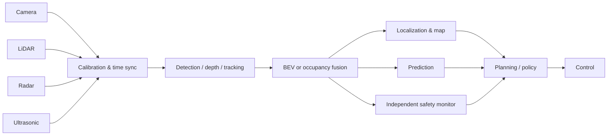

# Why Autonomous-Vehicle Architectures Split Between LiDAR-Centric and Camera/Neural-Network-Centric Designs

## Executive summary

The industry debate is often framed incorrectly as **“LiDAR versus neural networks.”** In practice, LiDAR-centric systems also rely heavily on neural networks, while camera-centric systems still use geometric constraints, temporal reconstruction, maps, calibration, and other non-learned components. The real architectural choice is how much **direct metric sensing and heterogeneous physical redundancy** to buy in hardware versus how much **3D inference, robustness, and redundancy** to obtain through learned software and fleet-scale data. Waymo, Aurora, GM/Cruise, and Mobileye’s higher-automation products retain LiDAR/radar/camera combinations; Tesla’s deployed FSD (Supervised) is camera-centric and explicitly remains driver-supervised. [[1]](https://waymo.com/waymo-driver/)

LiDAR’s central advantage is that it measures 3D range directly, with high geometric precision independent of visible-light illumination. Cameras provide far richer texture, color, lane, sign, traffic-light, and semantic information per dollar, but monocular metric depth is inferred rather than directly measured. Radar contributes direct range and Doppler velocity and is comparatively robust in rain/fog; ultrasonic sensing is useful only in the near field. No modality eliminates weather, occlusion, contamination, calibration, or long-tail failure modes. [[2]](https://microvision.com/sensors/iris)

The strongest architecture therefore depends on the **operational design domain (ODD), autonomy level, and business model**. For mass-market supervised L2/L2+ systems, camera/NN-centric designs have compelling manufacturing and scaling economics. For driverless urban L4 or high-speed autonomous trucking, the absence of a human fallback and the cost of rare perception errors make heterogeneous active sensing and independent safety channels more attractive. Mobileye’s “True Redundancy” is a useful middle ground: a camera world model plus an independently capable radar/LiDAR world model. [[3]](https://www.mobileye.com/blog/camera-first-approach-for-assisted-autonomous-driving/)

## Scope and assumptions

This brief assumes a **road-going passenger vehicle or Class-8 truck**, rather than low-speed sidewalk robots; a primarily **U.S. regulatory environment**; and deployment in mixed urban/suburban/highway conditions unless otherwise stated. “LiDAR-centric” means that LiDAR supplies a primary metric-geometry input, not that cameras or neural networks are absent. “Camera/NN-centric” means cameras and learned perception provide the principal environmental model; it does not imply a literal pixels-to-steering model with no intermediate representation.

The U.S. framework is broadly safety/performance oriented rather than prescribing one sensor architecture: NHTSA’s current AV framework includes ADS/L2 crash-reporting and exemption mechanisms, while ISO 26262 addresses hazards from malfunctioning E/E systems and ISO 21448 SOTIF addresses hazards arising from functional or performance insufficiencies in complex sensors and algorithms. Thus, **either architecture must establish a safety case for its actual ODD and failure envelope**. [[4]](https://www.nhtsa.gov/vehicle-safety/automated-vehicle-safety)

## Sensor modality trade-offs

Published specifications are not strictly apples-to-apples: stated range depends on target reflectivity, illumination, weather, field of view, and detection criterion. The figures below are therefore **representative product specifications**, not intrinsic limits of each technology. [[5]](https://microvision.com/sensors/iris)

| Modality | Representative performance | Principal strength | Principal weakness / failure pattern | Cost-system implication |
|---|---|---|---|---|
| **LiDAR** | IRIS: 280 m instrumented range, 4 cm 1σ range precision at 50 m/10% reflectivity, 1–30 Hz, 120°×26° FoV. [[6]](https://microvision.com/sensors/iris) | Direct, metrically accurate 3D geometry; works without visible illumination | Fog/rain/spray scatter and attenuate returns; water droplets can create false points/false obstacles. [[7]](https://arxiv.org/html/1912.03874v2) | Highest added hardware/integration burden: packaging, cleaning, calibration, power and BOM; cost is falling enough that Waymo reduced sensor count while retaining LiDAR. [[8]](https://waymo.com/blog/2024/08/meet-the-6th-generation-waymo-driver) |
| **Monocular / multicamera** | Bosch example: 8 MP, up to 300 m claimed range, ±60° horizontal FoV; Tesla uses multi-camera video and BEV networks. [[9]](https://www.bosch-mobility.com/de/loesungen/kamera/multifunktionskamera/) | Highest semantic density: color, markings, signs, lights, object appearance; mature mass-production ecosystem | Metric depth must be inferred; glare, darkness, rain, dirt and faded markings can reduce performance. Tesla explicitly warns of camera obstruction/environmental degradation. [[10]](https://www.tesla.com/ownersmanual/modely/en_us/GUID-E5FF5E84-6AAC-43E6-B7ED-EC1E9AEB17B7.html) | Low sensor BOM and good manufacturability, but shifts expenditure toward compute, data, training and validation. Mobileye explicitly cites capability/cost as its camera-first rationale. [[11]](https://www.mobileye.com/blog/camera-first-approach-for-assisted-autonomous-driving/) |
| **Stereo / multi-view camera** | Depth from disparity, Structure-from-Motion and temporal parallax; Bosch combines SfM, stereo disparity, classic CV and AI. [[12]](https://www.bosch-mobility.com/de/loesungen/kamera/multifunktionskamera/) | Adds geometric depth without active ranging; uses inexpensive camera hardware | Depth uncertainty generally worsens with distance, low texture and poor visibility; sensitive to calibration | Attractive compromise where camera hardware is already required, at the cost of greater calibration/compute complexity |
| **Radar / imaging radar** | ARS548 example: 0.2–300 m, up to ±70° azimuth, ±20° elevation, ±200 km/h velocity range. [[13]](https://www.continental-automotive.com/en/components/radars/industrial-radar-sensors.html) | Direct range plus Doppler velocity; relatively robust to fog, rain, snow and lighting changes | Lower fine spatial/semantic resolution than optical sensing; multipath/clutter can create ambiguous or ghost returns | Moderate-cost diversity sensor with particularly high value for longitudinal/highway safety |
| **Ultrasonic** | Bosch: ~0.15–5.5 m; ~14 g sensor. [[14]](https://www.bosch-mobility.com/media/global/solutions/passenger-cars-and-light-commercial-vehicles/driver-assistance-systems/construction-zone-assist/ultrasonic-sensor/ultraschallsensor_product_onepager_en.pdf) | Cheap, simple near-field obstacle ranging | Essentially unsuitable for long-range/high-speed perception | Best for parking and low-speed close-object coverage |

Controlled adverse-weather experiments find that **all three principal modalities can degrade**, but LiDAR information loss is markedly stronger than radar in heavy fog/rain; radar datasets likewise demonstrate resilience where cameras and LiDAR become difficult to use. Conversely, cameras retain uniquely valuable semantic information and LiDAR normally provides much sharper 3D geometry than automotive radar. This is why heterogeneous sensing is complementary rather than simply redundant. [[15]](https://arxiv.org/abs/2305.01336)

There is also no meaningful universal “camera false-negative rate” or “LiDAR false-positive rate.” Those are functions of detector, target class, range, threshold and ODD. Benchmarks such as nuScenes therefore use precision–recall/mAP plus translation, scale, orientation and velocity errors; its results also show that the ranking of image- and LiDAR-based methods can change with the matching metric. Safety validation should consequently stratify misses and false obstacles by **distance, class, weather, occlusion and severity**, rather than report one sensor-level number. [[16]](https://arxiv.org/html/1903.11027v5)

## Perception stacks, fusion, mapping, and data

A modular AV stack typically separates sensing/calibration, perception and tracking, localization, prediction, planning and control. Camera detectors may perform segmentation, object detection and learned depth; LiDAR networks operate on point clouds/voxels; radar supplies range-rate tracks; localization combines inertial/GNSS data with visual, LiDAR or radar landmarks and maps. Bosch, for example, combines classical vision, optical flow/SfM, stereo and neural networks; its camera system also extracts stationary landmarks for HD-map layers. [[17]](https://www.bosch-mobility.com/de/loesungen/kamera/multifunktionskamera/)

Modern fusion increasingly occurs in a common bird’s-eye-view or occupancy representation rather than by merely concatenating final object lists. BEVFusion, for example, preserves complementary LiDAR geometry and camera semantics in a shared BEV and reported higher nuScenes detection/map-segmentation performance with substantially reduced view-transformation latency. Aurora explicitly uses **early fusion** across FirstLight LiDAR, imaging radar and cameras. [[18]](https://arxiv.org/abs/2205.13542)

Camera-centric architectures push more work into learning. Tesla documents per-camera networks for segmentation, detection and monocular depth and multi-camera BEV networks that infer road layout, infrastructure and 3D objects. Pure end-to-end systems can go further by mapping observations into trajectories/policies, reducing hand-designed interfaces, but their learned representations make causal debugging, distribution-shift analysis and component-level safety arguments harder. The distinction remains gradual rather than binary. [[19]](https://www.tesla.com/en_in/AI)

The data cost is substantial for either approach. Waymo’s public dataset alone contains 390,000 perception frames, 12.6 million LiDAR 3D boxes, 11.8 million camera 2D boxes, more than 20 million motion frames, and a separate 5,000-segment camera end-to-end dataset—and Waymo says these releases are only a fraction of its training data. Simulation is similarly central: Waymo reports over 20 billion simulated miles for replaying, modifying and synthesizing difficult scenarios. [[20]](https://waymo.com/open/about/)

## Company choices and business logic

| Company / program | Architecture | Stated or observable rationale |
|---|---|---|
| **Waymo** | Multimodal L4: sixth generation has **13 cameras, 4 LiDAR, 6 radar**. [[8]](https://waymo.com/blog/2024/08/meet-the-6th-generation-waymo-driver) | LiDAR supplies 3D geometry, cameras semantics, radar range/speed and bad-weather robustness; Waymo reduced hardware count/cost rather than removing sensing diversity. Sixth-gen fully autonomous operation began in 2026. [[21]](https://waymo.com/waymo-driver/) |
| **Tesla FSD (Supervised)** | Camera-centric; multi-camera learned perception/BEV. [[22]](https://www.tesla.com/en_in/AI) | Hardware simplicity and software/fleet scalability are attractive for mass production, but Tesla still characterizes the deployed product as **supervised, not autonomous**. [[23]](https://www.tesla.com/support/fsd) |
| **Mobileye** | Camera-first, with independent radar/LiDAR channel for higher automation | Cameras are favored for cost/capability; “True Redundancy” gives camera and radar/LiDAR channels separate world models. Mobileye argues this improves MTBF and decomposes validation burden. [[24]](https://www.mobileye.com/blog/camera-first-approach-for-assisted-autonomous-driving/) |
| **Aurora** | Long-range LiDAR + imaging radar + high-resolution cameras, early fusion | Highway trucking rewards extreme look-ahead: Aurora states its current FirstLight system can see 1,000 m, corresponding to >34 s planning horizon at highway speed. [[25]](https://aurora.tech/) |
| **Cruise / GM lineage** | Cruise’s documented robotaxi stack used LiDAR, radar and cameras; GM’s current eyes-off architecture retains all three | GM explicitly contrasts its redundant multimodal design with vision-only systems and uses real-world data plus high-fidelity simulation for rare/hazardous cases. [[26]](https://news.gm.com/home.detail.html/Pages/news/us/en/2025/oct/1022-AI-GM-launch-eyes-off-driving-conversational-AI.html) |

The economic split follows the deployment model. **Mass-market supervised driving** rewards low BOM, easy packaging, fleet-wide data capture and over-the-air iteration—strong incentives for camera-heavy architectures. **Driverless robotaxis** can amortize expensive sensing over utilization and have no human fallback, so extra sensing diversity has greater safety value. **Autonomous highway trucking** particularly values long-range LiDAR/radar because braking and planning horizons grow with speed; Aurora’s hardware strategy reflects that requirement. [[27]](https://www.mobileye.com/blog/three-reasons-camera-first-adas-enables-scalable-automated-driving/)

## Safety, failure modes, and architecture recommendations

The principal common-cause failures are more important than nominal benchmark accuracy. Fog/rain/spray can corrupt optical and LiDAR sensing; glare and darkness disproportionately challenge cameras; all line-of-sight sensors suffer occlusion; mud, snow or condensation can block apertures; calibration drift damages cross-sensor fusion; and learned detectors can fail on rare or out-of-distribution objects. LiDAR rain filtering, radar cross-checking, online calibration, sensor-health monitoring, active cleaning, confidence gating, conservative fallback trajectories, ODD restriction and scenario simulation are therefore architectural necessities rather than optional refinements. [[28]](https://arxiv.org/abs/2310.00944)

ISO 21448 is especially relevant because nominally functioning perception can still be unsafe when specification or sensor/algorithm performance is insufficient; ISO 26262 separately addresses malfunctioning E/E behavior. A credible validation program therefore needs component tests, fault injection, closed-course testing, statistically meaningful real-world exposure, simulation of rare events, weather/contamination testing and post-deployment monitoring. A neural architecture does not eliminate these obligations, and adding LiDAR does not by itself establish safety. [[29]](https://www.iso.org/standard/77490.html)

**Recommendation:** choose a **camera/NN-centric architecture** when the product is supervised L2/L2+, manufacturing cost and fleet scalability dominate, the ODD is reasonably bounded, and a vigilant human remains the fallback. Use stereo/multi-view geometry, temporal BEV/occupancy estimation and radar where affordable to limit the consequences of monocular depth and visibility failures. Tesla and Mobileye’s lower-level systems demonstrate the economic logic of this approach. [[30]](https://www.tesla.com/support/fsd)

Choose a **LiDAR-centric multimodal architecture** for unattended L4 robotaxis, high-speed driverless trucking, difficult night operation, or applications where accurate long-range free-space/obstacle geometry must remain available without visible-light assumptions. The strongest case is not LiDAR alone but **LiDAR + cameras + imaging radar**, with graceful degradation when any modality becomes unreliable. Waymo, Aurora and GM all retain this diversity for higher-autonomy systems. [[31]](https://waymo.com/blog/2026/02/ro-on-6th-gen-waymo-driver)

The most defensible **hybrid** is therefore camera-rich semantic perception plus direct LiDAR geometry, Doppler-capable imaging radar, and an independently implementable safety path. A learned BEV/occupancy fusion layer can exploit complementary information during normal operation, while a separately validated channel—conceptually similar to Mobileye’s True Redundancy—prevents one fused model or one sensor physics failure from becoming a single point of failure. This costs more hardware, but for truly driverless operation it provides the clearest route to combining neural-network scalability with physically diverse safety evidence. [[32]](https://arxiv.org/abs/2205.13542)
