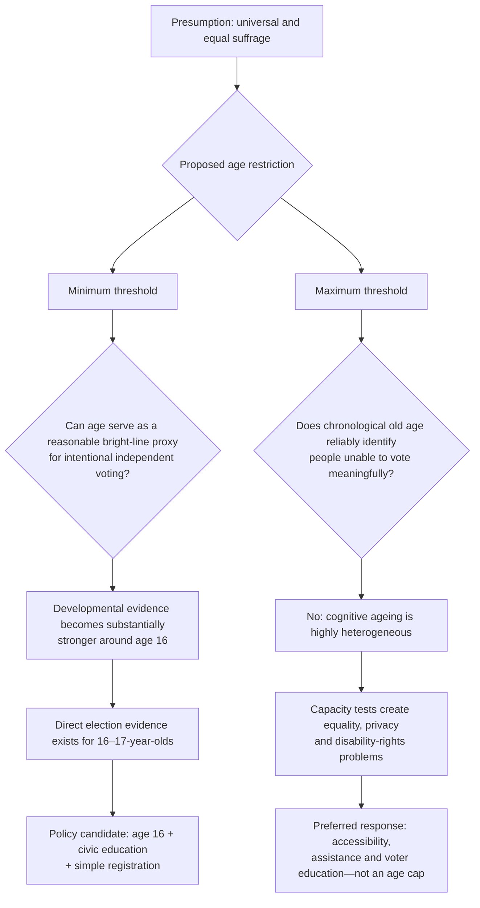

# Age Limits for Voting: Democratic Principles, Cognitive Evidence, Intergenerational Equity, and Comparative Law

## Executive Summary

The case for **a minimum voting age is substantially stronger than the case for a maximum voting age**, but the evidence does not establish age 18 as a uniquely correct threshold. International human-rights law starts from universal and equal suffrage while permitting reasonable, objective restrictions such as a minimum age. The UN Human Rights Committee has treated minimum-age rules as potentially legitimate, whereas restrictions based on education, literacy, disability, or similarly exclusionary criteria face much stronger scrutiny. [[1]](https://www.ohchr.org/en/instruments-mechanisms/instruments/international-covenant-civil-and-political-rights)

The empirical literature likewise points to an important asymmetry. A large multinational developmental study of 5,227 people aged 10–30 found that the cognitive capacities underlying logical, deliberative decisions reached adult levels at approximately **age 16**, while psychosocial maturity in emotionally arousing or risky situations continued developing beyond 18. That finding does not prove that every 16-year-old is a competent voter, but neither does it provide a scientific justification for treating 18 as a sharp cognitive boundary. [[2]](https://pubmed.ncbi.nlm.nih.gov/30762417/) Direct electoral research from Austria is broadly consistent with this conclusion: 16- and 17-year-olds did not make systematically lower-quality vote choices than older voters, although their participation was not uniformly high. [[3]](https://pmc.ncbi.nlm.nih.gov/articles/PMC4020373/) Malta's first local elections with the franchise extended to 16-year-olds also recorded a substantial 62.3% turnout among the 16–18 group. [[4]](https://electoral.gov.mt/elections)

By contrast, there is **no scientifically defensible chronological point at which older adults as a class cease to be capable voters**. Ageing increases the risks of dementia and some forms of cognitive impairment, but WHO emphasizes that changes in mental and physical capacity are neither linear nor consistent and are only loosely associated with chronological age. Dementia is more common after 65 but is not a normal or inevitable consequence of ageing. [[5]](https://www.who.int/news-room/fact-sheets/detail/dementia) Decision-science research similarly finds heterogeneous age effects: older adults perform worse on some cognitively demanding tasks but equal to or better than younger adults on others because knowledge, experience, emotional regulation, and decision strategies can compensate for declines in processing speed or working memory. [[6]](https://pmc.ncbi.nlm.nih.gov/articles/PMC4362707/) An upper voting age of 70, 75, 80, or any other fixed number would therefore exclude many demonstrably competent people while leaving untouched younger people with comparable impairments.

Nor does misinformation provide a convincing basis for an upper age limit. In a prominent study of the 2016 U.S. election, Facebook users over 65 shared nearly seven times as many links from fake-news domains as the youngest users. [[7]](https://www.science.org/doi/10.1126/sciadv.aau4586) Yet sharing behavior is not the same as believing misinformation or being unable to make a meaningful electoral choice; other experimental work has found much more qualified age effects on truth discernment. [[8]](https://pmc.ncbi.nlm.nih.gov/articles/PMC10066904/) Similarly, a meta-analysis of invalid voting finds that ballot invalidity generally rises with age, but invalid ballots can reflect both error and deliberate protest, and young voters can also generate high invalid-vote rates under some conditions. [[9]](https://www.cambridge.org/core/journals/government-and-opposition/article/what-affects-invalid-voting-a-review-and-metaanalysis/00EB9C6CA93CDA2F0C0B8223E20D7C17) These phenomena are better addressed through ballot design, accessibility, media literacy, and voter assistance than through disenfranchisement.

Intergenerational equity presents a genuine problem but does not justify disenfranchising older citizens. Population ageing is rapidly changing the political and fiscal environment: across OECD countries there were about 33 people aged 65+ for every 100 people aged 20–64 in 2024, with the ratio projected to reach about 55 by 2054; globally, the population aged 60+ is projected to roughly double between 2020 and 2050. [[10]](https://www.oecd.org/en/topics/policy-issues/ageing.html) Research finds meaningful age differences in preferences over pensions, health care, education, childcare, and related expenditures, and ageing is expected to raise pension and health spending. [[11]](https://www.oecd.org/en/publications/2025/07/oecd-employment-outlook-2025_5345f034/full-report/setting-the-scene-demographic-change-economic-growth-and-intergenerational-inequalities_9d481169.html) But electoral influence is not determined simply by population shares: turnout, parties, institutions, taxation, family ties, ideological commitments, and coalition politics all intervene. Age differences therefore support **bringing younger citizens into politics more effectively**, not subtracting older citizens from it.

Comparative law reinforces this conclusion. Eighteen remains the global modal minimum, but functioning democracies already use 16 nationally, including Austria and Malta, while Greece uses 17 and Singapore 21. Argentina permits voting from 16, with special treatment for non-participation by 16- and 17-year-olds. Brazil and Ecuador combine a low minimum with age-dependent compulsory-voting exemptions. [[12]](https://www.parlament.gv.at/en/services/inquiry-service/faq/elections) No comparable modern pattern has developed around a chronological **maximum** voting age. Instead, older-age provisions generally relax compulsory-voting duties rather than terminate political rights. [[13]](https://www.idea.int/data-tools/data/voter-turnout-database/compulsory-voting)

The strongest overall policy is therefore:

| Question | Assessment |
|---|---|
| **Should there be a minimum age?** | **Yes**, for direct personal voting, because some threshold is needed for an administrable presumption of intentional electoral agency. |
| **What minimum is best supported?** | **16 is defensible and, on balance, preferable to 18**, provided it is accompanied by civic education, simple registration, accessible information, and safeguards for ballot secrecy. The evidence supports 16 as a reasonable threshold, not as a neurologically exact dividing line. |
| **Should there be a maximum age?** | **No.** Chronological age is too inaccurate a proxy for individual competence, and an upper limit conflicts strongly with political equality, autonomy, disability rights, and non-discrimination. |
| **Should voters face competency tests?** | **No general test.** Such tests would threaten equal suffrage, introduce educational, linguistic, cultural and disability bias, require intrusive administration, and make political rights contingent on standards that current adult voters are not otherwise required to meet. [[14]](https://europe.ohchr.org/news-events/news/your-vote-your-right-foundations-right-vote-international) |
| **Should parents vote by proxy for children?** | Generally **no**. It represents children's interests only indirectly and gives additional formal power to parents rather than independent political agency to children. |
| **Should votes be weighted by age or remaining life expectancy?** | **No.** It directly contradicts the principle of equal suffrage and would require inherently contestable judgments about whose interests count more. Article 25 of the ICCPR expressly protects elections by universal and equal suffrage. [[15]](https://www.ohchr.org/en/instruments-mechanisms/instruments/international-covenant-civil-and-political-rights) |

The most defensible reform direction is therefore **more inclusive at the lower boundary and non-exclusionary at the upper boundary**: a voting age of 16 for ordinary elections, no maximum age, no knowledge or intelligence test, and supported rather than substituted voting for citizens who need assistance.

## Background and Legal Landscape

The voting-age debate is often framed as a single question—"At what age is someone competent to vote?"—but that formulation obscures several distinct issues. A democratic voting rule must simultaneously address political equality, administrative simplicity, cognitive capacity, representation of affected interests, individual autonomy, and the legitimacy of collective decisions. No single neuroscience finding can settle all of these questions.

International law establishes a particularly important starting point. Article 25 of the International Covenant on Civil and Political Rights provides that citizens must have the right and opportunity to vote without unreasonable restrictions and that elections are to be conducted by **universal and equal suffrage**. [[15]](https://www.ohchr.org/en/instruments-mechanisms/instruments/international-covenant-civil-and-political-rights) OHCHR's explanation of the Human Rights Committee's General Comment No. 25 states that a minimum voting age can qualify as a reasonable limitation, while literacy and educational requirements are examples of impermissible or discriminatory restrictions. [[16]](https://europe.ohchr.org/news-events/news/your-vote-your-right-foundations-right-vote-international) Thus international law does not require voting from birth, but it puts the evidentiary burden on governments to justify exclusions objectively rather than simply assuming that a disfavoured group is politically incompetent.

The Convention on the Rights of Persons with Disabilities strengthens that presumption for adults with cognitive or psychosocial impairments. Article 29 protects political participation on an equal basis, while Article 12 recognizes equal legal capacity. [[17]](https://www.ohchr.org/en/instruments-mechanisms/instruments/convention-rights-persons-disabilities) UN disability-rights experts have explicitly rejected blanket voting restrictions based on intellectual or psychosocial disability, and the CRPD Committee's 2026 General Comment on participation reiterates the importance of full and effective participation. [[18]](https://www.ohchr.org/ru/press-releases/2013/09/disability-rights-un-experts-reject-restrictions-persons-intellectual) This has major implications for proposals to disenfranchise older voters because of the statistical association between ageing and cognitive impairment: a proxy rule based on old age would sweep much more broadly than an individualized disability restriction that international law itself increasingly disfavors.

The global legal picture remains dominated by age 18. IPU's current comparative database records 161 parliamentary systems in its age-18 category, 12 below 18, nine in the 19–24 range and one in the 25–29 range, excluding certain suspended parliaments. [[19]](https://data.ipu.org/compare?field=chamber%3A%3Afield_min_age_vote_elect&structure=any__lower_chamber) Those figures should be treated as orientation rather than a perfectly audited global legal census: comparative databases can lag statutory changes—for example, legacy sources have listed Iran at 15 even though voters in its 2024 national elections were required to be 18 or older. [[20]](https://commonslibrary.parliament.uk/research-briefings/cbp-11107/) The robust comparative conclusion is therefore not the precise count but the distribution: **18 overwhelmingly predominates, while a meaningful minority of systems operate below or above it.**

### Selected current voting-age rules

| Jurisdiction | National-election minimum as of October 2026 | Older-age rule / distinctive feature | Legal or administrative significance |
|---|---:|---|---|
| **Austria** | **16** | No chronological upper limit | Austria lowered the voting age to 16 for elections at all levels in 2007; official Austrian information confirms 16 for national parliamentary and presidential elections. [[21]](https://www.parlament.gv.at/en/services/inquiry-service/faq/elections) |
| **Malta** | **16** | No chronological upper limit | The Electoral Commission states that Maltese citizens aged 16 can enter the general-election register. [[22]](https://electoral.gov.mt/faqs) |
| **Argentina** | **16** | No upper limit; absence by 16–17-year-olds is not sanctioned | The national government expressly recognizes the right of citizens aged 16–17 to vote; the youth-vote regime does not punish non-participation by this group. [[23]](https://www.argentina.gob.ar/dine/electores/voto-joven) |
| **Brazil** | **16** | Voting is voluntary at 16–17 and again above 70; compulsory for most adults in between | This model is especially relevant because ageing relaxes an obligation rather than extinguishing the right to vote. [[13]](https://www.idea.int/data-tools/data/voter-turnout-database/compulsory-voting) |
| **Ecuador** | **16** | Voting is voluntary for younger voters and those above the older-age exemption threshold | Like Brazil, Ecuador distinguishes compulsory participation from entitlement to vote rather than imposing an upper franchise cutoff. [[24]](https://www.idea.int/data-tools/data/voter-turnout-database/compulsory-voting) |
| **Greece** | **17** | No chronological upper limit | Greece's Ministry of the Interior identifies 17 as the franchise threshold in its voter guidance. [[25]](https://www.ypes.gr/en/information-for-the-voters/) |
| **Canada** | **18** | No chronological upper limit | Elections Canada requires citizenship and age 18 for federal voting; it separately maintains a register of future electors aged 14–17, showing that pre-registration can be administratively separated from eligibility. [[26]](https://www.elections.ca/content.aspx?dir=bkg&document=ec90518&lang=e&section=vot) |
| **United States** | **18** for the protected federal constitutional threshold | No chronological upper limit | The Twenty-Sixth Amendment prohibits federal or state denial or abridgement of the vote on account of age to citizens aged 18 or older. [[27]](https://constitution.congress.gov/constitution/amendment-26/) |
| **United Kingdom** | **18** for UK parliamentary and other reserved elections; **16** for major devolved franchises in Scotland and Wales | No upper limit | A Representation of the People Bill before Parliament in October 2026 would extend the franchise to 16–17-year-olds for reserved elections, but the government stated on October 23 that it expected Royal Assent only by spring 2027, so the reform was not yet law on October 27, 2026. [[28]](https://commonslibrary.parliament.uk/research-briefings/sn01747/) |
| **Taiwan** | **20** for public-office elections | No chronological upper limit | The 2022 constitutional referendum that would have reduced the electoral age to 18 failed the ratification threshold. A legislative committee again advanced 18-year voting legislation in May 2026, but Article 130's constitutional age provision remained a major obstacle. [[29]](https://constitutionnet.org/news/taiwan-referendum-lowering-voting-age-18-fails-meet-turnout-threshold) |
| **Singapore** | **21** | No chronological upper limit | Singapore's Elections Department currently requires voters to be at least 21. [[30]](https://www.eld.gov.sg/voters.html) |
| **Lebanon / Tonga** | **21** in current comparative datasets | No ordinary chronological maximum reported | These remain among the higher conventional national thresholds in International IDEA/IPU comparative data. [[31]](https://www.idea.int/data-tools/data/voter-turnout-database) |

An important comparative observation follows. Although countries disagree substantially about when political rights should **begin**, the modern democratic world has not converged on an age at which citizenship rights should **expire**. Current comparative sources instead show older-age exemptions from compulsory voting, supported-voting arrangements, or disability-related rules. [[32]](https://www.idea.int/data-tools/data/voter-turnout-database/compulsory-voting) That difference is normatively important: minimum-age rules govern the transition into independent political agency; maximum-age rules would withdraw a right already possessed by an autonomous citizen.

The direction of recent reform is also asymmetrical. Austria and Malta have moved downward to 16, Argentina expanded youth voting, the UK is currently legislating toward 16, and Taiwan has repeatedly debated lowering its unusually high constitutional threshold. [[33]](https://data.ipu.org/parliament/AT/AT-LC01/data-on-youth) Equivalent movements to create age-75 or age-80 disenfranchisement are conspicuously absent from mainstream comparative electoral reform.

## Evidence Synthesis

The empirical question is not whether cognitive abilities differ statistically by age; they clearly do. The relevant question is much narrower: **are the differences large, consistent, and election-relevant enough to justify denying an otherwise qualified citizen an equal vote?** Evidence sufficient to justify a protective rule in criminal justice, medical consent, driving, or financial contracting does not automatically justify the same threshold in electoral law because these activities demand different cognitive and psychosocial capacities.

The most influential contemporary evidence on adolescent development illustrates the distinction. Icenogle and colleagues examined 5,227 participants aged 10–30 across 11 countries. They distinguished "cognitive capacity"—abilities underlying logical deliberation—from "psychosocial maturity," including impulse control in emotionally arousing, risky circumstances. Cognitive capacity reached adult levels at about 16, while psychosocial maturity continued developing after 18. [[2]](https://pubmed.ncbi.nlm.nih.gov/30762417/) Earlier developmental research similarly finds that future orientation and planning improve substantially through adolescence and in some respects into young adulthood. [[34]](https://pubmed.ncbi.nlm.nih.gov/19236391/)

This does **not** mean that neuroscience proves "16-year-olds should vote." First, averages do not establish the capacity of every individual. Second, an election can become emotionally charged, so voting is not perfectly equivalent to a calm laboratory deliberation. Third, the scientific concept of maturity depends heavily on the task and measurement used. Critics of simplistic "brain maturity" claims emphasize precisely this problem. [[35]](https://pubmed.ncbi.nlm.nih.gov/19824746/) What the evidence does undermine is the claim that a universally recognizable neurological discontinuity occurs at 18.

Direct electoral studies are therefore particularly valuable. Wagner, Johann and Kritzinger examined Austria after the voting age was lowered to 16. They found that the quality of 16- and 17-year-olds' vote choices was similar to that of older citizens and found no evidence that their lower participation was attributable to uniquely deficient ability or motivation. [[3]](https://pmc.ncbi.nlm.nih.gov/articles/PMC4020373/) Zeglovits and Aichholzer's Austrian research likewise shows that enfranchisement at 16 need not produce the exceptionally low participation sometimes predicted for adolescents. [[36]](https://pmc.ncbi.nlm.nih.gov/articles/PMC4864896/) Malta offers administrative corroboration rather than a controlled experiment: in the 2015 local elections, 62.3% of eligible voters aged 16–18 cast a ballot. [[4]](https://electoral.gov.mt/elections)

Evidence that voting rights themselves create political knowledge is weaker. Rosenqvist used a regression-discontinuity design with Swedish register data to test whether receiving an early first opportunity to vote increased political knowledge; the study did not find the hypothesized positive causal effect. [[37]](https://www.cambridge.org/core/journals/british-journal-of-political-science/article/rising-to-the-occasion-youth-political-knowledge-and-the-voting-age/B52EB949B70DED5EACDA6B2932D3C017) This is important because one argument for votes at 16 is that enfranchisement automatically creates better-informed young citizens. The evidence does not justify that strong causal claim. The stronger position is more modest: **16- and 17-year-olds need not first demonstrate superior knowledge or a special educational benefit in order to possess the same presumptive political rights as other citizens.**

### Cognitive and electoral competence across age bands

| Age band | Relevant evidence | What can reasonably be inferred | What cannot be inferred |
|---|---|---|---|
| **Below 16** | Deliberative cognitive abilities are still developing substantially on average during early and middle adolescence; planning and future orientation also change across these ages. [[38]](https://pubmed.ncbi.nlm.nih.gov/30762417/) | There is a stronger empirical case for some bright-line minimum here than at 16–17. | The evidence does not show that every person below 16 lacks meaningful political preferences or decision capacity. |
| **16–17** | In a large 11-country sample, cognitive capacity reached adult levels around 16, while psychosocial maturity remained below later-adult levels. Austrian electoral research found vote-choice quality comparable with older voters. [[39]](https://pubmed.ncbi.nlm.nih.gov/30762417/) | A claim that 16–17-year-olds are categorically incapable of deliberative voting is poorly supported. | One cannot infer that all 16-year-olds are mature in every domain, or that turnout will automatically be high. |
| **18–29** | Psychosocial maturation continues beyond 18 in some domains, even though 18 is the modal legal threshold worldwide. [[40]](https://pubmed.ncbi.nlm.nih.gov/30762417/) | Age 18 is substantially a legal convention rather than a precise biological boundary. | Continued development does not make young adults incompetent voters. |
| **30–64** | Adult decision competence varies with education, information, numeracy, personality, health, ideology, and task; chronological age alone is not a complete competence measure. Decision research does not identify a single adult peak that could justify unequal electoral weight. [[6]](https://pmc.ncbi.nlm.nih.gov/articles/PMC4362707/) | This band provides no scientific rationale for giving votes greater weight than either younger or older adults. | Middle age cannot be treated as a neutral "gold standard" of political rationality. |
| **65–79** | Some cognitive functions decline, but knowledge and experience can compensate; decision outcomes vary greatly by task. Dementia risk rises after 65 but most older people do not have dementia. [[41]](https://pmc.ncbi.nlm.nih.gov/articles/PMC4362707/) | Additional accessibility, clear ballot design, and information support can be justified. | Membership in this age category does not demonstrate electoral incapacity. |
| **80+** | Risks of dementia, frailty and cognitive impairment are higher, but WHO stresses that functional changes are highly heterogeneous and only loosely related to chronological years. [[42]](https://www.who.int/news-room/fact-sheets/detail/ageing-and-health) | Some individuals will require assistance or may have severe impairments. | There is no evidentiary basis for treating all people above a particular birthday as incapable of political choice. |

The heterogeneity of older adulthood is central. WHO states that biological ageing leads on average to declining capacities, but those changes are "neither linear nor consistent" and are only loosely associated with age in years. [[43]](https://www.who.int/news-room/fact-sheets/detail/ageing-and-health) Dementia illustrates the difference between a risk factor and an individual diagnosis. WHO estimated in 2021 that 8.1% of women and 5.4% of men over 65 were living with dementia globally. [[44]](https://www.who.int/news/item/02-09-2021-world-failing-to-address-dementia-challenge) Even this diagnosis does not imply that every affected person is incapable of expressing any electoral preference at every stage of the disease.

Research on decision-making reinforces that conclusion. Reviews of ageing find losses in processing speed and some forms of fluid cognition alongside advantages from accumulated knowledge, experience, emotional regulation and simplified decision strategies. Depending on the task, older adults can make worse, equivalent, or sometimes better decisions than younger adults. [[6]](https://pmc.ncbi.nlm.nih.gov/articles/PMC4362707/) Among older adults without dementia, factors such as health and financial literacy predict decision-making performance, demonstrating why age alone is a noisy proxy. [[45]](https://pubmed.ncbi.nlm.nih.gov/22739454/)

Misinformation is perhaps the strongest contemporary empirical argument raised against unrestricted older-age voting, but it does not bear the weight placed on it. Guess, Nagler and Tucker found that Facebook users over 65 shared almost seven times as many articles from fake-news domains as the youngest group in their 2016 U.S. sample. [[7]](https://www.science.org/doi/10.1126/sciadv.aau4586) Subsequent research continues to find highly concentrated patterns of misinformation sharing, including "supersharers." [[46]](https://www.science.org/doi/10.1126/science.adl4435) Yet evidence on **sharing** cannot be equated with evidence that an age group systematically makes less meaningful electoral choices. Studies separating news-sharing behavior from veracity detection show more complicated age patterns and do not support a simple assumption that all older adults are unusually credulous. [[8]](https://pmc.ncbi.nlm.nih.gov/articles/PMC10066904/) Partisanship, prior attitudes, media environment, digital familiarity and analytical reasoning also influence misinformation susceptibility. Consequently, an age limit would be both overinclusive and underinclusive.

Ballot errors present a similar problem. A meta-analysis of invalid voting finds a general tendency for error-related invalid voting to rise with age, but it also emphasizes that invalid votes are generated by multiple processes and that intentional protest among younger voters can sometimes dominate. [[9]](https://www.cambridge.org/core/journals/government-and-opposition/article/what-affects-invalid-voting-a-review-and-metaanalysis/00EB9C6CA93CDA2F0C0B8223E20D7C17) An invalid ballot therefore cannot simply be coded as evidence that its voter was cognitively unfit. Moreover, ballot complexity and electoral technology influence residual and invalid votes, meaning election design can create or reduce the very "errors" sometimes attributed to voters. [[47]](https://www.umsl.edu/~kimballd/kkapr08april.pdf)

The intergenerational evidence is more consequential politically. Population ageing means that older cohorts constitute a growing proportion of electorates in many democracies. Across the OECD, the number of people over 65 per 100 people aged 20–64 rose from about 21 in 1994 to 33 in 2024 and is projected to reach around 55 over the following three decades. [[48]](https://www.oecd.org/en/topics/policy-issues/ageing.html) WHO projects the global population aged 60+ to rise from roughly one billion in 2020 to 2.1 billion by 2050. [[43]](https://www.who.int/news-room/fact-sheets/detail/ageing-and-health)

Age also correlates with some policy preferences. Swiss evidence found older respondents less willing on average to increase education expenditures and relatively more supportive of health and social-security spending. [[49]](https://www.sciencedirect.com/science/article/abs/pii/S0176268008000967) Reviews of ageing and political economy similarly find distinctive age patterns in support for pensions, education and other welfare programs, although lifecycle, cohort and period effects are difficult to separate. [[50]](https://www.tandfonline.com/doi/full/10.1080/2474736X.2021.1932532) OECD projections indicate that demographic ageing will increase expenditure pressure from pensions and health care by about three percentage points of GDP cumulatively to 2060 on average across OECD countries, reducing fiscal space for other priorities unless taxes, eligibility, productivity or program design change. [[51]](https://www.oecd.org/en/publications/2025/07/oecd-employment-outlook-2025_5345f034/full-report/setting-the-scene-demographic-change-economic-growth-and-intergenerational-inequalities_9d481169.html)

### Policy incidence and intergenerational effects

| Cohort primarily affected | Policy domains with concentrated effects | Evidence relevant to political representation | Main equity concern |
|---|---|---|---|
| **Children and adolescents** | Education, childcare, child poverty, environmental and climate policy, infrastructure and long-horizon public debt | Children below the franchise have no direct electoral voice; some evidence finds older respondents less supportive of marginal education expenditure. [[52]](https://www.sciencedirect.com/science/article/abs/pii/S0176268008000967) | Policies with very long effects can be decided without direct participation by those who will live with them longest. |
| **Young adults** | Higher education, housing, entry-level labour markets, family formation, public debt, climate policy | Lower political participation among young adults in many settings can amplify demographic underrepresentation even after they acquire voting rights; extending the vote at 16 can connect first voting experiences to school and family settings. Austrian and Maltese experience demonstrates feasibility. [[53]](https://pmc.ncbi.nlm.nih.gov/articles/PMC4020373/) | Formal equality may coexist with unequal effective political influence. |
| **Working-age adults** | Income and payroll taxes, employment insurance, childcare, education funding, pension contributions | They finance substantial portions of intergenerational transfers while simultaneously supporting children and accumulating pension claims. OECD ageing projections imply increasing fiscal pressure on this group absent adjustment. [[54]](https://www.oecd.org/en/publications/2025/07/oecd-employment-outlook-2025_5345f034/full-report/setting-the-scene-demographic-change-economic-growth-and-intergenerational-inequalities_9d481169.html) | Rising contribution burdens can generate conflict between current transfers and investment in future productivity. |
| **Older adults** | Pensions, health services, long-term care, age-friendly infrastructure | Older voters exhibit stronger average preferences for some old-age programs, and ageing electorates can affect party incentives and public-spending composition. [[55]](https://onlinelibrary.wiley.com/doi/10.1111/1467-923X.13301) | Legitimate needs of older citizens can command increasing fiscal weight as their population share rises. |
| **Future generations** | Climate, sovereign debt, natural resources, infrastructure, institutional quality | They cannot vote at all; current voters of every age may impose costs or create benefits extending beyond their lifetimes. | No adjustment to voting weights can perfectly represent unborn persons, so constitutional and fiscal institutions are needed alongside elections. |

The critical qualification is causal. A country with an older population may spend more on pensions because it has more pensioners, not simply because elderly voters have captured the state. Likewise, older individuals often care about children and grandchildren, younger voters can favor pension protection, and high social trust can moderate age-based self-interest. The literature therefore supports a real **intergenerational representation problem**, but not a model in which cohorts behave as internally uniform political blocs. [[50]](https://www.tandfonline.com/doi/full/10.1080/2474736X.2021.1932532)

## Normative Analysis

The normative starting point should be **political equality**, not a presumption that voting is a reward for intelligence. Modern democratic suffrage is ordinarily status-based: an adult citizen receives a vote because she is an equal member of the political community, not because she has demonstrated superior knowledge, economic productivity, rationality or educational attainment. Article 25 of the ICCPR's requirement of universal and equal suffrage embodies precisely that principle. [[15]](https://www.ohchr.org/en/instruments-mechanisms/instruments/international-covenant-civil-and-political-rights)

This matters because arguments about "informed voting" can quietly transform the justification of suffrage. If people must demonstrate factual political knowledge before voting, consistency would require applying the same standard to all ages. There is no reason to assume that an uninformed 45-year-old has a democratic entitlement that an equally informed 17-year-old lacks, or that a highly informed 80-year-old should lose a right retained by a poorly informed 30-year-old. Selective competence standards therefore risk becoming group-based exclusions rather than neutral quality controls.

**Universal suffrage** also serves representation rather than merely epistemic optimization. People possess interests that may deserve representation even if they make choices other observers regard as mistaken. A worker does not lose voting rights for misunderstanding monetary policy; a climate skeptic does not lose them for rejecting the scientific consensus; and a pensioner does not lose them for prioritizing retirement benefits. Once governments are empowered to distinguish "good" from "bad" political judgment, electoral equality becomes dependent on whoever designs the test.

This is why a minimum-age rule and an upper-age rule are not mirror images.

A minimum rule concerns when the law begins presuming the capacity for **independent political agency**. Very young children plainly cannot perform the basic intentional act involved in voting, and a universal individualized capacity hearing for every child would be administratively impossible. A bright-line minimum is therefore defensible as a rough institutional proxy. International human-rights law explicitly accepts the possibility of a reasonable minimum age. [[16]](https://europe.ohchr.org/news-events/news/your-vote-your-right-foundations-right-vote-international)

An upper limit, in contrast, would withdraw an established right from citizens because their group has an increasing statistical probability of impairment. WHO's evidence that chronological ageing is highly heterogeneous makes the proxy particularly poor. [[43]](https://www.who.int/news-room/fact-sheets/detail/ageing-and-health) Moreover, disability law has moved toward protecting political agency rather than equating diagnosis or guardianship status with civic incapacity. [[56]](https://www.ohchr.org/en/documents/general-comments-and-recommendations/crpdcgc11-general-comment-no-11-2026-participation) A person who has voted competently for six decades would therefore be stripped of a fundamental right on her 80th birthday despite no change in her actual abilities.

There is also an **autonomy** argument. Voting is partly instrumental—citizens use votes to affect outcomes—but it is also expressive of equal civic standing. Being told that one's preferences no longer count because one has become old communicates a loss of equal membership. The same objection has historically motivated removal of categorical exclusions attached to property, sex, race, literacy and disability. OHCHR specifically rejects literacy and educational criteria as legitimate conditions for electoral participation. [[16]](https://europe.ohchr.org/news-events/news/your-vote-your-right-foundations-right-vote-international)

The strongest ethical argument for an upper age limit is not cognitive but **intergenerational**: an 85-year-old may help choose climate, debt, or constitutional policies whose consequences will be experienced for seventy years by a 16-year-old. The moral intuition is understandable. But "stake proportional to remaining lifetime" produces severe problems.

First, no one knows an individual's remaining lifespan. Second, older people continue to bear current consequences of taxation, public services, war, health policy, policing and civil rights. Third, people have interests extending beyond their own biological lives through children, grandchildren, communities, property, institutions and moral commitments. Fourth, if future exposure justified stronger votes, consistency might require continuously varying vote weights by life expectancy, health, sex, occupation, or geography. Such a system abandons equal citizenship for a utilitarian calculation of anticipated future stake.

Most importantly, **intergenerational injustice can be addressed institutionally without disenfranchisement**. Lowering the voting age, strengthening youth turnout, using independent fiscal councils, debt rules, environmental duties, youth impact assessments, future-generations commissioners, constitutional environmental protections and long-term budgeting can increase attention to future interests while preserving political equality.

The informed-decision objection to voting at 16 should similarly be placed in context. Icenogle et al.'s research suggests that 16-year-olds have adult-like deliberative cognitive capacities on average but less mature psychosocial responses in emotionally arousing situations. [[2]](https://pubmed.ncbi.nlm.nih.gov/30762417/) If the latter were sufficient to deny voting, however, the same research would cast doubt on many 18-year-olds and young adults. The fact that elections can involve emotional propaganda is therefore a reason for **media literacy and high-quality election information**, not a clean scientific argument for precisely 18.

Political knowledge itself is also an unstable criterion. Voters can rationally rely on party labels, trusted organizations, ideology, endorsements or retrospective judgments rather than learning every policy detail. A democratic system that requires encyclopedic political knowledge would exclude substantial numbers of existing adults. The relevant competence threshold should consequently be minimal: understanding that an election presents alternatives, possessing a preference between them, and being able to express that preference intentionally.

On that standard, the evidence for 16 is considerably stronger than the evidence for substantially younger ages, while the case for 18 as a unique boundary is weak.

## Policy Options

The major alternatives differ sharply in democratic legitimacy, empirical support and administrative cost.

| Policy | Principal advantages | Principal disadvantages | Overall assessment |
|---|---|---|---|
| **Keep minimum at 18; no maximum** | Globally familiar; administratively simple; aligned with many legal-age conventions; lowest transition cost. [[19]](https://data.ipu.org/compare?field=chamber%3A%3Afield_min_age_vote_elect&structure=any__lower_chamber) | 18 has no unique neuroscientific status; excludes 16–17-year-olds who show adult-like deliberative capacity and, in Austria, comparable vote-choice quality. [[39]](https://pubmed.ncbi.nlm.nih.gov/30762417/) | **Defensible but conservative.** Better than any upper-age restriction, but evidence does not strongly favor 18 over 16. |
| **Lower minimum to 16; no maximum** | Expands representation; supported by developmental evidence; already administratively workable in Austria, Malta and Argentina; can connect first voting experiences with schools and civic education. [[57]](https://www.parlament.gv.at/en/services/inquiry-service/faq/elections) | Some adolescents remain highly dependent on families; political knowledge and turnout vary; emotionally charged decision-making continues maturing beyond 16. [[2]](https://pubmed.ncbi.nlm.nih.gov/30762417/) | **Best overall balance.** |
| **Lower minimum below 16** | Maximizes formal inclusivity; gives more of the affected young population a direct voice. | Direct comparative evidence is thin; average cognitive development is more incomplete; administration and independent choice become more difficult at younger ages. [[2]](https://pubmed.ncbi.nlm.nih.gov/30762417/) | **Insufficient evidence for general national adoption at present.** |
| **Set an upper limit, e.g. 75 or 80** | Extremely easy to administer; superficially addresses demographic imbalance and age-related cognitive decline. | Chronological age is a poor capacity measure; disenfranchises large numbers of capable citizens; conflicts with equality and autonomy; potentially inconsistent with disability and equal-suffrage norms. [[58]](https://www.who.int/news-room/fact-sheets/detail/ageing-and-health) | **Reject.** |
| **Individual voter-competency test** | In theory targets actual ability rather than age; avoids automatically excluding all elderly citizens. | Requires defining politically acceptable "competence"; introduces educational, linguistic, cultural and disability biases; creates testing, appeals and privacy burdens; international standards specifically disfavor literacy/educational qualifications. [[14]](https://europe.ohchr.org/news-events/news/your-vote-your-right-foundations-right-vote-international) | **Reject as a general franchise condition.** |
| **Proxy votes for children** | Gives some electoral weight to interests of otherwise unrepresented minors; could increase political incentives to consider families and future costs. | The vote is actually exercised by another adult; parents may not share children's preferences; childless citizens receive less household voting power; ballot secrecy and independent agency are absent. Experimental work on Demeny-style family voting has not established robust improvements in future-oriented collective decisions. [[59]](https://ideas.repec.org/p/kch/wpaper/sdes-2015-8.html) | **Inferior to direct enfranchisement when young people can vote for themselves.** |
| **Age-weighted voting** | Could theoretically compensate for unequal remaining lifespan or population ageing. | Directly abandons equal suffrage; requires arbitrary weights and assumptions about lifespan and interests; risks permanent cohort conflict and manipulation. Article 25 protects equal suffrage. [[15]](https://www.ohchr.org/en/instruments-mechanisms/instruments/international-covenant-civil-and-political-rights) | **Reject.** |
| **Supported/assisted voting without changing vote weight** | Preserves formal equality while helping citizens with visual, physical, communication or cognitive difficulties participate; compatible with CRPD's rights-based approach. [[60]](https://www.ohchr.org/en/documents/general-comments-and-recommendations/crpdcgc11-general-comment-no-11-2026-participation) | Safeguards are needed against coercion, undue influence and breaches of secrecy. | **Strongly preferred to age- or disability-based exclusion.** |

Competence testing deserves particular scrutiny because it initially appears to solve the age-proxy problem. In practice, however, it creates a more fundamental question: **what exactly must a citizen know to deserve a vote?** Recognizing candidates? Knowing constitutional institutions? Understanding inflation? Identifying misinformation? Demonstrating consistency between stated preferences and vote choice? Each measure privileges particular educational and cultural backgrounds.

A test would also create a major administrative state around franchise adjudication. Authorities would have to select test content, translate and accommodate it, determine pass thresholds, retest people whose condition changes, handle appeals, maintain medical or cognitive information, train officials, and decide whether a failed voter can vote in the next election. The privacy burden would be much greater than ordinary age verification. By contrast, a minimum age can usually be established with one non-sensitive datum already held in population registers: date of birth.

Existing election systems demonstrate the relative ease of youth registration. Canada's National Register of Future Electors records willing 14–17-year-olds and transfers their information to the ordinary register when they become eligible. [[61]](https://www.elections.ca/content.aspx?dir=bkg&document=ec92530&lang=e&section=vot) In the UK, the 2026 Representation of the People Bill implementation work includes secure services to register newly enfranchised young people and verify identities using existing government data. [[62]](https://hansard.parliament.uk/commons/2026-10-22/debates/26102232000016/RepresentationOfThePeopleBillContingenciesFundAdvance) These systems raise ordinary data-protection questions but do not require governments to collect medical or psychological profiles.

Assisted voting should also be distinguished from proxy voting. Assistance aims to help a citizen **express the citizen's own choice**; a proxy substitutes somebody else's decision-making authority. CRPD-based electoral standards favor accessibility and assistance precisely because they preserve personal agency. [[60]](https://www.ohchr.org/en/documents/general-comments-and-recommendations/crpdcgc11-general-comment-no-11-2026-participation) Safeguards should therefore require that assistance follow the voter's expressed will, protect ballot secrecy to the maximum extent possible, and prohibit carers or relatives from independently deciding how the person's vote should be cast.

Political feasibility also strongly favors incremental lowering of the minimum over either an upper limit or competency testing. Austria has operated a national age-16 franchise since 2007; Malta now uses 16; Argentina has more than a decade of youth voting experience; and Britain's current government is actively legislating to make 16 the voting age for reserved elections. [[63]](https://data.ipu.org/parliament/AT/AT-LC01/data-on-youth)

Institutional structure matters, however. Where a voting age is constitutionally entrenched, reform can be difficult. Taiwan's legislature supported a proposed reduction from 20 to 18 in 2022, but the constitutional referendum failed because it did not reach the required ratification threshold; another legislative effort was under way in 2026. [[64]](https://constitutionnet.org/news/taiwan-referendum-lowering-voting-age-18-fails-meet-turnout-threshold) Similarly, constitutional provisions can make franchise reform more demanding than simple amendment of election statutes. This suggests that pilots at local, regional or supranational elections can sometimes build evidence and familiarity before national constitutional change.

Upper-age restrictions would face the opposite political environment. They lack a mainstream democratic comparative model, directly remove existing rights from a large and growing electorate, and trigger equality and disability-rights concerns. This makes them not only normatively weaker but institutionally and politically much less feasible than extending the franchise downward.

## Recommendations

**The strongest general rule is a minimum voting age of 16, no maximum voting age, no general competence test, and equal vote weight for every eligible citizen.**

The recommendation for 16 should be understood correctly. It does not depend on the proposition that a neurological switch activates on a person's sixteenth birthday. No such switch exists. The justification is instead a combination of four considerations.

First, a democracy needs an administrable lower boundary because very young children cannot independently perform an intentional electoral act and case-by-case testing of every child would be infeasible and intrusive. Second, the best large cross-national developmental evidence places adult-like deliberative cognitive capacity at approximately 16, while showing that the later-developing psychosocial capacities often invoked to defend 18 do not themselves become uniformly adult at 18. [[2]](https://pubmed.ncbi.nlm.nih.gov/30762417/) Third, direct electoral evidence from Austria finds no major deterioration in vote-choice quality among 16–17-year-olds. [[65]](https://pmc.ncbi.nlm.nih.gov/articles/PMC4020373/) Fourth, multiple democracies have demonstrated that administering a franchise beginning at 16 is operationally practical. [[57]](https://www.parlament.gv.at/en/services/inquiry-service/faq/elections)

That makes 16 a **reasonable institutional threshold with empirical support**, rather than a scientifically exact definition of maturity.

Jurisdictions adopting 16 should pair the change with nonpartisan civic education and easy registration. Schools are unusually useful here because most 16-year-olds remain reachable through educational institutions, which allows election authorities to teach registration, ballot mechanics, source evaluation and the secrecy of the ballot without instructing students how to vote. Malta's experience and Austria's longer-running system demonstrate that youth voting can be incorporated into ordinary electoral administration. [[66]](https://electoral.gov.mt/elections)

Automatic or facilitated pre-registration should begin before eligibility where civil-registration systems permit it. Canada's future-elector register offers one practical model. [[61]](https://www.elections.ca/content.aspx?dir=bkg&document=ec92530&lang=e&section=vot) Data collection should be minimal: identity, citizenship or residence where required, address and date of birth. Extending the youth franchise does not justify broader government profiling of students' political views or educational records.

There should be **no maximum voting age**. The empirical foundation for such a restriction fails the proportionality test. Age predicts an increasing probability of some impairments but does not identify which individuals lack meaningful political agency. WHO expressly emphasizes the enormous heterogeneity of ageing. [[43]](https://www.who.int/news-room/fact-sheets/detail/ageing-and-health) An age cap would therefore generate a very high false-positive rate: many competent citizens would lose their vote merely to prevent a smaller subset of impaired citizens from voting.

The fact that some older people have dementia does not rescue an upper limit. Dementia is not inevitable in old age, and most people over 65 do not have it. [[67]](https://www.who.int/news-room/fact-sheets/detail/dementia) Moreover, rights standards increasingly reject broad exclusion of people with intellectual or psychosocial disabilities in favor of accessibility and supported decision-making. [[56]](https://www.ohchr.org/en/documents/general-comments-and-recommendations/crpdcgc11-general-comment-no-11-2026-participation) It would be difficult to defend a system that formally protects a 45-year-old citizen with a disability from group-based disenfranchisement but automatically disenfranchises a cognitively healthy 80-year-old on the assumption that disability is statistically more common at her age.

Nor should governments impose routine voter-competence exams at old age. A competence test creates an unavoidable equality problem unless it applies to everybody; if applied to everybody, it becomes a radical departure from universal suffrage. OHCHR's rejection of literacy and educational qualifications illustrates why apparently neutral measures of political competence can become discriminatory franchise restrictions. [[16]](https://europe.ohchr.org/news-events/news/your-vote-your-right-foundations-right-vote-international)

Where serious cognitive impairment exists, the appropriate direction is **support, accessibility and protection against coercion**, not age-based exclusion. Election administrators should provide accessible ballots, clear instructions, appropriate physical and communication assistance, and strong safeguards against carers or institutions manipulating a voter's choice. These measures are consistent with the CRPD's political-participation framework. [[60]](https://www.ohchr.org/en/documents/general-comments-and-recommendations/crpdcgc11-general-comment-no-11-2026-participation)

Intergenerational imbalance should be handled separately. Governments concerned that ageing electorates underrepresent younger and future generations should first enfranchise 16–17-year-olds, make youth registration nearly automatic, improve turnout, and institutionalize long-term policy analysis. OECD projections make the underlying demographic issue real: the old-age-to-working-age ratio will rise sharply and pension and health spending will place increasing pressure on government budgets. [[68]](https://www.oecd.org/en/publications/2025/07/oecd-employment-outlook-2025_5345f034/full-report/setting-the-scene-demographic-change-economic-growth-and-intergenerational-inequalities_9d481169.html) But depriving older citizens of votes would treat one form of representational imbalance by introducing another, more explicit one.

Useful non-electoral safeguards include mandatory long-term fiscal projections, generational-impact statements for major tax and spending legislation, independent fiscal institutions, explicit accounting for long-term liabilities, youth advisory bodies, and institutions tasked with representing future generations. These mechanisms can expose intertemporal costs without violating one-person-one-vote.

Age-weighting should not be adopted. Once one accepts that a citizen deserves more voting power because she is likely to experience consequences for longer, the same argument logically invites weighting by health, life expectancy, fertility, tax contribution, geographic exposure to climate risks or the number of dependent children. Equal suffrage prevents precisely this conversion of contested assessments of social stake into unequal political status. The ICCPR's commitment to universal **and equal** suffrage provides a strong legal as well as ethical reason to maintain equal vote weights. [[15]](https://www.ohchr.org/en/instruments-mechanisms/instruments/international-covenant-civil-and-political-rights)

Proxy voting for children is also inferior to directly lowering the franchise where adolescents can express their own preferences. A parent casting additional "child votes" increases the parent's formal political power and cannot guarantee representation of the child's own views. Experimental research on Demeny-style voting arrangements has not demonstrated a reliable general solution to short-termism. [[59]](https://ideas.repec.org/p/kch/wpaper/sdes-2015-8.html) For children too young to vote directly, institutional future-generation protections are preferable.

Finally, reforms to 16 should be evaluated after multiple election cycles. The relevant outcomes should include turnout, registration, ballot invalidity, political knowledge, independence of vote choice, socioeconomic participation gaps and experience with election administration. Partisan outcomes—whether young voters happen to favor left, right, green, populist or establishment parties—should **not** be treated as a criterion of success. Democratic inclusion cannot legitimately depend on whether newly enfranchised citizens vote the way incumbent political actors hope they will.

## Conclusion

The evidence supports a clear distinction between **a lower boundary necessary for administrable independent political agency** and **an upper boundary that would revoke citizenship rights on the basis of an increasingly inaccurate group proxy**.

A minimum voting age is compatible with democratic principles when it is objective, administratively necessary and not set higher than evidence reasonably supports. Eighteen remains legally conventional, but it is not a scientifically privileged age. Large multinational developmental evidence places adult-like deliberative cognitive capacity around 16, while direct Austrian evidence finds no meaningful degradation in the quality of electoral choice among 16- and 17-year-olds. [[39]](https://pubmed.ncbi.nlm.nih.gov/30762417/) The existence of functioning age-16 electorates in Austria, Malta and Argentina further removes the argument that such a system is administratively unrealistic. [[57]](https://www.parlament.gv.at/en/services/inquiry-service/faq/elections)

The evidence for a maximum age is dramatically weaker. Cognitive decline is real but heterogeneous; chronological age does not identify individual political competence; most older people do not have dementia; and misinformation or ballot-error differences are probabilistic rather than categorical. [[69]](https://www.who.int/news-room/fact-sheets/detail/ageing-and-health) A maximum therefore produces precisely the type of overbroad status-based exclusion that universal and equal suffrage is designed to prevent.

Demographic ageing nevertheless creates a genuine democratic challenge. Older populations increase legitimate demands for pensions, health care and long-term care and can alter electoral incentives, while younger and unborn generations bear unusually large stakes in education, debt, climate and long-term investment. [[70]](https://www.oecd.org/en/publications/2025/07/oecd-employment-outlook-2025_5345f034/full-report/setting-the-scene-demographic-change-economic-growth-and-intergenerational-inequalities_9d481169.html) The appropriate response is to **strengthen youth representation and institutions for long-term policymaking**, not to weaken older citizens' representation.

The resulting policy rule can be stated succinctly:

**Democracies should normally permit direct voting from age 16, retain equal voting rights for the remainder of a citizen's life, reject age-based or generalized competency disenfranchisement, and address cognitive vulnerability through accessible and supported voting rather than exclusion.**

That arrangement best reconciles universal suffrage, political equality, developmental evidence, autonomy, intergenerational fairness, administrative feasibility and contemporary human-rights law.

## Prioritized Sources

The following sources deserve the greatest weight in a final academic report because they are primary legal texts, official electoral/demographic sources, or particularly relevant peer-reviewed empirical studies.

| Priority | Source and contribution |
|---|---|
| **Core international legal framework** | **United Nations, International Covenant on Civil and Political Rights, Article 25** — establishes the principles of universal and equal suffrage and prohibits unreasonable restrictions. [[15]](https://www.ohchr.org/en/instruments-mechanisms/instruments/international-covenant-civil-and-political-rights) |
| **Interpretation of voting restrictions** | **OHCHR, "The foundations of the right to vote in international law" (2024)** — summarizes General Comment No. 25, including acceptance of a reasonable minimum age and rejection of literacy/educational restrictions. [[16]](https://europe.ohchr.org/news-events/news/your-vote-your-right-foundations-right-vote-international) |
| **Disability and political rights** | **UN Convention on the Rights of Persons with Disabilities, Articles 12 and 29; CRPD Committee materials** — crucial for evaluating competence testing and cognitive-disability exclusions. [[71]](https://www.ohchr.org/en/instruments-mechanisms/instruments/convention-rights-persons-disabilities) |
| **Global comparative electoral law** | **Inter-Parliamentary Union, PARLINE voting-age database** — broad current comparison of national parliamentary voting-age rules; useful with country-level verification because centralized databases can contain lagging entries. [[19]](https://data.ipu.org/compare?field=chamber%3A%3Afield_min_age_vote_elect&structure=any__lower_chamber) |
| **Adolescent developmental evidence** | **Icenogle et al., "Adolescents' cognitive capacity reaches adult levels prior to their psychosocial maturity" (Law and Human Behavior, 2019)** — 5,227 participants aged 10–30 in 11 countries; adult-level cognitive capacity at approximately 16, later psychosocial maturation. [[2]](https://pubmed.ncbi.nlm.nih.gov/30762417/) |
| **Direct voting competence at 16** | **Wagner, Johann & Kritzinger, "Voting at 16: Turnout and the Quality of Vote Choice" (Electoral Studies, 2012)** — among the most directly relevant empirical studies; Austrian 16–17-year-olds showed vote-choice quality comparable to older voters. [[3]](https://pmc.ncbi.nlm.nih.gov/articles/PMC4020373/) |
| **Youth turnout evidence** | **Zeglovits & Aichholzer, "Are People More Inclined to Vote at 16 than at 18?" (2014)** — examines actual Austrian experience with the lower franchise. [[36]](https://pmc.ncbi.nlm.nih.gov/articles/PMC4864896/) |
| **Political knowledge and enfranchisement** | **Rosenqvist, "Rising to the Occasion? Youth Political Knowledge and the Voting Age" (British Journal of Political Science, 2020)** — quasi-experimental evidence finding no positive causal effect of receiving an earlier voting opportunity on political knowledge. [[37]](https://www.cambridge.org/core/journals/british-journal-of-political-science/article/rising-to-the-occasion-youth-political-knowledge-and-the-voting-age/B52EB949B70DED5EACDA6B2932D3C017) |
| **Official age-16 implementation evidence** | **Austrian Parliament / Government and Malta Electoral Commission** — current official confirmation that national voting at 16 is administratively operational. [[72]](https://www.parlament.gv.at/en/services/inquiry-service/faq/elections) |
| **Cognitive ageing and heterogeneity** | **World Health Organization, "Ageing and health" and "Dementia"** — authoritative evidence that age-related capacity changes are heterogeneous and that dementia is more common in old age but not an inevitable consequence of ageing. [[42]](https://www.who.int/news-room/fact-sheets/detail/ageing-and-health) |
| **Older-adult decision making** | **Bruine de Bruin and colleagues / Strough and colleagues, reviews of age differences in decision making** — important counterweight to simplistic assumptions of monotonic cognitive deterioration; performance varies substantially by task and experience. [[6]](https://pmc.ncbi.nlm.nih.gov/articles/PMC4362707/) |
| **Misinformation by age** | **Guess, Nagler & Tucker, "Less than You Think: Prevalence and Predictors of Fake News Dissemination on Facebook" (Science Advances, 2019)** — strong evidence of disproportionately high fake-news sharing among users over 65, but properly interpreted as sharing behavior rather than a general voting-competence test. [[7]](https://www.science.org/doi/10.1126/sciadv.aau4586) |
| **Invalid-vote evidence** | **Kouba et al., "What Affects Invalid Voting? A Review and Meta-Analysis" (2019)** — useful for evaluating age-related ballot error while distinguishing mistakes from intentional invalid voting. [[9]](https://www.cambridge.org/core/journals/government-and-opposition/article/what-affects-invalid-voting-a-review-and-metaanalysis/00EB9C6CA93CDA2F0C0B8223E20D7C17) |
| **Demographic and fiscal context** | **OECD Employment Outlook / OECD ageing indicators (2025–26)** — documents rising old-age dependency ratios and projected pension and health expenditure pressures. [[73]](https://www.oecd.org/en/publications/2025/07/oecd-employment-outlook-2025_5345f034/full-report/setting-the-scene-demographic-change-economic-growth-and-intergenerational-inequalities_9d481169.html) |
| **Intergenerational policy preferences** | **Cattaneo & Wolter, "Are the Elderly a Threat to Educational Expenditures?" (2009)** — empirical evidence of age differences in education versus health/social-security spending preferences. [[49]](https://www.sciencedirect.com/science/article/abs/pii/S0176268008000967) |
| **Political economy of ageing** | **Vlandas, literature on ageing, electoral politics and public policy (2021–23)** — synthesizes evidence on age-specific preferences and how population ageing can affect pension, health, education and childcare politics. [[74]](https://www.tandfonline.com/doi/full/10.1080/2474736X.2021.1932532) |
| **Current reform and political feasibility** | **UK House of Commons Library and Parliament, Representation of the People Bill (2026)** — unusually useful live case of a major democracy moving from 18 toward 16 while confronting registration, identity and implementation questions. [[75]](https://commonslibrary.parliament.uk/research-briefings/sn01747/) |
