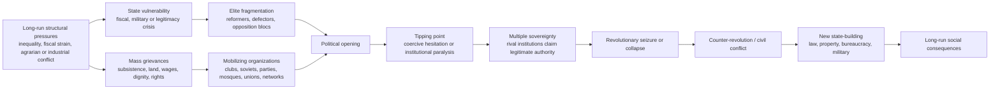
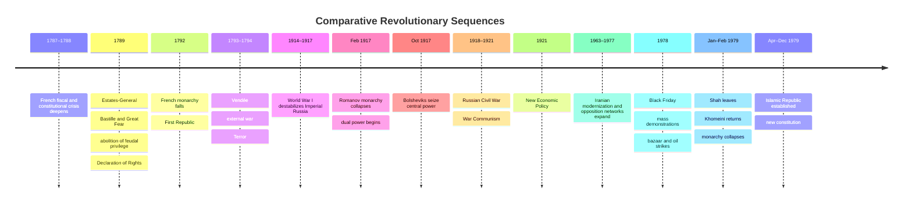
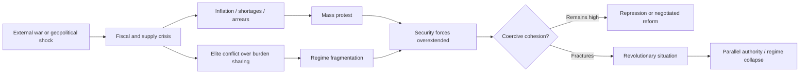

# Revolutions Compared: Causes, Processes, and Outcomes in France, Russia, and Iran

## Executive Summary

The French Revolution of 1789, the Russian Revolution of 1917, and the Iranian Revolution of 1979 arose in societies separated by radically different economic structures, political traditions, and ideological worlds. Yet the comparison reveals a common causal architecture. In all three cases, **long-standing social grievances became revolutionary only when they intersected with a crisis of the state itself**: the Bourbon monarchy encountered fiscal paralysis and elite resistance; the Romanov state was shattered by the military, logistical, and political burdens of the First World War; and the Pahlavi monarchy combined rapid, oil-financed modernization with political exclusion, uneven social transformation, and declining legitimacy. This pattern closely accords with Theda Skocpol's emphasis on state breakdown, international pressure, and class relations, while Charles Tilly's approach helps explain why organized networks and changing political opportunities converted discontent into sustained collective action. [[1]](https://books.google.co.il/books?id=4aGNCgAAQBAJ)

The revolutions differed most sharply in their **social coalitions and ideological languages**. France joined bourgeois and professional political elites, urban crowds, and largely autonomous peasant revolts under the languages of natural rights, national sovereignty, citizenship, and the destruction of privilege. Russia combined soldiers, industrial workers, and a massive peasant land revolution; Marxism supplied the Bolsheviks with a framework for turning a broad antiwar and social revolution into a party-led socialist state. Iran mobilized an unusually heterogeneous coalition—clerics, bazaar merchants, students and intellectuals, urban middle strata, industrial workers, and sections of the poor—under a dominant Islamic and anti-imperialist discourse, although liberal, nationalist, and Marxist currents also participated. [[2]](https://www.cambridge.org/core/books/cambridge-history-of-the-age-of-atlantic-revolutions/overview-of-the-french-revolution/91ADF6B57BA4F2C023FE1E34DAC9AE97)

**Economic misery by itself was not sufficient.** France's decisive crisis was not simply “poverty” but the interaction of an inequitable and politically obstructed fiscal order, looming state bankruptcy, harvest and subsistence crises, and a social structure organized around legally entrenched privilege. Russia's pre-1917 crisis likewise combined land hunger and class inequality with concentrated industrial conflict, but the First World War transformed chronic problems into an existential crisis of transport, food supply, military discipline, and governmental authority. Iran is particularly important as a counterexample to simple deprivation theories: the Pahlavi period included exceptionally rapid aggregate growth and industrialization, while the very processes of land reform, oil-led modernization, migration, education, and urban expansion generated new expectations, dislocations, and politically mobilizable constituencies. [[3]](https://www.cambridge.org/core/books/making-of-a-fiscalmilitary-state-in-postrevolutionary-france/revolutionary-quest-for-fiscal-stability-17891799/9ED6F43038DC1388F136FBB9985139F9)

**Leadership mattered most after revolutionary opportunities opened, rather than as an independent creator of the underlying crisis.** The French Revolution initially lacked a single revolutionary command center: assemblies, municipal institutions, political clubs, Parisian sections, crowds, and rural communities drove different portions of the process. Russia provides the strongest case for strategically consequential leadership: Lenin repeatedly pressed a hesitant Bolshevik leadership toward seizure of power, while Trotsky's position in the Petrograd Soviet and the Military Revolutionary Committee connected party strategy with soviet institutions. Nevertheless, scholarship emphasizing workers, soldiers, peasants, and shifting political opportunities makes it misleading to reduce October to a purely conspiratorial coup. Iran occupied an intermediate position: Ayatollah Ruhollah Khomeini became the coalition's pre-eminent symbolic and strategic leader, but the monarchy was also disabled by bazaar shutdowns, religious networks, repeated demonstrations, and—decisively—mass strikes in sectors such as oil. [[4]](https://www.cambridge.org/core/books/friends-of-freedom/french-jacobin-network-in-power/2FD655FFB49B09B652B7F62655FB9CC0)

The most important **tipping point** in each case was a breakdown in the incumbent state's capacity to command obedience. In France this emerged through fiscal-political paralysis followed by the assertion of constituent sovereignty and the collapse of old-regime authority in the countryside and municipalities. In Russia, military disintegration and the February Revolution destroyed the monarchy but produced “dual power,” allowing a second struggle over sovereignty that ended with the Bolshevik seizure. In Iran, widening protest, Black Friday, nationwide strikes, the Shah's departure, and eventually military neutrality deprived the monarchy of both legitimacy and reliable coercive supremacy. The comparative lesson is that a revolutionary situation becomes much more likely when **grievance + elite division + organized mobilization + coercive uncertainty** appear simultaneously. [[5]](https://www.cambridge.org/core/books/cambridge-history-of-the-age-of-atlantic-revolutions/overview-of-the-french-revolution/91ADF6B57BA4F2C023FE1E34DAC9AE97)

The outcomes show an equally important regularity: **revolutions tend to destroy some institutions while building stronger coercive and administrative capacities in others**. France abolished corporate privilege and seigneurial structures, proclaimed national citizenship and equal rights, nationalized Church property, and experimented repeatedly with constitutional forms, but war and internal revolt produced increasingly centralized emergency government. Russia abolished landlord property, created a soviet state and ultimately a one-party political order, built new coercive institutions, and moved toward extensive state control of the economy before the tactical retreat of the New Economic Policy. Iran replaced monarchy with a constitutional Islamic Republic combining elected institutions with clerical-supervisory institutions, revolutionary organizations, and an economy constitutionally divided among state, cooperative, and private sectors. [[6]](https://www.cambridge.org/core/books/cambridge-history-of-the-age-of-atlantic-revolutions/abolishing-feudalism/0EB663F152673B4B148D35A1DFB57BAA)

Finally, the three cases caution against equating revolution with democratization or human-rights improvement. France created an extraordinarily influential universalist language of rights and legal equality while leaving major gender and colonial exclusions unresolved. Russia opened avenues of social mobility and ultimately produced extensive state-directed modernization, but political pluralism was rapidly curtailed and coercive institutions became central to the new regime. Iran vastly expanded political participation during the revolutionary moment but subsequently narrowed ideological pluralism, constitutionalized Islamic supervision, restricted parts of the press and opposition, and reversed important aspects of the pre-revolutionary legal position of women even as women continued to create new forms of political and social activism. [[7]](https://www.elysee.fr/en/french-presidency/the-declaration-of-the-rights-of-man-and-of-the-citizen)

## Comparative Theoretical Framework

A useful comparative model should avoid two opposite errors: **structural determinism**, in which economic or demographic pressure automatically produces revolution, and **voluntarism**, in which charismatic leaders or revolutionary parties can manufacture revolutionary conditions at will. Skocpol's structural approach makes state organization, class relations, and international pressures central; Tilly directs attention to interests, organization, mobilization, political opportunity, and competing claims to sovereignty; Goldstone highlights the destabilizing interaction among fiscal stress, demographic/social change, elite competition, and institutional rigidity. These approaches are best treated as complementary rather than mutually exclusive. [[8]](https://books.google.co.il/books?id=4aGNCgAAQBAJ)

I propose a **State–Coalition–Mobilization–Coercion model**. It treats revolution as a sequential process with feedback effects:

This framework separates four analytical levels.

**Structural drivers** are pressures that make the existing political settlement progressively difficult to reproduce: unequal class relations, blocked social mobility, fiscal weakness, food or land crises, abrupt modernization, demographic change, and external military or economic pressures. Goldstone's central insight is especially valuable here: population or economic pressure does not cause revolution merely by making people suffer; its political importance increases when it contributes to fiscal distress and elite conflict. [[9]](https://www.routledge.com/Revolution-and-Rebellion-in-the-Early-Modern-World-Population-Change-and-State-Breakdown-in-England-France-Turkey-and-China1600-1850-25th-An/Goldstone/p/book/9781138222120)

**Mobilizing capacity** determines whether diffuse dissatisfaction becomes coordinated political action. Organizations do not have to be formally revolutionary. France's political clubs, Parisian sections and municipalities; Russia's soviets, factory organizations, army committees, and parties; and Iran's mosques, clerical institutions, bazaars, cassette distribution networks, and workplaces all provided forms of communication, trust, coordination, and resource mobilization. The Iranian example is particularly revealing because cassette recordings could connect an exiled leader to domestic networks, while bazaars and oil workplaces possessed independent capacities for economically disruptive collective action. [[10]](https://www.cambridge.org/core/books/friends-of-freedom/french-jacobin-network-in-power/2FD655FFB49B09B652B7F62655FB9CC0)

**Tipping points** occur when citizens cease to believe that the incumbent can reliably punish defiance and when key actors start behaving as if an alternative authority may prevail. The crucial variable is therefore not simply how repressive a regime is, but whether its coercive institutions remain cohesive, legitimate, supplied, and willing to act. In Tilly's terms, a revolutionary situation involves rival claims to political authority; in the cases here, that condition appeared in the French Assembly's assertion of national sovereignty, Russia's provisional-government/soviet duality, and Iran's confrontation between monarchical institutions and a revolutionary counter-authority centered increasingly on Khomeini. [[11]](https://www.elysee.fr/en/french-presidency/the-declaration-of-the-rights-of-man-and-of-the-citizen)

**Leadership and ideology** shape coalition formation and post-revolutionary outcomes more powerfully than they explain the initial structural breakdown. Leaders identify focal demands, supply narratives linking heterogeneous grievances, decide when to compromise or escalate, and—once old institutions weaken—compete to monopolize the emerging state. Ideology performs at least three functions: diagnosis (“what is wrong”), coalition-building (“who are the people”), and institutional design (“what should replace the old order”). This is why the same revolutionary crisis can initially mobilize a wide coalition yet eventually generate a much narrower post-revolutionary regime. The trajectories of the Jacobins, Bolsheviks, and Khomeinist clerical forces illustrate this progressive concentration of political authority. [[12]](https://www.cambridge.org/core/books/cambridge-history-of-the-age-of-atlantic-revolutions/jacobins-and-terror-in-the-french-revolution/4EF77F6C3E13E456C1D009A6058D989A)

A compact representation is:

\[
\text{Revolutionary potential} \sim
\frac{S \times E \times M \times C}{A}
\]

where **S** is structural strain, **E** elite fragmentation, **M** mobilizing capacity, **C** coercive/institutional breakdown, and **A** adaptive capacity of the incumbent order. This is **not a statistical equation**; it expresses a comparative-historical inference. Its multiplicative form captures a central finding of the cases: extreme hardship with cohesive elites and a loyal security apparatus may produce repression rather than revolution; elite division without mass organization may yield a palace coup; mass protest without state breakdown may produce reform or defeat; but the coincidence of all four conditions can produce a revolutionary rupture. This synthesis is consistent with the state-centered insights of Skocpol, the mobilization perspective of Tilly, and Goldstone's emphasis on fiscal and elite crises. [[8]](https://books.google.co.il/books?id=4aGNCgAAQBAJ)

## The French Revolution

**Socioeconomic preconditions.** France's ancien régime was not simply an economically “backward” society suddenly destroyed by destitution. Its central political-economic contradiction was that an increasingly expensive monarchy operated through a fragmented fiscal order in which legal privileges and corporate rights obstructed attempts to distribute taxation more uniformly. The revolution's immediate political crisis emerged from the Crown's inability to reform state finance in the face of resistance from traditional elites; the American War of Independence aggravated the financial problem, and by the later 1780s the monarchy faced a grave credit and fiscal crisis. [[13]](https://academic.oup.com/book/38767/chapter/337562996)

The social structure intensified the problem. The clergy and nobility possessed corporate status and fiscal privileges, while the heterogeneous Third Estate included professionals, merchants, artisans, urban laborers, and the overwhelming majority of peasants. Rural society still contained extensive seigneurial claims and payments. Peasants could owe dues for seigneurial facilities and other customary obligations; this helped turn a constitutional-political crisis in Versailles into an agrarian assault on the seigneurial order. The poor 1788 harvest and high grain prices added a severe subsistence crisis and stimulated grain-price disturbances even before the Estates-General assembled. [[14]](https://www.cambridge.org/core/books/forests-in-revolutionary-france/necessity-as-vital-as-bread/417F75CD5ADF28210773614B4119698B)

Taxation was therefore doubly revolutionary: it helped precipitate the collapse of the old regime and became one of the principal fields of institutional reconstruction. The abolition of privilege on the night of August 4, 1789, implied fiscal as well as social equality, and revolutionary governments tried to replace the old mosaic of privileges and indirect taxes with a simpler system based more heavily on direct taxation. Yet fiscal instability did not disappear; war, collapsing credit, paper-money issuance, and insufficient revenues contributed to severe inflation and continued governmental crisis during the 1790s. [[15]](https://www.cambridge.org/core/books/making-of-a-fiscalmilitary-state-in-postrevolutionary-france/revolutionary-quest-for-fiscal-stability-17891799/9ED6F43038DC1388F136FBB9985139F9)

**Ideology and religion.** Enlightenment concepts of natural rights, rational government, public opinion, and the “nation” transformed the language through which the fiscal crisis was contested. The Declaration of the Rights of Man and of the Citizen, voted article by article on August 20–26, 1789, defined liberty, property, security, and resistance to oppression as natural rights, affirmed equality before law, and located sovereignty in the nation. The official French presidential account explicitly notes the Declaration's connections to Enlightenment thought and the American experience. [[16]](https://www.elysee.fr/en/french-presidency/the-declaration-of-the-rights-of-man-and-of-the-citizen)

Religion was both an ideological fault line and an institutional problem. The November 1789 nationalization of Church property tied fiscal reconstruction to an enormous transfer of property, while the Civil Constitution of the Clergy reorganized the Church's relation to the revolutionary state. The subsequent clerical oath divided constitutional from refractory clergy and helped turn religious identity into a major axis of counter-revolutionary mobilization, especially in parts of western France. The Revolution thus moved beyond constitutional reform into an effort to reconstruct the relationship between sovereignty, citizenship, property, and religion. [[17]](https://www.cambridge.org/core/books/commerce-and-manners-in-edmund-burkes-political-economy/reflections-on-the-revolution-in-france-property-the-monied-interest-and-the-assignats/9F0F8DF3770585D29EF2173EC84FEC89)

**Leadership and mobilization.** Unlike the Russian and Iranian cases, France had no Lenin or Khomeini whose organization and personal authority unified the revolutionary coalition. The Estates-General and then National Assembly provided an institutional arena; Parisian crowds and the National Guard altered the balance of coercive power; rural insurgency during the Great Fear accelerated the destruction of seigneurial privilege; clubs such as the Jacobins created national political networks; and the sans-culottes supplied recurrent pressure from below. Revolutionary leadership therefore emerged through interaction among parliamentary politicians, journalists and intellectuals, political clubs, municipal structures, and popular mobilization rather than through a single hierarchical organization. [[18]](https://www.cambridge.org/core/books/cambridge-history-of-the-age-of-atlantic-revolutions/overview-of-the-french-revolution/91ADF6B57BA4F2C023FE1E34DAC9AE97)

This decentralized beginning helps explain the Revolution's repeated radicalization. Each successive institutional settlement faced pressures from actors who believed the preceding settlement had not solved the problems of sovereignty, war, subsistence, or social equality. The Jacobins eventually became highly influential, but their ascendancy was an outcome of the revolutionary process, external war, factional struggles, and Parisian mobilization rather than the execution of a pre-1789 Jacobin blueprint. [[19]](https://www.cambridge.org/core/books/cambridge-history-of-the-age-of-atlantic-revolutions/jacobins-and-terror-in-the-french-revolution/4EF77F6C3E13E456C1D009A6058D989A)

**International influences.** The French Revolution was international before 1789 in two senses. The American Revolutionary War had worsened royal finances, while American constitutional experience and Enlightenment political ideas influenced the French discussion of rights. Thereafter the Revolution itself became an international ideological force: political societies abroad interacted with French organizations, and revolutionary claims about national sovereignty and citizenship circulated through the Atlantic world. [[20]](https://academic.oup.com/book/38767/chapter/337562996)

War after 1792 radically changed revolutionary dynamics. By 1793 France confronted Austria, Prussia, Britain, Spain and other enemies while also fighting internal rebellion. International war expanded manpower requirements, intensified political suspicion, raised fiscal demands, and connected military survival with domestic repression. This interaction between war and revolution is essential: the Terror cannot be understood simply as the realization of abstract Jacobin ideology, because it emerged in a context of foreign invasion fears, civil war, political factionalism, and a comparatively fragile revolutionary government. [[21]](https://www.cambridge.org/core/books/cambridge-world-history-of-genocide/vicious-civil-war-in-the-french-revolution/576E50A9A665BB2501A8BFE71302302C)

**Counter-revolution and violence.** Counter-revolution took overlapping forms: aristocratic émigré opposition, clerical resistance, local royalism, rural rebellion, and support for or collaboration with foreign enemies. The Vendée illustrates the feedback between institutional reform and coercion particularly well. By March 1793, a levy for 300,000 soldiers interacted with religious, political, and local grievances to trigger a huge western insurrection and brutal civil war. Scholarship emphasizes both the extraordinary violence and the need to treat it as a civil war rather than reducing the episode to a single ideological explanation. [[22]](https://www.cambridge.org/core/books/cambridge-world-history-of-genocide/vicious-civil-war-in-the-french-revolution/576E50A9A665BB2501A8BFE71302302C)

The revolutionary government's response progressively centralized emergency power. The Convention and Committee of Public Safety used exceptional institutions, surveillance, political trials, economic controls, and violence in what became the Terror of 1793–94. Popular violence, including the September Massacres, was not identical with state Terror but formed part of the escalating relationship among external threat, popular pressure, factional politics, and governmental repression. [[23]](https://www.cambridge.org/core/books/cambridge-history-of-the-age-of-atlantic-revolutions/jacobins-and-terror-in-the-french-revolution/4EF77F6C3E13E456C1D009A6058D989A)

**Institutional transformation and property.** The achievements were profound. The revolution abolished the legal basis of the feudal/seigneurial regime and inherited privilege, asserted equality before law and national sovereignty, nationalized Church property, reconstructed taxation, and replaced dynastic political legitimacy with the principle that political authority derived from the nation. The monarchy eventually gave way to the First Republic after the victory at Valmy and the political crises of 1792. [[24]](https://www.cambridge.org/core/books/cambridge-history-of-the-age-of-atlantic-revolutions/abolishing-feudalism/0EB663F152673B4B148D35A1DFB57BAA)

Property relations changed without a socialist assault on private property as such. Indeed, property was explicitly defined as a natural right in the Declaration. What disappeared were corporate and seigneurial rights incompatible with the new legal conception of citizenship, while Church property became national property. This combination—**legal equality plus strengthened individual property rights**—distinguishes France sharply from Russia's later revolutionary transformation. [[25]](https://www.elysee.fr/en/french-presidency/the-declaration-of-the-rights-of-man-and-of-the-citizen)

**Long-term consequences.** France's most durable ideological contribution was the universalistic vocabulary of citizenship, national sovereignty, equality before law, and rights. It also helped make nationalism one of the central forms of modern political legitimacy. Yet universalism was incomplete: women's citizenship remained constrained, and race, colonialism, slavery, and gender exposed profound limits in the practical application of revolutionary equality. The broader Atlantic struggle over slavery demonstrates that the meaning of “universal” rights remained contested. [[26]](https://www.cambridge.org/core/books/revisiting-the-origins-of-human-rights/pluralities-of-discourses-and-rights-the-enlightenment-and-singleissue-causes-in-the-nineteenth-century/3A78BEC53286EF0D4EB005D8C0EE3D24)

The institutional legacy was equally paradoxical: revolutionary destruction of privilege and intermediate corporate structures contributed both to modern citizenship and to the further construction of a centralized administrative and fiscal state. The decade therefore combined liberation from inherited legal hierarchy with recurrent authoritarian emergency government—a pattern that would become familiar in later social revolutions. [[27]](https://www.cambridge.org/core/books/making-of-a-fiscalmilitary-state-in-postrevolutionary-france/revolutionary-quest-for-fiscal-stability-17891799/9ED6F43038DC1388F136FBB9985139F9)

## The Russian Revolution

**Socioeconomic preconditions.** Imperial Russia entered 1917 with a social structure transformed but not stabilized by the emancipation of the serfs, agrarian commercialization, and late industrialization. Peasants remained the overwhelming social majority, and land hunger together with disparities between peasant communities and major landowners created powerful rural grievances. The agrarian question was therefore not peripheral to the revolution: by 1917 a massive autonomous peasant movement was attacking landlord control and redistributing land from below. [[28]](https://www.cambridge.org/core/books/russian-revolution-1917/coming-of-the-revolution/92896D53219615C68E3EAF95D3C89250)

Industrialization created a smaller but politically strategic urban working class concentrated in major plants and cities. Petrograd workers possessed unusual capacity to disrupt production and politics, and worker agitation was central to both the February overthrow of the monarchy and the subsequent struggle over power. Economic collapse progressively radicalized workplace politics, but workers' behavior cannot be reduced to hunger alone: control over production, political representation, war, and the authority of factory management were also contested. [[29]](https://resolve.cambridge.org/core/services/aop-cambridge-core/content/view/9BDD74B2E0AF9A35FBE16D2DEFE39B48/9780511562952c10_p230-252_CBO.pdf/economic_crisis_and_the_fate_of_workers_control_october_1917_to_june_1918.pdf)

Taxation in the narrow French sense was not the principal immediate revolutionary issue. The more important economic mechanisms were **land distribution, wartime inflation, provisioning failure, and the state's capacity to extract resources for war**. The First World War destabilized trade and food supply, while declining grain deliveries to Petrograd and northern cities generated severe urban hunger. Bread shortages helped convert economic grievances into mass demonstrations in February 1917. [[30]](https://www.cambridge.org/core/books/hunger-redraws-the-map/famine-in-russia-and-parts-of-europe-191422/59758AEC407B0811B17F377D4974BAF8)

**War as the accelerator.** Of the three cases, Russia offers the clearest example of an international military conflict transforming structural weakness into state collapse. The First World War generated extraordinary demands for soldiers, food, transport, industrial output, and fiscal resources while exposing weaknesses in administrative and military coordination. Scholarship on the First World War therefore treats the war not as background but as a principal force precipitating the Russian Revolution. [[31]](https://www.cambridge.org/core/books/cambridge-history-of-the-first-world-war/revolution/7A03DABC179486ADC7B0FC45ED18C89B)

The army itself became a revolutionary institution. Millions of peasants had been mobilized into uniform; military defeat, supply failures, casualties, and political disintegration undermined discipline. When soldiers in the capital refused reliably to repress demonstrators, the monarchy's coercive foundation disappeared. This is a textbook example of why coercive cohesion is a better short-term indicator of revolutionary vulnerability than protest size alone. [[32]](https://soviethistory.msu.edu/sitemap)

**Ideology.** Russian revolutionary politics included liberals, moderate socialists, Socialist Revolutionaries, Mensheviks, anarchists, and Bolsheviks. Marxism gave the Bolsheviks a distinctive theory of class power and socialist transformation, but Lenin radically adapted strategy to the opportunities of 1917. His April position rejected support for the Provisional Government, emphasized the soviets, and connected demands for peace, land, and political power. The subsequent Decrees on Peace and Land demonstrate how Bolshevik ideology was translated into policies that addressed the central demands of soldiers and peasants even when, in the land question, the actual agrarian movement had developed substantially from below. [[33]](https://soviethistory.msu.edu/sitemap)

The Decree on Land abolished landlord ownership without compensation and transferred landed estates, Crown lands, monastery holdings, and Church lands into new arrangements controlled through local revolutionary institutions. The Decree on Peace called for immediate negotiations to end the war. Together they illustrate a crucial revolutionary leadership strategy: a party that was strongest in urban politics gained national political leverage by appropriating and institutionalizing demands generated by much larger social constituencies. [[34]](https://soviethistory.msu.edu/1917/peasant-revolution/peasant-revolution-texts/decree-on-the-land)

**Leadership structures.** The Bolshevik Party was substantially more disciplined and organizationally coherent than the principal leadership networks in France or Iran. Lenin's leadership was consequential, but Bolshevik politics in 1917 was not mechanically centralized: internal disagreements were substantial, and Lenin repeatedly had to pressure fellow leaders toward insurrection. Trotsky, after joining the Bolsheviks in 1917, became chairman of the Petrograd Soviet and helped connect party strategy with the institutions claiming to represent workers and soldiers. [[35]](https://www.cambridge.org/core/books/russian-revolution-1917/bolsheviks-take-power/0D09DF772A0B3BA4D3FBB11CB5171749)

The strongest scholarship therefore rejects both extreme interpretations of October: neither an inevitable mass revolution nor simply a tiny conspiracy explains the outcome. Alexander Rabinowitch's work emphasizes shifting popular moods, party flexibility, the July crisis, the Kornilov affair, and the interaction between Bolshevik organization and the radicalization of Petrograd. Rex Wade similarly places October within a broad revolutionary process rather than treating it as an isolated coup. [[36]](https://books.google.com.qa/books?hl=ar&id=jmXinAAACAAJ&num=20&source=gbs_navlinks_s)

**The revolutionary sequence and dual power.** February destroyed the monarchy but did not settle the question of sovereignty. The Provisional Government coexisted with the soviets, producing a structurally unstable dual-power arrangement. The Provisional Government wanted to preserve state continuity and continue the war, while workers, soldiers, peasants, and national groups made increasingly expansive social and political demands. [[37]](https://soviethistory.msu.edu/sitemap)

The failure to resolve peace, land, economic breakdown, and authority strengthened the Bolsheviks because they were the major party consistently associating themselves with “All Power to the Soviets” and opposition to the coalition government. The Kornilov crisis further weakened conservative and moderate alternatives and expanded Bolshevik influence. By October, the central question had shifted from whether the old monarchy could survive to which revolutionary institution would inherit sovereignty. [[38]](https://www.cambridge.org/core/books/russian-revolution-1917/summer-of-discontents/54E7BD5FC1166FB882CB12E0675CCB8A)

**International influences.** Russia remained entangled in world politics after the Bolshevik seizure. The new government's decision to leave the war culminated in the Treaty of Brest-Litovsk with the Central Powers in March 1918, demonstrating the severe constraints an externally weakened revolutionary state faced. Civil war then interacted with foreign intervention, national movements, and the geopolitical collapse of the former empire. [[39]](https://avalon.law.yale.edu/20th_century/brest.asp)

The international ideological consequences ran in the opposite direction as well: the Russian Revolution became the foundational event for the international communist movement. The later Communist International sought to turn a Russian revolutionary victory into a transnational model, giving the events of 1917 an ideological reach far beyond the former Russian Empire. [[40]](https://www.cambridge.org/core/books/revolutionary-world/global-red-revolution/D7BE69AA46775AA07B10760E7A27A140)

**Counter-revolution, civil war, and coercion.** Opposition after October included liberals, moderate and rival socialists, anti-Bolshevik military forces, regional and national movements, and the heterogeneous White armies. The civil war radically intensified coercion on all sides and forced competing regimes to mobilize soldiers, food, transportation, and political loyalty. Control over agricultural extraction was especially important because armies and cities depended on access to peasant grain. [[41]](https://www.cambridge.org/core/books/cambridge-history-of-communism/russian-revolution-and-civil-war/722BD278768298247AD003E32EEFB1A2)

The Bolshevik government created the Cheka, which acquired broad powers and became central to political repression and the Red Terror. The dissolution of the Constituent Assembly and repression of political competitors marked the narrowing of the initial multiparty revolutionary arena into a Bolshevik-dominated state. The Library of Congress archival treatment emphasizes the importance of decree rule, the secret police, and coercion in consolidating the new political order. [[42]](https://soviethistory.msu.edu/1917/constituent-assembly/constituent-assembly-texts/newspapers-on-the-constituent-assembly)

**Institutional and property transformation.** The most immediate property revolution was agrarian: landlord property was abolished. In industry, wartime emergency and ideological aims drove progressively broader state control and nationalization. Civil-war “War Communism” produced an extremely centralized system of economic administration and grain extraction; by 1921, widespread rural resistance, industrial collapse, and political crisis contributed to a major retreat under the New Economic Policy, which replaced some coercive procurement practices with more market-compatible arrangements. [[43]](https://soviethistory.msu.edu/1917/peasant-revolution/peasant-revolution-texts/decree-on-the-land)

Politically, the new order replaced monarchy with institutions claiming legitimacy from soviet and class sovereignty, but competitive pluralism rapidly contracted. The revolutionary state simultaneously rebuilt an army, security apparatus, economic bureaucracy, and eventually a new multinational constitutional order. This confirms the general pattern: **a revolution may begin with state disintegration but survive only through renewed state construction**. [[44]](https://www.loc.gov/exhibits/archives/intn.html)

**Long-term societal consequences.** The revolution destroyed the political supremacy of the hereditary landed elite and opened extraordinary paths of mobility for workers, peasants, party activists, military personnel, and newly trained professionals. State-directed social transformation after 1917 reshaped migration, urbanization, education, occupational structure, and class formation; later Soviet industrialization rested on institutions and political relationships generated by the revolutionary regime, even though the Stalinist transformation of the late 1920s and 1930s cannot simply be equated with the events of October 1917. [[45]](https://www.cambridge.org/core/books/cambridge-history-of-communism/migration-and-social-transformations-in-soviet-society-19171941/F32F67D851EB4733036AFB9F3327E0B9)

The human-rights balance was much darker. Political pluralism was curtailed, coercive institutions became permanent features of the state, and the logic of revolutionary emergency helped legitimize violence against designated class and political enemies. Thus the Russian case produced a striking combination of social mobility and modernization with authoritarian political consolidation—a combination that profoundly influenced twentieth-century revolutionary movements worldwide. [[46]](https://www.loc.gov/exhibits/archives/intn.html)

## The Iranian Revolution

**Socioeconomic preconditions.** Iran challenges any theory equating revolution with prolonged economic stagnation. Following reforms beginning in the early 1960s, including land reform, female suffrage, industrial profit-sharing, and literacy initiatives, Iran underwent rapid economic expansion; one authoritative Iranica account estimates average real GDP growth of about 10.5 percent annually during 1963–77. Yet rapid development generated major political and social dislocations rather than eliminating instability. [[47]](https://www.iranicaonline.org/articles/economy-ix/)

The Pahlavi modernization strategy was heavily dependent on oil revenues. This created what political-economy scholarship describes as rentier characteristics: the monarchy could finance state expansion and development without relying on the kind of broad domestic taxation that historically encourages bargaining between rulers and taxpayers. Oil wealth strengthened the central state but also made economic and political life exceptionally sensitive to state expenditure, oil income, and centralized allocation. [[48]](https://www.cambridge.org/core/books/dynastic-history-of-iran/economic-development-political-underdevelopment/14D9DCEFE1F0519159D12D13435B69A3)

Land reform weakened older landed structures but did not create a stable rural order. Rural migration contributed to rapid urbanization, while education and state-led development expanded the numbers of students, professionals, bureaucratic employees, and industrial workers. The resulting society was simultaneously more modernized, more urban, more politically aware, and more dependent on institutions that offered limited autonomous political participation. The contradiction was therefore between **social modernization and restricted political incorporation**, not simply between wealth and poverty. [[49]](https://www.iranicaonline.org/articles/economy-ix/)

Class structure was unusually important to the revolutionary coalition. Traditional bazaar merchants retained powerful commercial and social networks and close relationships with clerical institutions. Industrial workers, although not the original ideological leadership of the movement, became strategically decisive as strikes spread into the oil industry. Tens of thousands of oil workers participated, and the resulting disruption helped paralyze the state and deprive it of the economic flows on which it depended. [[50]](https://www.iranicaonline.org/articles/bazar-index/bazar-iii/)

**Ideological frameworks.** The revolution cannot accurately be described as either purely “Islamic” from the beginning or essentially secular until captured by clerics. Its opposition spectrum included Islamic activists, liberal constitutionalists, nationalists, Marxists, guerrilla organizations, students, intellectuals, and professional groups. What distinguished the successful revolutionary coalition was Khomeini's capacity and that of allied clerical networks to translate Shiʿi concepts, anti-monarchical politics, social-justice themes, and anti-imperialism into a language capable of integrating multiple constituencies. [[51]](https://www.cambridge.org/core/books/revolution-and-its-discontents/constructing-beheshte-jahan-islam-the-clergy-and-the-state/49E343BBBB5084A114F6A2FA24022C5C)

Religious intellectuals such as Ali Shariati helped recast Shiʿism in a modern revolutionary idiom, while Khomeini supplied the movement with both clerical authority and a theory capable of supporting a post-monarchical Islamic state. The revolutionary ideology therefore combined inherited religious institutions with highly modern forms of mass politics, ideological propaganda, and state-making. [[52]](https://www.cambridge.org/core/books/revolution-and-its-discontents/constructing-beheshte-jahan-islam-the-clergy-and-the-state/49E343BBBB5084A114F6A2FA24022C5C)

Religion also supplied an organizational repertoire. Mosques, clerical ties, religious commemorations, charitable and commercial relationships, and bazaar networks enabled mobilization outside formal state-controlled institutions. In October 1978, for example, religious authorities' call for a nationwide bazaar shutdown commemorating those killed on Black Friday produced the first successful nationwide closure of the bazaars. [[53]](https://www.iranicaonline.org/articles/bazar-index/bazar-iii/)

**Leadership and networks.** Khomeini's leadership differed sharply from Lenin's. He did not command a centralized revolutionary party comparable to the Bolsheviks. His authority instead rested on religious prestige, a clerical and seminary network, trusted intermediaries, and increasingly effective communications between exile and Iran. Smuggled cassette recordings of his speeches became an important means by which his messages circulated domestically. [[54]](https://www.cambridge.org/core/books/contesting-the-iranian-revolution/on-the-streets-and-beyond/850C063A78F2C175FA084D140A375B29)

This distributed structure made the revolutionary coalition both broad and difficult for the state to decapitate. Bazaaris could fund or sustain protest; clerics could mobilize through religious institutions; students and professionals provided organizational and intellectual energy; workers could strike; and neighborhoods could participate in mass demonstrations. Khomeini gradually became the focal point around which these otherwise diverse actors coordinated, but mobilization retained substantial social autonomy. [[55]](https://www.cambridge.org/core/journals/international-labor-and-working-class-history/article/reasons-to-revolt-iranian-oil-workers-in-the-1970s/5ECD42128A96B091D69C8BF584DB5E79)

That distinction became critical after victory. During the revolutionary phase, ideological ambiguity helped maximize coalition breadth. After February 1979, the political contest shifted from overthrowing the monarchy to defining the new state's institutions. Clerical forces aligned with Khomeini then possessed organizational advantages, symbolic legitimacy, and institutional access that enabled them progressively to marginalize liberals, secular leftists, and other revolutionary partners. [[56]](https://www.cambridge.org/core/books/iran/an-islamic-republic-in-iran/D71DA63AC81DADB47F1C7B6653FABF44)

**International influences.** International factors operated less through a disastrous war than in Russia and less through sovereign fiscal bankruptcy than in France. Instead, the Pahlavi monarchy's close strategic relationship with the United States became politically consequential. American diplomatic records after the revolution recognized that revolutionary hostility toward Washington was inseparable from Iranian perceptions of long-term U.S. support for the Shah and intervention in Iranian affairs. [[57]](https://history.state.gov/historicaldocuments/frus1977-80v11p1/d38)

Oil also made Iran unusually embedded in the international economy and geopolitical order. The very revenues that strengthened the Pahlavi state financed rapid modernization while tying political expectations and economic management to the international petroleum economy. The Shah's position as a major Western strategic partner strengthened the opposition's ability to frame domestic authoritarianism in anti-imperialist terms. [[58]](https://www.cambridge.org/core/books/dynastic-history-of-iran/economic-development-political-underdevelopment/14D9DCEFE1F0519159D12D13435B69A3)

Transnational communication mattered as well. Khomeini's exile ultimately facilitated rather than eliminated his capacity to become an international media figure, and communications technologies enabled speeches originating abroad to circulate inside Iran. The Iranian case therefore foreshadowed later revolutions in which **exile politics, transnational media, and domestic networks interact rather than operate separately**. [[54]](https://www.cambridge.org/core/books/contesting-the-iranian-revolution/on-the-streets-and-beyond/850C063A78F2C175FA084D140A375B29)

**Repression and revolutionary escalation.** The Pahlavi state had extensive coercive capabilities, including the security organization SAVAK, and had earlier used imprisonment, force, and exile against opposition. Khomeini himself was driven into exile after the political confrontations of the early 1960s. Yet coercive capacity did not translate indefinitely into political control. [[59]](https://www.iranicaonline.org/articles/economy-ix/)

Black Friday on September 8, 1978 became a major radicalizing event. Military forces killed demonstrators at Tehran's Jaleh Square; contemporary and later estimates vary, but scholarly accounts place the toll far below some of the thousands claimed in revolutionary rumor while still emphasizing the event's political importance. Rather than terminating mobilization, the killings helped intensify strikes and delegitimize compromise. Oil-worker research specifically identifies Black Friday as an important trigger for the spread and politicization of strikes. [[60]](https://www.cambridge.org/core/books/worlds-apart/blindsided-confronting-the-revolution-and-the-hostage-crisis-19771981/84BA3F2011209B2752D14B72E78CAEC9)

The causal mechanism is important: severe repression can restore control when the state remains cohesive and opposition networks are weak, but it can accelerate revolution when it generates martyrs, expands coalition solidarity, and is followed by further mobilization. Iran's Shiʿi commemorative practices and nationwide networks gave deaths a particularly powerful mobilizing afterlife. [[61]](https://www.iranicaonline.org/articles/bazar-index/bazar-iii/)

By late 1978, strikes increasingly impaired the economy while mass demonstrations demonstrated that the opposition retained mobilizing capacity despite martial law. The Shah left Iran in January 1979; Khomeini returned on February 1; the monarchy's remaining political order collapsed by February 11. A referendum then established the Islamic Republic, and a new constitution was drafted and ratified later in 1979. [[62]](https://www.cambridge.org/core/books/iran/an-islamic-republic-in-iran/D71DA63AC81DADB47F1C7B6653FABF44)

**Institutional transformation.** The new constitution institutionalized a political system radically different both from the monarchy and from a conventional liberal republic. Article 56 grounds ultimate sovereignty in God while recognizing human social agency; Article 57 places legislative, executive, and judicial powers under the overarching constitutional structure associated with the Leader and Islamic guardianship. Elections and representative institutions therefore coexist with supervisory religious institutions. [[63]](https://www.shora-gc.ir/en/news/87/constitution-of-the-islamic-republic-of-iran-full-text)

The economic constitution likewise rejected both unrestricted capitalism and complete Soviet-style state ownership. It envisaged state, cooperative, and private sectors, while major post-revolutionary measures included nationalization of banks and expansion of public control over important economic assets. Legitimate private property remained constitutionally protected. [[64]](https://www.cambridge.org/core/journals/iranian-studies/article/towards-an-antiwestern-stance-the-economic-discourse-of-irans-1979-revolution/1AA7E0560B4EAE48B9E0E0836269BB02)

Revolutionary committees quickly emerged to arrest opponents, maintain order, and replace or supplement institutions whose reliability was doubtful. This illustrates the same state-building dilemma visible in France and Russia: revolutionary movements attacking coercive institutions eventually need organizations capable of policing territory, enforcing decisions, and suppressing opponents. [[65]](https://www.cambridge.org/core/books/rule-of-law-in-the-islamic-republic-of-iran/law-enforcement-and-the-judiciary-in-postrevolutionary-iran/19A4E2FDEB3E321EE0552188BC5DAA48)

**Political pluralism, gender, and long-run impact.** The revolutionary coalition's broad pluralism contracted rapidly after victory. In August 1979 Khomeini's government banned numerous newspapers associated with liberal-nationalist and secular-left currents that criticized the evolving constitutional order. Institutions initially justified in terms of revolutionary defense became mechanisms for defining the permitted limits of political opposition. [[66]](https://www.iranicaonline.org/articles/islam-in-iran-xiii-islamic-political-movements-in-20th-century-iran/)

Gender illustrates the Revolution's contradictory social effects. Soon after the monarchy's collapse, the pre-revolutionary Family Protection Law was declared incompatible with the new Islamic order, provoking large women's demonstrations beginning around International Women's Day in March 1979. The subsequent regime initially attempted to re-Islamize gender roles and law, but women did not disappear from education, employment, electoral politics, professional life, or organized activism. Instead, post-revolutionary Iran developed a long-running struggle over the meaning of women's citizenship inside and against the institutions created by 1979. [[67]](https://www.iranicaonline.org/articles/feminist-movements-iv/)

Economically, the safest comparative conclusion is not that the revolution either “developed” or “ruined” Iran in a simple causal sense. Post-revolutionary performance has been mediated by the inherited oil economy, expanded state ownership, demographic change, domestic policy choices, and major subsequent geopolitical shocks. Institutionally, however, the revolution decisively changed who controlled state resources and created new channels for upward political mobility among networks previously peripheral to the Pahlavi elite, including organizations rooted in the religious-commercial milieu. [[68]](https://www.cambridge.org/core/journals/iranian-studies/article/towards-an-antiwestern-stance-the-economic-discourse-of-irans-1979-revolution/1AA7E0560B4EAE48B9E0E0836269BB02)

## Comparative Synthesis

The three revolutions are best understood not as variations on a single ideological model but as different solutions to a recurring problem: **an incumbent state lost the ability to reproduce its existing coalition of authority at the same moment that social groups acquired both grievances and organizational means to challenge it**. Their strongest similarities lie in process; their greatest differences lie in coalition structure, international context, and the institutional order constructed afterward. [[69]](https://books.google.co.il/books?id=4aGNCgAAQBAJ)

| Dimension | French Revolution | Russian Revolution | Iranian Revolution |
|---|---|---|---|
| **Pre-revolutionary state** | Bourbon absolute monarchy constrained by corporate privileges and fiscal institutions; looming bankruptcy. [[70]](https://www.cambridge.org/core/books/cambridge-history-of-the-age-of-atlantic-revolutions/overview-of-the-french-revolution/91ADF6B57BA4F2C023FE1E34DAC9AE97) | Romanov autocracy undergoing uneven industrialization; state and army destabilized by WWI. [[31]](https://www.cambridge.org/core/books/cambridge-history-of-the-first-world-war/revolution/7A03DABC179486ADC7B0FC45ED18C89B) | Oil-rich authoritarian monarchy with rapid modernization but limited political incorporation. [[49]](https://www.iranicaonline.org/articles/economy-ix/) |
| **Core socioeconomic fault line** | Privileged orders vs. Third Estate; seigneurial burdens; tax inequality; subsistence crisis. [[71]](https://www.cambridge.org/core/books/forests-in-revolutionary-france/necessity-as-vital-as-bread/417F75CD5ADF28210773614B4119698B) | Peasant land hunger, worker-management conflict, war-induced provisioning breakdown. [[72]](https://www.cambridge.org/core/books/russian-revolution-1917/coming-of-the-revolution/92896D53219615C68E3EAF95D3C89250) | Uneven oil-led modernization, urbanization, class displacement, authoritarian exclusion. [[49]](https://www.iranicaonline.org/articles/economy-ix/) |
| **Tax/fiscal mechanism** | Central: inability to reform taxation produced sovereign fiscal crisis. [[15]](https://www.cambridge.org/core/books/making-of-a-fiscalmilitary-state-in-postrevolutionary-france/revolutionary-quest-for-fiscal-stability-17891799/9ED6F43038DC1388F136FBB9985139F9) | Secondary to wartime resource extraction, inflation, land and food crises. [[73]](https://www.cambridge.org/core/books/cambridge-history-of-the-first-world-war/revolution/7A03DABC179486ADC7B0FC45ED18C89B) | Oil rents reduced dependence on broad domestic taxation; distribution of rent became politically important. [[48]](https://www.cambridge.org/core/books/dynastic-history-of-iran/economic-development-political-underdevelopment/14D9DCEFE1F0519159D12D13435B69A3) |
| **Major mass bases** | Peasants, urban crowds, artisans, sections of bourgeois/professional Third Estate. [[74]](https://www.cambridge.org/core/books/cambridge-history-of-the-age-of-atlantic-revolutions/overview-of-the-french-revolution/91ADF6B57BA4F2C023FE1E34DAC9AE97) | Peasants, workers, soldiers and sailors. [[75]](https://www.cambridge.org/core/books/cambridge-history-of-communism/soviet-state-and-peasants/B9CF388324C0CFC2B624438EBBE5510B) | Clerical followers, bazaari networks, students, professionals, workers, urban masses. [[50]](https://www.iranicaonline.org/articles/bazar-index/bazar-iii/) |
| **Dominant revolutionary language** | Natural rights, nation, citizenship, equality, popular/national sovereignty. [[76]](https://www.elysee.fr/en/french-presidency/the-declaration-of-the-rights-of-man-and-of-the-citizen) | Marxism, socialism, soviet power, peace, land and class rule. [[77]](https://www.marxists.org/archive/lenin/works/1917/oct/25-26/26b.htm) | Shiʿi political Islam, anti-monarchism, social justice, anti-imperialism; alongside liberal and left alternatives. [[51]](https://www.cambridge.org/core/books/revolution-and-its-discontents/constructing-beheshte-jahan-islam-the-clergy-and-the-state/49E343BBBB5084A114F6A2FA24022C5C) |
| **Leadership structure** | Fragmented and competitive: assemblies, clubs, sections and popular leaders. [[78]](https://www.cambridge.org/core/books/friends-of-freedom/french-jacobin-network-in-power/2FD655FFB49B09B652B7F62655FB9CC0) | Most organizationally centralized; Bolsheviks under Lenin with Trotsky crucial operationally. [[35]](https://www.cambridge.org/core/books/russian-revolution-1917/bolsheviks-take-power/0D09DF772A0B3BA4D3FBB11CB5171749) | Charismatic-symbolic centrality of Khomeini operating through decentralized religious/social networks. [[79]](https://www.cambridge.org/core/books/contesting-the-iranian-revolution/on-the-streets-and-beyond/850C063A78F2C175FA084D140A375B29) |
| **International accelerator** | War debt before 1789; European war after 1792. [[80]](https://academic.oup.com/book/38767/chapter/337562996) | WWI was a central cause of state collapse; Brest-Litovsk and intervention shaped aftermath. [[81]](https://www.cambridge.org/core/books/cambridge-history-of-the-first-world-war/revolution/7A03DABC179486ADC7B0FC45ED18C89B) | Oil economy and Western alliance shaped political economy and anti-imperialist legitimacy claims. [[82]](https://www.cambridge.org/core/books/dynastic-history-of-iran/economic-development-political-underdevelopment/14D9DCEFE1F0519159D12D13435B69A3) |
| **Critical tipping mechanism** | Fiscal-political breakdown + assertion of national sovereignty + rural/urban breakdown of old authority. [[83]](https://www.cambridge.org/core/books/cambridge-history-of-the-age-of-atlantic-revolutions/overview-of-the-french-revolution/91ADF6B57BA4F2C023FE1E34DAC9AE97) | Army disintegration → February collapse → unstable dual power → October seizure. [[84]](https://soviethistory.msu.edu/sitemap) | Repression failed to end protest; generalizing strikes and declining coercive confidence preceded monarchical collapse. [[85]](https://www.cambridge.org/core/journals/international-labor-and-working-class-history/article/reasons-to-revolt-iranian-oil-workers-in-the-1970s/5ECD42128A96B091D69C8BF584DB5E79) |
| **Counter-revolution** | Émigrés, clerical/royalist resistance, Vendée, European coalitions. [[86]](https://www.cambridge.org/core/books/cambridge-world-history-of-genocide/vicious-civil-war-in-the-french-revolution/576E50A9A665BB2501A8BFE71302302C) | Whites, rival socialists/national movements, foreign intervention, civil war. [[87]](https://www.cambridge.org/core/books/cambridge-history-of-communism/russian-revolution-and-civil-war/722BD278768298247AD003E32EEFB1A2) | Monarchical repression before victory; post-victory resistance and suppression of liberal/left competitors. [[88]](https://www.repository.cam.ac.uk/items/417cdf84-8946-42b7-a540-88e28039aaa2) |
| **Property transformation** | Abolition of seigneurial privilege; Church nationalization; private property affirmed. [[89]](https://www.cambridge.org/core/books/cambridge-history-of-the-age-of-atlantic-revolutions/abolishing-feudalism/0EB663F152673B4B148D35A1DFB57BAA) | Landlord property abolished; extensive later state control of industry and economic exchange. [[90]](https://soviethistory.msu.edu/1917/peasant-revolution/peasant-revolution-texts/decree-on-the-land) | Expanded state sector and bank nationalization while private property remained constitutionally recognized. [[64]](https://www.cambridge.org/core/journals/iranian-studies/article/towards-an-antiwestern-stance-the-economic-discourse-of-irans-1979-revolution/1AA7E0560B4EAE48B9E0E0836269BB02) |
| **Political outcome** | Constitutional monarchy → republic → radical emergency government → unstable post-Terror regimes. [[91]](https://www.cambridge.org/core/books/cambridge-history-of-the-age-of-atlantic-revolutions/overview-of-the-french-revolution/91ADF6B57BA4F2C023FE1E34DAC9AE97) | Soviet government → civil-war party-state → increasingly consolidated Communist rule. [[44]](https://www.loc.gov/exhibits/archives/intn.html) | Islamic Republic combining elected offices with clerical-supervisory authority. [[63]](https://www.shora-gc.ir/en/news/87/constitution-of-the-islamic-republic-of-iran-full-text) |
| **Rights paradox** | Universal rights language but persistent exclusions by gender and colonial status. [[92]](https://www.cambridge.org/core/journals/international-review-of-social-history/article/from-slaves-and-servants-to-citizens-regulating-dependency-race-and-gender-in-revolutionary-france-and-the-french-west-indies/B116464991B8994CF9C2CDA63EA85F73) | Social leveling/mobility accompanied by severe restriction of pluralist political rights. [[93]](https://www.cambridge.org/core/books/cambridge-history-of-communism/migration-and-social-transformations-in-soviet-society-19171941/F32F67D851EB4733036AFB9F3327E0B9) | Mass revolutionary participation followed by ideological restriction, press repression, and gender-law retrenchment. [[94]](https://www.iranicaonline.org/articles/islam-in-iran-xiii-islamic-political-movements-in-20th-century-iran/) |

Several causal conclusions emerge.

**First, state weakness matters more than raw grievance.** None of the three societies lacked grievances before the revolutionary year. What changed was the state's ability to manage them. France's monarchy could no longer finance itself without politically destabilizing reform; Russia could no longer sustain war, provisioning, and military obedience; the Iranian monarchy could no longer combine coercive control with enough legitimacy and economic normality to isolate the opposition. This supports Skocpol and Goldstone against “misery causes revolution” explanations. [[95]](https://www.cambridge.org/core/books/making-of-a-fiscalmilitary-state-in-postrevolutionary-france/revolutionary-quest-for-fiscal-stability-17891799/9ED6F43038DC1388F136FBB9985139F9)

**Second, elite defection or fragmentation is usually a necessary bridge between grievance and revolutionary opportunity.** In France the opening came through the monarchy's conflict with privileged elites and representative institutions; in Russia the monarchy collapsed before the Bolsheviks became dominant, leaving elites and moderate socialists unable to stabilize a successor regime; in Iran the Shah's attempts to alternate reform, repression, military government, and conciliation signaled weakening control and encouraged opponents to believe victory was plausible. [[96]](https://www.cambridge.org/core/books/cambridge-history-of-the-age-of-atlantic-revolutions/overview-of-the-french-revolution/91ADF6B57BA4F2C023FE1E34DAC9AE97)

**Third, revolutionary coalitions are typically broader than the regimes that emerge from them.** French constitutional monarchists did not foresee Jacobin government; the February coalition did not imply Bolshevik one-party rule; Iranian liberals, Marxists and nationalists who opposed the Shah did not thereby endorse clerical constitutional supremacy. During revolutionary ascent, ambiguity helps cooperation; after victory, control of coercion, administration, communications and constitution-making determines which component of the coalition defines the new order. [[97]](https://www.cambridge.org/core/books/cambridge-history-of-the-age-of-atlantic-revolutions/jacobins-and-terror-in-the-french-revolution/4EF77F6C3E13E456C1D009A6058D989A)

**Fourth, rural and urban dynamics must be integrated.** France and Russia show especially clearly that autonomous peasant action can transform property relations even when national revolutionary leaders are urban. Iran was more urbanized and its countryside less independently revolutionary by 1978–79, while bazaar, mosque, university, neighborhood, and industrial networks played a larger role. A theory built exclusively on urban protests therefore misses France and Russia; one based exclusively on peasant rebellion cannot explain Iran. [[98]](https://www.cambridge.org/core/books/cambridge-history-of-the-age-of-atlantic-revolutions/abolishing-feudalism/0EB663F152673B4B148D35A1DFB57BAA)

**Fifth, international pressures are constitutive rather than incidental.** France's fiscal breakdown was tied partly to geopolitical competition and American-war debt, while post-1792 war radicalized the revolution. Russia's revolution is virtually unintelligible without World War I. Iran's revolution did not require wartime military collapse, but oil dependence, geopolitical alignment, and anti-imperialist interpretations of the Shah's Western relationships were integral to both the monarchy's state-building capacity and the opposition's ideology. [[99]](https://academic.oup.com/book/38767/chapter/337562996)

### Comparative revolutionary timeline

The chronology also illustrates a major difference in **tempo**: France radicalized over several years; Russia experienced two regime-changing episodes within eight months in 1917 and then several years of civil war; Iran's decisive revolutionary escalation was concentrated largely in 1978–79 after a much longer period of opposition formation. [[100]](https://www.cambridge.org/core/books/russian-revolution-1917/chronology/809E112DA57D54B4F82C5A504A6FE2E1)

| Period | France | Russia | Iran |
|---|---|---|---|
| **Long prelude** | Fiscal crisis intensifies in 1786–88; elite conflict blocks reform. [[101]](https://www.cambridge.org/core/books/1789-the-french-revolution-begins/long-slumber-of-the-estates-general/18094447382C4D5256A2327C83021CDD) | 1905 revolution, uneven reform and industrialization; land and labor conflict persist. [[102]](https://soviethistory.msu.edu/sitemap) | White Revolution from 1963; rapid modernization; 1963 opposition and Khomeini's eventual exile. [[47]](https://www.iranicaonline.org/articles/economy-ix/) |
| **Initial rupture** | Estates-General and National Assembly, 1789; Bastille and Great Fear. [[83]](https://www.cambridge.org/core/books/cambridge-history-of-the-age-of-atlantic-revolutions/overview-of-the-french-revolution/91ADF6B57BA4F2C023FE1E34DAC9AE97) | February/March 1917 uprising and abdication; soviets and Provisional Government emerge. [[103]](https://soviethistory.msu.edu/sitemap) | Nationwide protest cycle intensifies in 1978; Black Friday, September 8. [[104]](https://www.cambridge.org/core/books/worlds-apart/blindsided-confronting-the-revolution-and-the-hostage-crisis-19771981/84BA3F2011209B2752D14B72E78CAEC9) |
| **Social radicalization** | August 4 abolition of feudal regime; Rights Declaration; Church reorganization. [[105]](https://www.cambridge.org/core/books/cambridge-history-of-the-age-of-atlantic-revolutions/abolishing-feudalism/0EB663F152673B4B148D35A1DFB57BAA) | Land seizures, worker and soldier radicalization; July and Kornilov crises. [[106]](https://www.cambridge.org/core/books/russian-revolution-1917/summer-of-discontents/54E7BD5FC1166FB882CB12E0675CCB8A) | Bazaar shutdowns and expanding strikes; oil sector increasingly paralyzes state economy. [[50]](https://www.iranicaonline.org/articles/bazar-index/bazar-iii/) |
| **Second regime rupture** | Monarchy falls and Republic emerges in 1792. [[107]](https://www.elysee.fr/en/french-presidency/bastille-day-14-july) | Bolsheviks seize power in October/November 1917. [[108]](https://www.cambridge.org/core/books/russian-revolution-1917/bolsheviks-take-power/0D09DF772A0B3BA4D3FBB11CB5171749) | Shah departs; Khomeini returns February 1, 1979; monarchy collapses February 11. [[62]](https://www.cambridge.org/core/books/iran/an-islamic-republic-in-iran/D71DA63AC81DADB47F1C7B6653FABF44) |
| **Revolutionary state-building** | War, Vendée and Terror, 1793–94. [[21]](https://www.cambridge.org/core/books/cambridge-world-history-of-genocide/vicious-civil-war-in-the-french-revolution/576E50A9A665BB2501A8BFE71302302C) | Brest-Litovsk, civil war, Cheka and War Communism, followed by NEP in 1921. [[109]](https://avalon.law.yale.edu/20th_century/brest.asp) | Islamic Republic referendum and constitution, 1979; revolutionary institutions consolidate. [[110]](https://www.cambridge.org/core/books/iran/an-islamic-republic-in-iran/D71DA63AC81DADB47F1C7B6653FABF44) |

## Future Revolutionary Scenarios

Historical comparison cannot produce a reliable list of countries “next in line” for revolution. Revolutions are rare, nonlinear events, and the three cases demonstrate why apparently stable regimes can collapse quickly while highly unpopular governments may survive for decades. A defensible forecast should therefore identify **configurations of conditions** rather than announce deterministic national predictions. The following scenarios are analytical extrapolations from the comparative framework, not claims that any particular state will experience them. The logic derives from the interaction of state crisis, elite fragmentation, mobilization, and coercive capacity emphasized by Skocpol, Tilly, Goldstone, and more recent comparative work on spontaneous revolutions. [[111]](https://books.google.co.il/books?id=4aGNCgAAQBAJ)

### Fiscal-military breakdown

The closest future analogue to the French–Russian pattern would involve a state that enters a prolonged external conflict while already carrying weak fiscal institutions, high debt-service burdens, or declining revenues. Military expenditure then competes with food subsidies, public-sector salaries, pensions, and infrastructure; battlefield setbacks discredit elites; inflation or shortages erode urban living standards; and the government attempts exceptional taxation or requisitioning. The historical lesson from France and Russia is that the decisive transition would not be the hardship itself but **elite resistance to further extraction plus declining military willingness to defend the government**. [[112]](https://www.cambridge.org/core/books/making-of-a-fiscalmilitary-state-in-postrevolutionary-france/revolutionary-quest-for-fiscal-stability-17891799/9ED6F43038DC1388F136FBB9985139F9)

A plausible sequence would be:

The likely post-revolutionary outcome would depend heavily on organizational preparation. Where opposition organizations are weak, collapse could produce fragmented sovereignty or military rule rather than democratic government. Where a disciplined party, religious organization, insurgent movement, or broad civic coalition already has nationwide networks, that organization would possess a large advantage in building the successor state—the Russian lesson in its strongest form. [[113]](https://www.cambridge.org/core/books/russian-revolution-1917/bolsheviks-take-power/0D09DF772A0B3BA4D3FBB11CB5171749)

### Rentier-authoritarian revenue shock

A second plausible scenario extrapolates from Iran. Consider an authoritarian state whose stability rests substantially on commodity rents, external subsidies, or another concentrated revenue stream. Such a government may maintain a large security apparatus and patronage system without extensive fiscal bargaining with citizens. If revenues fall sharply at the same time that an educated and urbanized population experiences declining expectations, the regime could face simultaneous budgetary and legitimacy crises. Iran demonstrates that rapid modernization can increase, rather than reduce, revolutionary potential when social mobility and expectations expand faster than political incorporation. [[49]](https://www.iranicaonline.org/articles/economy-ix/)

The critical warning indicators would be not simply falling revenue but the coincidence of **elite defections, arrears in state spending, successful cross-class mobilization, and strikes in strategically indispensable sectors**. Iran's oil workers illustrate the disproportionate leverage possessed by workers located at an economic choke point: their numerical size need not approach a majority of the population for their collective action to damage the state's fiscal and logistical capacity. [[114]](https://www.cambridge.org/core/journals/international-labor-and-working-class-history/article/reasons-to-revolt-iranian-oil-workers-in-the-1970s/5ECD42128A96B091D69C8BF584DB5E79)

The likely ideological winner would not necessarily be the group that initiates demonstrations. It would more likely be the movement with the most resilient pre-existing institutions—religious, union, party, regional, professional, or other networks—capable of coordinating activity after centralized government begins to fail. This is one of the strongest lessons of 1979. [[115]](https://www.iranicaonline.org/articles/bazar-index/bazar-iii/)

### Networked urban general-strike revolution

A third future form could resemble Iran more than either eighteenth-century France or agrarian Russia: a highly urbanized revolution in which workplaces, universities, professional associations, transportation networks, energy systems, and digital communications substitute for peasant revolt as the principal infrastructure of mobilization.

The revolutionary threshold would arise when protest becomes **economically noncompliant rather than merely demonstrative**. Millions of demonstrators can be politically contained if government institutions continue functioning. A smaller number of coordinated workers in ports, logistics, electricity, telecommunications, finance, public administration, or energy may have greater leverage if their strikes disable state revenue and distribution. The oil strikes of 1978 provide a historical precedent for this choke-point mechanism. [[114]](https://www.cambridge.org/core/journals/international-labor-and-working-class-history/article/reasons-to-revolt-iranian-oil-workers-in-the-1970s/5ECD42128A96B091D69C8BF584DB5E79)

Digital communication would lower some coordination costs but would not eliminate the need for durable offline organization. Iran itself already illustrates an earlier technological version: cassette recordings carried messages, but mosques, bazaars and workplaces converted those messages into collective action. The analytically important variable is thus not “social media” as such, but whether communications are embedded in organizations capable of financing strikes, protecting activists, coordinating schedules, producing trusted information, and surviving repression. [[79]](https://www.cambridge.org/core/books/contesting-the-iranian-revolution/on-the-streets-and-beyond/850C063A78F2C175FA084D140A375B29)

### Constitutional crisis becoming social revolution

A fourth scenario begins not with economic collapse but with a dispute inside the ruling elite over succession, election results, constitutional authority, military command, or emergency powers. Initially, citizens mobilize for procedural or legal demands rather than social revolution. Yet if the elite conflict splits the coercive apparatus and opens political space, accumulated socioeconomic grievances can enter the struggle and transform a constitutional dispute into a challenge to property relations, class authority, or the state itself.

France provides the clearest precedent: what began as a dispute over how the monarchy could finance itself and where legitimate authority over taxation lay became, within months, a struggle over national sovereignty and inherited privilege. Russia's February Revolution similarly opened a political system that rapidly became unable to contain demands over war, land, workplace authority, nationality, and social ownership. [[116]](https://www.cambridge.org/core/books/cambridge-history-of-the-age-of-atlantic-revolutions/overview-of-the-french-revolution/91ADF6B57BA4F2C023FE1E34DAC9AE97)

This scenario is especially likely to produce a **two-stage revolution**: a first coalition removes or constitutionally defeats the old executive, followed by a second contest between moderates and radicals over the meaning of the victory. Russia in 1917 is the strongest example; France from 1789 through 1792 represents a slower version. [[117]](https://www.cambridge.org/core/books/russian-revolution-1917/conclusions/773B08D8486B8437BEBF21CB9D6FBCEA)

### Reform as the principal alternative to revolution

The model also explains non-revolution. Incumbent institutions can lower revolutionary probability by maintaining fiscal competence, permitting meaningful channels of representation, dividing opposition coalitions through credible concessions, preserving professional and politically legitimate security forces, and adapting policy before elite and mass crises converge. The key is timing: reforms undertaken while institutions retain legitimacy can strengthen adaptive capacity; reforms offered after the state has lost credibility may instead reveal weakness and raise opposition expectations. This is an inference from the three cases rather than a universal law. [[118]](https://www.cambridge.org/core/books/concise-history-of-revolution/from-social-movement-to-revolution/979725D4706393B9B9BF320BE32D70A9)

This yields a practical comparative matrix:

| Structural configuration | Most plausible outcome |
|---|---|
| High grievance + cohesive elite + cohesive coercive apparatus + weak opposition organizations | Repression, limited protest, or gradual reform rather than revolution. This follows the framework's implication that grievance alone is insufficient. [[119]](https://dokumen.pub/revolution-and-rebellion-in-the-early-modern-world-0520067584.html) |
| Elite split + low mass mobilization + loyal military | Palace coup, negotiated transition, or constitutional reshuffling rather than social revolution. [[120]](https://www.cambridge.org/core/books/concise-history-of-revolution/from-social-movement-to-revolution/979725D4706393B9B9BF320BE32D70A9) |
| Mass mobilization + elite split + functioning adaptive institutions | Major reform or negotiated democratic transition remains plausible. [[120]](https://www.cambridge.org/core/books/concise-history-of-revolution/from-social-movement-to-revolution/979725D4706393B9B9BF320BE32D70A9) |
| State fiscal/military crisis + elite split + mass organizations + coercive fracture | Highest risk of revolutionary collapse. [[121]](https://books.google.co.il/books?id=4aGNCgAAQBAJ) |
| Regime collapse + weak revolutionary institutions | Fragmented sovereignty, civil war, or military restoration is more likely. The Russian Civil War demonstrates the connection between state collapse and violent competition for reconstruction. [[87]](https://www.cambridge.org/core/books/cambridge-history-of-communism/russian-revolution-and-civil-war/722BD278768298247AD003E32EEFB1A2) |
| Regime collapse + one opposition network organizationally dominant | High probability that the dominant network monopolizes post-revolutionary institutions, even if the original coalition was pluralistic—as Bolshevik Russia and Khomeinist Iran illustrate. [[122]](https://www.cambridge.org/core/books/russian-revolution-1917/bolsheviks-take-power/0D09DF772A0B3BA4D3FBB11CB5171749) |

The most defensible general prediction is consequently **conditional rather than geographic**: future social revolutions will be most plausible where a major fiscal, military, economic, or succession shock coincides with severe elite fragmentation, dense autonomous opposition networks, and uncertainty within the coercive apparatus. Their eventual regimes will be determined less by who first takes to the streets than by who can organize resources, claim sovereignty, command coercion, and reconstruct institutions after the incumbent state loses control. [[123]](https://books.google.co.il/books?id=4aGNCgAAQBAJ)

## Source Base and Historiographical Note

The comparison rests deliberately on a mixture of **primary constitutional and diplomatic evidence** and major works of comparative and national historiography. For France, the most important primary normative text is the *Declaration of the Rights of Man and of the Citizen*, available through both the French presidency and Yale's Avalon Project; its language permits direct analysis of sovereignty, equality, liberty, and property rather than relying on later summaries. The French institutional narrative here is anchored in recent Cambridge scholarship on the Revolution, fiscal-state formation, abolition of feudalism, Jacobinism, and civil war, with William Doyle's work representing one of the standard English-language interpretations of revolutionary origins. [[124]](https://www.elysee.fr/en/french-presidency/the-declaration-of-the-rights-of-man-and-of-the-citizen)

For Russia, Lenin's *Decree on Peace* and *Decree on Land* are indispensable because they show how the Bolsheviks publicly connected the seizure of state authority to the two issues most capable of linking urban revolutionaries with soldiers and peasants. The Treaty of Brest-Litovsk provides primary evidence of the revolution's international constraints. Rex Wade provides a strong synthetic account of 1917, while Sheila Fitzpatrick and Alexander Rabinowitch represent influential English-language scholarship on the Revolution's social transformation and the relationship between Bolshevik organization, mass politics, and October. The Michigan State University *Seventeen Moments in Soviet History* collection provides unusually useful English translations of primary materials concerning soviets, the army, the Constituent Assembly, and early Soviet institutions. [[125]](https://www.marxists.org/archive/lenin/works/1917/oct/25-26/26b.htm)

For Iran, the 1979 Constitution as published in English by the official Guardian Council is essential for distinguishing revolutionary rhetoric from the institutional system actually constructed. U.S. *Foreign Relations of the United States* documents supply primary diplomatic evidence on Washington's understanding of its relations with the Shah and the new revolutionary regime. Encyclopaedia Iranica and Cambridge scholarship provide the core evidence on the Pahlavi economy, class structure, bazaar networks, oil-worker mobilization, political Islam, constitutional development, and gender politics. Among the seminal English-language interpretations, Ervand Abrahamian emphasizes the interaction between political organizations and social forces, while Nikki Keddie's *Modern Iran: Roots and Results of Revolution* remains a major synthetic account of the Revolution's historical roots. [[126]](https://www.shora-gc.ir/en/news/87/constitution-of-the-islamic-republic-of-iran-full-text)

The theoretical interpretation deliberately does not adopt one school wholesale. Skocpol's *States and Social Revolutions* is indispensable for understanding state structures, international pressures, class relations, and the special importance of state breakdown; Tilly's *From Mobilization to Revolution* corrects a purely structural account by emphasizing organization, mobilization, political opportunity, and contested sovereignty; Goldstone explains how demographic and socioeconomic pressures become politically explosive through their effects on fiscal systems and elite competition. Taken together with the three historical cases, these works support a central conclusion: **revolution is neither simply caused by deprivation nor simply engineered by revolutionaries. It occurs when structural stresses weaken an incumbent state, organized actors transform grievances into collective power, elite and coercive unity erode, and competing institutions become capable of claiming sovereignty.** [[8]](https://books.google.co.il/books?id=4aGNCgAAQBAJ)

The comparison also counsels humility about “outcomes.” The liberal rights associated with France coexisted with revolutionary violence and exclusions; Soviet social leveling and modernization coexisted with political coercion; and Iran's mass revolutionary mobilization produced a constitutional order that combined electoral participation with religious supervision and restrictions on pluralism. Revolutions are therefore best evaluated not on a single liberal–authoritarian or progressive–reactionary scale but across separate dimensions: **state capacity, legal status, property distribution, social mobility, political participation, coercion, and individual rights**. On those dimensions, the three revolutions produced transformations of extraordinary depth but markedly mixed normative legacies. [[127]](https://www.cambridge.org/core/journals/international-review-of-social-history/article/from-slaves-and-servants-to-citizens-regulating-dependency-race-and-gender-in-revolutionary-france-and-the-french-west-indies/B116464991B8994CF9C2CDA63EA85F73)
