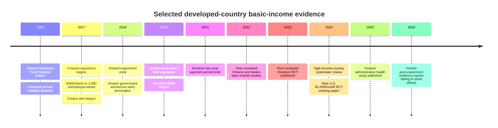
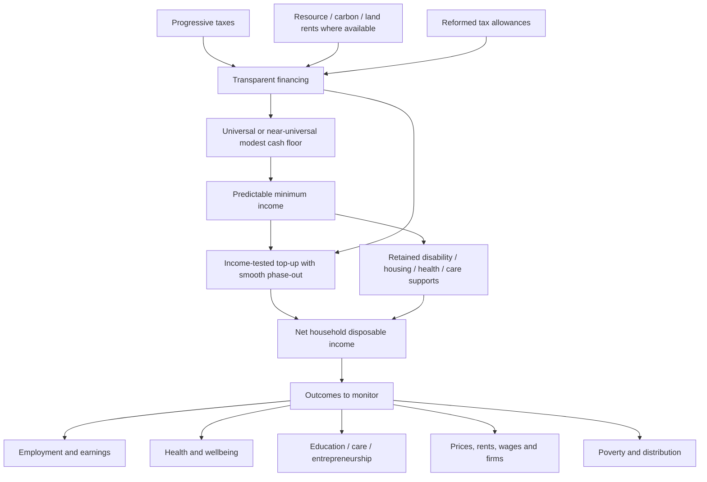

# Universal Basic Income in Developed Countries: Effectiveness, Long-Term Consequences, and Policy Design Lessons

## Executive Summary

The post-2015 evidence from developed-country Universal Basic Income (UBI) and guaranteed-income experiments supports a more nuanced conclusion than either “UBI makes people stop working” or “UBI solves poverty with no trade-offs.” The best causal evidence shows that **unconditional cash reliably improves short-run financial security and often mental wellbeing, while employment effects range from approximately zero for relatively modest transfers to modestly negative for larger transfers**. The evidence is considerably weaker on long-run productivity, human-capital accumulation, fertility, entrepreneurship, informal work, inflation, and economy-wide fiscal effects because nearly all experiments are temporary, targeted, small relative to the economy, and financed externally rather than through the taxes that a permanent national program would require. A 2024 Campbell systematic review of 27 studies covering 10 high-income-country experiments reached a similarly qualified conclusion: food insecurity and mental distress appear to improve under some guaranteed-income designs, but results for life satisfaction and financial wellbeing vary by program type, and methodological weaknesses substantially reduce certainty for many outcomes. [[1]](https://onlinelibrary.wiley.com/doi/full/10.1002/cl2.1414)

The **Finnish experiment** provides the strongest administrative-data evidence among the focal pilots. Two thousand unemployed people aged 25–58 received €560 per month tax-free during 2017–2018, regardless of subsequent earnings. Randomization substantially reduced employment-related benefit withdrawal rates, yet the peer-reviewed economic evaluation found essentially no statistically significant employment response in the first year and characterized overall employment effects as minor. Official results for the later reference period indicated roughly six additional days of employment, but interpretation is complicated by a nationwide activation-policy reform in 2018. [[2]](https://valtioneuvosto.fi/en/-/1271139/perustulokokeilun-tulokset-tyollisyysvaikutukset-vahaisia-toimeentulo-ja-psyykkinen-terveys-koettiin-paremmaksi) More recent administrative research is important: a 2025 *Journal of Public Economics* paper found that the experiment raised participants' average income by roughly 9–11% and reduced psychotropic-medication use by 8–11%, with suggestive reductions in outpatient mental-health treatment but no detectable effects on most other health outcomes. Because most subjects continued claiming unemployment benefits—and therefore retained associated obligations—the authors interpret the health effect mainly as an income effect rather than an effect of unconditionality itself. [[3]](https://www.sciencedirect.com/science/article/pii/S0047272725001781) Follow-up research published in 2026 suggests that some mental-health gains faded after the experiment and finds no substantial lasting effect on employment, geographic mobility, or fertility. [[4]](https://www.elgaronline.com/edcollchap-oa/book/9781035375448/chapter16.xml)

The **Ontario Basic Income Pilot** was potentially more policy-relevant for low-income households but became a methodological cautionary tale. It offered up to C$16,989 annually to a single adult and C$24,027 to a couple, reduced by C$0.50 for every dollar of earned income, with an additional disability supplement. More than 4,000 people were enrolled across Hamilton-Brantford, Thunder Bay, and Lindsay, with a planned three-year evaluation. [[5]](https://news.ontario.ca/mcys/en/2017/04/ontarios-basic-income-pilot.html) The incoming provincial government terminated the pilot early; payments continued only through March 31, 2019. [[6]](https://news.ontario.ca/mcys/en/2018/08/ontarios-government-for-the-people-announces-compassionate-wind-down-of-basic-income-research-projec.html) Consequently, Ontario never produced the intended completed causal evaluation. A subsequent McMaster study of 217 former recipients plus 40 qualitative interviewees found striking self-reported improvements—79% reported better general health and 83% better mental health, alongside gains in food security, debt management, housing and social participation—but the sample was self-selected and lacked a contemporaneous experimental control, so these percentages **cannot be interpreted as randomized treatment effects**. [[7]](https://labourstudies.mcmaster.ca/app/uploads/2024/06/southern-ontarios-basic-income-experience.pdf)

The **Stockton Economic Empowerment Demonstration (SEED)** in California provides useful U.S. randomized evidence. The program gave $500 a month, with no work requirement or spending restriction, for two years beginning in 2019; the peer-reviewed analysis used 131 treatment and 200 control participants. [[8]](https://www.stocktondemonstration.org/) It found lower income volatility, reduced psychological distress, better energy and physical functioning, and increased perceived agency. The COVID-19 shock disrupted the second year and several wellbeing differences weakened during or after the crisis, illustrating both the stabilizing value of cash and the difficulty of inferring permanent effects from short pilots. [[9]](https://pmc.ncbi.nlm.nih.gov/articles/PMC10160253/) First-year employment patterns did not support fears of mass labor-force withdrawal; however, Stockton was far too small to identify general-equilibrium labor-market effects. More recent U.S. evidence from a substantially larger transfer—$1,000 per month for three years in the OpenResearch experiment—finds a roughly 4.2-percentage-point decline in labor-force participation, underscoring that labor responses are likely **dose-dependent**. That study remains best treated as supplementary evidence rather than as one of the focal programs. [[10]](https://www.nber.org/papers/w32719)

The **Alaska Permanent Fund Dividend (PFD)** is uniquely valuable because it is universal, durable, and economy-wide, although it is an annual resource dividend rather than a subsistence-level UBI. The program has distributed annual payments to eligible Alaska residents since 1982. [[11]](https://apfc.org/about/history/) A 2022 *American Economic Journal: Economic Policy* synthetic-control study found **no statistically significant decrease in overall employment** and a 1.8-percentage-point increase in part-time work. The authors argue that individual income effects that reduce labor supply can be offset by higher local demand, particularly in non-tradable sectors—a general-equilibrium mechanism absent from small pilots. [[12]](https://www.aeaweb.org/articles?id=10.1257%2Fpol.20190299) Alaska also illustrates the limits of confident claims about inflation: a 2022 *National Tax Journal* study found suggestive evidence of higher prices but could not construct a sufficiently convincing synthetic control because Alaska already had unusual inflation dynamics around the policy's introduction, leaving the causal price effect uncertain. [[13]](https://www.journals.uchicago.edu/doi/10.1086/720770)

The central policy conclusion is therefore **not that a full UBI has been experimentally “proven.”** None of Finland, Ontario, or Stockton tested a permanent nationwide UBI financed through national taxation, while Alaska's permanent universal transfer is much smaller and annual. The strongest evidence supports a narrower proposition: **predictable unconditional cash can reduce financial stress and improve some health and wellbeing outcomes without necessarily causing large employment losses at modest benefit levels.** The fiscal and macroeconomic question is much harder. A British Columbia expert panel simulation illustrates the scale of the targeting trade-off: for a C$10,000 guarantee, a universal design had an estimated C$25.7 billion gross cost, compared with C$11.6 billion at a 15% benefit-reduction rate, C$4.3 billion at 50%, and C$2.7 billion at 100%. [[14]](https://bcbasicincomepanel.ca/wp-content/uploads/2021/01/Final_Report_BC_Basic_Income_Panel.pdf) Dynamic general-equilibrium research likewise finds that modest, expenditure-neutral reform can have quite different employment and output effects from a large $1,000-per-month UBI requiring substantial new taxation. [[15]](https://avdluduvice.github.io/files/Luduvice_UBI_June24_final.pdf)

**For developed welfare states, the evidence therefore favors a carefully designed guaranteed-income floor or refundable tax credit with gradual phase-out, retained disability/housing/health supports, and transparent progressive or resource-based financing over an immediate high-value flat UBI that replaces targeted programs.** A universal dividend can still be justified on administrative, political, or common-ownership grounds, as Alaska demonstrates, but that is a different objective from obtaining the maximum poverty reduction per fiscal dollar. [[16]](https://www.nber.org/papers/w25538)

## Analytical Framework and What the Experiments Actually Identify

A definitional distinction is essential. A strict UBI is normally understood as an **individual, periodic, unconditional payment with broad or universal population coverage and no means test**. Most famous “UBI pilots” do not satisfy all of those criteria. Finland tested unconditionality among people already receiving unemployment support; Ontario tested a household-income-dependent negative-income-tax-type guarantee; Stockton tested a targeted guaranteed income; and Alaska is a universal annual social dividend. The Campbell review explicitly warns that treating these heterogeneous interventions as one policy is analytically misleading and separates them into categories such as supplemental fixed payments, guaranteed minimum incomes, and negative income taxes. [[17]](https://onlinelibrary.wiley.com/doi/full/10.1002/cl2.1414)

That distinction matters for causal interpretation. A randomized trial can answer, for example, **“What happens to selected low-income households when they receive $500 a month without simultaneously paying the taxes needed to finance it?”** It generally cannot answer **“What happens to national employment, wages, prices, tax bases, migration, or investment when every adult permanently receives the payment and taxes rise to finance it?”** Hoynes and Rothstein's post-2015 review of UBI in advanced economies emphasizes that the financing mechanism and treatment of pre-existing benefits are central to distributional and fiscal conclusions, not secondary implementation details. [[18]](https://www.nber.org/papers/w25538)

A useful way to read the empirical record is therefore to separate three levels of evidence:

| Evidence level | What can be learned relatively well | What remains poorly identified |
|---|---|---|
| **Individual/household causal effects** | Financial security, labor supply of recipients, some health and wellbeing outcomes, sometimes education or job search | Very long-run behavior after 5–20 years; effects on children reaching adulthood |
| **Community/general-equilibrium effects** | Partially observable in Alaska; potentially local demand and non-tradable employment | Wages, rents, firm entry, migration and local prices in most short pilots |
| **National fiscal/macroeconomic effects** | Mainly model-based | Inflation, equilibrium wages, capital accumulation, national labor supply and politically feasible taxation under a full-scale UBI |

This hierarchy is consistent with the 2024 systematic review, which found a relatively small number of experiments, considerable outcome heterogeneity, and enough methodological limitations that broad claims about a generic “UBI effect” are not warranted. [[17]](https://onlinelibrary.wiley.com/doi/full/10.1002/cl2.1414)

The chronology also shows why claims of decades-long experimental evidence are misleading: only Alaska offers permanent universal exposure, while the experimental programs were short.



The dates and program descriptions are documented by the Finnish government, Ontario government, SEED, the Alaska Permanent Fund Corporation, and subsequent peer-reviewed studies. [[19]](https://valtioneuvosto.fi/en/-/1271139/perustulokokeilun-tulokset-tyollisyysvaikutukset-vahaisia-toimeentulo-ja-psyykkinen-terveys-koettiin-paremmaksi)

## Program Design and Identification Comparison

| Program | Transfer and duration | Population/sample | Conditionality and interaction with earnings | Evaluation design | Causal/external-validity assessment |
|---|---|---|---|---|---|
| **Finland Basic Income Experiment** | €560/month, tax-exempt, Jan. 2017–Dec. 2018 | 2,000 randomly selected unemployed people aged 25–58 nationwide | Basic-income payment itself did not fall when recipients obtained employment; no job-search condition attached to BI, although subjects could continue claiming unemployment benefits and associated obligations | National RCT linked to administrative registers; very large eligible control population | **High internal validity for low-income unemployed recipients; low-to-moderate external validity for universal UBI.** 2018 activation reform complicates year-two employment interpretation. [[20]](https://valtioneuvosto.fi/en/-/1271139/perustulokokeilun-tulokset-tyollisyysvaikutukset-vahaisia-toimeentulo-ja-psyykkinen-terveys-koettiin-paremmaksi) |
| **Ontario Basic Income Pilot** | Up to C$16,989/year single; C$24,027 couple; earnings reduced benefit by 50 cents per dollar; disability supplement; intended 3 years | More than 4,000 low-income adults in Hamilton-Brantford, Thunder Bay and Lindsay; more than 2,000 comparison participants reported during implementation | No work requirement; means-tested guarantee rather than universal payment | Intended experimental/comparison design in Hamilton/Thunder Bay plus a broader community design in Lindsay; terminated before planned evaluation | **Intended design potentially strong, realized evidence weak for causality.** Post-cancellation research is mostly self-selected observational survey/interview evidence. [[21]](https://news.ontario.ca/mcys/en/2017/04/ontarios-basic-income-pilot.html) |
| **Stockton SEED** | $500/month for 24 months | Official program: 125 randomly selected recipients; peer-reviewed analytic RCT: 131 treatment and 200 control participants | Fully unconditional; no employment requirement or spending restriction | Mixed-methods RCT with repeated surveys and 105 qualitative interviews | **Good internal validity for recipient financial/health effects; low external validity for national UBI or macro effects.** COVID-19 is a major time-varying shock. [[8]](https://www.stocktondemonstration.org/) |
| **Alaska Permanent Fund Dividend** | Variable annual per-capita dividend; continuing since 1982 | Broadly all eligible Alaska residents, including children | Not means-tested and not withdrawn with earnings; residency eligibility applies | Natural experiment; synthetic control and related quasi-experimental methods | **Moderate causal identification and unusually high relevance for permanence/universality**, but payment is annual and too small to approximate a subsistence-level UBI. [[22]](https://apfc.org/about/history/) |
| **OpenResearch U.S. experiment — supplementary evidence** | $1,000/month for 3 years; control received a nominal monthly amount | About 1,000 low-income treatment adults and roughly 2,000 controls across two U.S. states | Unconditional | Large RCT; 2024 NBER working-paper evidence | Important for **transfer-size sensitivity**, but not yet equivalent to peer-reviewed permanent-UBI evidence; labor-force participation fell about 4.2 percentage points. [[10]](https://www.nber.org/papers/w32719) |

Two design issues are especially important.

First, **Finland's payment was substantially more work-friendly at the margin than conventional unemployment assistance**, yet removing the effective “welfare trap” generated little employment response. The peer-reviewed evaluation reports that the reform reduced participation tax rates substantially—about 23 percentage points for full-time employment—without producing a statistically meaningful first-year increase in employment. This suggests that employment barriers among the long-term or recurrently unemployed involve much more than financial incentives: skills, health, local job availability, matching frictions and employer demand matter. [[23]](https://www.aeaweb.org/articles?id=10.1257%2Fpol.20200143)

Second, Ontario demonstrates how **political commitment is part of experimental methodology**. An experiment designed for three years cannot cleanly identify medium-term behavioral adaptation when participants learn midway through that the program will disappear. The official decision to terminate payments after March 31, 2019 changed participants' expected lifetime resources and disrupted the planned research design. [[24]](https://news.ontario.ca/mcys/en/2018/08/ontarios-government-for-the-people-announces-compassionate-wind-down-of-basic-income-research-projec.html)

## Evidence on Employment, Income, Poverty, Consumption, Health and Spillovers

The overall empirical pattern is one of **stronger evidence for reductions in economic insecurity than for either large positive or large negative employment effects**. Importantly, the labor result varies with benefit size, population, duration, and whether general-equilibrium demand effects are present. [[25]](https://onlinelibrary.wiley.com/doi/full/10.1002/cl2.1414)

| Outcome | Finland | Ontario | Stockton | Alaska PFD |
|---|---|---|---|---|
| **Employment / labor supply** | No statistically significant first-year employment effect; official later-period estimate about six additional employment days, but year-two policy changes complicate attribution. [[26]](https://www.aeaweb.org/articles?id=10.1257%2Fpol.20200143) | No completed causal pilot estimate. Post-hoc survey did **not** show wholesale withdrawal from work, but self-selection prevents causal inference. [[27]](https://labourstudies.mcmaster.ca/app/uploads/2024/06/southern-ontarios-basic-income-experience.pdf) | No evidence of broad withdrawal from employment; first-year full-time-employment patterns favored treatment, but sample was small and labor outcomes should not be extrapolated to national equilibrium. [[28]](https://pmc.ncbi.nlm.nih.gov/articles/PMC10160253/) | No significant aggregate employment effect; part-time employment +1.8 pp. [[12]](https://www.aeaweb.org/articles?id=10.1257%2Fpol.20190299) |
| **Earnings / disposable income** | Average income rose roughly 9–11% in later administrative analysis, partly because BI overlapped with pre-experiment benefits and was not tapered against labor earnings. [[3]](https://www.sciencedirect.com/science/article/pii/S0047272725001781) | Benefits explicitly supplemented low earnings with a 50% withdrawal rate. Realized long-run earnings effect **not causally identified**. [[29]](https://news.ontario.ca/mcys/en/2017/04/ontarios-basic-income-pilot.html) | Reduced income volatility and increased capacity to handle financial shocks. [[30]](https://pmc.ncbi.nlm.nih.gov/articles/PMC10160253/) | Dividend directly raises household cash income; labor-demand effects appear to offset some individual income-effect reductions in work. [[12]](https://www.aeaweb.org/articles?id=10.1257%2Fpol.20190299) |
| **Poverty / material hardship** | Poverty itself was not the principal causal endpoint; financial wellbeing improved in surveys. | Self-reported food, housing, debt and emergency-finance indicators improved substantially, but no valid treatment-vs-control poverty estimate survived cancellation. [[31]](https://labourstudies.mcmaster.ca/app/uploads/2024/06/southern-ontarios-basic-income-experience.pdf) | Greater financial stability; trial not powered to estimate citywide poverty rates. [[30]](https://pmc.ncbi.nlm.nih.gov/articles/PMC10160253/) | Long-horizon research estimates meaningful poverty and inequality reductions; one 2024 analysis estimates roughly 20–40% fewer Alaskans below the poverty threshold under alternative specifications and a Gini reduction of about 0.02. [[32]](https://ideas.repec.org/a/wly/povpop/v16y2024i2p126-145.html) |
| **Consumption / food security** | Direct consumption effects not a major administrative endpoint; **insufficient evidence for a precise causal consumption estimate**. | 86% of surveyed former recipients reported a better diet and 69% less meal skipping, but these are retrospective self-reports rather than randomized effects. [[33]](https://labourstudies.mcmaster.ca/app/uploads/2024/06/southern-ontarios-basic-income-experience.pdf) | Cash reduced financial volatility and increased ability to meet routine and unexpected expenses; exact card-spending categories do not capture all cash use. [[30]](https://pmc.ncbi.nlm.nih.gov/articles/PMC10160253/) | General-equilibrium labor evidence is consistent with dividend-induced local demand; precise consumption response is outside the core studies reviewed here. [[12]](https://www.aeaweb.org/articles?id=10.1257%2Fpol.20190299) |
| **Mental health / wellbeing** | Strong self-reported wellbeing gains; administrative evidence shows 8–11% lower psychotropic-drug use and suggests fewer outpatient mental-health visits. [[34]](https://valtioneuvosto.fi/en/-/1271139/perustulokokeilun-tulokset-tyollisyysvaikutukset-vahaisia-toimeentulo-ja-psyykkinen-terveys-koettiin-paremmaksi) | 83% of the 209 respondents answering the mental-health question reported improvement; highly suggestive but non-causal. [[35]](https://labourstudies.mcmaster.ca/app/uploads/2024/06/southern-ontarios-basic-income-experience.pdf) | Lower psychological distress, higher agency, and improved physical functioning during the experiment; some effects attenuated later. [[9]](https://pmc.ncbi.nlm.nih.gov/articles/PMC10160253/) | Evidence extends to intergenerational health: a 2016 study estimates that an additional $1,000 dividend increased birth weight by about 17.7 grams and reduced low-birth-weight incidence by roughly 14% of its sample mean. [[36]](https://pure.korea.ac.kr/en/publications/money-transfer-and-birth-weight-evidence-from-the-alaska-permanen-2/) |
| **Informal work, care, education, entrepreneurship** | Qualitative evidence reports more flexibility for freelancing, entrepreneurship attempts, caregiving and volunteering, but no strong causal quantity estimate. [[37]](https://www.helsinki.fi/en/news/society-and-learning/universal-basic-income-experiment-finland-new-research-reveals-significant-diversity-participants-experience) | Among survey respondents who stopped working during the pilot, 40.6% reported returning to school; participants also reported more volunteering and family time. Selection makes treatment effects **unspecified**. [[33]](https://labourstudies.mcmaster.ca/app/uploads/2024/06/southern-ontarios-basic-income-experience.pdf) | Qualitative evidence indicates recipients used greater security for job search, caregiving and other risk-taking; causal magnitudes are not precisely identified. [[30]](https://pmc.ncbi.nlm.nih.gov/articles/PMC10160253/) | Part-time work rose, suggesting adjustment on hours/job type rather than mass exit from employment. [[12]](https://www.aeaweb.org/articles?id=10.1257%2Fpol.20190299) |

### What Finland contributes

Finland is particularly informative because it directly tested one argument often made for UBI: that eliminating benefit withdrawal and job-search conditionality would dramatically improve work incentives. It did remove a major part of the financial penalty associated with taking work, but the labor response was small. This is evidence **against the strong version of the welfare-trap hypothesis**, not evidence that incentives never matter. The participants were already unemployed, the transfer was moderate, and the experiment lasted only two years. [[38]](https://www.aeaweb.org/articles?id=10.1257%2Fpol.20200143)

Finland's newer health evidence strengthens the case that cash can affect outcomes that ordinary employment-focused evaluations miss. Psychotropic drug use fell 8–11%, while effects on most non-mental-health outcomes were absent. The researchers' interpretation is also policy-relevant: because most recipients continued participating in unemployment insurance and its conditions, the mental-health gain appears more consistent with **higher and more stable resources** than with the psychological effect of eliminating all bureaucracy. [[3]](https://www.sciencedirect.com/science/article/pii/S0047272725001781)

Long-term interpretation is less favorable to claims of transformational behavioral change. The 2026 synthesis of Finnish register evidence reports that mental-health-related gains largely faded after the experiment and that there were no substantial lasting changes in employment, geographical mobility, or fertility. That combination—meaningful short-run relief without major permanent life-course transformation—is arguably the most defensible characterization of the Finnish evidence so far. [[4]](https://www.elgaronline.com/edcollchap-oa/book/9781035375448/chapter16.xml)

### What Ontario contributes

Ontario is strongest as evidence about **participant experience and political risk**, not as a causal estimate. The later McMaster study surveyed 217 former Hamilton-Brantford recipients and conducted 40 interviews; recruitment involved community organizations, social media and public outreach, making the sample self-selected rather than a randomized subset of the original experimental groups. [[39]](https://labourstudies.mcmaster.ca/app/uploads/2024/06/southern-ontarios-basic-income-experience.pdf)

The reported improvements are nevertheless large enough to be policy-relevant hypotheses. Among respondents, 79% reported improved overall health; 83% reported better mental wellbeing; 86% less frequent stress/anxiety; 86% a better diet; 60% greater ease repaying debt; and 75% improved preparedness for financial emergencies. [[40]](https://labourstudies.mcmaster.ca/app/uploads/2024/06/southern-ontarios-basic-income-experience.pdf) But respondents who had especially favorable or unfavorable experiences may have been disproportionately likely to participate, there was no contemporaneous randomized-control comparison in this follow-up, and recall after cancellation could influence responses. Those limitations mean that saying “Ontario's basic income caused an 83% improvement in mental health” would be incorrect. Peer-reviewed analyses of the Hamilton experience appropriately treat these data as mixed-methods evidence rather than as recovered RCT estimates. [[41]](https://ideas.repec.org/a/bpj/bistud/v15y2020i2p39n2.html)

Ontario also reveals a neglected behavioral effect: **policy-reversal risk**. Households may make multi-year decisions about schooling, housing, debt and work based on an announced three-year income floor. Premature cancellation can itself cause welfare losses and contaminate measurement of the original treatment. The McMaster report explicitly describes abandoned or postponed life plans following cancellation. [[27]](https://labourstudies.mcmaster.ca/app/uploads/2024/06/southern-ontarios-basic-income-experience.pdf)

### What Stockton and Alaska add

Stockton strengthens the causal case for short-run psychological and financial benefits. Its randomized design, repeated measurement before and during treatment, and mixed quantitative/qualitative approach found lower income volatility and mental distress and greater agency. [[30]](https://pmc.ncbi.nlm.nih.gov/articles/PMC10160253/) The trial also illustrates why post-treatment follow-up matters: differences weakened in the extraordinary COVID environment and after payments ceased, so a two-year treatment does not establish that health or labor-market effects persist indefinitely. [[9]](https://pmc.ncbi.nlm.nih.gov/articles/PMC10160253/)

Alaska provides the crucial counterpoint to individual-level labor-supply reasoning. A person receiving non-labor income may choose to work fewer hours, but when an entire population simultaneously receives money, higher consumption can increase demand for local labor. Jones and Marinescu find no aggregate employment decline and a 1.8-percentage-point rise in part-time work, with relatively stronger employment responses in non-tradable industries. This is one of the clearest pieces of evidence that **micro labor-supply effects and macro employment effects need not have the same sign or magnitude**. [[12]](https://www.aeaweb.org/articles?id=10.1257%2Fpol.20190299)

The most useful visual summary is therefore directional rather than a falsely precise meta-average, because the studies measure different endpoints:

```text
Selected labor-market evidence
(effect metric differs by study; bars are therefore NOT directly comparable)

Finland, employment days        ≈ 0 first year | modest + later
                                  ──────────────┼──►

Ontario, causal employment      [ NOT IDENTIFIED — pilot cancelled ]

Stockton, employment attachment  no broad withdrawal detected
                                  ──────────────┼─►

Alaska, total employment         ≈ 0
                                  ──────────────┼
Alaska, part-time share          +1.8 pp
                                  ──────────────┼──►

OpenResearch, labor-force part.  -4.2 pp
                          ◄───────┼──────────────
                 lower work      0       higher work
```

The Finland and Alaska estimates come from peer-reviewed causal/quasi-causal research; the Stockton conclusion is based on its randomized study but should not be interpreted as an economy-wide employment estimate; Ontario lacks a completed causal estimate; and OpenResearch is included as a non-peer-reviewed boundary case showing that larger payments can produce more visible labor-supply responses. [[42]](https://www.aeaweb.org/articles?id=10.1257%2Fpol.20200143)

## Fiscal, Macroeconomic, Distributional and Political Consequences

**Fiscal cost is the largest gap between pilot evidence and permanent UBI policy.** Pilot recipients receive externally financed transfers; they generally do not face a new tax schedule that recovers much of the transfer from middle- and high-income households. A national UBI is therefore a joint policy consisting of a transfer **plus** taxes, benefit reductions, or resource revenues. Its true distributional impact is the net of all those components. Hoynes and Rothstein accordingly emphasize that in advanced welfare states the central question is not merely the size of the check but which existing programs and tax preferences are replaced and who finances the residual cost. [[18]](https://www.nber.org/papers/w25538)

The British Columbia Expert Panel's microsimulation provides a useful scale comparison. With a C$10,000 individual guarantee, it estimated the following gross costs as income testing became progressively tighter: [[14]](https://bcbasicincomepanel.ca/wp-content/uploads/2021/01/Final_Report_BC_Basic_Income_Panel.pdf)

| Design | Benefit-reduction rate | Estimated gross cost |
|---|---:|---:|
| Universal payment | 0% | **C$25.7bn** |
| Refundable credit | 15% | C$11.6bn |
| Refundable credit | 30% | C$6.6bn |
| Refundable credit | 50% | C$4.3bn |
| Refundable credit | 75% | C$3.2bn |
| Refundable credit | 100% | C$2.7bn |

The table exposes a genuine policy frontier rather than a free lunch. **Universality minimizes withdrawal-rate disincentives but maximizes the amount that must be raised elsewhere. Targeting reduces fiscal cost but imposes an effective marginal tax as benefits phase out.** The appropriate comparison therefore includes both the phase-out rate and the distortion created by whichever income, payroll, consumption, wealth, carbon, land, or other tax finances the universal alternative. [[14]](https://bcbasicincomepanel.ca/wp-content/uploads/2021/01/Final_Report_BC_Basic_Income_Panel.pdf)

Macroeconomic models reach similarly conditional conclusions. Luduvice's 2024 *Journal of Monetary Economics* analysis replaces part of the U.S. income-security system with UBI in a heterogeneous-agent overlapping-generations framework. An expenditure-neutral reform produces higher aggregate employment and output and lower earnings/wealth inequality in the model; a much larger UBI equivalent to $1,000 a month requires a much larger consumption-tax increase and instead lowers employment and output. Both scenarios make disposable income and consumption more equally distributed. [[15]](https://avdluduvice.github.io/files/Luduvice_UBI_June24_final.pdf) This result should not be read as a forecast of exact effects. Its value is to demonstrate an economically important nonlinearity: **results from a small UBI cannot simply be multiplied by two or three to infer the effect of a large UBI.**

Financing choices can be grouped analytically as follows:

| Financing route | Main advantage | Main risk / trade-off |
|---|---|---|
| **Progressive income or surtaxes** | Recovers transfer from higher-income recipients; can make net policy strongly progressive | Raises marginal tax rates and may affect labor supply, avoidance and taxable-income responses |
| **Broad consumption/VAT tax** | Large and relatively stable base; administratively feasible | Regressive before recycling; a large UBI may require a substantial rate increase, as macro models illustrate. [[43]](https://avdluduvice.github.io/files/Luduvice_UBI_June24_final.pdf) |
| **Resource / sovereign-wealth dividend** | Makes common-asset ownership transparent and can be politically durable | Available revenue is limited and volatile; Alaska's scale is far below a full subsistence UBI. [[44]](https://apfc.org/about/history/) |
| **Carbon or environmental rents** | Can combine redistribution with Pigouvian pricing | Revenue declines if emissions fall; insufficient by itself for a large UBI in most economies |
| **Land/property or wealth taxation** | Targets relatively immobile or concentrated assets | Valuation, liquidity, avoidance and political-administration challenges |
| **Replacing existing cash benefits / tax allowances** | Reduces gross new fiscal requirement | Can create losers among disabled people, high-rent households, single parents and others with needs above the flat amount |
| **Debt financing** | Avoids immediate tax increase | Turns UBI into a net aggregate-demand injection and raises debt-service/fiscal-sustainability issues; not a permanent financing solution absent future taxation |
| **Monetary financing** | Maximum immediate purchasing-power injection | Greatest risk that nominal demand outruns productive capacity; inappropriate to infer its consequences from tax- or resource-funded pilots |

The strongest case against simply replacing existing welfare programs is **heterogeneity of need**. A flat payment gives the same amount to a healthy adult in a low-cost region and a severely disabled person with high housing or care costs. A UBI large enough to ensure that the latter is not worse off becomes very expensive; a lower UBI that eliminates disability, housing or health supports can make vulnerable households net losers. This distributional concern is central to advanced-economy UBI analysis and to the British Columbia panel's conclusion that a basic-income-centered replacement of the welfare system was not the most effective way to address diverse needs. [[45]](https://www.nber.org/papers/w25538)

On **inflation**, the empirical evidence is markedly weaker than public debate often implies. Small randomized pilots cannot reveal national inflation because the transfer is tiny relative to total demand and local recipients can purchase goods supplied from outside the experimental area. Alaska is closer to the relevant experiment, but Jones and Marinescu's 2022 *National Tax Journal* study could not construct a convincing pre-policy synthetic inflation control and therefore reported only suggestive, highly uncertain positive price effects. [[13]](https://www.journals.uchicago.edu/doi/10.1086/720770) The responsible inference is not “UBI causes no inflation,” but that **there is no robust developed-country causal estimate of the inflation rate generated by a large permanent national UBI**. Inflation would depend on transfer size, financing, monetary accommodation, unused capacity, labor-supply responses, import capacity and especially supply constraints in housing and services. [[46]](https://www.journals.uchicago.edu/doi/10.1086/720770)

Distributional effects are more predictable. For a fixed gross budget, targeting sends more resources to low-income households, while universality improves horizontal simplicity, eliminates exclusion errors, avoids stigma and can create a much larger political constituency. Alaska shows that an equal per-capita dividend can meaningfully reduce poverty and inequality because a fixed dollar amount is proportionally much larger for low-income families; recent analysis estimates substantial poverty reductions over the program's long history. [[32]](https://ideas.repec.org/a/wly/povpop/v16y2024i2p126-145.html) But those distributional gains do not prove that the same fiscal resources would reduce poverty more under a universal design than under a well-designed targeted credit.

Political feasibility differs sharply across the cases. Finland successfully implemented a statutory national experiment but did not subsequently convert it into a national UBI; analysis of its political context finds much more influence on debate than on actual social-policy architecture. [[47]](https://www.researchgate.net/publication/361240830_A_Truly_Missed_Opportunity_The_Political_Context_and_Impact_of_the_Basic_Income_Experiment_in_Finland) Ontario shows the opposite risk: a government change terminated a three-year pilot after roughly a year and a half, undermining both participants' planning and the scientific investment. [[24]](https://news.ontario.ca/mcys/en/2018/08/ontarios-government-for-the-people-announces-compassionate-wind-down-of-basic-income-research-projec.html) Alaska demonstrates exceptional durability: its underlying sovereign wealth fund was created through a constitutional amendment, and the dividend has existed since 1982, benefiting a broad constituency and being framed as a return on collectively owned resource wealth. [[48]](https://apfc.org/about/history/) This comparison suggests—an inference, rather than a directly randomized finding—that **political narratives about ownership and entitlement may matter almost as much as technocratic benefit formulas for policy durability**. [[49]](https://news.ontario.ca/mcys/en/2018/08/ontarios-government-for-the-people-announces-compassionate-wind-down-of-basic-income-research-projec.html)

Long-term behavioral effects remain the largest unresolved empirical question. The available record gives little support to dramatic claims that modest unconditional cash permanently destroys work incentives: Finland shows little employment change, Alaska no aggregate employment decline, and Stockton no broad disengagement. [[50]](https://www.aeaweb.org/articles?id=10.1257%2Fpol.20200143) Yet the larger three-year U.S. experiment's approximately 4.2-percentage-point labor-force-participation reduction warns against extrapolating small-transfer findings to a high-value UBI. [[10]](https://www.nber.org/papers/w32719) Moreover, reduced paid work is not itself a sufficient welfare statistic: time may shift to childcare, education, caring for relatives, health recovery, entrepreneurship, job search or leisure. Existing pilots measure these margins incompletely, and informal work is particularly poorly quantified. [[51]](https://www.helsinki.fi/en/news/society-and-learning/universal-basic-income-experiment-finland-new-research-reveals-significant-diversity-participants-experience)

## Policy Scenarios and Recommendations

The following scenarios are **analytical scenarios, not forecasts**. They combine the experimental evidence with the fiscal and macroeconomic literature and make explicit which assumptions generate favorable or unfavorable outcomes. [[52]](https://onlinelibrary.wiley.com/doi/full/10.1002/cl2.1414)

| Dimension | Optimistic scenario | Neutral / central scenario | Pessimistic scenario |
|---|---|---|---|
| **Design** | Moderate guaranteed income or partial universal dividend; gradual phase-out; disability/housing/health benefits retained | Larger cash floor with partial consolidation of existing cash benefits | High subsistence-level universal grant replaces much of targeted welfare |
| **Financing** | Progressive broad tax base plus resource/carbon/land rents; budget broadly balanced | Mix of income/consumption taxes and benefit consolidation | Heavy distortionary taxation or persistent deficits; financing politically unstable |
| **Employment** | Small individual reductions are offset by better job matching, health and local demand; aggregate employment near unchanged | Modest reduction in participation/hours concentrated among some groups | Large transfer produces meaningful participation and hours reductions; tax increases reinforce the effect |
| **Poverty** | Large and durable reduction, with near-poor also insured against income shocks | Material reduction but less per fiscal dollar than a highly targeted transfer | Gains partly lost because targeted high-need benefits disappear or prices/rents capture part of transfer |
| **Wellbeing / health** | Lower stress becomes persistent because the income floor is permanent | Meaningful but moderate mental-health gains; some adaptation over time | Short-run gains fade; vulnerable households losing specialized services can be worse off |
| **Human capital** | Some recipients use security for training, better job search, entrepreneurship and caregiving | Positive for some groups, offset by reduced accumulated work experience for others | Prolonged labor-force detachment reduces skills and future wages |
| **Inflation** | Limited because financing largely redistributes existing purchasing power and supply responds | Little aggregate inflation but price pressure in housing/care/local services | Deficit-financed demand plus constrained supply generates meaningful inflation; rents absorb gains |
| **Fiscal sustainability** | Transfer is moderate and tax base robust; automatic adjustment rules preserve solvency | High but manageable cost requires visible tax increases | Gross cost forces repeated tax hikes, benefit retrenchment or borrowing |
| **Politics** | Universal/near-universal constituency plus targeted supplements creates durable coalition | Policy survives but transfer level and phase-out continually contested | Fiscal cost and perceived work disincentives trigger reversal similar in spirit to Ontario |
| **Evidence most consistent with scenario** | Alaska's employment result; Finland's health findings; Stockton wellbeing | Mixed cross-program evidence and macro models | Larger U.S. transfer's labor response and large-UBI macro simulations [[53]](https://www.aeaweb.org/articles?id=10.1257%2Fpol.20190299) |

The policy implications follow directly from where the evidence is strongest and weakest.

| Recommendation | Rationale from the evidence |
|---|---|
| **Use a guaranteed-income/refundable-credit architecture when the primary objective is poverty reduction.** | The British Columbia simulations show that income testing can achieve a given income floor at a fraction of the gross cost of a universal transfer, albeit with a phase-out-rate trade-off. A universal payment is better justified when simplicity, non-stigmatization, universal insurance or common-asset ownership is itself an objective. [[54]](https://bcbasicincomepanel.ca/wp-content/uploads/2021/01/Final_Report_BC_Basic_Income_Panel.pdf) |
| **Keep specialized disability, housing, health and care supports outside the flat cash floor.** | Advanced-economy households have heterogeneous needs that a single uniform grant cannot efficiently insure; replacing these programs is where a seemingly progressive UBI can generate vulnerable losers. [[55]](https://www.nber.org/papers/w25538) |
| **Set phase-out rates to avoid sharp welfare cliffs.** | Finland shows that removing very high effective marginal tax rates does not automatically create large employment effects, but cliffs still distort incentives and create volatility. Smooth withdrawal preserves gains from additional earnings. [[56]](https://www.aeaweb.org/articles?id=10.1257%2Fpol.20200143) |
| **Publish the transfer and financing package together.** | A “$1,000 monthly UBI” without specifying taxes or benefit replacements is not a complete policy. Macroeconomic results change qualitatively with scale and financing. [[57]](https://avdluduvice.github.io/files/Luduvice_UBI_June24_final.pdf) |
| **Prefer durable tax or asset revenues to permanent deficit financing.** | Alaska demonstrates the institutional advantages of linking a dividend to an asset pool, while large structural deficits would make a permanent income guarantee dependent on future fiscal retrenchment. [[44]](https://apfc.org/about/history/) |
| **Pair cash reform with supply-side housing, childcare, healthcare and training policies.** | Cash solves liquidity and purchasing-power constraints; it does not by itself create apartments, doctors, childcare slots or appropriate vacancies. Supply constraints are also the channel through which localized price effects are most plausible. Inflation evidence from Alaska is too uncertain to assume prices will never respond. [[13]](https://www.journals.uchicago.edu/doi/10.1086/720770) |
| **Treat reduced paid work as an outcome to decompose, not automatically as a social loss.** | The relevant distinction is between harmful long-term detachment and valuable shifts into care, education, recovery, entrepreneurship, job search or leisure. Ontario, Finland and Stockton all show qualitative evidence of such reallocations, but current causal measurement is insufficient. [[51]](https://www.helsinki.fi/en/news/society-and-learning/universal-basic-income-experiment-finland-new-research-reveals-significant-diversity-participants-experience) |
| **Future pilots should last at least several years and include post-transfer follow-up.** | Finland and Stockton show that effects can change or fade after payments stop, while Ontario shows the scientific damage caused by premature termination. Permanent-policy claims require observing adaptation, not merely first-year responses. [[58]](https://www.elgaronline.com/edcollchap-oa/book/9781035375448/chapter16.xml) |
| **Legally protect major experiments against arbitrary political cancellation.** | Ontario lost much of the value of its randomized design when its three-year commitment was terminated. A credible pilot should have pre-specified funding, independent data stewardship and provisions for continued outcome measurement even after a government change. [[24]](https://news.ontario.ca/mcys/en/2018/08/ontarios-government-for-the-people-announces-compassionate-wind-down-of-basic-income-research-projec.html) |
| **Measure equilibrium spillovers explicitly.** | Future experiments should collect local rents/prices, vacancies, wages, firm formation, partner labor supply, migration, informal work, caregiving and local-business revenues. Alaska indicates that demand-side general-equilibrium effects can offset individual labor-supply effects, something ordinary treatment-vs-control trials miss. [[12]](https://www.aeaweb.org/articles?id=10.1257%2Fpol.20190299) |
| **Pre-register distributional endpoints and link surveys to administrative records.** | Finland's administrative health evidence is considerably more persuasive than retrospective self-reports; Ontario shows the limitations created when the original evaluation disappears and researchers must rely on volunteer surveys. [[59]](https://www.sciencedirect.com/science/article/pii/S0047272725001781) |

A particularly defensible developed-country reform would therefore look less like “replace the welfare state with the same check for everyone” and more like a **layered income floor**:



Such a structure captures the principal benefits suggested by Finland, Stockton and Ontario—income security, lower stress and administrative simplicity—while acknowledging the fiscal efficiency of targeting and the need to insure heterogeneous high-cost needs. Alaska's experience suggests that a modest universal component can coexist with durability and broad political legitimacy without requiring that the universal payment itself be large enough to replace all social insurance. [[60]](https://www.sciencedirect.com/science/article/pii/S0047272725001781)

## Studies Reviewed, Evidence Gaps, and Overall Assessment

The core literature reviewed below prioritizes post-2015 peer-reviewed research, official pilot material and expert policy analysis, as requested.

| Study / source | Program or question | Method / data | Principal contribution | Evidence weight |
|---|---|---|---|---|
| **Verho, Hämäläinen & Kanninen, 2022, *American Economic Journal: Economic Policy*** | Finland | Randomized experiment; administrative employment records | Large reduction in participation tax rates produced no statistically significant first-year employment response; overall labor effect minor. [[23]](https://www.aeaweb.org/articles?id=10.1257%2Fpol.20200143) | **High** for recipient employment |
| **Hämäläinen & Verho, 2022, *National Tax Journal*** | Finland design/evaluation | Experimental-design analysis | Documents identification strengths and design limitations of the Finnish experiment. [[61]](https://ideas.repec.org/a/eee/pubeco/v250y2025ics0047272725001781.html) | **High** methodological relevance |
| **Hämäläinen, Simanainen & Verho, 2025, *Journal of Public Economics*** | Finland health | RCT + national prescription and secondary-care registers | Income +9–11%; psychotropic medication −8–11%; suggestive mental-health outpatient decline; most other health outcomes null. [[3]](https://www.sciencedirect.com/science/article/pii/S0047272725001781) | **High** |
| **Simanainen, 2024, *BMC Health Services Research*** | Finland dental care | Randomized experiment / administrative evidence | Finds no broad increase in overall dental-care use; illustrates that higher cash income does not automatically improve every healthcare endpoint. [[62]](https://www.cambridge.org/core/journals/journal-of-international-and-comparative-social-policy/article/how-to-implement-a-perfect-basic-income-experiment-evidence-from-four-countries/C1D78CAAEDF3E7C43B42DAFA7A07D549) | **High–moderate** |
| **Salokangas et al., 2026, peer-reviewed chapter, *Beyond the Nordic Welfare State*** | Finland post-experiment | Linked research/register synthesis | Short-run mental-health gains largely faded; no substantial lasting employment, geographic-mobility or fertility effects. [[4]](https://www.elgaronline.com/edcollchap-oa/book/9781035375448/chapter16.xml) | **Moderate–high** for longer-run synthesis |
| **Ferdosi & McDowell, 2020, *Basic Income Studies*** | Ontario | Mixed survey/interview evidence | Reports improvements across employed and unemployed recipients; continuously employed respondents also benefited. [[63]](https://ideas.repec.org/a/bpj/bistud/v15y2020i2p39n2.html) | **Low–moderate causal; high qualitative** |
| **McDowell & Ferdosi, 2021, *Basic Income Studies*** | Ontario Hamilton region | Comparative mixed-method analysis | Synthesizes participant outcomes after premature cancellation; useful for experience, not a substitute for intended RCT results. [[64]](https://ideas.repec.org/a/bpj/bistud/v16y2021i2p209-256n2.html) | **Low–moderate causal** |
| **Ferdosi et al., McMaster report, 2020** | Ontario | 217-recipient volunteer survey + 40 interviews | Large self-reported health, food-security, financial and social gains; explicitly limited by cancellation and self-report design. [[65]](https://labourstudies.mcmaster.ca/app/uploads/2024/06/southern-ontarios-basic-income-experience.pdf) | **Low causal / useful descriptive** |
| **West & Castro, 2023, *Journal of Urban Health*** | Stockton SEED | Mixed-method RCT, 131 treatment / 200 control | Reduced financial volatility and distress; improved agency and aspects of health/functioning. [[30]](https://pmc.ncbi.nlm.nih.gov/articles/PMC10160253/) | **High** for sampled recipients |
| **Jones & Marinescu, 2022, *American Economic Journal: Economic Policy*** | Alaska PFD labor market | CPS + synthetic control | No aggregate employment decline; part-time work +1.8 pp; evidence consistent with local-demand general-equilibrium offset. [[12]](https://www.aeaweb.org/articles?id=10.1257%2Fpol.20190299) | **Moderate–high** |
| **Jones & Marinescu, 2022, *National Tax Journal*** | Alaska inflation | Synthetic control | Suggestive positive price effects, but poor pre-treatment synthetic fit leaves large causal uncertainty. [[13]](https://www.journals.uchicago.edu/doi/10.1086/720770) | **Low–moderate** for inflation |
| **Chung, Ha & Kim, 2016, *Economic Inquiry*** | Alaska PFD / birth outcomes | Quasi-experimental variation in dividend amounts | Extra dividend income associated with higher birth weight and lower low-birth-weight risk. [[36]](https://pure.korea.ac.kr/en/publications/money-transfer-and-birth-weight-evidence-from-the-alaska-permanen-2/) | **Moderate** |
| **Berman, 2024, *Poverty & Public Policy*** | Alaska poverty/inequality | Long-run distributional analysis | Finds substantial poverty reduction and a lower Gini associated with the PFD. [[32]](https://ideas.repec.org/a/wly/povpop/v16y2024i2p126-145.html) | **Moderate** |
| **Rizvi et al., 2024, *Campbell Systematic Reviews*** | High-income-country guaranteed income | Systematic review/meta-analysis; 27 studies, 10 experiments | Strongest synthesized indications for food insecurity, mental distress and some education outcomes; highlights design heterogeneity and bias. [[17]](https://onlinelibrary.wiley.com/doi/full/10.1002/cl2.1414) | **High as evidence synthesis** |
| **McKay, Bennett & Dunn, 2023, *Health Promotion International*** | Basic income and health | Systematic review | Finds generally encouraging health/wellbeing signals but stresses the small and heterogeneous experimental base. [[66]](https://www.researchgate.net/publication/358361936_Removing_Welfare_Traps_Employment_Responses_in_the_Finnish_Basic_Income_Experiment) | **High as health synthesis** |
| **Hoynes & Rothstein, 2019, *Annual Review of Economics*** | UBI in advanced economies | Economic policy review | Demonstrates why taxes, replacement of existing benefits and distributional incidence dominate national-UBI feasibility. [[18]](https://www.nber.org/papers/w25538) | **High policy-analysis relevance** |
| **Luduvice, 2024, *Journal of Monetary Economics*** | U.S. macroeconomic UBI | Dynamic heterogeneous-agent general-equilibrium model | Small/expenditure-neutral and large UBI reforms can produce qualitatively different output, employment and inequality results. [[67]](https://www.sciencedirect.com/science/article/abs/pii/S0304393224000680) | **High-quality model; not experimental** |
| **British Columbia Expert Panel on Basic Income, 2021** | Fiscal/distributional design | Microsimulation and expert review | Quantifies large fiscal savings from targeting relative to universality and stresses heterogeneous social needs. [[14]](https://bcbasicincomepanel.ca/wp-content/uploads/2021/01/Final_Report_BC_Basic_Income_Panel.pdf) | **High policy-analysis relevance; not RCT** |
| **Vivalt et al., 2024, NBER working paper** | Larger U.S. guaranteed-income RCT | Three-year randomized experiment | Roughly 4.2-pp reduction in labor-force participation under a $1,000/month transfer; important dose-response boundary evidence. [[10]](https://www.nber.org/papers/w32719) | **Promising but supplementary/non-peer-reviewed in this review** |

Several important **data gaps remain unresolved as of the evidence reviewed through October 2026**.

**Long-run labor supply is still unspecified for a subsistence-level permanent UBI.** Alaska is permanent but relatively small; Finland and Stockton are short and targeted; Ontario was cancelled; the larger three-year U.S. experiment remains much shorter than a lifetime program. We therefore do not have credible developed-country experimental evidence describing labor supply after ten or twenty years of a high-value UBI. [[68]](https://www.aeaweb.org/articles?id=10.1257%2Fpol.20190299)

**Economy-wide inflation remains unspecified.** Alaska offers the closest evidence, but the post-2015 peer-reviewed inflation study explicitly encounters weak synthetic-control identification. Local pilots are not suitable tests of national price dynamics. [[13]](https://www.journals.uchicago.edu/doi/10.1086/720770)

**Entrepreneurship, informal production and unpaid care are under-measured.** Qualitative evidence from Finland, Ontario and Stockton indicates that recipients sometimes change job search, freelance work, education, volunteering and caregiving, but administrative systems are much better at observing formal earnings than socially productive unpaid time. [[69]](https://www.helsinki.fi/en/news/society-and-learning/universal-basic-income-experiment-finland-new-research-reveals-significant-diversity-participants-experience)

**Intergenerational effects are largely unspecified.** Alaska's birth-weight research provides suggestive evidence that parental cash resources can affect children at birth, but there is not yet comparable developed-country UBI evidence tracking children through schooling, adult earnings, health and family formation over decades. [[36]](https://pure.korea.ac.kr/en/publications/money-transfer-and-birth-weight-evidence-from-the-alaska-permanen-2/)

**Fiscal feedback is mostly modelled rather than experimentally observed.** No focal trial required its own beneficiaries and the rest of society to pay the permanent tax package needed to finance a national UBI. Any claim that pilot benefits “pay for themselves” through lower healthcare use, higher productivity or administrative savings therefore goes beyond the current causal evidence. [[70]](https://www.nber.org/papers/w25538)

The most rigorous overall conclusion is consequently asymmetric. Evidence is now reasonably strong that **modest unconditional cash can improve economic security and mental wellbeing without triggering a large short-run collapse in employment**. Finland, Stockton and Alaska all contribute to that conclusion through different research designs, and the 2024 systematic review broadly reinforces it. [[71]](https://www.aeaweb.org/articles?id=10.1257%2Fpol.20200143) The evidence is **not** strong enough to conclude that a high-value nationwide UBI would have negligible labor, tax, inflation or output effects, because those outcomes depend on transfer size and financing and largely lie outside existing experiments. [[72]](https://www.journals.uchicago.edu/doi/10.1086/720770)

For policy in mature welfare states, that evidence points toward **incremental guaranteed-income architecture rather than wholesale welfare-state replacement**: establish a reliable cash floor; make withdrawal gradual and predictable; preserve supports for exceptional disability, housing and care needs; finance the program transparently; and evaluate labor supply, prices, firms, partners, informal work and post-transfer outcomes over a much longer horizon. A modest universal dividend can be layered on top where common-asset ownership or political universality is an independent objective. That design is more consistent with what the developed-country evidence actually demonstrates—and with what it still does not know—than either an unconditional rejection of UBI or the claim that short-term pilots have already validated a permanent, full-scale universal income. [[73]](https://onlinelibrary.wiley.com/doi/full/10.1002/cl2.1414)
