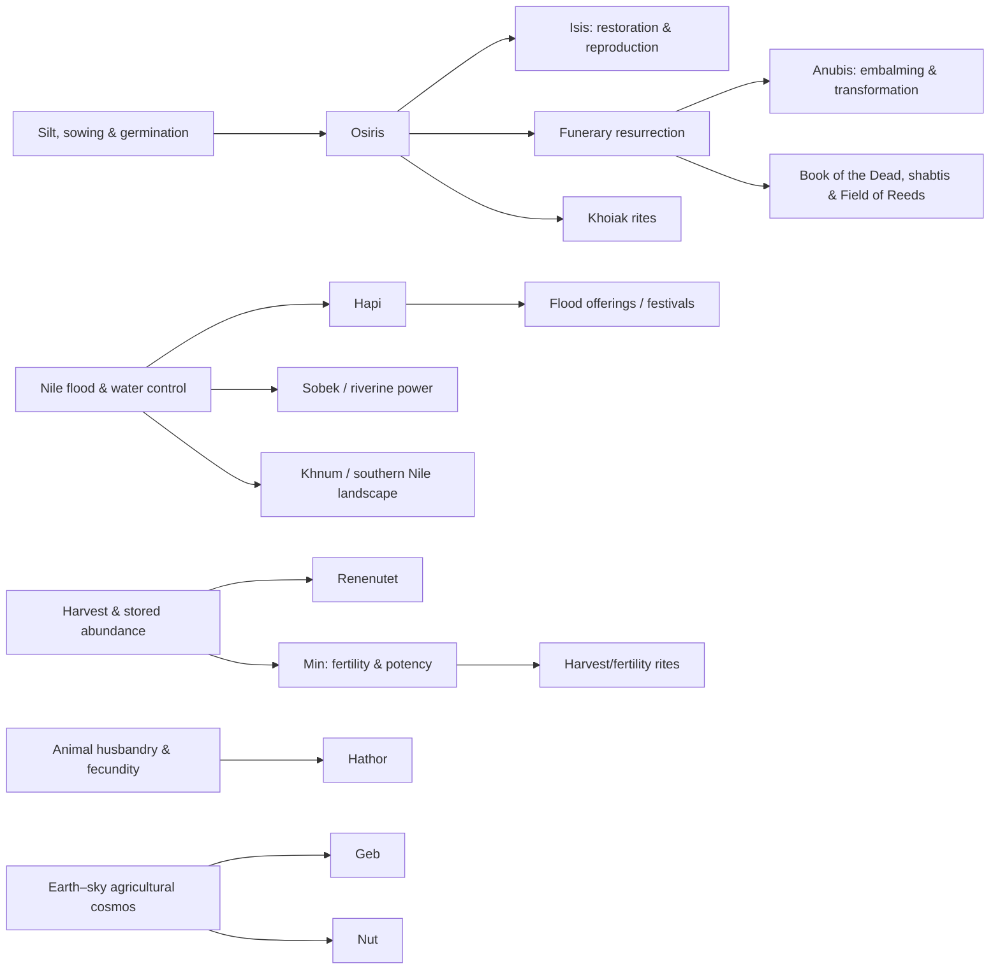
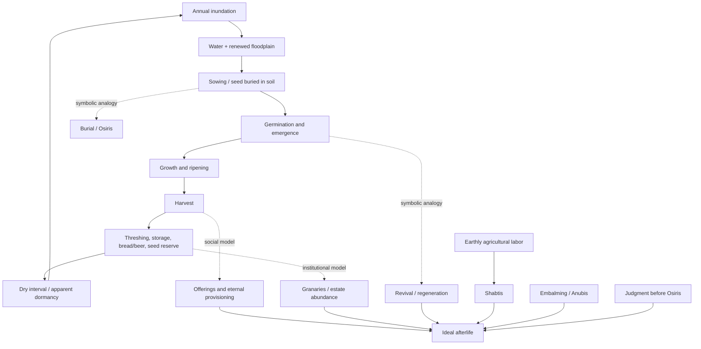

# Agriculture and Mythology in Ancient Egypt: Agrarian Practice, Divine Regeneration, and the Afterlife from the Predynastic Period to the Late Period

## Executive Summary

Ancient Egyptian religion cannot be reduced to an environmental reflex or a simple “nature religion.” Nevertheless, agriculture supplied some of the most persistent experiences through which Egyptians conceptualized divine power, legitimate kingship, death, and renewed life. Egyptian cultivation depended above all on the Nile’s annual inundation, the retention and distribution of floodwater, sowing into newly exposed moist soils, cereal and flax production, animal husbandry, and the storage and redistribution of agricultural surplus. The result was a distinctive rhythm of inundation, emergence/growth, harvest, storage, and renewed inundation. Egyptian theology repeatedly translated that material rhythm into religious language: Hapi embodied the life-giving flood; Osiris became exceptionally closely associated with death followed by renewed vegetal life; Renenutet protected agricultural abundance; Min represented reproductive potency; and Geb, Nut, Khnum, Hathor, Sobek, Isis, and even the funerary Anubis were incorporated, with very different degrees of directness, into systems of regeneration and landscape theology. The Egyptian “Hymn to the Nile Flood,” for example, praises Hapi as the “maker of barley, grower of emmer” and as one who fills stores and enlarges granaries—an unusually explicit primary-text connection among hydrology, crops, abundance, and divinity. [[1]](https://www.ucl.ac.uk/museums-static/digitalegypt/literature/floodtransl.html)

**The central thesis of this report is that agriculture did not mechanically create Egyptian mythology; rather, the Nile agrarian regime furnished a durable experiential and symbolic grammar that Egyptian religious institutions transformed into myths, rituals, images, and expectations of post-mortem existence.** The strongest demonstrable connections are between Nile inundation and Hapi, cereal germination and Osiris, harvest abundance and Renenutet, and the agricultural estate and the imagined afterlife. Other associations—such as Hathor with fertility, Khnum with creation and the southern Nile landscape, or Sobek with riverine power—are important but less directly derived from crop production. The relationship of Anubis to agriculture is more indirect still: he belongs primarily to embalming and mortuary transformation, but participates in an afterlife increasingly articulated through Osirian regeneration. This graded approach avoids treating every deity as an agricultural personification. [[2]](https://www.ucl.ac.uk/museums-static/digitalegypt/religion/deitiescreation.html)

Agricultural practice affected religious thought at several levels. Environmentally, Nile flood variability made abundance contingent rather than automatic. Technologically, basin irrigation, canals, dikes, simple wooden ploughs, draft animals, and—only from the New Kingdom in secure evidence—the shaduf structured agricultural labor; the late appearance of the shaduf is especially important because it should not be projected backward as a cause of Old Kingdom theology. Socially, grain was measured, stored, taxed, paid as rations, and administered by households, estates, temples, and royal institutions. The Middle Kingdom Heqanakht documents record rented fields, emmer, flax, storehouses, salaries, and estate administration; the same economic world reappears in idealized form in tomb models, offering scenes, and eventually the agricultural afterlife. Modern scholarship also cautions against the older “hydraulic despotism” model in which a centralized pharaonic state supposedly owed its existence simply to the need to manage irrigation: irrigation and landholding involved multiple local, institutional, household, and state actors. [[3]](https://www.metmuseum.org/art/collection/search/545445)

The afterlife provides perhaps the clearest synthesis. Old Kingdom Pyramid Texts established an increasingly important Osirian dimension of royal resurrection; Middle Kingdom Coffin Text traditions expanded and reformulated funerary possibilities; New Kingdom and later Books of the Dead made agricultural landscapes explicit. Book of the Dead Spell 110 places the deceased in a Field of Offerings/Reeds, and Sennedjem's Nineteenth-Dynasty tomb depicts him and his wife harvesting grain, sowing, and pulling flax in the next world. Spell 6 could command a shabti to undertake agricultural labor, while actual shabtis bear hoes and seed baskets. Other texts imagine supernaturally tall barley in the Field of Reeds. Thus death was not merely compared with a seed: the entire social technology of agriculture—fields, water, labor, tools, grain, offerings, administrators, and abundance—could be reproduced in funerary religion. [[4]](https://www.metmuseum.org/art/collection/search/548354)

The evidence nevertheless demands caution. Predynastic agriculture long predates surviving religious texts, so direct causal claims about the origins of specific myths are inherently difficult to demonstrate. Civil-calendar festivals did not remain permanently synchronized with the ecological year. Opet was primarily a festival of Amun and royal renewal, even where its river journey and fertility imagery resonated with inundation; the Sed festival primarily renewed royal power, not crops. Climate stress could affect food production and political conditions, but simple narratives in which a bad Nile “caused” political collapse or a particular myth are too deterministic. Egyptian religion continually combined agrarian experience with solar theology, kingship, ancestor cult, ethics, local cult geography, and temple intellectual traditions. [[5]](https://www.ucl.ac.uk/museums-static/digitalegypt/ideology/festivaldates.html)

## Agrarian Foundations and Historical Development

Egyptian agriculture operated within an unusually elongated riverine landscape, but that landscape was far from uniform. In **Upper Egypt**, the Nile generally occupied a comparatively narrow valley constrained by desert margins, producing discrete stretches of floodplain and strong relationships among settlements, cultivable basins, desert-edge cemeteries, and river transport. **Lower Egypt and especially the Delta** presented a much wider, distributary environment in which shifting channels, wetlands, marshes, and problems of drainage and water management created different settlement and agricultural conditions. The Delta therefore cannot simply be treated as “Upper Egypt with more water”: management of channels and flood regimes was a persistent issue there from early settlement onward. Archaeobotanical work confirms that farming and herding were established in Lower Egypt in pre-pharaonic times, including the cultivation of Near Eastern domesticates such as emmer and barley. [[6]](https://www.cambridge.org/core/books/archaeology-of-pharaonic-egypt/people-in-landscapes/46162C49F9BBE60FFB70933318BBB3E5)

The basic cereal economy centered especially on **emmer wheat and barley**, with **flax** important as both an agricultural and textile crop. This is supported not only by archaeobotany but by administrative records and artistic evidence. Heqanakht's Twelfth-Dynasty account enumerates emmer stored at several locations and counts flax sheaves, while Sennedjem's afterlife field scene still shows grain agriculture and flax-pulling centuries later. Such continuity matters: the agricultural symbolism found in mortuary religion was grounded in crops that were economically consequential, not in arbitrarily chosen vegetation. [[7]](https://www.metmuseum.org/art/collection/search/545451)

Animal husbandry was similarly integrated into cultivation. Oxen supplied traction for ploughing; cattle and other livestock transformed plant resources and floodplain grazing into meat, milk, hides, manure, status, and sacrificial animals. A Middle Kingdom model in the Metropolitan Museum depicts a farmer following a simple wooden hook-shaped plough drawn by two oxen. The museum notes that this device opened rather than deeply turned the soil, facilitating seed placement in moist ground, and that textual evidence sometimes implies institutional leasing of draft oxen by state or temple organizations. Even the Hymn to Hapi links adequate inundation not only to crops but to the flourishing of herds. [[8]](https://www.metmuseum.org/art/collection/search/544255)

### Seasonal rhythm as a religious template

| Agrarian phase | Conventional Egyptian season | Material process | Religious-symbolic potential |
|---|---|---|---|
| Nile rise and inundation | **Akhet**, “Inundation” | Floodwater entered low-lying land and basins; sediments and moisture renewed fields. | Arrival of life-giving water; Hapi; divine abundance; return and renewal. [[9]](https://www.ucl.ac.uk/museums-static/digitalegypt/literature/floodtransl.html) |
| Recession, sowing, emergence and growth | **Peret**, “Emergence” | Water receded; fields were opened/ploughed and sown; cereals germinated. | Especially powerful analogy of apparent death → emergence; later made explicit in Osirian germination rites. [[10]](https://www.metmuseum.org/art/collection/search/544255) |
| Ripening and harvest | **Shemu**, “Harvest” | Cereals were reaped, threshed, transported and stored; flax harvested. | Abundance, Renenutet/Nepri/Min festivals, offerings, and institutional granaries. [[11]](https://www.ucl.ac.uk/museums-static/digitalegypt/ideology/festivaldates.html) |
| Low Nile and anticipation | Late harvest/dry interval | Stored grain sustained society while the next rise was awaited. | Dependence on stored surplus, expectation, cyclical return, and vulnerability to inadequate inundation. [[12]](https://www.ucl.ac.uk/museums-static/digitalegypt/literature/floodtransl.html) |

The seasonal scheme should not be interpreted as an eternally fixed modern calendar. The Egyptian civil calendar consisted of twelve thirty-day months plus five additional days; because it comprised 365 days, its dates did not remain permanently locked to the solar and hydrological seasons over the very long span of pharaonic history. Consequently, statements such as “Khoiak happened at sowing time” are historically strongest where a source's date and environmental context coincide; they should not be mechanically applied to every century. This is an inference from the civil calendar's structure and the explicitly approximate seasonal correspondences in the surviving festival evidence. [[13]](https://www.ucl.ac.uk/museums-static/digitalegypt/ideology/festivaldates.html)

### Technology and the limits of hydraulic determinism

Floodwater could be retained in basins defined by natural levees and artificial embankments, while channels directed water toward lower land. Basin irrigation therefore depended on local topography, collective maintenance, timing, and labor. Yet the existence of irrigation does **not** demonstrate that every canal was planned and operated by a monolithic central government. Modern reassessment has challenged the older assumption that pharaonic political centralization followed automatically from the supposedly immense managerial requirements of irrigation. [[14]](https://www.oxfordreference.com/display/10.1093/acref/9780195105070.001.0001/acref-9780195105070-e-0787?d=%2F10.1093%2Facref%2F9780195105070.001.0001%2Facref-9780195105070-e-0787&p=emailA0eBgbfAuH8YA)

This qualification matters for mythology. If the irrigation system was not simply a single royal machine, religion should likewise not be interpreted as straightforward ideological propaganda for centralized water control. Pharaoh certainly claimed responsibility for maintaining *maat*, prosperity, offerings, and cosmic order, but the agrarian world actually experienced by Egyptians included household farmers, tenants, villages, estates, temple personnel, local officials, labor gangs, herders, and administrators. Religious representations could therefore encode both royal order and ordinary agrarian experience. [[15]](https://escholarship.org/uc/item/1nr1d3s9)

The **shaduf**—a counterweighted water-lifting device—is a particularly useful chronological warning. The secure Egyptian evidence belongs only from the New Kingdom onward. Earlier agriculture therefore depended primarily on floodwater, channels, basins and other techniques rather than the extensive use of a technology that popular reconstructions sometimes project into much earlier periods. The simple plough, by contrast, is well evidenced in Middle Kingdom imagery and models. [[16]](https://www.cambridge.org/core/elements/urban-life-and-form-in-ancient-egypt/7DB332D7468856E715716DE1FF90B780)

### Long-term chronology

| Period | Agrarian-religious developments most relevant to the argument |
|---|---|
| **Predynastic** | Domesticated cereal agriculture and livestock became embedded in Nile Valley and Delta subsistence. Regional ecological differences were already significant, but surviving evidence for mythology is predominantly archaeological rather than textual; claims that a particular later deity originated directly from a Predynastic crop practice are therefore speculative. [[17]](https://www.cambridge.org/core/books/nile-delta/nile-delta-before-the-pharaohs/93451B1E4529A05EDC285CC2C6A2BD20) |
| **Early Dynastic** | Political unification increasingly linked regional landscapes and cult centers to kingship. The Sed tradition is attested very early, but its primary function was renewal of royal power, not the performance of an agricultural calendar. [[18]](https://www.metmuseum.org/essays/the-temples-of-senwosret-iii-at-dahshur) |
| **Old Kingdom** | Funerary estates, crop-production scenes and offerings made agricultural provisioning integral to elite tomb culture. By late Dynasty Five Osiris had acquired growing prominence, while the Pyramid Texts began to inscribe royal resurrection theology in pyramid chambers. [[19]](https://www.metmuseum.org/essays/egypt-in-the-old-kingdom-ca-2649-2150-b-c) |
| **Middle Kingdom** | Coffin-text traditions broadened and reformulated earlier mortuary theology; agricultural estate documents such as Heqanakht's reveal land rental, grain accounting, flax and cult income. Models of ploughing and granaries placed economic production directly in mortuary assemblages. [[20]](https://www.metmuseum.org/art/collection/search/545445) |
| **New Kingdom** | Book of the Dead traditions, Field of Reeds imagery, agricultural shabtis, Opet river processions, and well-documented Osirian/Khoiak ritual make the integration of agriculture, regeneration, and afterlife unusually visible. The shaduf is first securely attested in this broad period. [[21]](https://www.ucl.ac.uk/museums-static/digitalegypt/literature/religious/bdbynumber.html) |
| **Third Intermediate and Late Period** | Osirian funerary symbolism, agricultural shabtis, elaborate coffin cosmology and ritualized germination remained powerful. A Third Intermediate Period shabti can explicitly carry hoes and a seed basket while bearing Book of the Dead Spell 6; Late Period coffins continue to identify the deceased with Osiris and place Osirian earth/netherworld symbolism against the sky goddess Nut. [[22]](https://www.metmuseum.org/art/collection/search/553541) |

Environmental variability supplied an additional stimulus for religious thought without dictating it. Archaeological and geomorphological research shows that the Nile floodplain itself changed through the Holocene, while flood heights varied within the pharaonic period; climatic conditions after the later fourth millennium BCE were comparatively stable at the broadest scale but still allowed hydrological fluctuations meaningful to agriculture. Some episodes of diminished Nile flow correlate with periods of political and economic stress, yet Egyptological and palaeoenvironmental research increasingly resists a one-variable equation of climate deterioration with state collapse. [[23]](https://www.nature.com/articles/s41561-024-01451-z)

## Deities and the Agrarian Theology of Regeneration

Egyptian gods should not be classified by a modern one-god/one-natural-phenomenon taxonomy. Deities could possess overlapping identities, acquire local forms, merge syncretically, or operate simultaneously at cosmological, political, funerary, and material levels. Egyptian sources themselves distinguish a divine force present in the Nile flood as Hapi, in the earth as Geb, and in the sky as Nut, yet this does not make Egyptian theology merely a catalogue of personified natural objects. [[24]](https://www.ucl.ac.uk/museums-static/digitalegypt/religion/deitiescreation.html)

The following table therefore evaluates **how direct** each deity's relationship to agricultural practice actually was.

| Deity | Agrarian / environmental connection | Analytical assessment |
|---|---|---|
| **Osiris** | Death, renewed life, underworld kingship; germinating grain was deliberately formed in his image in Khoiak rites, and later funerary objects contained grain, mud and sand to evoke his regeneration. [[25]](https://www.ucl.ac.uk/museums-static/digitalegypt/ideology/khoiak.html) | **Very strong**, but historically layered. Agricultural regeneration became one of the most explicit languages for Osirian resurrection; Osiris was nevertheless much more than a “grain god.” |
| **Isis** | Reassembles/revives Osiris and conceives Horus; hides and protects Horus in the Delta marshes. [[26]](https://www.ucl.ac.uk/museums-static/digitalegypt/religion/deitiescreation.html) | **Strong but mediated.** Her agricultural significance lies especially in restoration, fertility, reproduction, and the Osiris cycle rather than direct patronage of cereal cultivation. |
| **Geb** | Divine earth within Egyptian cosmology. [[27]](https://www.ucl.ac.uk/museums-static/digitalegypt/religion/deitiescreation.html) | **Moderate/structural.** Cultivation occurs in Geb's terrestrial domain, but equating him narrowly with farmland would understate his cosmological scope. |
| **Nut** | Divine sky, member of the same cosmological genealogy; later funerary iconography places Nut over/around the deceased as a framework of rebirth. [[28]](https://www.ucl.ac.uk/museums-static/digitalegypt/religion/deitiescreation.html) | **Indirect.** Nut provides the celestial half of the earth–sky regenerative cosmos rather than functioning as an agricultural goddess. |
| **Hapi** | Divine manifestation of inundation; hymns credit him with reviving Egypt, watering vegetation, sustaining herds, producing emmer and barley, and filling granaries. [[29]](https://www.ucl.ac.uk/museums-static/digitalegypt/literature/floodtransl.html) | **Most direct hydrological link.** Hapi demonstrates that actual agricultural dependency could be formulated explicitly as divine beneficence. |
| **Min** | Ithyphallic god of procreative potency, especially important at Koptos and Akhmim; agricultural/harvest festivals and fertility symbolism clustered around him. [[30]](https://www.ucl.ac.uk/museums-static/digitalegypt/koptos/min.html) | **Strong fertility link**, particularly in Upper Egypt. Sexual and vegetal productivity overlap without becoming identical. |
| **Anubis** | God of embalming and mortuary protection; Book of the Dead iconography places him at embalming and judgment. [[31]](https://www.ucl.ac.uk/museums-static/digitalegypt/religion/deitiescreation.html) | **Indirect.** His importance is a useful corrective to agricultural reductionism: death required embalming, ritual protection and judgment as well as regenerative agricultural symbolism. |
| **Hathor** | Cow-associated goddess with major roles in sexuality, motherhood, fertility and post-mortem rebirth; Hathoric objects explicitly invoke fertility and rebirth. [[32]](https://www.metmuseum.org/art/collection/search/553379) | **Moderate.** Bovine and reproductive imagery made her readily compatible with livestock and fertility concerns, but she was not principally a cereal deity. |
| **Khnum** | Creator god especially localized at Elephantine and other southern centers, molding living forms; his southern cult geography placed him in a landscape closely associated with the Nile and First Cataract. [[33]](https://www.ucl.ac.uk/museums-static/digitalegypt/religion/deitiesplaces.html) | **Moderate and regionally specific.** Connections with Nile fertility should not erase his primary creative and local-cult dimensions. |
| **Renenutet** | Serpent goddess associated directly with abundance and protection of the harvest; festivals and offerings occur in agricultural calendar contexts. [[34]](https://www.ucl.ac.uk/museums-static/digitalegypt/religion/deitiescreation.html) | **Very strong.** Among the clearest specialist divinities linking harvest, stored prosperity and cult. |
| **Sobek** | Crocodile god strongly localized in riverine/wetland landscapes including the Faiyum and Kom Ombo region. [[35]](https://www.ucl.ac.uk/museums-static/digitalegypt/religion/deitiesplaces.html) | **Environmental rather than narrowly agricultural.** Sobek expresses the potency and danger of water landscapes on which cultivation depended; making him simply an “irrigation god” would overstate the evidence. |

A key implication is that **different dimensions of agriculture generated different theological possibilities**. Floodwater could be Hapi; earth could be Geb; sexual fecundity could be expressed through Min or Hathor; crop protection through Renenutet; riverine danger through Sobek; creation in a Nile-border landscape through Khnum; and the paradox of life emerging from buried or apparently dead matter through Osiris. These were complementary rather than mutually exclusive theological models. [[36]](https://www.ucl.ac.uk/museums-static/digitalegypt/literature/floodtransl.html)

Regional geography reinforced this plurality. Osiris acquired especially powerful associations with **Abydos in Upper Egypt** and **Busiris in the Delta**; Min had important Upper Egyptian cult centers at **Koptos and Akhmim**; Khnum was prominent at **Elephantine**; Hathor at **Dendera**; and Sobek developed particularly strong associations with **Faiyum and other crocodile landscapes**. At Abydos, Osiris' growing importance transformed the site into a major pilgrimage and processional center; Middle Kingdom tradition identified an early royal tomb there with Osiris' burial, and annual processions linked town, temple, cultivation zone and desert cemetery. Theologically, therefore, “Egyptian agriculture” never produced a single uniform pantheon: local hydrologies, animals, crops, historical cults and political patronage all mattered. [[37]](https://www.ucl.ac.uk/museums-static/digitalegypt/religion/deitiesplaces.html)

The relationship can be summarized as a network rather than a single causal chain:

The arrows in this figure indicate historically supportable **associations**, not claims that one economic practice single-handedly “invented” a deity. That distinction is particularly necessary for gods such as Nut, Anubis and Sobek, whose theological functions substantially exceed agriculture. [[38]](https://www.ucl.ac.uk/museums-static/digitalegypt/religion/deitiescreation.html)

## Ritual Calendar, Festivals, and Agricultural Landscape

Ritual transformed agricultural rhythms from passive observation into acts by which humans, king and gods were understood to maintain the world's capacity to renew itself. The clearest agricultural ceremonies do not all belong to the same category: some addressed water supply, others enacted germination, others celebrated harvest abundance, while large state festivals such as Opet and Sed employed a more generalized language of rejuvenation.

| Ritual / festival | Agricultural relationship | Critical interpretation |
|---|---|---|
| **Hapi / inundation offerings** | Ramesside calendar evidence records offerings to Hapi and Amun intended to secure a favorable flood. [[39]](https://www.ucl.ac.uk/museums-static/digitalegypt/ideology/festivaldates.html) | **Direct:** cultivation depended on adequate floodwater, so hydrological anxiety and thanksgiving could become ritual action. |
| **Khoiak / Osiris rites** | Osiris-shaped beds or figures containing earth and seed were watered until grain germinated; ceremonies fell in a calendrical context associated with receding inundation and renewed sowing. [[40]](https://www.ucl.ac.uk/museums-static/digitalegypt/ideology/khoiak.html) | **The strongest ritual evidence** for deliberate fusion of cereal germination and resurrection. |
| **Opet** | Amun's bark traveled between Karnak and Luxor, including river transport; festival theology emphasized royal/divine renewal and contains fecundity and inundation resonances. [[41]](https://escholarship.org/content/qt4739r3fr/qt4739r3fr.pdf) | **Indirect but significant:** not a harvest festival. Its Nile journey and renewal symbolism embedded royal regeneration in the same riverine landscape that sustained agriculture. |
| **Sed festival** | A jubilee sequence intended to renew the king's powers; at Senwosret III's complex Sed scenes occurred alongside personifications of seasons and food-offering imagery. [[18]](https://www.metmuseum.org/essays/the-temples-of-senwosret-iii-at-dahshur) | **Structural analogy, not direct agrarian causation:** renewal of sovereign vitality could resonate with cyclical fertility, but Sed's primary subject was kingship. |
| **Renenutet / Nepri / Min harvest observances** | Calendar evidence places Renenutet, the grain-associated Nepri and Min within festival sequences connected with harvest, granaries and agricultural abundance. [[42]](https://www.ucl.ac.uk/museums-static/digitalegypt/ideology/festivaldates.html) | **Direct to moderate:** these rites connected food production and reproductive plenty with divine protection. |

### Khoiak: agriculture deliberately made into resurrection

Khoiak is the most decisive case because the relationship is not merely a modern analogy. In ritual forms known especially from the New Kingdom onward, earth or mud was shaped into an Osirian body and seeded with grain; moisture caused the seeds to sprout, after which the object could be dried and deposited. Museum examples preserve this fusion materially, including “germinating Osiris” objects and later corn-mummy traditions combining grain with earth or sand. [[43]](https://www.metmuseum.org/art/collection/search/553820)

Here an ordinary agronomic fact—seed buried in dark, moist soil later produces green shoots—became a ritual demonstration that death and burial need not signify terminal extinction. Yet the ritual should not be read as evidence that Osiris began historically as nothing but a vegetation god. His mythology also concerns kingship, murder, bodily integrity, inheritance, judgment, legitimate succession, and the underworld. Recent scholarship on Osirian ritual material therefore emphasizes the complexity of “corn mummies” and germinating objects rather than treating them as transparent survivals of a hypothetical primitive vegetation cult. [[44]](https://www.mdpi.com/2077-1444/15/7/813)

### Opet, processions, and the Nile as sacred infrastructure

Opet shows a different relationship between agriculture and religion. The festival centered on Amun and the renewal of royal/divine power, with the divine barks moving from Karnak toward Luxor. Scholarship on its river journey has noted imagery and texts suggestive of fecundity and the returning inundation. The correct conclusion is therefore **not** that Opet was an irrigation ceremony, but that the Nile could simultaneously be transportation infrastructure, agricultural lifeline, processional route, and sacred medium. [[41]](https://escholarship.org/content/qt4739r3fr/qt4739r3fr.pdf)

This physical integration of temple and river mattered. Egyptian ritual was spatial: temples, riverbanks, quays, cultivated land, desert cemeteries and processional roads created a landscape in which movement could reenact relations among gods, king, living community and dead. At Abydos, for instance, the Osiris cult connected settlement and temple with the western desert burial landscape through processions. In funerary iconography, marshes, fields and boats similarly convert a worked landscape into a field of divine renewal. [[45]](https://www.ucl.ac.uk/museums-static/digitalegypt//abydos/index.html)

### Harvest imagery and ritual abundance

Harvest scenes themselves were carefully structured images of ordered productivity. An Old Kingdom scene from the tomb chapel of Raemkai shows reaping, binding, transport by donkeys, threshing and preparation for winnowing; its inscription specifically relates barley to a funerary estate. Middle Kingdom and New Kingdom tomb imagery repeats ploughing, sowing, transporting and harvesting. Such images are not photographs of peasant life: in elite tombs they simultaneously document recognizable agricultural techniques and construct an ideal world in which the deceased commands perpetual, orderly abundance. [[46]](https://www.metmuseum.org/art/collection/search/577371)

That dual character is crucial. Tomb agriculture tells historians something about work, crops and technology, but its **selection and arrangement** are religious. The hard realities of crop failure, landlord demands and exhaustion disappear; the agricultural estate becomes productive forever. Mythology was therefore shaped not simply by agriculture “as it was” but also by the elite desire to transform uncertain agriculture into guaranteed cosmic abundance. [[47]](https://www.metmuseum.org/art/collection/search/548438)

## Agriculture, Death, and the Egyptian Afterlife

The most profound impact of agriculture on Egyptian religious imagination was the conversion of death from a linear ending into part of a recurring process. This should not be understood as a single metaphor—“human equals grain”—but as a collection of mutually reinforcing analogies: seed burial and germination, Nile withdrawal and return, seasonal emergence, harvested grain becoming food and seed again, and an estate replenished through repeated labor.

### From royal resurrection to the cultivated hereafter

By late Dynasty Five, Osiris had become increasingly prominent in royal funerary religion, and the Pyramid Texts inscribed in the pyramid of Unis and later kings placed Osirian and solar models of continued existence within the royal mortuary sphere. The textual history is complex: resurrection was never purely agrarian, because stellar and solar transformations were also fundamental. Indeed, later Egyptian mortuary theology could combine Osiris as the dead/regenerated figure with the daily solar cycle of Ra. [[48]](https://www.metmuseum.org/essays/egypt-in-the-old-kingdom-ca-2649-2150-b-c)

Middle Kingdom funerary compositions conventionally grouped as the **Coffin Texts** preserved, altered and expanded earlier traditions, while later Book of the Dead compositions continued to transmit material with Old and Middle Kingdom antecedents. The textual corpus was never a single fixed “bible”: UCL's concordance of Book of the Dead spells shows older Pyramid and Coffin Text material being incorporated into later compositions. This historical layering is evidence for continuity through adaptation rather than an unchanging agricultural theology. [[49]](https://www.ucl.ac.uk/museums-static/digitalegypt/literature/religious/bdbynumber.html)

By the New Kingdom, the cultivated afterlife becomes unmistakably visual. The east wall of Sennedjem's burial chamber at Deir el-Medina illustrates Book of the Dead Spell 110: Sennedjem and Iineferti sow, harvest grain and pull flax amid the abundant Fields of Iaru. The image does not depict escape from agricultural existence; it depicts **perfected agricultural existence**. [[50]](https://www.metmuseum.org/art/collection/search/548354)

Book of the Dead Chapter 149 makes the abundance hyperbolic: the Field of Reeds contains fantastically tall barley harvested by superhuman spirits. The agricultural imagery therefore does more than promise subsistence. It signifies a cosmos in which the precarious yields of terrestrial cultivation have been replaced by superabundance. [[51]](https://www.ucl.ac.uk/museums-static/digitalegypt/literature/religious/bd149.html)

### Shabtis: terrestrial labor organization projected beyond death

Shabtis expose the social rather than merely botanical dimension of this theology. Funerary texts could anticipate that the deceased might be summoned to perform field labor—cultivating fields, moving earth, or transporting water. The shabti answered in the owner's place. By the New Kingdom and later periods such figures often carry agricultural implements; a Third Intermediate Period shabti of Nestanebetisheru holds hoes and a seed basket and bears Book of the Dead Chapter 6, explicitly promising to perform agricultural labor for her. [[52]](https://www.metmuseum.org/art/collection/search/553541)

The institution makes sense against terrestrial corvée and conscripted labor. Scholarly analysis of shabtis notes that Egyptian conceptions of the hereafter could reproduce expectations of compulsory agricultural service and then magically delegate that service to substitutes. Yet there is an important distinction: agricultural work in paradisal Field-of-Offerings scenes could also be represented as desirable participation in abundant life rather than punishment. Thus Egyptian afterlife agriculture contains both **labor anxiety** and **agrarian idealization**. [[53]](https://escholarship.org/content/qt6cx744kk/qt6cx744kk.pdf)

Large groups could even reproduce a miniature labor hierarchy. Nauny's burial contained hundreds of worker shabtis and separate overseers, effectively transferring an organized work force into the grave. This is an extraordinary example of an earthly socio-economic institution becoming funerary technology. [[54]](https://www.metmuseum.org/art/collection/search/625673)

### Food offerings and the immortal estate

The dead also required continual provisioning. Tomb decoration, food offerings, bread and beer, agricultural models and offering formulae created mechanisms by which the deceased's *ka* could receive sustenance. Middle Kingdom tomb models reproduce granaries, bakeries, breweries, livestock and agricultural work; a granary model from Meketre even depicts scribes overseeing grain transfers into storage bins. These were not ornamental miniatures of “daily life” alone: within a tomb they participated in the effort to make production eternally available. [[55]](https://resources.metmuseum.org/resources/metpublications/pdf/The_Art_of_Ancient_Egypt_A_Resource_for_Educators.pdf)

The result was an afterlife modeled partly on the successful estate. Grain arrives; scribes account for it; storage remains full; bread and beer continue to be manufactured; offerings reach the deceased. Agricultural administration was therefore no less relevant to funerary imagination than germination itself. [[56]](https://resources.metmuseum.org/resources/metpublications/pdf/The_Art_of_Ancient_Egypt_A_Resource_for_Educators.pdf)

### Osiris, Anubis, and the limits of the agricultural explanation

Agricultural symbolism did not eliminate specifically mortuary theology. Book of the Dead Chapter 125 presents judgment before Osiris; Chapter 151 includes Anubis in the embalming pavilion; spells protect the body, reunite aspects of the person, open the tomb and allow movement in the divine world. The deceased needed bodily preservation, ritual knowledge, ethical vindication and divine protection as well as fertile fields. [[57]](https://www.ucl.ac.uk/museums-static/digitalegypt/literature/religious/bdbynumber.html)

Late funerary equipment often fuses these systems. A Late Period coffin can place the **djed**, identified with Osiris' backbone and regeneration, on one side and the sky goddess Nut around the deceased, effectively turning the coffin into a miniature cosmos of earth, netherworld and sky. Ptah-Sokar-Osiris figures containing wheat, sand and mud similarly link bodily resurrection with the agricultural cycle. [[58]](https://www.metmuseum.org/art/collection/search/550801)

The logic can be represented as follows:

This flowchart represents an **analytical reconstruction**, not a claim that Egyptian texts explicitly formulate a single causal theory in this sequence. What the primary sources do demonstrate is that the individual links—flood and crops, Osiris and germination, afterlife and cultivated fields, shabtis and agricultural work, grain and funerary provisioning—were all culturally real. [[59]](https://www.ucl.ac.uk/museums-static/digitalegypt/literature/floodtransl.html)

## Socio-Economic Organization, Evidence, and Interpretive Limits

Agricultural mythology was shaped not only by fields and seasons but by **institutions that controlled agricultural resources**. The Heqanakht documents are particularly revealing because Heqanakht administered land and income endowed to support a mortuary statue cult. His correspondence discusses renting land and arranging rations, while his accounts record emmer, flax, storehouses and payments. Here economy and cult are not separate domains: agricultural assets finance continued ritual for the dead. [[60]](https://www.metmuseum.org/art/collection/search/545445)

Temple estates likewise held or administered land, livestock and agricultural income within a highly varied land-tenure regime. The evidence does not support a simple equation in which the king personally “owned all land”; royal, temple, institutional, household and private interests intersected, and arrangements changed over three millennia. Even the Met's Middle Kingdom ploughing model notes textual evidence for oxen being leased from state or temple institutions, illustrating how institutional control could penetrate practical cultivation without making every farmer a direct state employee. [[61]](https://escholarship.org/uc/item/1nr1d3s9)

Grain storage was especially important because it converted seasonal production into durable institutional resources. Granaries allowed cereals to become rations, offerings, salaries, reserves and tax/estate income. Tomb models depict scribes controlling granary transactions; the Hapi hymn itself defines a successful inundation partly by its capacity to fill storage and enlarge granaries. Consequently, the theological language of abundance cannot be separated entirely from the administrative reality that abundance became meaningful through collection, measurement and redistribution. [[62]](https://resources.metmuseum.org/resources/metpublications/pdf/The_Art_of_Ancient_Egypt_A_Resource_for_Educators.pdf)

Corvée labor adds another dimension. Agricultural work, canal and earth maintenance, royal projects and other obligations could mobilize labor beyond the individual household. Mortuary imagination then reproduced the possibility of being called for work in the hereafter and supplied shabtis as substitutes. This is one of the strongest cases in which a socio-economic institution—not simply a natural process—shaped a specific funerary practice. [[63]](https://escholarship.org/content/qt6cx744kk/qt6cx744kk.pdf)

### Comparing the evidence

| Evidence type | Example | What it can establish | Main limitation |
|---|---|---|---|
| **Primary religious text** | Hymn to Hapi: flood, emmer, barley, herds, storerooms and granaries. [[64]](https://www.ucl.ac.uk/museums-static/digitalegypt/literature/floodtransl.html) | Explicit Egyptian association between inundation, agricultural abundance and divinity. | Hymnic rhetoric idealizes divine beneficence; it is not a hydrological report. |
| **Funerary texts** | Pyramid/Coffin-text traditions; Book of the Dead Spells 6, 110, 125, 149, 151. [[49]](https://www.ucl.ac.uk/museums-static/digitalegypt/literature/religious/bdbynumber.html) | Shows how labor, fields, Osiris, judgment and transformation entered formal afterlife discourse. | Texts are historically layered and disproportionately represent literate/elite funerary culture. |
| **Administrative text** | Heqanakht accounts and letters; Wilbour-type field registers. [[65]](https://www.metmuseum.org/art/collection/search/545445) | Land rental, crop accounting, storage, flax, salaries and institutional administration. | Administrative documents rarely explain theology directly. |
| **Archaeobotany** | Predynastic/early Delta evidence for emmer, barley and other cultivated plants. [[66]](https://www.cambridge.org/core/books/nile-delta/nile-delta-before-the-pharaohs/93451B1E4529A05EDC285CC2C6A2BD20) | Establishes what people actually cultivated independently of literary symbolism. | Seeds cannot by themselves reveal what farmers believed about gods. |
| **Agricultural iconography** | Raemkai harvesting; Djari ploughing; Nakht agricultural landscape. [[46]](https://www.metmuseum.org/art/collection/search/577371) | Documents recognizable stages of farming and their ideological selection in tomb art. | Elite tomb scenes idealize order and abundance rather than neutrally recording working conditions. |
| **Ritual archaeology** | Germinating Osiris objects containing earth and grain. [[67]](https://www.metmuseum.org/art/collection/search/553820) | Direct material fusion of plant germination and divine resurrection. | Surviving objects often belong to later periods; they cannot automatically reconstruct Predynastic origins. |
| **Funerary equipment** | Shabtis with hoes and seed baskets; granary/ploughing models. [[68]](https://www.metmuseum.org/art/collection/search/553541) | Shows transfer of agricultural labor and institutional production into the imagined afterlife. | Most surviving examples come from particular social classes and mortuary contexts. |
| **Palaeoenvironmental evidence** | Holocene Nile-channel change and flood variability. [[69]](https://www.nature.com/articles/s41561-024-01451-z) | Establishes environmental change independently of religious literature. | Correlation between ecological stress and a myth or political event is not proof of causation. |

There is an important textual asymmetry here. Pharaonic Egypt has not left a straightforward farmer's handbook comparable to a later classical agronomic treatise that systematically explains when to plough, how to irrigate and which crop to plant. For practical agricultural history, researchers consequently rely heavily on administrative accounts and land registers such as the Heqanakht documents and Wilbour Papyrus, together with archaeobotanical remains, tools, models and tomb scenes. Religious texts then reveal how the same practices were reimagined symbolically. [[70]](https://www.metmuseum.org/art/collection/search/545445)

### Major uncertainties and alternative interpretations

**Agriculture versus “nature religion.”** It is tempting to say that Hapi “is the Nile,” Geb “is the earth,” or Osiris “is the grain” and conclude that Egyptian religion simply personified environmental forces. Egyptian sources and modern scholarship instead reveal gods whose identities overlap natural, cosmic, royal, local and funerary domains. Osiris' agricultural symbolism is exceptionally strong, but his roles as dead king, ruler of the underworld, judge and guarantor of legitimate succession cannot be derived from germinating barley alone. [[71]](https://www.ucl.ac.uk/museums-static/digitalegypt/religion/deitiescreation.html)

**Osiris and the vegetation-god hypothesis.** Older comparative scholarship often treated Osiris as a straightforward “dying and rising vegetation god.” Germinating Osiris objects certainly prove an intentional vegetal interpretation in historical Egyptian ritual. They do **not**, however, prove that cereal agriculture was the single original source from which the deity evolved in prehistory. The earliest textual evidence already presents a complex divine and royal figure, while the most unambiguous cereal embodiments are later. [[72]](https://www.metmuseum.org/essays/egypt-in-the-old-kingdom-ca-2649-2150-b-c)

**Predynastic origins.** Archaeology documents farming before the historical state, particularly in Lower Egypt, but texts explaining gods and rituals survive much later. Similarity between agricultural cycles and later resurrection theology is therefore suggestive but not sufficient to reconstruct an undocumented Predynastic myth. The evidentiary gap is itself historically significant. [[17]](https://www.cambridge.org/core/books/nile-delta/nile-delta-before-the-pharaohs/93451B1E4529A05EDC285CC2C6A2BD20)

**Hydraulic state theory.** The Nile unquestionably structured Egyptian subsistence. Yet it does not follow that centralized irrigation management created pharaonic kingship and, from there, a state-sponsored mythology. Modern work has challenged simplistic centralized hydraulic models and stresses variations in local management and landholding. A better interpretation sees irrigation as one important field in which communities and institutions coordinated resources, rather than the sole engine of Egyptian state formation. [[73]](https://www.cambridge.org/core/books/from-the-ptolemies-to-the-romans/geography-and-population/E141261C0AA0AD72CD4421ABABBEDF21)

**Climate and political change.** Reduced floods could produce harvest stress, while longer-term channel and climate changes altered settlement possibilities. But correlations between aridity, low Nile conditions and political fragmentation remain debated, especially around transitions such as the end of the Old Kingdom. Mythology therefore should not be treated as a direct climatic barometer. Environmental insecurity made themes of order, abundance and recurrence culturally salient, but theology also possessed centuries of textual and institutional momentum independent of short-term flood conditions. [[74]](https://www.cambridge.org/core/books/nile-and-ancient-egypt/climate-change-and-crisis-differing-views-of-devolution-across-the-first-intermediate-period/BE772650963F77DC06C1EDEBF39BFBFB)

**Elite evidence versus farmers' beliefs.** Most elaborate surviving religious texts, monumental images and tombs were produced for kings, officials, temples and relatively privileged people. A scene of a nobleman surveying eternally productive fields may reflect elite control over agricultural labor as much as a farmer's own religious worldview. Administrative papyri such as Heqanakht's help expose the economic relationships concealed behind idealized scenes, but the religious outlook of ordinary cultivators remains less directly documented. [[75]](https://www.metmuseum.org/art/collection/search/545445)

## Conclusion

Agriculture shaped ancient Egyptian mythology most powerfully **not by producing a fixed set of “agricultural gods,” but by supplying a recurring structure of experience through which regeneration could be thought, represented and ritualized**. Nile water arrived and withdrew; silted ground became cultivable; apparently lifeless seed disappeared into earth and re-emerged; crops matured, were cut down, stored and consumed; some grain became seed for another cycle. Livestock reproduced, institutional granaries transformed seasonal yield into enduring resources, and coordinated labor continually remade the cultivated landscape. Egyptian theology took these processes and made them operate simultaneously at environmental, bodily, political and cosmic scales. [[76]](https://www.ucl.ac.uk/museums-static/digitalegypt/literature/floodtransl.html)

This influence is clearest in **Osirian religion**. The Osiris myth supplied a narrative of death, bodily restoration, renewed potency and legitimate succession; Khoiak rites then rendered regeneration materially visible through germinating grain. But agriculture did more than provide a metaphor for Osiris. It helped give the afterlife a **social geography**: waterways, fertile fields, extraordinary barley, agricultural labor, tools, servants, overseers, granaries and perpetual offerings. Book of the Dead imagery and shabtis make that translation from economy to eternity explicit. [[77]](https://www.ucl.ac.uk/museums-static/digitalegypt/ideology/khoiak.html)

Other deities show why the relationship must remain plural. Hapi expresses the direct theological importance of the flood; Renenutet connects divinity to harvest security; Min and Hathor articulate reproductive fertility; Geb and Nut provide terrestrial and celestial dimensions of the regenerative cosmos; Khnum and Sobek show how specific riverine environments acquired distinctive sacred identities; Isis converts restoration and reproduction into a central component of Osirian rebirth; and Anubis demonstrates that afterlife religion could never be reduced to agricultural symbolism alone. [[78]](https://www.ucl.ac.uk/museums-static/digitalegypt/literature/floodtransl.html)

Ritual likewise ranged from direct to indirect agricultural connection. Khoiak intentionally united seed and resurrection; harvest and Hapi observances directly addressed agricultural abundance; Opet incorporated river movement and fecundity within a larger theology of Amun and kingship; and Sed renewed royal vitality without being fundamentally a crop festival. Treating every renewal ritual as “agricultural” would erase distinctions Egyptians themselves maintained. [[79]](https://www.ucl.ac.uk/museums-static/digitalegypt/ideology/khoiak.html)

Chronologically, the relationship accumulated rather than remaining static. Predynastic cultivation provides the deep material background, but direct theological reconstruction is limited by the absence of contemporary religious texts. Old Kingdom funerary culture and Pyramid Texts make Osirian resurrection increasingly visible; Middle Kingdom estate documents and funerary traditions show the convergence of agricultural economy and mortuary provisioning; New Kingdom sources make fields, shabtis, river festivals and germinating Osiris rituals especially explicit; Third Intermediate and Late Period funerary equipment continues and elaborates those associations. Thus later evidence should illuminate—but not simply be projected backward onto—the earliest periods. [[80]](https://www.cambridge.org/core/books/nile-delta/nile-delta-before-the-pharaohs/93451B1E4529A05EDC285CC2C6A2BD20)

The most defensible conclusion is consequently neither environmental determinism nor complete separation of religion from subsistence. **Agricultural practice supplied Egyptian religion with a powerful repertoire of experiences—cyclicality, fertility, vulnerability, storage, labor, death-like dormancy and renewed emergence. Temples, royal institutions, households and funerary traditions then selectively transformed that repertoire into theology.** The Egyptian hope for eternal life was not simply the belief that a human being was a seed. It was the much more ambitious conviction that the ordered, fertile world itself—river, field, crop, labor force, offering table, divine king and renewed body—could be made to begin again.

## Bibliography

**Primary texts, translations, administrative documents, and official collections**

Allen, James P. *The Ancient Egyptian Pyramid Texts*. 2nd ed. Atlanta: Society of Biblical Literature, 2015. The Pyramid Text tradition provides the indispensable Old Kingdom baseline for Osirian and royal resurrection; the first inscription of such texts in Unis' pyramid belongs to late Dynasty Five. [[81]](https://www.metmuseum.org/essays/egypt-in-the-old-kingdom-ca-2649-2150-b-c)

Allen, James P. *The Heqanakht Papyri*. New York: Metropolitan Museum of Art, 2002. Essential primary documentation for Middle Kingdom estate management, land rental, grain, flax, rations and cult income; individual documents are preserved by the Metropolitan Museum. [[60]](https://www.metmuseum.org/art/collection/search/545445)

de Buck, Adriaan. *The Egyptian Coffin Texts*. 7 vols. Chicago: University of Chicago Press, 1935–1961. Fundamental edition of the Middle Kingdom Coffin Text corpus; later Book of the Dead compositions demonstrably preserve material with Coffin Text antecedents. [[49]](https://www.ucl.ac.uk/museums-static/digitalegypt/literature/religious/bdbynumber.html)

Faulkner, Raymond O. *The Ancient Egyptian Coffin Texts*. 3 vols. Warminster: Aris & Phillips, 1973–1978.

Faulkner, Raymond O. *The Ancient Egyptian Book of the Dead*. Edited by Carol Andrews. London: British Museum Publications, 1985. A standard English translation; the corpus includes the agricultural-work shabti spell, Field-of-Offerings/Reeds material, Osirian judgment and numerous transformations. [[82]](https://www.ucl.ac.uk/museums-static/digitalegypt/literature/religious/bdbynumber.html)

Lichtheim, Miriam. *Ancient Egyptian Literature: A Book of Readings*. 3 vols. Berkeley: University of California Press, 1973–1980. Important English translations of literary, religious, commemorative and instructional texts across the major periods.

University College London, Digital Egypt. **“Hymn to the Nile Flood.”** Translation based principally on Papyrus Chester Beatty V. Particularly valuable as a primary text explicitly linking Hapi to vegetation, livestock, barley, emmer, storerooms and granaries. [[64]](https://www.ucl.ac.uk/museums-static/digitalegypt/literature/floodtransl.html)

University College London, Digital Egypt. **“The Book of the Dead: Chapters in Modern Numerical Order.”** Useful scholarly concordance and translations identifying Spell 6 on shabti labor, Spell 110 and the Field of Hetep, Spell 125 on judgment, Spells 145–146 on the Field of Reeds, and Spell 151's Anubis embalming imagery. [[57]](https://www.ucl.ac.uk/museums-static/digitalegypt/literature/religious/bdbynumber.html)

University College London, Digital Egypt. **Book of the Dead Chapter 149.** Primary-text translation describing the extraordinarily productive Field of Reeds and its gigantic barley. [[51]](https://www.ucl.ac.uk/museums-static/digitalegypt/literature/religious/bd149.html)

Metropolitan Museum of Art. **Heqanakht Letter I** and **Heqanakht Account VII**, Dynasty 12. Primary administrative documents concerning land rental, estate management, emmer, flax, storehouses and remuneration. [[60]](https://www.metmuseum.org/art/collection/search/545445)

Metropolitan Museum of Art. **Sennedjem and Iineferti in the Fields of Iaru**, facsimile of a Dynasty 19 tomb scene. Primary iconographic evidence for Book of the Dead Spell 110 and agricultural work in the afterlife. [[50]](https://www.metmuseum.org/art/collection/search/548354)

Metropolitan Museum of Art. **Tomb Chapel of Raemkai: East Wall**, Old Kingdom. Primary iconographic evidence for reaping, grain transport, threshing and the relationship between barley and a funerary estate. [[83]](https://www.metmuseum.org/art/collection/search/577371)

For practical agriculture, the absence of a surviving pharaonic agronomic handbook makes documents such as the **Wilbour Papyrus**, an extensive Ramesside field register, especially important alongside Heqanakht, archaeobotany and iconography. [[84]](https://readinglists.ucl.ac.uk/link?sig=a2760f66547d3e0ab19b2e99299c41a31470c898ac6d4469090ef2a37a74e2f3&url=http%3A%2F%2Fwww.jstor.org%2Fstable%2F3632784)

**Secondary scholarship and archaeological studies**

Assmann, Jan. *Death and Salvation in Ancient Egypt*. Translated by David Lorton. Ithaca: Cornell University Press, 2005. A major theoretical study of Egyptian death, regeneration and mortuary theology.

Betrò, Marilina. Study of **Osirian materia sacra and “corn mummies,”** *Religions* (2024). Useful recent reassessment of material embodiments of Osiris, germinating grain and individualized resurrection, cautioning against overly simple vegetation-god interpretations. [[85]](https://www.mdpi.com/2077-1444/15/7/813)

Butzer, Karl W. *Early Hydraulic Civilization in Egypt: A Study in Cultural Ecology*. Chicago: University of Chicago Press, 1976. Foundational study of Nile ecology, agriculture, settlement and irrigation; later scholarship has refined and challenged strongly centralized versions of hydraulic-state models. [[86]](https://www.cambridge.org/core/books/from-the-ptolemies-to-the-romans/geography-and-population/E141261C0AA0AD72CD4421ABABBEDF21)

Darnell, John Coleman. **“Opet Festival.”** *UCLA Encyclopedia of Egyptology*, 2010. Peer-reviewed synthesis of Opet's processional, royal, Amunic, fertility and inundation dimensions; especially useful for distinguishing primary festival function from broader agrarian resonance. [[41]](https://escholarship.org/content/qt4739r3fr/qt4739r3fr.pdf)

Katary, Sally. **“Land Tenure (to the End of the Ptolemaic Period).”** *UCLA Encyclopedia of Egyptology*, 2012. Essential overview of the complexity of Egyptian land possession and institutional tenure, countering simplistic assumptions that agricultural land belonged uniformly to a single state apparatus. [[87]](https://escholarship.org/uc/item/1nr1d3s9)

Kemp, Barry J. *Ancient Egypt: Anatomy of a Civilization*. 3rd ed. London/New York: Routledge, 2018. Broad synthesis of state, economy, settlement and ideology; especially useful for placing agriculture within institutional rather than purely environmental explanations.

Marinova, Elena, et al. **“Predynastic and Early Dynastic Plant Economy in the Nile Delta: Archaeobotanical Evidence from Tell el-Iswid.”** *Vegetation History and Archaeobotany* (2023). Important archaeobotanical evidence for cereal and other crop economies in the Predynastic/Early Dynastic Delta. [[88]](https://hal.science/hal-04906913v1/file/s00334-023-00958-6.pdf)

Milde, Henk. **“Shabtis.”** *UCLA Encyclopedia of Egyptology*, 2012. Peer-reviewed discussion of shabtis, conscripted agricultural labor, funerary substitution, implements and the distinction between compulsory labor and paradisal agricultural activity. [[89]](https://escholarship.org/content/qt6cx744kk/qt6cx744kk.pdf)

Moeller, Nadine. *The Archaeology of Urbanism in Ancient Egypt*. Cambridge: Cambridge University Press, 2016; see also her later work on Egyptian urban landscapes and water management. Scholarship emphasizes the relatively simple technological basis of much Egyptian irrigation and the New Kingdom dating of secure shaduf evidence. [[90]](https://www.cambridge.org/core/elements/urban-life-and-form-in-ancient-egypt/7DB332D7468856E715716DE1FF90B780)

Moreno García, Juan Carlos, ed. *Ancient Egyptian Administration*. Leiden: Brill, 2013. Major scholarly resource for royal, provincial, temple and economic administration and the institutional context of agricultural production.

Oppenheim, Adela. **“The Pyramid Complex of Senwosret III, Dahshur: Temples.”** Metropolitan Museum of Art. Archaeological synthesis of the Middle Kingdom complex, including Sed-festival scenes, seasonal personifications and food offerings; useful for separating royal regeneration from narrowly agricultural ritual. [[18]](https://www.metmuseum.org/essays/the-temples-of-senwosret-iii-at-dahshur)

Peeters, Jan, et al. **“Shift Away from Nile Incision at Luxor.”** *Nature Geoscience* (2024). Geoarchaeological reconstruction demonstrating substantial Holocene changes in the Nile landscape and providing a long-term environmental framework for Egyptian settlement and agriculture. [[91]](https://www.nature.com/articles/s41561-024-01451-z)

Peeters, Jan, et al. **“Holocene Nile Dynamics Shaped the Physical and Cultural Landscape of Ancient Egypt.”** *Proceedings of the National Academy of Sciences* (2026). Recent evidence connecting evolving Nile dynamics to the landscapes in which Egyptian communities developed, while supporting analysis more nuanced than simple environmental determinism. [[92]](https://www.pnas.org/doi/10.1073/pnas.2529986123)

Smith, Mark. **“Democratization of the Afterlife.”** *UCLA Encyclopedia of Egyptology*, 2009. Important critical treatment of the traditional claim that Middle Kingdom funerary change simply “democratized” formerly royal beliefs; useful caution when interpreting the spread and transformation of Pyramid and Coffin Text traditions. [[93]](https://escholarship.org/content/qt70g428wj/qt70g428wj.pdf)

Teeter, Emily. *Religion and Ritual in Ancient Egypt*. Cambridge: Cambridge University Press, 2011. Broad scholarly synthesis particularly useful for temple cult, offerings, festival practice, kingship and the interplay between theology and material ritual.

University College London, Digital Egypt. **Festival calendar, Khoiak, deity and regional-cult resources.** Although designed as scholarly digital reference rather than a monograph, these pages are particularly valuable because they combine calendrical documentation, translated material and geographically specific cult evidence for Hapi, Min, Renenutet, Osiris, Khnum, Sobek and other deities. [[94]](https://www.ucl.ac.uk/museums-static/digitalegypt/ideology/festivaldates.html)

The combined primary, archaeological and scholarly evidence therefore supports a **graded rather than deterministic model**: agriculture was a fundamental generator of Egyptian religious symbolism and ritual practice, but its influence was always mediated by regional cults, political institutions, social hierarchy, funerary tradition and theological innovation.
